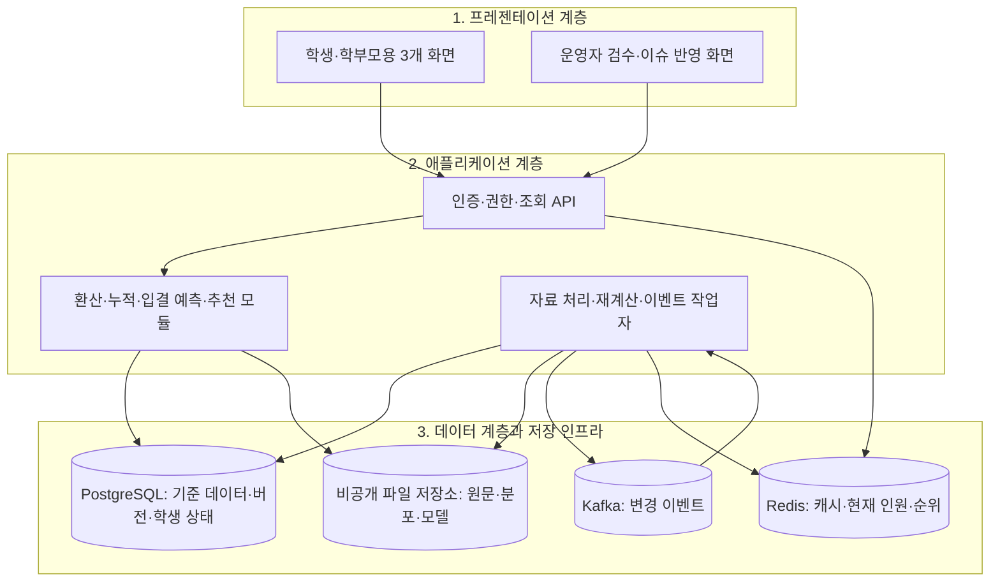

<!-- jungsi:historical -->
> 이 문서는 이전 기획·검토 이력입니다. 현재 개발 기준은 [현재 서비스 기획](../../current/서비스_기획.md)과 [라우팅 명세](../../current/라우팅_명세.md)입니다. 아래 내용은 당시 상태를 보존하며 현재 요구사항이나 구현 완료 판정으로 사용하지 않습니다.

# 정시 서비스 통합 설계 — 3티어와 대학 환산 엔진

작성: 2026-09-27. 상태: 사용자 결정 사항을 통합한 구현 설계안. 기술 스택·출시 범위·모델 승인·운영 구축 완료를 의미하지 않는다.

이 문서는 최신 사용자 결정을 기준으로 흩어진 기획을 연결한다. 과거 문서와 원본은 보존한다. 상세 계산 계약은 [대학 환산 엔진 명세](01_대학환산_엔진명세.md), 개발 순서와 검증 조건은 [구현 순서](02_구현순서_검증기준.md)를 따른다.

## 1. 서비스의 목적과 확정된 경험

학생의 전체 성적 위치에서 출발해, 학생의 과목별 강점을 유리하게 반영하는 대학·모집단위를 찾고, 과거 입결과 올해 예상 컷을 함께 검토해 핵심 지원 학교를 정리하는 상담 서비스다. 주 사용자는 학생·학부모, 부 사용자는 교사·입시담당자다.

| 화면 | 이용자가 하는 일 | 제공할 내용 | 권한 |
|---|---|---|---|
| 1. 입시결과 탐색 | 성적 입력 없이 대학·학과 검색 | 4년치 환산점수·자체 누적, 합격권/상위70% 각각의 지표, 군·인원 | 일반·유료 |
| 2. 내 성적 리포트 | 실제 수능 성적 입력 | 국수탐2 표준점수 총점과 전체 응시자 기준 상위 누적 | 일반·유료 |
| 2. 리포트 확장 | 관심 대학과 분석 결과 정리 | 대학별 환산·비교·상담 내용·인쇄 가능한 리포트 | 유료 |
| 3. 유리한 대학 찾기 | 대학·학과를 비교하고 핵심 지원 학교 선택 | 환산상 유리함, 입결 대비 위치, 예상 컷, 추천/선택 집계와 내 순위 | 유료 기능으로 제안 |

- 1페이지의 4년치 **입시결과 연도**와 매핑 작업의 2024~2027 **모집요강 연도**는 다르다. 결과 조회의 정확한 네 연도는 데이터 공개 범위를 확인해 별도 확정한다.
- 대학 제목 오른쪽에는 2027학년도 모집군, 최초 선발인원, 변경분, 최종인원을 표시한다. 변경분은 수시 이월을 포함한 모든 모집인원 변경이다. 공식 최종 공고가 없으면 최신 인원과 최종 확정 여부를 구분한다. 감소도 허용하고 미공개를 0으로 만들지 않는다.
- 3페이지는 큰 화면에서 기본 후보 목록 2/3, 간호·보건·교육 와일드카드 1/3로 구성한다. 작은 화면에서는 기본 목록 다음에 와일드카드를 배치한다.
- 학교를 펼치면 실제 학과·전형·군별 과거 기준 도달 여부를 보여준다. 같은 대학이라도 반영식이 다르면 별도 점수 묶음이다. 학과를 고정 서열로 놓고 어느 학과 이하 전체를 합격권으로 표시하지 않는다.
- 화면 문구는 **핵심 지원 학교**, **핵심 지원 학교에 담기**, **모의지원 서비스에서 확인**을 사용한다. 외부 모의지원으로의 자동 등록·성적 전송은 범위에 포함하지 않는다.
- 실기·실적 및 실기고사 반영 모집행은 현행 프로젝트 범위에서 제외한다. 비실기 예체능은 학과명만으로 제외하지 않는다.

## 2. 계산 결과 네 종류를 혼동하지 않는다

| 결과 | 의미 | 기준과 제한 |
|---|---|---|
| 전체 총점 상위 누적 | 전국 유효 응시자 가운데 국수탐2 총점의 위치 | 문·이과 구분 없이 네 성적이 모두 있는 응시자. 자체 추정 분포이면 추정 표시 |
| 대학 환산점수 | 공식 대학 산식에 개인 성적을 대입한 점수 | 학년도·실제 모집행·산식 버전에 종속. 만점 대비 비율을 누적으로 표시하지 않음 |
| 대학 환산 기준 누적 | 대학 점수 분포에서 환산점수가 차지하는 위치 | 승인된 자체 분포와 비교 모집단 필요. 대학 실제 지원자 순위가 아님 |
| 서비스 내 순위 | 추천된 학생 / 핵심 지원 학교로 선택한 학생 가운데 위치 | 서비스의 현재 유효 학생만 집계. 전국 등수·실제 경쟁률·합격확률과 별개 |

전체 총점은 `T(x) = 국어 표준점수 + 수학 표준점수 + 탐구1 표준점수 + 탐구2 표준점수`다. 총점별 추정 인원을 n(t)라 하면 동점 포함 상위 누적은 `100 × Σ[t ≥ T(x)] n(t) / Σ n(t)`다. 동점 제외 값과 동점 구간도 함께 보존한다. 영어·한국사는 총점에 임의로 합산하지 않고 대학 환산에서 공식 규칙에 따라 사용한다.

수학의 같은 점수에 국어·탐구의 여러 성적 조합이 존재한다. 공개 과목별 백분위를 일대일로 맞추거나 과목 가중치를 바꾸어 전국 총점 분포 문제를 해결하지 않는다. 세 정시 자료를 정렬·보정해 총점 곡선을 만드는 경로와 성적 조합의 분포를 추정하는 경로를 구분한다.

**총점 곡선만으로 모든 대학의 환산 누적을 도출할 수는 없다.** 대학별 곡선은 학년도·모집단이 확인된 참고 환산 분포를 보정하거나, 과목 간 조합을 보존·추정한 참조 분포를 대학 공식 엔진에 통과시켜 구축한다. 총점별 평균 성적 하나를 전체 학생의 성적 조합으로 취급하지 않는다. 전국 개인 성적 원자료의 확보를 총점 곡선 제작의 선행 필수조건으로 두지는 않는다.

## 3. 3티어 구성 제안

3티어는 책임 경계다. 서버 세 대를 먼저 마련하거나 모든 기능을 별도 서비스로 나눌 필요는 없다. 시작은 웹 앱 하나, 모듈화된 API 하나, 배치 작업자 프로세스로 구성하고 부하에 따라 배포 단위를 나눈다.

| 계층 | 구현 제안 | 담당 | 경계 |
|---|---|---|---|
| 프레젠테이션 | Next.js + TypeScript | 검색·성적 입력·목록·리포트·관리 화면, 결과 표시 | 핵심 산식/전체 누적표/모델 실행을 클라이언트에 넣지 않음 |
| 애플리케이션 | Python + FastAPI, 같은 엔진 패키지를 쓰는 작업자 | 권한, 공식 환산, 분포 조회, 입결·예측, 추천, 이벤트 처리 | 웹 요청과 대량 재계산 분리. 업무 검증은 서버에서 수행 |
| 데이터 | PostgreSQL + 비공개 파일 저장소 | 원본·정규화 데이터·버전·관계·학생별 상태의 기준 저장 | 브라우저 직접 접근 금지 |
| 데이터 보조 인프라 | Redis + Kafka | 빠른 조회와 변경 전달·재처리 | 기준 데이터베이스를 대체하지 않음 |

위 기술은 **권장안이며 미확정**이다. Python은 기존 누적 모듈 재사용과 계산 검증에 맞고, FastAPI는 라우터와 모듈을 나누어 한 애플리케이션으로 구성할 수 있다. [FastAPI 공식 안내](https://fastapi.tiangolo.com/tutorial/bigger-applications/)

Next.js를 사용해도 대학 계산을 Next.js와 Python 양쪽에 중복 구현하지 않는다. 웹 서버는 화면과 필요 시 API 중계만 맡고, 핵심 결과의 단일 기준은 Python 애플리케이션이다. Kafka는 인프라, Kafka 소비자는 애플리케이션 작업자이므로 계층이 하나 더 생기는 것은 아니다.

## 4. 애플리케이션의 업무 모듈

| 모듈 | 입력 → 출력 | 주요 책임 |
|---|---|---|
| 회원·이용권 | 로그인/결제 상태 → 허용 기능 | 학생 본인·연결 학부모·상담자 접근 및 유료 확인 |
| 대학·모집행 조회 | 대학/학과/연도 → 실제 모집행 | 기존 PK·캠퍼스 정보·4개년 연결·인원 이력 |
| 성적 프로필 | 실제 과목·선택과목·점수 → 검증된 성적 버전 | 학년도·과목별 허용 점수·결측·소유권 검사 |
| 전체 누적 | 표준점수 총점 + 승인 분포 → 상위 누적 | 기존 `percentile.py`를 활용, 자체 분포 제작은 별도 |
| 대학 환산 | 성적 + 모집행 + 공식 규칙 → 환산점수·계산 근거 | 탐구 선택, 변환표, 가산·감점, 단계별 정밀도 |
| 대학별 누적 | 환산점수 + 승인된 대학 분포 → 상대 위치 | 모집단·동점·모형 버전 확인 |
| 입결 정규화·예측 | 과거 결과 + 연결 + 연도별 분포 + 학교 이슈 → 예상 컷 | 원자료/기본 예측/사용자 조정/채택값 분리 |
| 추천 | 자격 + 환산 + 분포 + 입결/예상 컷 + 희망 조건 → 후보 | 유불리와 도달 수준 별도, 와일드카드 포함 |
| 리포트·선택 목록 | 분석 버전 + 핵심 지원 학교 → 조회/출력 | 동일 결과를 페이지 2·3에서 재사용 |
| 실시간 집계 | 현재 추천·선택·성적 상태 변경 → 두 집단의 인원과 내 순위 | 중복/역순/동점/재처리·갱신 상태 처리 |

공통 Python 패키지는 웹 프레임워크와 DB에 의존하지 않는 계산 함수로 유지한다. 저장소 조회·권한 검사는 서비스 계층, 수식 실행은 계산 모듈, 원본 수집은 작업자가 맡는다.

## 5. 성적 입력부터 리포트까지

1. 사용자에게 학생의 권한이 있는지 확인하고 실제 수능 성적을 검증한다. OCR 입력을 도입하더라도 자동 인식값의 확인 단계는 별도 설계한다. 최초 버전은 직접 입력으로 시작할 수 있다.
2. 성적을 새 `score_profile_version`으로 저장한다. 전체 누적은 승인된 해당 학년도 분포에서 조회한다. 미승인·분포 부재는 이유와 함께 보류한다.
3. 유료 사용자에 대해 후보 모집행의 지원 조건과 공식 환산 가능 여부를 검사하고, 해당 성적 전체를 대학 산식에 각각 대입한다.
4. 같은 규칙·입력·변환표를 사용하는 모집행은 계산 결과를 공유해 반복 비용을 줄이되, 서로 다른 산식·선발 조건·학과 입결은 합치지 않는다.
5. 대학별 누적과 비교 가능한 과거 입결/올해 예상 컷을 연결한다. 누적이 아직 없어도 검증된 대학 환산점수는 먼저 표시할 수 있다. 없는 값을 임의 추정하지 않는다.
6. 전체 누적 주변 후보와 과목 강점으로 발굴한 확대 후보를 함께 검토한다. 전체 누적 한 구간만으로 후보를 확정 탈락시키지 않는다.
7. 페이지 3에 대학별 유불리와 실제 학과별 입결 대비 위치를 표시한다. 와일드카드에도 같은 자격·산식·입결 검사를 적용한다.
8. 사용자가 핵심 지원 학교를 선택하면 저장하고, 페이지 2에서 같은 결과로 리포트를 만든다. 리포트는 발행 당시 버전을 보존하고 실시간 집계는 별도 기준시각을 표시한다.

서로 다른 대학의 800점과 950점을 비교해 더 높은 학교가 유리하다고 판단하지 않는다. 동일 비교집단 C에서 `advantage_pp = 100 × (p_base,C − p_college,C)`를 제안 지표로 쓴다. p는 0~1 비율이며 양수이면 상대 위치 개선이다. C가 전국 전체와 다르면 총점 기준 p도 C에서 다시 계산한다. 비교집단·동점 정의가 다르거나 오차보다 차이가 작으면 순위를 보류하거나 공동 구간으로 보여준다. [기존 유불리 상세 명세](../../planning/2026-09-23-v0.7/01_환산유불리_산출명세.md)

## 6. 입결 수집과 올해 컷 예측

대학 매핑 검수가 끝난 범위부터 대학어디가·대학 공식 결과를 수집한다. 실제 결과 연도, 모집행, 점수 종류, 지표 정의, 출처 페이지, 공시일을 보존한다. 2026학년도 안내 화면에 실린 2025 결과를 2026 결과로 저장하지 않는다.

`과거 원자료 → 당시 대학 산식/분포와 연결 → 자체 누적으로 정규화 → 2024·2025·2026 변화 분석 → 기본 예상 컷 → 학교별 이슈와 사용자 판단 → 채택 예상 컷`

- 과거 입결의 총 환산점수 하나에서 원래 국수탐 성적을 역산할 수 없다. 연도별 산식·분포 연결이 없으면 비교 보류한다.
- 최종등록자 70% 지표는 실제 최저 합격점도, 전국 응시자 중 상위70%도 아니다. 합격권 추정과 각각의 원 정의를 유지한다. [대학어디가 성적 지표 안내](https://www.adiga.kr/ucp/cls/uni/classUnivAdmssPopup.do?ruCd=0117617&searchSyr=2026&unvCd=0000019)
- 세 연도는 복잡한 예측식의 정확도를 주장하기에 충분한 검증 근거가 아니다. 단순 기준 모형부터 시점 분할 검증을 하고, 모집인원·군·반영식 변경과 사용자 이슈를 기록한다. 전년도 예측 검증에는 그 시점에 알려진 자료만 사용한다.
- 학교 이슈의 영향 범위는 대학 전체/특정 계열/특정 모집행으로 구분한다. 기본 모형에 들어간 모집인원 효과를 수동 조정에 다시 넣지 않는다.
- 올해 수능 분포가 아직 없으면 누적 기준 시나리오를 우선 만들고, 실제 올해 분포와 공식 변환표가 준비된 뒤 점수 컷으로 변환한다. 범위는 추정 시나리오인지 통계적으로 검증된 구간인지 명시한다.
- 서비스 추천 인원은 추천 알고리즘 자체의 영향을 받는다. 이를 실제 지원 수요로 간주해 예상 컷을 자동 상승시키지 않는다.

## 7. 실시간 집계

추천 인원과 선택 인원을 각각 집계한다. 새로고침 수나 계정 수가 아니라 동일 학생을 중복 제거한다. 학생의 최신 상태가 기준이며 추천 취소·선택 취소·성적 수정이 반영되어야 한다. 추천되지 않아도 직접 선택한 학생은 선택 집단에만 포함될 수 있다.

`DB 상태 변경 + Outbox 기록(한 트랜잭션) → 발행 작업자 → Kafka → 집계 작업자 → Redis → 본인 조회 API/SSE`

동일 학년도·실제 모집행·규칙/분포 공개 버전의 대학 환산점수를 기준으로 집단별 순위를 제공한다. `내 순위 = 나보다 점수가 높은 유효 학생 수 + 1`. 동점자 수와 동점 구간을 함께 제공한다. 대학 전체 인원은 여러 학과 중복을 제거해 요약할 수 있지만, 다른 산식의 대학 전체 등수를 만들지는 않는다.

집단 전체 인원과 순위 산정 가능한 인원을 구분한다. 자신이 집단에 없거나 점수가 갱신 중이면 순위는 null과 사유다. 서버는 다른 학생의 이름·성적 목록을 반환하지 않는다.

이벤트는 현재 절대 상태·학생별 모집행 상태 버전·성적 버전을 포함한다. 이벤트 ID 중복과 이전 버전 이벤트를 무시하고 두 집단을 함께 갱신한다. Kafka의 exactly-once가 외부 Redis 갱신까지 자동 보장하지는 않으므로 소비자의 멱등성과 버전 검사가 필요하다. [Kafka 전달 보장 설명](https://kafka.apache.org/43/design/design/)

동일 규칙 공개 버전별로 인덱스를 준비한 뒤 전환해 이전 점수와 새 점수를 섞지 않는다. p95 5초 이내 반영은 제안 목표이며 실측값이 아니다. 성적 저장부터 재추천 완료까지와, 확정 상태 이벤트의 집계 반영 지연을 따로 측정한다. [실시간 상세 설계](../../planning/2026-09-27_실시간_추천선택_인원과순위_Kafka_설계.md)

## 8. 기준 데이터와 버전

| 데이터 묶음 | 제안 구조 | 보존해야 할 기준 |
|---|---|---|
| 원문·검수 | source_documents, review_records | 원본 위치·해시·페이지·공개/확인 날짜·검수 범위 |
| 대학·모집행 | offerings, offering_lineage, quota_snapshots | 기존 실제 모집 PK·연도 연결·명칭 변경·통합/분리·인원 변경 |
| 대학 계산 | score_rule_versions, offering_rule_bindings, conversion_table_versions | 적용 연도·대상 모집행·공식 근거·연산 순서·불변 버전 |
| 자체 분포 | population_definitions, curve_versions, curve_points | 전체/대학 구분·추정/관측·분모·동점·학년도·승인 |
| 과거 입결 | admission_results | 실제 결과 연도·지표 정의·점수 척도·원 수치·추정 여부 |
| 예측·이슈 | forecast_runs, school_issue_notes, forecast_adjustments, adopted_cut_versions | 기본 예측·조정 근거·범위·채택값·검토자·시점 |
| 학생 분석 | students, score_profile_versions, analysis_runs, conversion_results | 학생과 계정 연결·입력 버전·공개 데이터 버전·산출 이력 |
| 추천·리포트 | recommendation_memberships, selected_offerings, report_snapshots | 현재 상태와 이력·동일 모집행·리포트 기준시각 |
| 이벤트·공개 | outbox_events, service_releases | 상태 버전·발행 상태·배포할 데이터 묶음 |

현재 매핑 엑셀에 산식 문자열이나 새 캠퍼스 키를 임의 추가하지 않는다. 별도 테이블에서 기존 `학년도 + 모집행 PK`를 참조한다. 기존 `uni_match_key`와 원문 캠퍼스 식별을 재사용하고 구분이 불명확하면 검수 대상으로 남긴다.

`service_release`는 매핑·규칙·변환표·분포·예측의 버전 ID와 호환 관계를 고정한 목록이다. 전국 모든 대학이 준비될 때까지 아무 기능도 공개하지 않는 구조는 아니다. 모집행별로 입결 조회 가능/환산 가능/누적 가능/예측 가능을 따로 기록하고 검증된 범위만 공개한다. 이전 공개 버전은 재현을 위해 보존한다.

## 9. API와 권한의 경계

| API 제안 | 기능 | 권한/주의 |
|---|---|---|
| GET /v1/admission-history | 대학·학과·지표별 과거 결과 | 일반·유료, 4년치 범위·페이지네이션 |
| GET /v1/offerings/{id}/recruitment | 올해 군·모집인원 변경 | 기준일·확정 여부 |
| POST /v1/score-profiles | 본인 성적의 새 버전 저장 | 일반·유료, 소유권·입력 검증 |
| GET /v1/me/overall-percentile | 전체 총점 누적 | 일반·유료, 승인된 해당 연도 분포 |
| POST /v1/analyses | 대학별 분석 요청 | 유료, 재요청 중복 방지·202 작업 ID 가능 |
| GET /v1/analyses/{id} | 분석 진행/결과 | 유료 + 해당 학생 접근권 |
| PUT /v1/me/core-schools/{offering_id} | 핵심 지원 학교 선택 상태 설정 | 유료 제안, 선택 해제도 상태 이력 보존 |
| GET /v1/reports/{id} | 개인 리포트 조회/출력 | 유료 + 소유권, 원본 엑셀 접근 없음 |
| GET /v1/offerings/{id}/live-statistics | 두 집단의 수와 내 순위 | 유료 제안, 자신의 정보만 |
| GET /v1/events | 변경 알림 후 결과 재조회 | 인증·관심 범위, 한 사용자 연결 재사용 |
| /internal/v1/reviews·rules·releases | 자료/산식/예측 검수와 공개 | 운영 권한, 일반 사용자 접근 불가 |

실시간 통계의 무료 공개 범위와 비회원의 1페이지 접근은 아직 미정이다. 유료 핵심 분석의 일부로 설계하되 별도 이용권 정책으로 변경 가능하게 한다. 무료 화면에서 버튼만 숨기고 실제 API는 열어 두는 방식은 사용하지 않는다.

## 10. 내부 데이터·로직 보호와 공동 개발

3티어는 외부 이용자에게 서버 코드·원본·전체 분포를 전달하지 않는 데 도움이 된다. 모든 공동 제작자에게 전체 코드·데이터 접근을 허용한다는 사용자 결정은 유지한다. 그 권한을 가진 사람이 복사하는 것까지 3티어나 .env가 막아 주지는 않는다.

- 외부 응답은 필요한 환산 결과·설명·출처·본인 순위로 제한한다. 서버의 원자료, 전체 모델·테이블, 다른 학생 데이터를 일괄 반환하지 않는다.
- 계산과 유료 권한·학생 소유권 확인을 API에 둔다. 운영 DB·Redis·Kafka·원문 저장소는 외부 브라우저에 직접 열지 않는다.
- `.env`는 접속 설정·비밀값을 주입하는 방식이다. 저장소에는 값이 없는 `.env.example`을 두고 실제 비밀값은 보호된 공유 수단이나 배포 설정으로 전달한다. 공동 제작자의 전체 코드/데이터 권한과 실행 프로세스의 역할별 권한은 별개다.
- Next.js의 `NEXT_PUBLIC_` 값은 클라이언트에 노출된다. DB 비밀번호·서명키·내부 토큰은 여기에 넣지 않는다. 서버에서 읽은 값도 클라이언트에 넘기면 노출되므로 반환 객체를 제한한다. [Next.js 데이터 보안 문서](https://nextjs.org/docs/app/guides/data-security)
- 대량 점수 조회를 통한 결과 수집은 권한·사용량 제한·접근 기록으로 줄인다. 이미 화면에 제공한 결과의 복제를 완전히 방지한다고 약속하지 않는다.

## 11. 운영자 화면도 구현 범위에 포함한다

운영자에게 학교별 4개년 검수 범위, 미확인 규칙, 변환표 대기, 공식 계산 예제 대조 결과를 보여준다. 산식 변경 시 영향을 받는 모집행·학생 결과를 미리 계산하고 검증 후 새 버전을 공개한다. 원문 추출값을 자동으로 운영 산식에 반영하지 않는다.

학교별 이슈 입력에는 근거·영향 모집행·방향·예상 크기·검토 상태를 기록한다. 예상 컷의 기본값/조정값/최종 채택값을 나란히 검토한다. 사용자의 상담 판단을 별도 조정 이력으로 남겨 모형을 개선하는 근거로 사용한다.

원본·이전 버전·임시 산출물의 삭제를 자동화하지 않는다. 현재 프로젝트의 파일 보존 규칙을 배치 스크립트와 개발 명령에도 적용한다.
