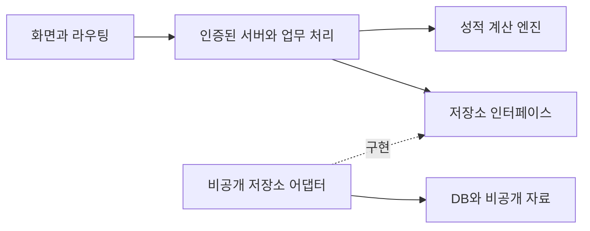

# 정시터치 3티어 개발구조

이 문서는 공통 명세 service_spec.json에서 생성한다. 현재 버전은 1.1.1이며 기획·라우팅·계층 문서를 같은 변경으로 갱신한다.

3티어는 화면·업무 처리·저장소의 책임과 접근 경계를 나눈다. 현재 계산 모듈의 경로를 보존하고 새 권한·저장소 인터페이스를 계층에 배치한다. 서버 세 대를 요구하는 설계가 아니며 운영 기술과 배포 방식은 후속 결정이다.

## 계층과 의존 방향

| 계층 | 코드 위치 | 책임 | 허용 의존 |
| --- | --- | --- | --- |
| 프레젠테이션 | apps/web | 별도 프레젠테이션 작업자의 화면·입력·탐색·리포트 UI. 애플리케이션이 허용한 API 결과와 생성 경로 계약을 사용한다. | authorized_application_API |
| 애플리케이션 | src/jungsi_touch/application, src/jungsi_touch | 현재 개발팀의 서버 권한·검증·계산·API 계약과 애플리케이션 소유 공급/저장 포트. 프레젠테이션과 구체 Drive/DB 어댑터에 의존하지 않는다. | application_ports, domain_engine |
| 데이터와 인프라 | src/jungsi_touch/infrastructure, database | 현재 개발팀의 Google Drive API 공급/저장 어댑터와 DB 구조. 데이터팀의 정리 자료를 버전·검수 상태와 함께 연결하며 실제 값과 인증 설정은 Git 제외 영역에 둔다. | application_ports |

애플리케이션은 구체 DB 어댑터를 가져오지 않고 자신이 정의한 포트에 의존한다. 인프라가 포트를 구현한다. 프레젠테이션은 허용된 API 결과만 표시하며 Python 엔진·DB 비밀값·전체 환산표·곡선·모델을 포함하지 않는다.

## 커밋된 코드와 새 기반

| 파일 | 계층 | 현재 상태 | 요구사항 |
| --- | --- | --- | --- |
| src/jungsi_touch/percentile.py | application | 공통 계산 기반 | REQ-02, REQ-07 |
| src/jungsi_touch/year_equating.py | application | 공통 계산 기반 | REQ-06 |
| src/jungsi_touch/university_conversion.py | application | 공통 계산 기반 | REQ-05, REQ-06 |
| src/jungsi_touch/admission_result_percentile.py | application | 공통 계산 기반 | REQ-08 |
| src/jungsi_touch/application/authorization.py | application | 권한 기반 모듈; 실제 인증과 HTTP 연결 전 | REQ-14 |
| src/jungsi_touch/application/ports.py | application | 저장소 인터페이스 | REQ-14, REQ-15, REQ-02, REQ-12 |
| src/jungsi_touch/infrastructure/memory_report_repository.py | data_infrastructure | 합성 검산 전용 어댑터 | REQ-14, REQ-15 |
| apps/web/route_catalog.json | presentation | 라우팅 계약; 웹 실행 앱 연결 전 | REQ-01, REQ-02, REQ-03, REQ-04 |
| src/jungsi_touch/application/overall_analysis.py | application | 2페이지 분석 서비스; HTTP·영속저장 연결 전 | REQ-02, REQ-07, REQ-12, REQ-14, REQ-15 |

기존 src/jungsi_touch 루트 계산 모듈은 애플리케이션의 엔진 라이브러리다. 경로를 옮겨 기존 사용자를 깨뜨리지 않는다. 새 application과 infrastructure를 통해 입출력·소유권·저장소를 연결한다. 메모리 어댑터는 합성 검산 전용으로 운영 연결을 의미하지 않는다.

## 데이터와 기술 결정

실제 원자료·학생 성적·입결·환산표·곡선·모델과 .env 계열은 모든 브랜치에서 제외한다. database에는 DB 구조·마이그레이션 코드만 둘 수 있다. 현재 DB 엔진·Supabase·웹 프레임워크·HTTP 서버 채택은 미정이며 연결 비밀값을 문서나 코드로 대신하지 않는다.

## 구현 순서

현재 계약과 권한 기반 검증 다음에 로그인·결제·운영 저장소를 연결한다. 이후 1페이지 공식 조회와 2페이지 입력·전체 누적, 3페이지 학과별 분석, 4페이지 추천·리포트와 실시간 집계를 순서대로 연결한다. 각 단계는 승인된 자료가 없는 값을 보류한다.

## 계층별 담당과 브랜치

프레젠테이션 구현은 다른 작업자가 진행한다. 현재 개발팀은 애플리케이션·데이터/인프라 및 서버 API를 담당하고 시스템기획팀은 공통 명세와 인계 계약을 관리한다.

| 담당 영역 | 작업자 | 코드와 문서 위치 | 브랜치 |
| --- | --- | --- | --- |
| 공통 기획 | 시스템기획팀 | docs/current/service_spec.json, scripts/check_project_consistency.py | feature/planning-* |
| 프레젠테이션 | 별도 프레젠테이션 작업자 | apps/web | feature/presentation-* |
| 애플리케이션 | 현재 개발팀 | src/jungsi_touch/application, src/jungsi_touch | feature/application-* |
| 데이터와 인프라 | 현재 개발팀의 인프라 담당; 데이터팀은 자료 정리 담당 | src/jungsi_touch/infrastructure, database | feature/data-* |

각 작업은 원격 develop의 확정 커밋에서 시작하고 출발 SHA를 기록한다. 같은 브랜치나 작업 폴더를 동시에 수정하지 않는다. 보유 작업을 보존한 별도 체크아웃 또는 worktree를 사용한다.

각자 소유한 feature 브랜치에서 작업한다. 다른 작업자의 feature에 커밋하지 않고 검증한 PR을 develop에 통합한다. main은 검증된 최종 코드와 문서의 반영 경로다.

현재 개발팀의 기존 브랜치는 feature/overall-analysis-service이다. 화면 작업자는 feature/presentation-reports-me처럼 별도 feature/presentation-* 브랜치를 사용한다. 작업 시작 시 별도 작업자가 최신 origin/develop 커밋에서 생성한다. 현재 개발팀 feature와 기획 feature를 공유하지 않는다.

route_catalog.json과 생성 README/현재 문서는 직접 편집하지 않는다. 계약 변경은 service_spec.json과 생성 도구에서 수정하고 생성 결과를 같은 커밋에 포함한다.

계약·필드·오류/보류 사유가 바뀌면 기획팀과 해당 계층 담당에게 인계한다. 통합되지 않은 다른 feature의 코드·가상 응답을 develop에 구현된 기능으로 기록하지 않는다.

Git 변경 범위와 해당 계약·필수 커밋 검산을 확인한다. 원자료 전수검수나 전국 재집계를 매 개발 작업에서 반복하지 않는다.

## Google Drive 폴더 API 연동

API로 Google Drive 폴더와 자료를 주고받는 방향은 사용자 확정이다. 실제 폴더·인증 설정과 운영 연동 검증은 아직 완료하지 않았다.

프레젠테이션 → 우리 서비스 API → 애플리케이션 포트 ← Drive API 어댑터 → 비공개 Google Drive 폴더

애플리케이션은 자신이 정의한 포트에 의존한다. Drive API 호출·파일 변환·인증·재시도는 인프라 어댑터가 담당하며 전체 원자료와 인증값을 학생 응답에 넣지 않는다.

화면은 우리 서비스의 허용 API 결과만 이용한다. Google Drive API·폴더·토큰·전체 원자료에 직접 접근하지 않는다.

### 읽기와 쓰기

서버에 설정한 입력 폴더와 발행 버전만 읽는다. 파일 식별자·자료 버전·내용 해시·학년도/시험·출처·검수 상태를 연결하며 단순 최신 수정 파일을 승인 데이터로 자동 채택하지 않는다.

서버에 설정한 결과 폴더로 새 산출 파일 또는 새 버전을 기록한다. 원본·이전 버전은 보존하고 삭제·휴지통 이동·동기화 정리는 수행하지 않는다. 사용자 성적과 공개 산출물의 접근 범위를 구분한다.

실제 폴더 ID·인증 계정·키/토큰·자료·입결·곡선·모델·검수 결과는 Git 제외 설정/폴더 또는 비공개 저장소에 둔다. 코드에는 어댑터와 자료 형식 계약만 둔다.

파일·버전·권한·검수 상태가 준비되지 않으면 데이터 대기 또는 오류 사유를 반환한다. 다른 시험·연도·미승인 모형으로 대체하지 않는다.

### 남은 설정

- 입력 폴더와 결과 폴더의 실제 식별자·읽기/쓰기 대상 범위
- 인증 계정과 서버 접근 권한·인증 방식
- 자료 형식·발행 명부·버전/해시/검수 상태 계약
- 쓰기 충돌·재시도·감사 기록·운영 연결 검증

<!-- jungsi:generated spec_sha256=4407570fd102aca0a50e25a79893af19566c6e0666073ac5447621fbf8e1e7e5 -->
