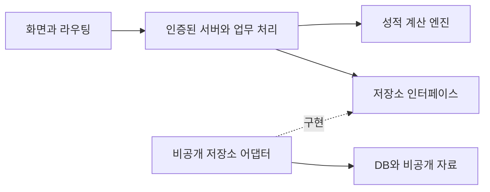

# 정시터치 3티어 개발구조

이 문서는 공통 명세 service_spec.json에서 생성한다. 현재 버전은 1.9.21이며 기획·라우팅·계층 문서를 같은 변경으로 갱신한다.

3티어는 화면·업무 처리·저장소의 책임과 접근 경계를 나눈다. 현재 계산 모듈의 경로를 보존하고 새 권한·저장소 인터페이스를 계층에 배치한다. 계층별 책임과 포트를 기준으로 구성하며 배포 환경과 실제 서버 연결 설정은 후속 구성이다.

## 계층과 의존 방향

| 계층 | 코드 위치 | 책임 | 허용 의존 |
| --- | --- | --- | --- |
| 프레젠테이션 | apps/web | 별도 프레젠테이션 작업자의 화면·입력·탐색·리포트 UI. 애플리케이션이 허용한 API 결과와 생성 경로 계약을 사용한다. | authorized_application_API |
| 애플리케이션 | src/jungsi_touch/application, src/jungsi_touch, supabase/functions/_shared/official_history_display.ts | 현재 개발팀의 서버 권한·검증·계산·API 계약과 애플리케이션 소유 공급/저장 포트. 프레젠테이션과 구체 Drive/DB 어댑터에 의존하지 않는다. | application_ports, domain_engine |
| 데이터와 인프라 | src/jungsi_touch/infrastructure, database, supabase/functions/official-history-display, supabase/functions/_shared/official_history_postgres.ts | 현재 개발팀의 Google Drive API 공급/저장 어댑터와 DB 구조. 데이터팀의 정리 자료를 버전·검수 상태와 함께 연결하며 실제 값과 인증 설정은 Git 제외 영역에 둔다. 입결의 현재 조회·변경은 단일 정본과 출처/멱등 정정 이력을 따르고, 동결 C 역사 검수 공급자는 구분한다. | application_ports |



애플리케이션은 구체 DB 어댑터를 가져오지 않고 자신이 정의한 포트에 의존한다. 인프라가 포트를 구현한다. 프레젠테이션은 허용된 API 결과만 표시하며 Python 엔진·DB 비밀값·전체 환산표·곡선·모델을 포함하지 않는다.

## 커밋된 코드와 새 기반

| 파일 | 계층 | 현재 상태 | 요구사항 |
| --- | --- | --- | --- |
| src/jungsi_touch/percentile.py | application | 공통 계산 기반 | REQ-02, REQ-07 |
| src/jungsi_touch/year_equating.py | application | 공통 계산 기반 | REQ-06 |
| src/jungsi_touch/university_conversion.py | application | 공통 계산 기반 | REQ-05, REQ-06 |
| src/jungsi_touch/admission_result_percentile.py | application | 공통 계산 기반 | REQ-08 |
| src/jungsi_touch/application/authorization.py | application | server_policy_connected_by_HTTP_session_adapter | REQ-14 |
| src/jungsi_touch/application/ports.py | application | 저장소 인터페이스 | REQ-14, REQ-15, REQ-02, REQ-12 |
| src/jungsi_touch/infrastructure/memory_report_repository.py | data_infrastructure | 합성 검산 전용 어댑터 | REQ-14, REQ-15 |
| apps/web/route_catalog.json | presentation | 라우팅 계약; 웹 실행 앱 연결 전 | REQ-01, REQ-02, REQ-03, REQ-04 |
| src/jungsi_touch/application/overall_analysis.py | application | stateless_engine_connected_by_persisted_workflow_and_HTTP | REQ-02, REQ-07, REQ-12, REQ-14, REQ-15 |
| src/jungsi_touch/application/platform.py | application | implemented_synthetic_verified_live_configuration_pending | REQ-01, REQ-02, REQ-03, REQ-04, REQ-10, REQ-11, REQ-13, REQ-14 |
| src/jungsi_touch/application/platform_ports.py | application | implemented_synthetic_verified_live_configuration_pending | REQ-12, REQ-14, REQ-15, REQ-19 |
| src/jungsi_touch/application/sessions.py | application | implemented_synthetic_verified_live_configuration_pending | REQ-14, REQ-15 |
| src/jungsi_touch/application/time_contract.py | application | implemented_synthetic_verified_live_configuration_pending | REQ-12, REQ-14, REQ-15 |
| src/jungsi_touch/application/offering_analysis.py | application | implemented_synthetic_verified_live_configuration_pending | REQ-05, REQ-06, REQ-07, REQ-08, REQ-09, REQ-12 |
| src/jungsi_touch/application/publication.py | application | implemented_synthetic_verified_live_configuration_pending | REQ-11, REQ-14, REQ-17, REQ-19 |
| src/jungsi_touch/infrastructure/http_api.py | data_infrastructure | implemented_synthetic_verified_live_configuration_pending | REQ-01, REQ-02, REQ-03, REQ-04, REQ-14, REQ-15, REQ-18 |
| src/jungsi_touch/infrastructure/postgres_repository.py | data_infrastructure | implemented_synthetic_verified_live_configuration_pending | REQ-10, REQ-11, REQ-14, REQ-15, REQ-17 |
| src/jungsi_touch/infrastructure/supabase_session.py | data_infrastructure | implemented_synthetic_verified_live_configuration_pending | REQ-14, REQ-15 |
| src/jungsi_touch/infrastructure/drive_provider.py | data_infrastructure | implemented_synthetic_verified_live_configuration_pending | REQ-01, REQ-06, REQ-12, REQ-13, REQ-15, REQ-17, REQ-19 |
| src/jungsi_touch/infrastructure/settings.py | data_infrastructure | implemented_synthetic_verified_live_configuration_pending | REQ-15, REQ-19 |
| database/migrations/001_pre_data_platform.sql | data_infrastructure | additive_schema_prepared_not_applied_to_live_DB | REQ-10, REQ-11, REQ-14, REQ-15, REQ-17 |
| src/jungsi_touch/application/university_scoring.py | application | accepted_on_develop_synthetic_verified_live_rules_configuration_pending | REQ-05, REQ-06, REQ-12, REQ-14 |
| src/jungsi_touch/application/university_percentile.py | application | implemented_synthetic_verified_live_curve_publication_pending | REQ-05, REQ-06, REQ-08, REQ-12, REQ-14 |
| src/jungsi_touch/reported_score_mapping.py | application | reported_mapping_derivation | REQ-02, REQ-05, REQ-06, REQ-07, REQ-12, REQ-14, REQ-15, REQ-16 |
| src/jungsi_touch/estimated_profiles.py | application | candidate_profiles | REQ-02, REQ-05, REQ-06, REQ-07, REQ-12, REQ-14, REQ-15, REQ-16 |
| src/jungsi_touch/estimated_fitting.py | application | entropy_soft_reference | REQ-02, REQ-05, REQ-06, REQ-07, REQ-12, REQ-14, REQ-15, REQ-16 |
| src/jungsi_touch/estimated_validation.py | application | independent_validation | REQ-02, REQ-05, REQ-06, REQ-07, REQ-12, REQ-14, REQ-15, REQ-16 |
| src/jungsi_touch/estimated_curves.py | application | exact_aggregation | REQ-02, REQ-05, REQ-06, REQ-07, REQ-12, REQ-14, REQ-15, REQ-16 |
| src/jungsi_touch/application/estimated_population.py | application | private_workflow_and_server_adoption | REQ-02, REQ-05, REQ-06, REQ-07, REQ-12, REQ-14, REQ-15, REQ-16 |
| src/jungsi_touch/infrastructure/private_estimation.py | data_infrastructure | private_append_only_adapters | REQ-02, REQ-05, REQ-06, REQ-07, REQ-12, REQ-14, REQ-15, REQ-16 |
| apps/web/src/app/admissions/possibilities/page.tsx | presentation | page3_presentation_on_backend_DTO_synthetic_responses_no_live_API | REQ-03, REQ-05, REQ-08, REQ-11, REQ-13, REQ-14, REQ-18 |
| apps/web/src/lib/api/index.ts | presentation | presentation_API_client_synthetic_default_live_pending | REQ-14, REQ-15, REQ-18 |
| apps/web/src/app/admissions/favorable/page.tsx | presentation | page4_presentation_on_backend_DTO_synthetic_responses_no_live_API | REQ-04, REQ-05, REQ-08, REQ-09, REQ-10, REQ-11, REQ-14, REQ-18 |
| apps/web/src/app/admissions/results/page.tsx | presentation | page1_presentation_on_backend_DTO_synthetic_responses_no_live_API | REQ-01, REQ-13, REQ-14, REQ-18 |
| apps/web/src/lib/dto.ts | presentation | presentation_copy_of_backend_DTO_contract_1_2_2 | REQ-01, REQ-13, REQ-15 |
| apps/web/src/app/reports/me/page.tsx | presentation | page2_presentation_on_backend_DTO_synthetic_responses_no_live_API | REQ-02, REQ-11, REQ-12, REQ-14, REQ-18 |
| apps/web/src/app/reports/me/print/page.tsx | presentation | counseling_report_print_view_on_report_export_DTO | REQ-11, REQ-14 |
| apps/web/src/lib/report-ops.ts | presentation | report_bound_analysis_candidates_shortlist_calls_with_idempotency_and_revision_retry | REQ-04, REQ-05, REQ-06, REQ-10, REQ-11 |
| apps/web/src/proxy.ts | presentation | supabase_ssr_token_refresh_and_private_no_store_DEV006 | REQ-14, REQ-15, REQ-20 |
| apps/web/src/lib/supabase/server.ts | presentation | same_supabase_project_cookie_read_publishable_key_only | REQ-14, REQ-15, REQ-20 |
| apps/web/src/components/connection-notice.tsx | presentation | explicit_synthetic_only_connection_pending_notice_no_fallback | REQ-14, REQ-15, REQ-20 |
| apps/web/src/app/management/forecasts/page.tsx | presentation | ADMIN_FORECAST_management_screen_on_1_7_1_contract_synthetic_responses | REQ-08, REQ-09, REQ-14, REQ-20, REQ-21, REQ-22 |
| src/jungsi_touch/application/public_response.py | application | implemented_synthetic_verified_integration_pending | REQ-24, REQ-25, REQ-26 |
| src/jungsi_touch/application/public_response_schemas.json | application | implemented_synthetic_verified_integration_pending | REQ-24, REQ-25, REQ-26 |
| src/jungsi_touch/infrastructure/secured_http.py | data_infrastructure | implemented_synthetic_verified_integration_pending | REQ-24, REQ-25, REQ-26 |
| src/jungsi_touch/infrastructure/supabase_runtime.py | data_infrastructure | implemented_synthetic_verified_live_configuration_pending | REQ-12, REQ-14, REQ-15, REQ-16, REQ-17, REQ-20, REQ-23, REQ-24, REQ-25, REQ-26 |
| src/jungsi_touch/infrastructure/official_history_display.py | data_infrastructure | implemented_scoped_synthetic_verified_integration_pending | REQ-01, REQ-08, REQ-12, REQ-20, REQ-24, REQ-25, REQ-26 |
| supabase/functions/_shared/official_history_display.ts | application | implemented_scoped_synthetic_verified_integration_pending | REQ-01, REQ-08, REQ-12, REQ-20, REQ-24, REQ-25, REQ-26 |
| supabase/functions/_shared/official_history_postgres.ts | data_infrastructure | implemented_scoped_synthetic_verified_integration_pending | REQ-01, REQ-08, REQ-12, REQ-20, REQ-24, REQ-25, REQ-26 |
| supabase/functions/official-history-display/index.ts | data_infrastructure | implemented_scoped_synthetic_verified_integration_pending | REQ-01, REQ-08, REQ-12, REQ-20, REQ-24, REQ-25, REQ-26 |
| supabase/functions/_shared/official_history_display_test.ts | data_infrastructure | implemented_scoped_synthetic_verified_integration_pending | REQ-01, REQ-08, REQ-12, REQ-20, REQ-24, REQ-25, REQ-26 |

기존 src/jungsi_touch 루트 계산 모듈은 애플리케이션의 엔진 라이브러리다. 경로를 옮겨 기존 사용자를 깨뜨리지 않는다. 새 application과 infrastructure를 통해 입출력·소유권·저장소를 연결한다. 메모리 어댑터는 합성 검산 전용으로 운영 연결을 의미하지 않는다.

## 데이터와 기술 결정

실제 원자료·학생 성적·입결·환산표·곡선·모델과 .env 계열은 모든 브랜치에서 제외한다. database에는 DB 구조·마이그레이션 코드만 둘 수 있다. FastAPI·Supabase PostgreSQL을 채택했다. UTC aware/timestamptz와 date를 구분하고 서버는 환경 설정만 읽는다. 실제 연결 설정·자료 승인·운영 배포는 대기다.

## 구현과 운영 연결

FastAPI 22개 경로와 업무 서비스·Supabase/Drive 어댑터를 구현했다. 코드 합성 검증과 실제 운영 연결은 구분한다. [API DTO 계약](API_DTO_계약.md)과 [백엔드 운영 준비](백엔드_운영준비.md)를 함께 읽는다. 각 단계는 승인된 자료가 없는 값을 사유와 함께 보류한다.

## 계층별 담당과 브랜치

기획 정본은 시스템기획팀이 develop에서 직접 관리·배포한다. 실제 개발은 시스템·콘텐츠 담당과 프레젠테이션 담당 두 명이 각각 하나의 상시 브랜치를 재사용한다. 다른 팀은 develop의 기획을 가져가 담당 브랜치에서 구현하고 PR로 누적한다.

| 담당 영역 | 작업자 | 코드와 문서 위치 | 브랜치 |
| --- | --- | --- | --- |
| 공통 기획 | 시스템기획팀 | docs/current/service_spec.json, scripts/check_project_consistency.py | develop |
| 프레젠테이션 | 다른 PC의 프런트 전담 개발자 | apps/web | feature/presentation-foundation (상시); 등록된 presentation_task만 하위 작업 |
| 애플리케이션 | 시스템·콘텐츠 개발 담당 / 현재 개발팀 | src/jungsi_touch/application, src/jungsi_touch | feature/application-pre-data-platform |
| 데이터와 인프라 | 시스템·콘텐츠 개발 담당; 데이터팀은 비공개 자료 정리 담당 | src/jungsi_touch/infrastructure, database | feature/application-pre-data-platform |

시스템기획팀은 develop의 현재 HEAD와 원격 동기화 상태를 확인하고 기획 정본을 검증·공유한다. 서버 개발팀과 별도 프레젠테이션 담당은 최신 origin/develop의 기획 기준과 출발 SHA를 확인하고 각자의 기존 작업 브랜치를 재사용한다. 다른 작업자의 미커밋 변경을 기준으로 삼지 않는다. AGENTS.md와 외부접근_데이터보호_개발기준.md를 반드시 읽고 변경 operation의 SEC 통제를 확인한다.

시스템기획팀만 develop에서 기획·공통 관리 설정을 직접 관리한다. 시스템·콘텐츠 개발자는 feature/application-pre-data-platform, 화면 개발자는 feature/presentation-foundation을 상시 재사용한다. 다른 팀은 develop에서 직접 구현하지 않고 담당 브랜치의 PR로 누적한다. 3티어는 폴더·포트·의존 관계로 구분한다. 하위 작업은 필요 시 부모·담당·사유를 정본에 등록하며 작업 항목이나 에이전트마다 생성하지 않는다. 상시 시스템/화면 브랜치의 통합 대상은 develop이고, 하위 개발 작업은 등록된 직계 부모에 먼저 통합한다. main에는 작업이 모두 끝나고 최종 검증·인계가 정리된 develop만 PR로 반영하며 라이브 배포는 별도 승인한다.

현재 개발팀의 기존 브랜치는 feature/application-pre-data-platform이다. 화면 작업자는 feature/presentation-foundation를 화면 담당의 상시 브랜치로 재사용한다. 화면 상시 브랜치 feature/presentation-foundation는 유지하며 PR6 head6b2는 develop2624에 통합됐다. 두 CI success는 해당6b head에 한정한다. 347 빈 학교 표시 fix는 develop 미포함이고 Retry-After 보완과 함께 FE-05 후속 PR/정확 fullSHA·CI·브라우저 증거가 필요하다. PR5 closed/superseded head/ref와 PR7/9 종료 이력은 보존한다. 서비스·DB PR13/develop947 인수 이력도 그대로다. 실Caller/화면·보안·승인 수치/운영 인수는 별도 pending/NOT_RUN이다.

route_catalog.json과 생성 README/현재 문서는 직접 편집하지 않는다. 계약 변경은 service_spec.json과 생성 도구에서 수정하고 생성 결과를 같은 커밋에 포함한다.

두 개발 담당은 origin/develop의 같은 커밋에 있는 service_spec과 생성 문서를 가져가 구현한다. 계약·필드·오류/보류 사유가 바뀌면 시스템기획팀과 해당 계층 담당에게 인계한다. 통합되지 않은 feature의 코드·가상 응답을 develop에 구현된 기능으로 기록하지 않는다. 현재 기획팀과 서비스·DB 개발팀은 외부 프런트 담당에게 확정 공통 계약과 백엔드 인수 증거를 전달한다. 외부 프런트의 수정·브라우저 인수검증은 해당 담당자의 완료 증거를 별도로 확인한다.

Git 변경 범위와 해당 계약·필수 커밋 검산을 확인한다. 원자료 전수검수나 전국 재집계를 매 개발 작업에서 반복하지 않는다. 하위 브랜치 병합은 등록된 직계 부모 또는 승인된 develop 인입과 결속한 Git merge-tree 결과를 기준으로 확인한다. 충돌 해결 근거와 별도 직접 수정의 승인 범위를 구분하며 삭제 차단·팀 권한·main 승격·등록 부모·fast-forward 규칙을 유지한다. merge_scope_policy 표식이 있는 커밋부터 병합 재구성 정책을 적용한다. 과거 병합은 소급 판정하지 않으며, 기획 경로 충돌 해결과 비기획 자동 병합 결과를 구분한다.

## Google Drive 폴더 API 연동

Google Drive API 고정 폴더·파일 버전/해시·승인 읽기와 별도 결과 폴더 멱등 새 파일 쓰기 어댑터를 구현했다. 실제 계정·폴더·승인 자료·토큰 갱신·읽기/쓰기 검증은 설정 대기다.

프레젠테이션 → 우리 서비스 API → 애플리케이션 포트 ← Drive API 어댑터 → 비공개 Google Drive 폴더

애플리케이션은 자신이 정의한 포트에 의존한다. Drive API 호출·파일 변환·인증·재시도는 인프라 어댑터가 담당하며 전체 원자료와 인증값을 학생 응답에 넣지 않는다.

화면은 우리 서비스의 허용 API 결과만 이용한다. Google Drive API·폴더·토큰·전체 원자료에 직접 접근하지 않는다.

### 읽기와 쓰기

서버에 설정한 입력 폴더와 발행 버전만 읽는다. 파일 식별자·자료 버전·내용 해시·학년도/시험·출처·검수 상태를 연결하며 단순 최신 수정 파일을 승인 데이터로 자동 채택하지 않는다.

서버에 설정한 결과 폴더로 새 산출 파일 또는 새 버전을 기록한다. 원본·이전 버전은 보존하고 삭제·휴지통 이동·동기화 정리는 수행하지 않는다. 사용자 성적과 공개 산출물의 접근 범위를 구분한다.

실제 폴더 ID·인증 계정·키/토큰·자료·입결·곡선·모델·검수 결과는 Git 제외 설정/폴더 또는 비공개 저장소에 둔다. 코드에는 어댑터와 자료 형식 계약만 둔다.

파일·버전·권한·검수 상태가 준비되지 않으면 데이터 대기 또는 오류 사유를 반환한다. 다른 시험·연도·미승인 모형으로 대체하지 않는다.

### 남은 설정

- 실제 입출력 폴더·서버 계정 권한·OAuth와 갱신 설정
- 비공개 발행 명부/승인 자료 값과 형식 호환 검수
- 실제 읽기/쓰기·재시도/충돌·감사와 사용자 접근 검수

## 대학별 수능 환산 연결

[대학별 수능환산 엔진](대학별_수능환산_엔진.md)을 따른다. 구현 상태는 accepted_on_develop_synthetic_verified_live_rules_configuration_pending다. conversion.ready와 assessment.pending은 함께 존재할 수 있다. 대학 분포·입결·지원 판단·자격 미확인은 각각의 사유로 보존한다. 프레젠테이션은 독립 conversion 결과와 후속 지원 판단 상태를 표시하며 계산/조회표를 구현하지 않는다.

## 대학별 누백 연결

[대학별 누백 계산](대학별_누백_계산.md)을 따른다. 구현 상태는 implemented_synthetic_verified_live_curve_publication_pending다. conversion.ready / percentile.ready / assessment.pending은 함께 존재할 수 있다. conversion.ready / percentile.pending도 가능하며 환산 성공을 보존한다. 누백 준비만으로 지원 판단·자격·유불리를 승인하지 않는다. 프레젠테이션은 학교 환산 기준 상위 누백과 동점·자료 기준을 표시한다.

## 자체 추정분포 연결

[자체 추정분포 개발](자체_추정분포_개발.md)을 따른다. 상태는 integrated_on_develop_generic_engine_and_private_pilot_verified다. 제공된 공식 시험 자료의 주변도수와 응시/선택 조건, 비교 가능한 참고 총점 곡선을 이용해 공동 성적 조합과 가중치를 자체 추정한다. 이는 전체 학생 실제 점수를 복원했다는 의미가 아니며 실제 도수·관측 분포와 구분한다. 전체 학생의 실제 공동 성적 DB 부재는 작업 중단 조건이 아니다. 전체 누백은 overall.status=estimated, 대학 누백은 percentile.data_kind=estimated_weights로 구분한다. 기존 API 권한·시험 결속·애플리케이션 소유 포트와 프레젠테이션 담당을 유지한다.

## Supabase 운영 인수 상태

현재 develop57f74b1daabd2d6a8e94de216f182e8bfe6557b7에 서비스phase2와 승인된 병합 하네스 수정이 통합됐다. 정상precommit/prepush/정확HEAD pushCI/PR병합시험CI/최종developCI각678PASS·실패/오류/skip0이며 main은 보존했다. 최소source-only draft18의신규2 ownerINSERT COMMIT/freshapp18과선별Storage18(fullGET/SHA·비인증72건본문미반환)을확인했다. 최종appTLS READONLY exact18/old16불변/new2exact 독립영수증도PASS이며003/13RLS24policy·공개/Storagebaseline보존을확인했다. 원수능AST source는 보존하고 모평적용child3의 source/applicationContext를 분리 확인했다. engine/production/runtimefalse·publishednull과 기본회원경로유지/명시DI만준비선택은 확정 유지다. 공식입결v2/v3의미실패는보존하고 최소선별v4의일부학교/학교년도local·remote native범위PASS를 수령했다. 신규2개DB메타등록을수령하고최소공식source2의독립native58/frozenRAM39를기록했으며전체draft18/발행0·전국완료false를유지한다. 최종freshapp18독립검수도완료했다. StorageRLS메타는현재보호bucket에클라이언트SELECT허용조건없음을확인했으나실제JWT HTTP/운영SECgate는NOT_RUN이다. v2설계승인·최신v1.1/14경로PLAN_ONLY구현계획은 준비됐으나 코드0·품질/newscopeFE공통계약/모형호환·계산채택은 미완료다. 실제JWT/APIorigin·22API/4페이지/보안운영·live배포는 미인수다. 과거제안/실패/fixture·관측은 보존한다.

[Supabase 운영 인수인계](Supabase_운영_인수인계.md)를 따른다. revision 2026.10.07.v9; HTTP 관측 시각 2026-10-06T08:40:54.349322Z.

[화면팀 최종 회신 요청](화면팀_회신요청_최종.md)의 RF-01~06과 로컬 요청 ①~⑥를 함께 인수한다. 문서 전달 준비 완료는 담당자 회신·실제 연결·운영 검수 완료를 뜻하지 않는다.

[화면팀 후속 작업 지시](화면팀_후속작업_지시.md)의 FE-01~05는 로컬 검수 보고 이후 발견한 결함·증거 보완·승인 자료 대조·후속 PR 통합을 담당한다.

PR13 adc684/74fd/947의493건·b66의530건·PR14 구현429/병합91과 문서816의 정상561건/정확CI는 확인된 이전 코드 인수 이력이다. 이번 문서 후보의 미실행 검사·미래 commit/CI와 실제 운영 완료를 뜻하지 않는다.

## DEV006⑦ 정확한 파일 삭제 승인 검사

기본값은 deny다. develop947 이후 등록·공통 검사는 시스템기획팀, 실제 삭제와 화면 검증은 외부 화면 개발팀의 범위다. 서비스 개발팀은 서비스 계층만 담당한다. 삭제 승인 등록 당시의 역사 관측 상태: observed_completed_external_not_integrated. 이 관측을 현재 PR 통합 상태로 취급하지 않는다. 별도 develop 선행 등록 전에는 후보가 스스로 승인할 수 없다.

| 정확한 경로 | mode | 고정 Git blob | 원본 바이트 SHA256 |
| --- | --- | --- | --- |
| apps/web/src/app/admissions/possibilities/actions.ts | 100644 | c1f0200bec8cdd20f23e49134125a7cff7b17fce | fe2fcf6e3e02c9a08c4d7922babd6e4c8c1d6a10ccdd3b7120493dfb3dfe5c68 |
| apps/web/src/components/pending-page.tsx | 100644 | 2bd4303143db69494460f8740977c90c2e4060c1 | 7fd9a61c79fc4b09296d6140db4318482974ee37a8a47dc034e72c53af08a9ec |
| apps/web/src/lib/api/synthetic-fixtures.ts | 100644 | a8e5bb68743d8f2f5a776964f8c042d09a97dc51 | bdc103cb6059e29f1192d22e40275da77ff17beb17a7414577df40c0fe245ede |
| apps/web/src/lib/contract.ts | 100644 | c12709ab04dba81d6f4748b3fea7a937b5a0d6c9 | 0456daf6671c4c2ba76b932dc7d7cf5022cd96b398a1baa10c219b0013f7e478 |

출발 브랜치: feature/presentation-foundation; 출발 커밋: f46c6635664a6c2315e6c71c4f700aa3e331c60c; 사용자 메시지: 01a10bf5-898b-7180-8442-3bfd4d1c2914; 요청서 SHA256: 686e51deb7f29cc259e5fb8d63e1c16456b16aebfa5fc9f4c04e9988d0d694e3. 원본과 이전 버전은 보존한다. 최초 삭제와 승인된 삭제의 부모 병합 승계를 구분하고 다른 경로·수정/복원 후 재사용·병렬 삭제 origin의 재소비·과거 소급·숨긴 sideparent·ref 삭제·force를 거절한다. 동일한 승인 삭제 origin을 develop/main으로 운반하는 정상 병합과 새로운 삭제 사건은 구분한다.

## 로컬 검증 연결 계약

[로컬 검증 연결](로컬_검증_연결.md)은 별도 loopback factory·메모리 저장소·네 시험 subject·수신PC DPAPI·신뢰 명부/선택명부와 출처 영수증을 규정한다. 이 로컬 factory의 성적·리포트·담기·시험 이용권·예측 초안/발행 내용은 메모리에만 있으므로 서버 재시작 시 사라진다. 원본 승인 파일·DPAPI 패키지 보존과 계산·저장 결과의 영속성은 별개이며 실제 학생의 저장 기능 인수에는 운영 DB 검수가 필요하다. 운영 factory/22API·DTO는 불변이다. 전체 분석에서 시험팩 미등록은 exam_not_available 503, 등록된 미채택 팩은 provider의 artifact_not_approved를 exam_data_unavailable 503으로 응답하는 조건이다. 이는 소스 조건이며 HTTP 관측은 별도 증거로 확인한다. 승인 시험팩이 있고 승인곡선이 없는 경우에는 HOLD와 계산에 성공한 총점 보존을 확인한다. 실제 DB/운영 인증/외부 브라우저 인수와 production_ready=false를 구분한다.

[명시 Supabase 실행 자료 연결·공급자별 readiness·운영 준비](Supabase_실행자료_연결.md)의 DEV-009 계약을 함께 따른다.

## 현재 운영 플랫폼과 화면 인계

[Google Drive·Supabase 전용 배포 계약](Supabase_배포_화면_후속작업.md)이 이전 별도 FastAPI 호스팅/외부 워커 인계보다 우선한다. Python 검산은 보존하고 Edge 호환과 실제 인수는 후속 작업이다. relay는 X-Jungsi-Relay-Token 확정 계약이며 발행 감지는 최신 승인 native 버전/해시를 사용한다. 화면 제공 범위와 요금제 포함량 검수는 완료 전 상태를 유지한다.

## 기존 입결 DB를 화면 API에 연결

[공식 입결 DB 표시 연결](DB_입결_화면연결.md)의 DEV-011을 따른다. 기존 DB를 별도 목적 범위로 명시 조회하며 기본 이용권·엔진/운영 원형 상태·22API/DTO·보안 gate를 유지한다. 코드 implemented_scoped_verified_in_develop_cloud_acceptance_pending; 실제 검수/운영 상태는 같은 문서의 항목별 증거로 확인한다.

## 1페이지 추정 2열과 초안 시사

[공식 자료·추정 표기·시사 계약](1페이지_공식자료_추정표기_시사.md)을 따른다. 추정 총 지원자·추정 탈락자 2열을 유지한다. 대학 발표 공식 지표와 분리된 화면 파생값이며 자체 누백/예상컷/개인 분석을 1페이지에 추가하지 않는다. 동일 학년도/모집행/통계 분모와 결측·실제0·음수를 검사하고 실제 불합격자수와의 차이를 표시한다. API의 공식 history_metric과 회원 권한은 유지한다. 학교별 부분 발행은 단일 활성 catalog의 누적 불변 판으로 착수하며 source 승격·자동 병합을 하지 않는다. 실제 발행된 과거 입결의 목록/검수 계보·부분 조회를 화면에서 대조하고 승인·선택·수신·브라우저·운영 발행은 별도 인수다.

## 개발 변경과 문서 동기화

[현재 개발현황과 문서 동기화](개발현황_문서동기화.md) 및 [코드 색인](code_routing_index.json)을 먼저 읽는다. 최신 검증 커밋부터 Git 변경 파일과 연결된 요구사항·라우팅만 검토하고 공통 명세에서 모든 문서를 함께 생성한다. 모든 에이전트는 코드·기획·라우팅을 같은 커밋에서 일치시키고 필수 훅·CI를 통과해야 한다. 이미 검증한 원자료·전체 소스를 매 작업마다 다시 읽지 않는다. 범위 확대 사유와 실제 운영 미검증 상태는 별도로 기록한다.

## 공통 도구의 확인된 이전 인수 기준

| 범위 | 확인한 증거 |
| --- | --- |
| 공통 Git/CI 검사·명세·생성 문서 | b66c2274f0b0a27dc174555adde181cd16c68188; tree bd23bf5bd1ec0a05fed7c7f8db7db39621bf2748 |
| 정상 commit/push 훅 | 530건 PASS; 실패 0·오류 0·건너뜀 0 |
| 정확한 HEAD GitHub CI | [project-consistency](https://github.com/natural0448/Jungsi_touch/actions/runs/37324278331/job/111810898785): success |
| 서비스·DB 역사 기준 | adc684/74fd 구현과 develop947 통합의 493 PASS는 별도의 역사 인수 증거로 유지한다. |
| 당시 외부 프런트 관측 | d7b0279b2725a81ecd734cdec957c485ae5d6172; 4cc에서 필수3버전의 비어 있지 않은 문자열·정확동일성 보완과context17비교유지를관측했다. 실제Caller/브라우저/운영로그인인수는NOT_RUN이다. |
| 승인 등록 당시 외부 삭제 관측 | observed_completed_external_not_integrated; 이후 develop 통합과 실제 브라우저 인수는 각각의 정확한 증거로 구분한다. |
| 운영/외부 인수 | verification_pending; DB .env 추후; main not_ready |

확인된 이전 baseline b66까지만 증거로 명시한다. 후속 문서 커밋 자신의 미래 SHA나 미실행 CI 성공을 기록하지 않는다. 공통 Git/CI 검사·명세·생성 문서 인수 및 전체 합성 회귀. 운영 DB·외부 프런트·실제 데이터·모형 운영 승인을 뜻하지 않는다. 이전 e12/676 버전값 보완 pending은 역사이며 최신 소스 관측과 실제 프런트 인수 대기를 구분한다. 최소 profile 조건 읽기와 실제 로그인 JWT NOT_RUN, 실제 자료·모형 운영 미승인 상태를 유지한다.

## 외부 접근 데이터 보호: 개발 시작 전 필수

[외부접근 데이터보호 개발기준](외부접근_데이터보호_개발기준.md)을 작업 전에 반드시 읽는다. 정본은 service_spec.json의 security_contract와 workflow.development_harness이며 보안 revision은 2026.10.06.v1이다. REQ-24~26 / SEC-01~08은 화면·API·DB 개발의 공통 기준이다. 공개 응답의 재귀 허용목록, 서버 중계와 사용자 권한, 공유 누적 사용량 통제를 함께 구현한다. 기획·라우팅·route_catalog와 AGENTS 필수 참조는 동일 Git 스냅샷에서 하네스가 검사한다. 현재 운영 인수는 production_ready=false이고 3개 보안 release gate는 pending이다. 문서/계약 검사 통과는 런타임 차단 구현·브라우저·운영 DB 검수 완료와 구분한다.

<!-- jungsi:generated spec_sha256=076b840e721ab97c1be39569e5f3fe5b023c7cd1e7db177c6157caad01699cb7 -->

## 학과별 예상 기준 산출과 관리

현재 상태: implemented_synthetic_HTTP_contract_verified_live_readiness_pending

[작업 항목](../../docs/work_items/DEV-007-forecast-policy.json)

### 적용 요구사항

- REQ-21
- REQ-22

### 담당 계층과 구현 위치

계산은 src/jungsi_touch/forecasting.py, 업무·포트는 application, SQL/Drive/JSON 어댑터는 infrastructure와 database. 화면은 우리 HTTP API만 호출한다.

### atomic_unit

학년도·대학·캠퍼스·모집단위·전형·모집군이 결속된 offering_id. 학교는 필터·권한 범위이며 학과로 동일 판단을 복사하지 않는다.

### input_rules

- 서버 승인 입력·정책 ID와 version을 결속한다. 클라이언트에서 원자료·원점수·모형 상태·작성자·승인자·회원 역할을 신뢰하지 않는다.
- 2024~2026 동일 입결 지표의 원값과 비교값을 분리한다. 동일 지표 정의·단위·공통 척도·모집단과 승인된 4개년 모집행 연결/연도 변환 영수증이 필요하다.
- 대학 환산 원점수와 표준점수를 연도 간 직접 회귀하지 않는다. 70%컷 한 점을 학생용 과목 보정 함수에 넣지 않는다.
- 예상70%와 판단용 합격권은 각각 별도의 승인 근거/자료 요건이다. 한쪽 미준비 시 준비된 결과를 유지한다. 70%만으로 최저점·합격확률을 생성하지 않는다.
- 각 정책의 min_years, 허용 비교 척도, 출력 단위/범위/표시 정밀도, 기준/폭/가중치와 검산 근거를 명시한다. 합성 수치를 운영 기본값으로 사용하지 않는다.
- 올해 모집/반영 변화는 사실과 상담 가설, 근거, 중복 관련 이슈를 구분한다. 수치 효과가 미확인인 이슈는 null이며 임의 +점/%p로 적용하지 않는다.

### calculation_methods

- latest_comparable
- weighted_mean
- linear_trend

### method_rules

- 정확한 유리수 계산 후 정책 지정 위치에서만 표시 반올림한다. 연도와 가중치 정합/합계, 연속성, 최소 자료 수를 검사한다.
- linear_trend는 승인된 공통 척도 비교값의 연도별 최소제곱 추세다. 적용 여부/추세 상한/대상 연도는 명시 정책이며 회귀 오차를 합격확률이나 95% 신뢰구간으로 명명하지 않는다.
- 판단용 구간은 별도 calibration 근거와 정책에서 생성하며 경계 [lower,upper), 비중복, 허용 category를 검증한다. 단위와 higher/lower 방향을 검사한다.

### state_flow

- draft
- validated
- approved
- published

### authority_rules

- ForecastAuthorityRepository의 editor/approver와 허용 university_ids를 사용한다. 유료 등급이나 Supabase user_metadata로 관리 권한을 부여하지 않는다.
- 편집과 승인은 별도 capability이다. 정책 require_independent_approver=true이면 작성/조정자와 다른 승인자가 필요하다. false인 명시 정책과 두 capability가 있으면 개인 운영자의 승인도 가능하다. 누락 정책은 자동 false로 채택하지 않는다.
- 미허용 관리 기능은403; 조회 범위 밖 draft는 존재하지 않는 draft와 동일404이다. 클라이언트는 status/역할/작성자/승인자/검증 통과값을 지정하지 않는다.

### revision_rules

- 모든 POST는 Idempotency-Key를 요구한다. 생성 이후 expected_revision/base_result_hash/policy_version을 결속한다.
- 조정은 reason과 server-verified evidence_refs, 동일 단위의 명시 replacement를 새 revision으로 저장한다. 기본값과 이전 revision을 보존하고 조정이 재시도마다 더해지지 않는다.
- 조정은 검증/승인 승계를 해제한다. 검증/승인 hash는 정확한 채택값과 revision/자료 버전에 결속한다.
- 현재 자료/정책/카탈로그/규칙/곡선 변경과 동시 수정은409이며 미검증·미승인 값을 발행하지 않는다. 발행은 새 불변 release를 보존한다.

### public_fields

- forecast_release_version
- basis_summary
- issue_summaries
- recommendation_reasons
- adjustment_summary

### reason_rules

- 확인된 대학 반영 방법과 해당 학생 계산 결과/위치 및 학과 판단의 설명만 공개한다. 내부 전체trace·계수표·곡선·가중치·담당자 ID를 공개하지 않는다.
- 추천 이유는 {code,text,evidence_refs}로 서버가 생성한다. 정책 추세 근거와 학생 유불리 설명을 구분하고 확인되지 않은 인과를 확정 표현하지 않는다.
- 내부 판단 기준 수치 비노출과 정상 공개 근거 보존은 함께 적용한다. 학생 분석의 채택본에 결속된 이슈·상담조정 요약·버전은 최신 별도 발표본이 null/409/다른판이어도 삭제하거나 새 발표본으로 덮어쓰지 않는다. 성공한 환산점수·누백·공식 입결은 비교/판단 보류와 독립적으로 유지한다.

### 인수검증 기준

- 원점수/연도/지표/단위/집단 혼용 거부; 최소 자료/정책 부재와 미확인 이슈 null 보존
- 예상70%와 합격권 독립 상태 및 독립 환산/누백 성공값 보존
- 편집/승인 범위·위조 역할·자기 승인 정책·동시 수정·정확 해시·멱등 재시도·새 revision 검증
- 새 공개 근거가 3/4페이지에 연결되고 학생에게 내부 자료가 노출되지 않음
- 학생 점수 54.001과 정확 경계 54.004를 사용하는 합성 사례에서 표시 54.00 때문에 핵심으로 바뀌지 않는다. 표시 자릿수와 exact 판정을 분리한다.
- converted_score/university_top_percent의 지표·단위·방향·동점 정책과 population을 검사하며 전체 overall 누백 대체를 거부한다.
- 발표본 조회와 학생 분석의 공통 검증으로 catalog/analysis/input/policy 변경 및 일부 context 누락을 동일하게 차단한다.
- 게시 전후 2024~2026 공식 historical_metrics·출처·연도별 추정 환산과 성공 conversion/percentile을 보존한다.
- DTO 키 집합·관리 민감 필드·공개 projection·이유 코드 종류·outside/ineligible/pending 분할을 검증한다.
- 기획/라우팅 생성 검사, 백엔드 합성/HTTP 검증, 실제 운영 DB002 검증, 외부 프런트 검증을 각각 기록한다.
- 모든 판단이 outside/ineligible로 완료된 추천0 결과는 ready-empty이며, 전부 실제 보류인 pending과 혼용하지 않는다. 혼합 결과의 완료·보류 수도 분리해 검증한다.

### 남은 작업

- 실제 자료의 비교값·연도 보정·정책별 숫자와 근거 승인
- DB001/002/003 적용과 명시 포트의 DB002 forecast metadata 검수는 PASS다. 실제 사용자 JWT·editor/approver 범위·독립 승인·운영 발행 HTTP/전체 readiness는 NOT_RUN이며 검수 토큰과 Drive/승인자료 준비가 필요하다.
- 전국 대학 산출 정확도·예측 성능 검증
- 외부 프런트 담당의 새 context/version/base_result, 후보 분할, 이유 코드 소비 수정 및 브라우저 검증
- PR13의서비스·DB 코드는develop947cee8에통합완료. 운영배포·검수사용자·DB/Drive·외부프런트·예측정확도는별도증거대기다.

### 이번 범위에서 제외

- 리포트/인쇄 확장
- 학생별 개별 수동 판정
- 군별 지원 조합
- 실제 입결 수집/정본 변경
- 실제 대학 지원자 확률
- 라이브 배포

### 검증 상태

code_verified_live_NOT_RUN

### 공개 context 허용 필드와 결속 기준

```json
{
  "format": "jungsi.publication-context-contract/v1",
  "field": "context",
  "fields": [
    "offering_id",
    "academic_year",
    "exam_id",
    "source_pack_version",
    "catalog_version",
    "rule_id",
    "rule_version",
    "curve_version",
    "analysis_version",
    "score_scale_id",
    "score_scope",
    "bonus_treatment",
    "population_id",
    "comparison_metric",
    "unit",
    "direction",
    "tie_policy"
  ],
  "source": "검증한 서버 승인 context의 공개 허용 projection. 없는 값을 학생 성적·이름·올해 자료에서 추론하거나 기본값으로 채우지 않는다.",
  "required_identity_versions": [
    "offering_id",
    "academic_year",
    "exam_id",
    "source_pack_version",
    "catalog_version",
    "rule_id",
    "rule_version",
    "curve_version",
    "analysis_version",
    "score_scale_id",
    "score_scope",
    "bonus_treatment",
    "population_id"
  ],
  "required_comparison_fields": [
    "comparison_metric",
    "unit",
    "direction",
    "tie_policy"
  ],
  "nullable_fields": {
    "tie_policy": "converted_score 비교에서는 해당 없음 null; university_top_percent는 include_equal이 필요하다."
  },
  "missing_behavior": "필수 context 값이 없거나 불일치하면 자료 미준비/결속 사유로 지원 판단만 pending이다. 성공한 conversion/percentile과 과거 발표 지표는 보존한다.",
  "private_fields_excluded": [
    "input_hash",
    "policy_hash",
    "release_hash",
    "validation_hash",
    "approval_hash",
    "created_by",
    "published_by",
    "contributors",
    "raw_rows",
    "curve_nodes",
    "model_weights",
    "rule_trace",
    "access_token"
  ],
  "population_display_rule": "population_scope와 data_kind는 percentile DTO에서 각각 전체/반영 필수 비교집단 및 관측/추정을 표시한다. 공개 발표본 context는17필드이며 이 두 표시 필드를 임의로 추가하지 않는다."
}
```

### 학생 분석과 발표본의 동일 근거 결합 조건

```json
{
  "responses": [
    "forecast_public",
    "assessment.decision_evidence"
  ],
  "same_context_projection": true,
  "same_context_field": "context",
  "release_fields": {
    "forecast_public": "release_version",
    "assessment.decision_evidence": "forecast_release_version"
  },
  "version_fields": [
    "policy_version",
    "input_version"
  ],
  "join_rule": "release ID·policy_version·input_version·context의 모든 공개 항목이 일치할 때만 같은 근거로 결합한다. 문자열/형/null을 보존하며 ID나 같은 대학명만으로 합치지 않는다.",
  "adopted_analysis_rule": "学生分析は計算時に採用した発表本の版を維持する。新しい発表本を古い判定に上書きしない。差異がある場合は再分析待ちとし新しい分析revisionで再採用する。",
  "stages_checked": [
    "draft_create",
    "adjust",
    "validate",
    "approve",
    "publish",
    "published_read",
    "student_assessment_adoption"
  ],
  "current_binding_fields": [
    "catalog_version",
    "offering_id",
    "academic_year",
    "exam_id",
    "source_pack_version",
    "rule_id",
    "rule_version",
    "curve_version",
    "analysis_version",
    "score_scale_id",
    "score_scope",
    "bonus_treatment",
    "population_id",
    "comparison_metric",
    "unit",
    "direction",
    "tie_policy",
    "input_version",
    "policy_version"
  ],
  "version_conflict": "관리 변경/발표본 조회의 현재 결속 불일치는409 forecast_base_version_conflict다. 학생 분석은pending과 공개reason_code를 반환하며 성공 계산과 과거 공개값은 보존한다."
}
```

### 판정 비교 지표·단위·방향·동점 기준

```json
{
  "comparison_metric_values": [
    "converted_score",
    "university_top_percent"
  ],
  "converted_score": {
    "source": "ScoringResult의 승인 반영식/공식 지정 노드 반올림을 적용한 내부 정확 환산값",
    "direction": "higher_is_better",
    "tie_policy": null,
    "unit": "점",
    "rules": [
      "승인 환산 척도의 점수이며 score_scale_id·score_scope·bonus_treatment도 일치해야 한다. 다른 척도/등급/원점수는 점 단위 문자열로 치환하지 않는다."
    ]
  },
  "university_top_percent": {
    "source": "승인 대학 환산 분포의 percentile.top_percent에 대응하는 내부 정확 누적비율",
    "direction": "lower_is_better",
    "tie_policy": "include_equal",
    "unit": "%"
  },
  "total_overall_is_allowed_comparator": false,
  "rules": [
    "university_top_percent는 해당 모집행 대학 환산 분포의 값만 사용한다. 전체 국수탐2 overall 누백을 대신 넣지 않는다.",
    "숫자 문자열이 같아도 척도·단위·방향·모집단·보너스·동점 정책이 다르면 비교하지 않는다.",
    "converted_score에 lower_is_better 또는 university_top_percent에 higher_is_better를 지정한 정책은 거부한다.",
    "자료에 tie_policy가 없는 상태와 converted_score의 해당 없음 null을 구분한다.",
    "모집단이 whole_complete가 아닌 경우 전체 누백과의 유불리는 별도 승인한 동일 모집단 근거가 있어야 한다.",
    "PAGE-03 과거 입결과 연도별 학생 환산점수는 연도·모집행·통계 정의/단계·점수 척도·단위·범위·보너스·모집집단 일치를 입증한 경우에만 비교한다. 같은 70% 이름의 첫 지표나 현재 분석 context17은 연도별 비교 증거가 아니다. 평균백분위/등급/다른 만점·집단이면 개별 공개값을 보존하고 비교를 보류한다. 과거와 올해 판정의 방향 차이만으로 올해 기준 변화의 원인을 단정하지 않는다."
  ]
}
```

### 정확한 판정과 표시 값의 분리

```json
{
  "storage_shape_status": "internal_implementation_detail_not_fixed",
  "comparison_source": "internal_exact_values",
  "display_strings_are_comparison_inputs": false,
  "rules": [
    "예상 기준과 구간 경계는 내부 정확 유리수로 계산·저장·검증·판정한다. 개발팀 확인 전 특정 내부 필드명/JSON 저장 모양을 고정하지 않는다.",
    "display_places/rounding_mode는 공개 표시만 정한다. 반올림한 DTO 값으로 판정하거나 경계를 다시 만들지 않는다.",
    "공식 판단에서도 반올림이 필요한 경우 표시 정책과 별도의 명시적 승인 판정 규칙으로 결속한다.",
    "검증·승인·발행 영수증은 정확한 채택값과 현재revision·자료·정책 버전에 결속한다. 공개 표시만 바뀌어도 이전 영수증을 임의 승계하지 않는다.",
    "[lower,upper)의 하한 포함·상한 제외를 정확히 유지하고 표시 자릿수 때문에 학생의 구간을 바꾸지 않는다."
  ]
}
```

### 과거 공식 입결 근거 보존

```json
{
  "source": "동일 승인 모집행 연결과 검증된 공식 발표 근거. 데이터팀 정본을 변경하지 않는다.",
  "fields": [
    "academic_year",
    "metric_name",
    "metric_definition",
    "value",
    "unit",
    "original_scale",
    "publication_status",
    "source_url",
    "source_as_of"
  ],
  "rules": [
    "발표한 원값과 비교/동등화 값 및 올해 예상값은 별도다.",
    "예상 기준을 새로 게시/재분석해도 검증된 과거historical_metrics와 승인 연도별 개인 환산 결과를 버리지 않는다.",
    "새 발표본에 과거값이 없으면 같은 context로 검증한 기존 공식 근거를 보존하거나 공식 근거 공급 포트로 결속한다. 근거 부재를 실제 0이나 예측값으로 채우지 않는다.",
    "70%만 준비되거나 합격권만 준비된 발표본에서도 준비된 값과 과거 공개값은 유지한다."
  ]
}
```

### 추천 이유의 종류와 공개 범위

```json
{
  "fields": [
    "code",
    "text",
    "evidence_refs"
  ],
  "groups": {
    "rule_application": {
      "codes": [
        "best_inquiry_one",
        "ranked_areas",
        "english_deduction",
        "english_grade_table"
      ],
      "meaning": "승인 반영식에서 실제 실행한 반영 방법. 이 사실만으로 학생에게 유리했다고 표현하지 않는다."
    },
    "support_assessment": {
      "codes": [
        "adopted_support_range",
        "approved_forecast_70",
        "approved_acceptance_range"
      ],
      "meaning": "채택한 예상 기준·별도 합격권·지원 판단의 근거. 70%를 최저점이나 합격확률로 바꾸지 않는다."
    },
    "conversion_advantage": {
      "codes": [
        "converted_score_position_gain",
        "converted_score_position_loss",
        "converted_score_position_equal"
      ],
      "meaning": "같은 시험·연도·모집단·동점 기준의 보정 총점 위치와 대학 환산 위치를 정확히 비교한 유불리. 필요한 근거가 없으면 생성하지 않는다."
    }
  },
  "unknown_code_behavior": "새 코드의 종류·의미는 공통 계약에 함께 등록한다. 외부 프런트는 알 수 없는 코드를 유리한 이유로 추정하지 않는다.",
  "private_trace_allowed": false
}
```

### 추천·범위 밖·미충족·보류의 구분

```json
{
  "recommended_categories": [
    "challenge",
    "core",
    "room"
  ],
  "basic_university_groups": "status=ready 및 category=challenge/core/room인 학과만 학교별로 묶는다. 대학 전체 category를 학과에 복사하지 않는다.",
  "wildcards": "동일 추천 조건의 간호/보건/교육이며 담기와 집계에서 중복을 제거한다.",
  "outside_offerings": {
    "fields": [
      "offering_id",
      "category",
      "reason_code"
    ],
    "category": "outside",
    "meaning": "판단 완료 후 추천 범위 밖. 자료 부족/보류 수에 포함하지 않는다."
  },
  "ineligible_offerings": {
    "fields": [
      "offering_id",
      "category",
      "reason_code"
    ],
    "category": "ineligible",
    "meaning": "확인된 지원 조건 미충족. 자격 미확인과 구분한다."
  },
  "pending_offerings": {
    "fields": [
      "offering_id",
      "category",
      "reason_code"
    ],
    "category": "pending",
    "meaning": "입력·자료·승인·자격 확인 부족 또는 현재 버전 불일치로 판단 보류."
  },
  "catalog_search_is_filtered_by_recommendation": false,
  "status_rules": [
    "승인 카탈로그와 계산 완료 결과에서 추천 학교가0개여도 outside/ineligible 판단이 완료되어 있으면 status=ready인 빈 추천 결과다. 자료 부족 pending으로 바꾸지 않는다.",
    "계산 완료 영역과 실제 pending_offerings를 함께 반환한다. 일부 학과만 보류인 경우 완료된 판단을 숨기지 않는다.",
    "대상 분석이 모두 실제 보류이거나 승인 카탈로그/분석 공급이 미준비이면 status=pending과 정확한 사유를 반환한다.",
    "승인 카탈로그의 검색 대상 자체가 비어 있는 정상 결과와 공급 자료 부재를 구분한다. 정상 빈 결과는 ready다."
  ]
}
```

### DB002 운영 검증 대기 조건

```json
{
  "migration": "database/migrations/002_forecast_policy.sql",
  "status": "NOT_RUN",
  "production_ready": false,
  "migration_001_dependency": "001_pre_data_platform을 적용·검증한 후002를 추가 적용한다. 자동 reset/drop/delete는 허용하지 않는다.",
  "checks": [
    "002의 forecast_authorities/drafts/revisions/releases/requests 테이블, PK/UNIQUE/FK 및 불변 revision 저장 계약",
    "서버 역할 권한과 anon/authenticated 직접 접근 차단 및 권한 없는 학교 조회 404",
    "실제 PostgreSQL의 revision 동시 수정 1승자, 멱등 재시도, 승인/게시와 레코드 저장의 원자적 트랜잭션",
    "승인된 draft revision과 정확 결과 해시를 결속한 불변 release 및 변경 이력 보존",
    "최신 release의 결정적 조회, UTC timestamptz와 공개 UTC Z, 운영 백업/복원/추가 적용 검수"
  ],
  "evidence_required": "실제 Supabase DB/서버 역할의 실행 영수증. 메모리 저장소·가짜 SQL 연결·합성 HTTP 통과로 대체하지 않는다.",
  "missing_behavior": "DB002/schema/권한 미준비는 forecast storage readiness의 503으로 구분한다. 이용권 강등·가짜 발행·다른 학생/학교 자료 대체를 하지 않는다."
}
```

### implementation_commit

adc684be2e9d22f8edad766d044b81894676036d

### implementation_acceptance

```json
{
  "status": "service_DB_code_accepted_synthetic_HTTP_contract_verified",
  "implementation_commit": "adc684be2e9d22f8edad766d044b81894676036d",
  "source_parent_commit": "262e6ba283d37c9e2e446619e6bf1235f4881170",
  "accepted_on": "2026-10-05",
  "scope": "확정 Git 스냅샷의 서비스·DB 코드와 공통 계약·합성 HTTP/권한/회귀 검사 인수. 실제 운영·외부 프런트·예측 정확도 인수를 뜻하지 않는다.",
  "normal_commit_push_hooks": {
    "tests_run": 493,
    "failures": 0,
    "errors": 0,
    "skipped": 0,
    "successful": true,
    "snapshot": "adc684be2e9d22f8edad766d044b81894676036d"
  },
  "dto_allowlist_comparison": {
    "checks": 40,
    "passed": true,
    "scope": "합성 서비스 응답의 허용 필드 집합 대조. 운영 연결·전체 응답값·예측 정확도 검증으로 확대하지 않는다."
  },
  "remote_checks": {
    "head": "adc684be2e9d22f8edad766d044b81894676036d",
    "check_name": "project-consistency",
    "successful_count": 2,
    "source": "부모의 정확한 HEAD GitHub API 독립 확인"
  },
  "byte_equivalence": {
    "service_test_files": 16,
    "common_contract_generator_files": 25,
    "same_or_lf_normalized": true
  },
  "validated_source_spec": {
    "original_sha256": "37a155ede2d9048b2eb071ba7446ce32e19106aa734be8943a3c738e986472b7",
    "committed_content_sha256": "8bd3b6cbb9d87875b00533219b56448cbfc26858eac052232465468845d99d42",
    "difference": "LF normalization only"
  },
  "develop_integration": {
    "status": "merged_verified",
    "pull_request": "https://github.com/natural0448/Jungsi_touch/pull/13",
    "pull_request_state": "merged",
    "merge_method": "merge",
    "integrated_develop_commit": "947cee82f0a91b0ed337753d6e0ae9619e49a78b",
    "status_document_commit": "74fd795099cc25762481c0498c76065f91048003",
    "merge_tree_equals_tested_HEAD": true,
    "CI": {
      "conclusion": "success",
      "url": "https://github.com/natural0448/Jungsi_touch/actions/runs/37302190441/job/111737291613"
    },
    "live_API_Supabase_DB_Drive": "NOT_RUN",
    "operational_migration_002": "NOT_APPLIED",
    "external_frontend_acceptance": "NOT_RUN",
    "forecast_accuracy": "NOT_RUN"
  },
  "live_API_Supabase_DB_Drive": "NOT_RUN",
  "operational_migration_002": "NOT_APPLIED",
  "operational_DB002_readiness": "NOT_RUN",
  "external_frontend_acceptance": "NOT_RUN",
  "forecast_accuracy": "NOT_RUN",
  "local_evidence": [
    "outputs/service_review/20261005T104545255261Z/planning-acceptance.json",
    "outputs/service_review/20261005T104545255261Z/service-fix-byte-verification.json"
  ],
  "post_acceptance_readiness_guard": "후보 상태와 서비스·DB 코드 인수 완료 상태 모두에서 운영 DB002 미실행 NOT_RUN/production_ready=false를 검사한다. 코드 인수 사실만으로 실제 운영 DB 인수를 주장하지 못하도록 공통 검사 한 조건을 강화하며 기능 계약·tests·실제 DB/서비스/프런트 코드는 변경하지 않는다.",
  "historical_develop_integration_at_adc684_acceptance": {
    "status": "pending",
    "pull_request": "https://github.com/natural0448/Jungsi_touch/pull/13",
    "pull_request_state_at_acceptance": "open_draft"
  }
}
```

### historical_remaining_at_adc684_acceptance

- 실제 자료의 비교값·연도 보정·정책별 숫자와 근거 승인
- 실제 Supabase/DB/Drive 설정 및 운영 마이그레이션·발행 검증
- 전국 대학 산출 정확도·예측 성능 검증
- 외부 프런트 담당의 새 context/version/base_result, 후보 분할, 이유 코드 소비 수정 및 브라우저 검증
- 확정 서비스·DB 구현 adc684be2e9d22f8edad766d044b81894676036d의 PR #13 develop 통합. 현재 open/draft이며 운영 배포 완료가 아니다.


## 성적 분석 화면과 실제 세션 연결

현재 상태: approved_for_implementation

[작업 항목](../../docs/work_items/DEV-006-analysis-connection.json)

### source_commit

d7b0279b2725a81ecd734cdec957c485ae5d6172

### authentication

- 같은 Supabase 프로젝트/쿠키를 @supabase/ssr로 읽고 refresh를 쿠키 쓰기 가능 경계에서 처리한다.
- 화면은 access token을 HTTP Authorization으로 전달하고 사용자 신원·회원 등급은 우리 API에서 검증한다. 서비스 권한을 클라이언트에서 변경하지 않는다.
- Supabase publishable key와 URL만 Auth client에 사용하고 운영 DB/내부 엔진/비공개 저장소에 접근하지 않는다.
- 회원 개인 응답과 token refresh 응답은 no-store/private이며 다른 사용자의 CDN 캐시로 공유하지 않는다.

### display_rules

- conversion/percentile/assessment의 준비 상태를 각각 표시한다. 판정 pending만으로 성공 환산/누백을 숨기지 않는다.
- observed_counts와 estimated_weights의 의미를 표시하고 전체 국수탐2/규칙 필수입력 비교집단의 차이를 명시한다.
- 동점 구간 {lower,upper}, UTC Z 시각의 서울 표시, 실제 수능/모평/연도보정 추정을 구분한다.
- 3페이지 전체 유료 검색을 유지하고4페이지 학과별 도전/핵심/여유/보류 및 와일드카드에서 근거를 표시한다.
- 관리 화면은 소비자 4개 탭과 분리하고 서버 관리 capability/허용 학교로 생성·검증·조정·승인·발행을 수행한다.
- 1페이지 추정 2열은 history_presentation_contract의 공식 지표 분리·동일 학년도/모집행/통계 분모·정확 소수·오차/산술 한계·결측/0/음수 정책을 따른다. 공식 history_metric DTO와 발행 자료는 불변이다.
- 초안 시사는 기존 로컬 경로의 최소 catalog 후보 준비부터 진행한다. 별도 preview 상태/DTO나 source-only 승인 우회를 도입하지 않으며 운영 native 발행·4페이지 수치 검수와 구분한다.
- PAGE-03 과거 입결과 연도별 학생 환산점수는 연도·모집행·통계 정의/단계·점수 척도·단위·범위·보너스·모집집단 일치를 입증한 경우에만 비교한다. 같은 70% 이름의 첫 지표나 현재 분석 context17은 연도별 비교 증거가 아니다. 평균백분위/등급/다른 만점·집단이면 개별 공개값을 보존하고 비교를 보류한다. 과거와 올해 판정의 방향 차이만으로 올해 기준 변화의 원인을 단정하지 않는다.
- 내부 판단 기준 수치 비노출과 정상 공개 근거 보존은 함께 적용한다. 학생 분석의 채택본에 결속된 이슈·상담조정 요약·버전은 최신 별도 발표본이 null/409/다른판이어도 삭제하거나 새 발표본으로 덮어쓰지 않는다. 성공한 환산점수·누백·공식 입결은 비교/판단 보류와 독립적으로 유지한다.
- 유불리 설명은 등록된 converted_score_position_gain/loss/equal 코드·ready 상태·정확한 부호와 일치시킨다. 음수는 반영식에 잘 맞는다는 설명으로 표현하지 않고, 0은 상승/하락이 아닌 같은 위치로 설명한다. 알 수 없는 코드·보류 delta는 정상 이유 텍스트와 상태를 보존하고 새 이득 이유로 해석하지 않는다.

### mode_rules

- 합성 모드는 명시적 synthetic 설정만 사용하며 실서버 실패에서 자동 합성 대체하지 않는다.
- 미설정 운영 연결은 설정/연결 대기로 표시하고 일반회원 또는 가짜 점수로 대체하지 않는다.

### official_sources

- https://supabase.com/docs/guides/auth/server-side/creating-a-client
- https://nextjs.org/docs/app/api-reference/file-conventions/proxy

### 인수검증 기준

- 실제 어댑터의401/403/404/409/503와 권한 상태
- 불완전 판정에서도 독립 환산/누백·추정/집단 표시
- 관리 업무의 요청 형식·변경 충돌·서버 거부 표시
- TypeScript·lint·명시적 합성/HTTP 연결 검사
- DEV006② 관리 객체/원본/조정 항목/검증·승인 hash/감사 항목 소비 형식 일치
- DEV006③ 새 발표본과 채택 학생 분석의 release/version/context 불일치 시 결합 금지 및 재분석 표시
- 외부 프런트 담당의 수정 커밋·TypeScript/lint·브라우저 흐름 검증은 별도 인수 증거이며 현재 verification_pending

### 남은 작업

- 기존 최소 Supabase HTTP 조회와 명시 포트의 실제 DB metadata 검수는 별도 증거로 확인됐다. 검수 사용자·이용권 행·관리 capability·Drive/승인자료·우리 22API의 실사용자 HTTP와 기존 쿠키/배포 연결은 NOT_RUN이다. .env 파일 보관과 운영 프로세스 환경 주입은 구분한다.
- 실제 계정/이용권/관리 capability의 전체 연결 검증
- v1.7.1 후보의 DTO allowlist/base_result/context/version/이유 코드/후보 분할을 외부 프런트 담당에게 확정 백엔드 커밋과 전달
- DB001/002/003 적용과 명시 포트의 metadata·24정책·합성 멱등/소유권 영속성 검수는 PASS다. 실제 사용자 JWT·전체 발행 HTTP readiness·운영 동시성/부하·backup/restore는 NOT_RUN이며 default factory는 유지한다.
- DB 연결 설정은 비공개로 수령했고 실제 app/owner TLS 및 명시 포트 metadata를 검수했다. 운영에는 app DATABASE_URL만 전달하고 owner URL은 이관 전용으로 분리한다. 실제 사용자 토큰·배포 환경 주입·Drive/승인자료·운영 전체 검수는 별도 대기이며 .env 자체는 필수 파일이 아니다.
- RF-01~06: BFF/CSRF/서버신원·관리자 CR·DDL/사용자키·모드·정확 PR/SHA/증거·로컬 명부/네 subject/기대값 수령을 회신받는다. 현재 22API/DTO/session v1·보안은 불변이다.

### 이번 범위에서 제외

- 리포트/인쇄 확장
- 라이브 배포

### 검증 상태

verification_pending

### 외부 프런트 담당

다른 PC의 프런트 전담 개발자

### 우리 팀 담당 범위

시스템 기획·서비스·DB 계약과 백엔드 인수검증. 외부 프런트 소스를 구현·수정하지 않는다.

### backend_reference_commit

262e6ba283d37c9e2e446619e6bf1235f4881170

### 관리·공개 응답의 허용 필드

```json
{
  "forecast_draft": {
    "format": "jungsi.forecast-draft/v1",
    "fields": [
      "format",
      "draft_id",
      "offering_id",
      "revision",
      "status",
      "base_result_hash",
      "policy_version",
      "result",
      "adjustments",
      "validation",
      "approval",
      "audit_events",
      "base_result",
      "context",
      "created_at",
      "updated_at"
    ],
    "rules": [
      "허용 학교의 관리 사용자만 조회한다. 기본·조정·채택 결과, immutable revision, 근거/출처/정책/보정 버전, 작성/검증/승인/발행 이력을 보존한다.",
      "검증과 승인 영수증은 정확한 revision과 채택값 hash에 결속한다. 조정은 새 revision을 만들고 이전 검증/승인을 승계하지 않는다.",
      "result는 현재 revision의 검증 대상 채택 객체이고 base_result는 조정 전 서버 산출 원본이다. 조정과 검증·승인은 base_result를 수정하지 않는다.",
      "관리 권한과 학교 범위를 확인한 사용자만 직원 actor·관리 영수증 해시를 조회한다. 학생/forecast_public 응답에는 반환하지 않는다.",
      "draft의 최상위 응답은 fields 허용목록으로 투영한다. 내부 record 전체·contributors·created_by·events·상위 input_hash/policy_hash를 암묵적으로 반환하지 않는다.",
      "관리 draft.context는 학교·캠퍼스·전형·모집군 등 관리 확인용20필드이며 공개 발표본 context17필드와 같은 객체가 아니다.",
      "created_at/updated_at은UTC Z 문자열이다. draft 최상위 input_version은 반환하지 않으며 생성 요청의 검수된 input_version과 공개 발표본의 input_version 계약을 구분한다.",
      "result/base_result는 공개용 기준선·합격권·지원 구간의3필드 projection이다. 내부 exact 저장 객체·원자료·계수·trace를 포함하지 않는다.",
      "validation/approval의허용목록밖input_hash/policy_hash/actor를암묵적으로반환하지않는다. 감사actor는audit_events와허용조정항목에만포함한다."
    ],
    "nested": {
      "context": [
        "offering_id",
        "offering_lineage_id",
        "academic_year",
        "university_id",
        "campus",
        "department",
        "track",
        "group",
        "exam_id",
        "source_pack_version",
        "catalog_version",
        "analysis_version",
        "rule_id",
        "rule_version",
        "curve_version",
        "population_id",
        "score_scope",
        "score_scale_id",
        "bonus_treatment",
        "unit"
      ],
      "result": [
        "forecast_70",
        "acceptance_range",
        "category_ranges"
      ],
      "base_result": [
        "forecast_70",
        "acceptance_range",
        "category_ranges"
      ],
      "result.forecast_70": [
        "status",
        "reason_code",
        "value",
        "unit",
        "definition",
        "version"
      ],
      "result.acceptance_range": [
        "status",
        "reason_code",
        "lower",
        "upper",
        "unit",
        "definition",
        "policy_version"
      ],
      "result.category_ranges": [
        "category",
        "lower",
        "upper"
      ],
      "base_result.forecast_70": [
        "status",
        "reason_code",
        "value",
        "unit",
        "definition",
        "version"
      ],
      "base_result.acceptance_range": [
        "status",
        "reason_code",
        "lower",
        "upper",
        "unit",
        "definition",
        "policy_version"
      ],
      "base_result.category_ranges": [
        "category",
        "lower",
        "upper"
      ],
      "adjustments": [
        "target",
        "replacement",
        "reason",
        "evidence_refs",
        "actor",
        "at",
        "base_result_hash"
      ],
      "adjustments.replacement.forecast_70": [
        "value",
        "unit"
      ],
      "adjustments.replacement.acceptance_range": [
        "lower",
        "upper",
        "unit"
      ],
      "adjustments.replacement.category_ranges": [
        "ranges"
      ],
      "adjustments.replacement.category_ranges.ranges": [
        "category",
        "lower",
        "upper"
      ],
      "validation": [
        "status",
        "reason_code",
        "checks",
        "validated_revision",
        "result_hash",
        "receipt_hash",
        "at"
      ],
      "approval": [
        "approved_revision",
        "result_hash",
        "validation_hash",
        "approval_hash",
        "reason",
        "at"
      ],
      "audit_events": [
        "action",
        "actor",
        "at"
      ]
    }
  },
  "forecast_list": {
    "format": "jungsi.forecast-list/v1",
    "fields": [
      "format",
      "items"
    ],
    "rules": [
      "허용 학교만 조회한다. 목록은 실제 draft가 없을 때 []이며 저장소 장애는 503이다. 페이지/limit 계약은 후속 대규모 운영 검증에서 확장한다."
    ]
  },
  "forecast_public": {
    "format": "jungsi.forecast-public/v1",
    "fields": [
      "format",
      "status",
      "reason_code",
      "offering_id",
      "release_version",
      "forecast_70",
      "expected_acceptance_range",
      "category_ranges",
      "basis_summary",
      "issue_summaries",
      "recommendation_reasons",
      "adjustment_summary",
      "context",
      "policy_version",
      "input_version"
    ],
    "rules": [
      "발행된 정확한 모집행/시험/규칙/곡선/정책 버전만 공개한다. 미발행은 pending/null과 사유이다. 내부 원자료·가중치·trace·담당자 ID와 내부 감사 기록은 제외한다.",
      "이 조회는 대학 유료 분석의 근거 조회이며 실제 지원자 확률이나 최저 합격점으로 표시하지 않는다.",
      "status는 published|pending이다. pending이면 release_version/context/policy_version/input_version/forecast_70/expected_acceptance_range는 null이다.",
      "context는 승인 발표본의 공개 허용 projection이며 학생 decision_evidence와 동일하다. 없는 값을 기본값으로 가공하지 않는다."
    ],
    "nested": {
      "context": [
        "offering_id",
        "academic_year",
        "exam_id",
        "source_pack_version",
        "catalog_version",
        "rule_id",
        "rule_version",
        "curve_version",
        "analysis_version",
        "score_scale_id",
        "score_scope",
        "bonus_treatment",
        "population_id",
        "comparison_metric",
        "unit",
        "direction",
        "tie_policy"
      ],
      "recommendation_reasons": [
        "code",
        "text",
        "evidence_refs"
      ],
      "issue_summaries": [
        "issue_id",
        "title",
        "summary",
        "numeric_effect_applied"
      ],
      "adjustment_summary": [
        "applied",
        "reason",
        "version"
      ],
      "forecast_70": [
        "status",
        "reason_code",
        "value",
        "unit",
        "definition",
        "version"
      ],
      "expected_acceptance_range": [
        "status",
        "reason_code",
        "lower",
        "upper",
        "unit",
        "definition",
        "policy_version"
      ],
      "category_ranges": [
        "category",
        "lower",
        "upper"
      ]
    }
  }
}
```

### 공개 context 허용 필드와 결속 기준

```json
{
  "format": "jungsi.publication-context-contract/v1",
  "field": "context",
  "fields": [
    "offering_id",
    "academic_year",
    "exam_id",
    "source_pack_version",
    "catalog_version",
    "rule_id",
    "rule_version",
    "curve_version",
    "analysis_version",
    "score_scale_id",
    "score_scope",
    "bonus_treatment",
    "population_id",
    "comparison_metric",
    "unit",
    "direction",
    "tie_policy"
  ],
  "source": "검증한 서버 승인 context의 공개 허용 projection. 없는 값을 학생 성적·이름·올해 자료에서 추론하거나 기본값으로 채우지 않는다.",
  "required_identity_versions": [
    "offering_id",
    "academic_year",
    "exam_id",
    "source_pack_version",
    "catalog_version",
    "rule_id",
    "rule_version",
    "curve_version",
    "analysis_version",
    "score_scale_id",
    "score_scope",
    "bonus_treatment",
    "population_id"
  ],
  "required_comparison_fields": [
    "comparison_metric",
    "unit",
    "direction",
    "tie_policy"
  ],
  "nullable_fields": {
    "tie_policy": "converted_score 비교에서는 해당 없음 null; university_top_percent는 include_equal이 필요하다."
  },
  "missing_behavior": "필수 context 값이 없거나 불일치하면 자료 미준비/결속 사유로 지원 판단만 pending이다. 성공한 conversion/percentile과 과거 발표 지표는 보존한다.",
  "private_fields_excluded": [
    "input_hash",
    "policy_hash",
    "release_hash",
    "validation_hash",
    "approval_hash",
    "created_by",
    "published_by",
    "contributors",
    "raw_rows",
    "curve_nodes",
    "model_weights",
    "rule_trace",
    "access_token"
  ],
  "population_display_rule": "population_scope와 data_kind는 percentile DTO에서 각각 전체/반영 필수 비교집단 및 관측/추정을 표시한다. 공개 발표본 context는17필드이며 이 두 표시 필드를 임의로 추가하지 않는다."
}
```

### 학생 분석과 발표본의 동일 근거 결합 조건

```json
{
  "responses": [
    "forecast_public",
    "assessment.decision_evidence"
  ],
  "same_context_projection": true,
  "same_context_field": "context",
  "release_fields": {
    "forecast_public": "release_version",
    "assessment.decision_evidence": "forecast_release_version"
  },
  "version_fields": [
    "policy_version",
    "input_version"
  ],
  "join_rule": "release ID·policy_version·input_version·context의 모든 공개 항목이 일치할 때만 같은 근거로 결합한다. 문자열/형/null을 보존하며 ID나 같은 대학명만으로 합치지 않는다.",
  "adopted_analysis_rule": "学生分析は計算時に採用した発表本の版を維持する。新しい発表本を古い判定に上書きしない。差異がある場合は再分析待ちとし新しい分析revisionで再採用する。",
  "stages_checked": [
    "draft_create",
    "adjust",
    "validate",
    "approve",
    "publish",
    "published_read",
    "student_assessment_adoption"
  ],
  "current_binding_fields": [
    "catalog_version",
    "offering_id",
    "academic_year",
    "exam_id",
    "source_pack_version",
    "rule_id",
    "rule_version",
    "curve_version",
    "analysis_version",
    "score_scale_id",
    "score_scope",
    "bonus_treatment",
    "population_id",
    "comparison_metric",
    "unit",
    "direction",
    "tie_policy",
    "input_version",
    "policy_version"
  ],
  "version_conflict": "관리 변경/발표본 조회의 현재 결속 불일치는409 forecast_base_version_conflict다. 학생 분석은pending과 공개reason_code를 반환하며 성공 계산과 과거 공개값은 보존한다."
}
```

### 외부 프런트가 소비할 이유 코드 종류

```json
{
  "rule_application": {
    "codes": [
      "best_inquiry_one",
      "ranked_areas",
      "english_deduction",
      "english_grade_table"
    ],
    "meaning": "승인 반영식에서 실제 실행한 반영 방법. 이 사실만으로 학생에게 유리했다고 표현하지 않는다."
  },
  "support_assessment": {
    "codes": [
      "adopted_support_range",
      "approved_forecast_70",
      "approved_acceptance_range"
    ],
    "meaning": "채택한 예상 기준·별도 합격권·지원 판단의 근거. 70%를 최저점이나 합격확률로 바꾸지 않는다."
  },
  "conversion_advantage": {
    "codes": [
      "converted_score_position_gain",
      "converted_score_position_loss",
      "converted_score_position_equal"
    ],
    "meaning": "같은 시험·연도·모집단·동점 기준의 보정 총점 위치와 대학 환산 위치를 정확히 비교한 유불리. 필요한 근거가 없으면 생성하지 않는다."
  }
}
```

### 추천·범위 밖·미충족·보류의 구분

```json
{
  "recommended_categories": [
    "challenge",
    "core",
    "room"
  ],
  "basic_university_groups": "status=ready 및 category=challenge/core/room인 학과만 학교별로 묶는다. 대학 전체 category를 학과에 복사하지 않는다.",
  "wildcards": "동일 추천 조건의 간호/보건/교육이며 담기와 집계에서 중복을 제거한다.",
  "outside_offerings": {
    "fields": [
      "offering_id",
      "category",
      "reason_code"
    ],
    "category": "outside",
    "meaning": "판단 완료 후 추천 범위 밖. 자료 부족/보류 수에 포함하지 않는다."
  },
  "ineligible_offerings": {
    "fields": [
      "offering_id",
      "category",
      "reason_code"
    ],
    "category": "ineligible",
    "meaning": "확인된 지원 조건 미충족. 자격 미확인과 구분한다."
  },
  "pending_offerings": {
    "fields": [
      "offering_id",
      "category",
      "reason_code"
    ],
    "category": "pending",
    "meaning": "입력·자료·승인·자격 확인 부족 또는 현재 버전 불일치로 판단 보류."
  },
  "catalog_search_is_filtered_by_recommendation": false,
  "status_rules": [
    "승인 카탈로그와 계산 완료 결과에서 추천 학교가0개여도 outside/ineligible 판단이 완료되어 있으면 status=ready인 빈 추천 결과다. 자료 부족 pending으로 바꾸지 않는다.",
    "계산 완료 영역과 실제 pending_offerings를 함께 반환한다. 일부 학과만 보류인 경우 완료된 판단을 숨기지 않는다.",
    "대상 분석이 모두 실제 보류이거나 승인 카탈로그/분석 공급이 미준비이면 status=pending과 정확한 사유를 반환한다.",
    "승인 카탈로그의 검색 대상 자체가 비어 있는 정상 결과와 공급 자료 부재를 구분한다. 정상 빈 결과는 ready다."
  ]
}
```

### DEV006 응답 소비 규칙

- DEV006②: forecast_draft.result는 최종 채택 객체, base_result는 조정 전 산출 원본이며 각각 읽기 전용이다. 수정은 허용 POST와 revision/hash/policy로 수행한다.
- adjustments의 각 항목은 target/replacement/reason/evidence_refs/actor/at/base_result_hash다. validation.receipt_hash와 approval.approval_hash는 서버가 생성한 현재 revision의 영수증이다.
- audit_events는 action/actor/at만 소비하고 직원 actor·관리 해시를 학생 화면/로그/공개 서버 데이터에 복사하지 않는다.
- 관리 draft에는context·created_at·updated_at·base_result가있으며최상위input_version은없다. result/base_result는forecast_70·acceptance_range·category_ranges이다. 공개발표본은input_version을반환한다.
- DEV006③: forecast_public.status는 published|pending이다. 학생 analysis의 forecast_release_version와 발표본 release_version 및 context/policy_version/input_version이 모두 일치할 때만 합친다.
- 학생 판정은 분석 채택 버전을 유지한다. 새 발표본/입력/규칙/곡선/카탈로그와 다르면 재분석을 요구하고 기존 분석에 새 컷만 붙이지 않는다.
- 외부 프런트는 반영 방법 code를 유리한 이유로 읽지 않고 outside/ineligible/pending을 각각 표시한다.
- API 허용 필드 또는 오류/보류 사유가 추가되면 외부 프런트 담당의 계약 수정과 별도 검증이 필요하다. 이 기획 후보 작업의 완료로 대체하지 않는다.

### management_context_rule

관리 draft.context의20필드와 공개 발표본/학생decision_evidence.context의17필드를 구분한다. 관리context로학생근거를결합하지않는다.

### backend_contract_acceptance

```json
{
  "status": "service_DB_code_accepted_synthetic_HTTP_contract_verified",
  "implementation_commit": "adc684be2e9d22f8edad766d044b81894676036d",
  "source_parent_commit": "262e6ba283d37c9e2e446619e6bf1235f4881170",
  "accepted_on": "2026-10-05",
  "scope": "확정 Git 스냅샷의 서비스·DB 코드와 공통 계약·합성 HTTP/권한/회귀 검사 인수. 실제 운영·외부 프런트·예측 정확도 인수를 뜻하지 않는다.",
  "normal_commit_push_hooks": {
    "tests_run": 493,
    "failures": 0,
    "errors": 0,
    "skipped": 0,
    "successful": true,
    "snapshot": "adc684be2e9d22f8edad766d044b81894676036d"
  },
  "dto_allowlist_comparison": {
    "checks": 40,
    "passed": true,
    "scope": "합성 서비스 응답의 허용 필드 집합 대조. 운영 연결·전체 응답값·예측 정확도 검증으로 확대하지 않는다."
  },
  "remote_checks": {
    "head": "adc684be2e9d22f8edad766d044b81894676036d",
    "check_name": "project-consistency",
    "successful_count": 2,
    "source": "부모의 정확한 HEAD GitHub API 독립 확인"
  },
  "byte_equivalence": {
    "service_test_files": 16,
    "common_contract_generator_files": 25,
    "same_or_lf_normalized": true
  },
  "validated_source_spec": {
    "original_sha256": "37a155ede2d9048b2eb071ba7446ce32e19106aa734be8943a3c738e986472b7",
    "committed_content_sha256": "8bd3b6cbb9d87875b00533219b56448cbfc26858eac052232465468845d99d42",
    "difference": "LF normalization only"
  },
  "develop_integration": {
    "status": "merged_verified",
    "pull_request": "https://github.com/natural0448/Jungsi_touch/pull/13",
    "pull_request_state": "merged",
    "merge_method": "merge",
    "integrated_develop_commit": "947cee82f0a91b0ed337753d6e0ae9619e49a78b",
    "status_document_commit": "74fd795099cc25762481c0498c76065f91048003",
    "merge_tree_equals_tested_HEAD": true,
    "CI": {
      "conclusion": "success",
      "url": "https://github.com/natural0448/Jungsi_touch/actions/runs/37302190441/job/111737291613"
    },
    "live_API_Supabase_DB_Drive": "NOT_RUN",
    "operational_migration_002": "NOT_APPLIED",
    "external_frontend_acceptance": "NOT_RUN",
    "forecast_accuracy": "NOT_RUN"
  },
  "live_API_Supabase_DB_Drive": "NOT_RUN",
  "operational_migration_002": "NOT_APPLIED",
  "operational_DB002_readiness": "NOT_RUN",
  "external_frontend_acceptance": "NOT_RUN",
  "forecast_accuracy": "NOT_RUN",
  "local_evidence": [
    "outputs/service_review/20261005T104545255261Z/planning-acceptance.json",
    "outputs/service_review/20261005T104545255261Z/service-fix-byte-verification.json"
  ],
  "post_acceptance_readiness_guard": "후보 상태와 서비스·DB 코드 인수 완료 상태 모두에서 운영 DB002 미실행 NOT_RUN/production_ready=false를 검사한다. 코드 인수 사실만으로 실제 운영 DB 인수를 주장하지 못하도록 공통 검사 한 조건을 강화하며 기능 계약·tests·실제 DB/서비스/프런트 코드는 변경하지 않는다.",
  "historical_develop_integration_at_adc684_acceptance": {
    "status": "pending",
    "pull_request": "https://github.com/natural0448/Jungsi_touch/pull/13",
    "pull_request_state_at_acceptance": "open_draft"
  }
}
```

### historical_frontend_source_before_20261006

01b8fe6461ad60c10649f07349f796b00051d903

### external_source_observation

```json
{
  "version_fix_commit": "4cc849a39ebbadf82f348d37995f3d84a938a8c9",
  "version_fix": "observed_implemented",
  "approved_four_file_deletion": "observed_completed_external_not_integrated",
  "PR6": "open_unmerged",
  "exact_HEAD_CI_jobs": "NOT_REVIEWED_for_latest_head",
  "browser_and_real_connection": "NOT_RUN",
  "local_SSR_Caller": "SSR/로컬시험Caller 자동상호대체를보장하지않는다. 최신PR6 실Caller/운영JWT/브라우저는외부별도인수.",
  "observed_at": "2026-10-06T05:32Z",
  "observed_head": "ff2a8e412c7adc16eb61af34a6219a2c5c2d072b",
  "base": "81672e7214e34ff929639492319896420bd62196"
}
```

### historical_external_source_observation_before_supabase_handoff_v1

```json
{
  "version_fix_commit": "4cc849a39ebbadf82f348d37995f3d84a938a8c9",
  "version_fix": "observed_implemented",
  "approved_four_file_deletion": "observed_completed_external_not_integrated",
  "PR6": "open_unmerged",
  "exact_HEAD_CI_jobs": "two_success",
  "browser_and_real_connection": "NOT_RUN",
  "local_SSR_Caller": "Supabase SSR쿠키없이는고정local token을자동취득하지못한다. 서버전용연결은외부담당후속이며운영로그인인수와구분한다."
}
```

### security_contract_ref

security_contract

### security_transition_status

pending_runtime_implementation

### latest_followup_ref

supabase_operations_handoff_contract.current_followup

### history_display_ref

history_presentation_contract

