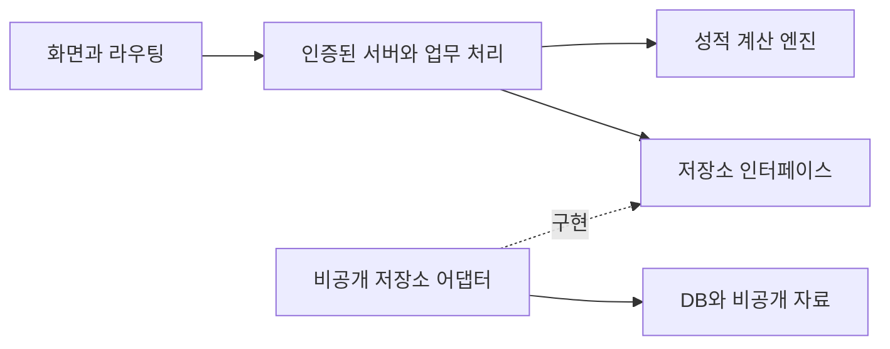

# 정시터치 3티어 개발구조

이 문서는 공통 명세 service_spec.json에서 생성한다. 현재 버전은 1.2.3이며 기획·라우팅·계층 문서를 같은 변경으로 갱신한다.

3티어는 화면·업무 처리·저장소의 책임과 접근 경계를 나눈다. 현재 계산 모듈의 경로를 보존하고 새 권한·저장소 인터페이스를 계층에 배치한다. 계층별 책임과 포트를 기준으로 구성하며 배포 환경과 실제 서버 연결 설정은 후속 구성이다.

## 계층과 의존 방향

| 계층 | 코드 위치 | 책임 | 허용 의존 |
| --- | --- | --- | --- |
| 프레젠테이션 | apps/web | 별도 프레젠테이션 작업자의 화면·입력·탐색·리포트 UI. 애플리케이션이 허용한 API 결과와 생성 경로 계약을 사용한다. | authorized_application_API |
| 애플리케이션 | src/jungsi_touch/application, src/jungsi_touch | 현재 개발팀의 서버 권한·검증·계산·API 계약과 애플리케이션 소유 공급/저장 포트. 프레젠테이션과 구체 Drive/DB 어댑터에 의존하지 않는다. | application_ports, domain_engine |
| 데이터와 인프라 | src/jungsi_touch/infrastructure, database | 현재 개발팀의 Google Drive API 공급/저장 어댑터와 DB 구조. 데이터팀의 정리 자료를 버전·검수 상태와 함께 연결하며 실제 값과 인증 설정은 Git 제외 영역에 둔다. | application_ports |

애플리케이션은 구체 DB 어댑터를 가져오지 않고 자신이 정의한 포트에 의존한다. 인프라가 포트를 구현한다. 프레젠테이션은 허용된 API 결과만 표시하며 Python 엔진·DB 비밀값·전체 환산표·곡선·모델을 포함하지 않는다.

## 커밋된 코드와 새 기반

| 파일 | 계층 | 현재 상태 | 요구사항 |
| --- | --- | --- | --- |
| src/jungsi_touch/percentile.py | application | 공통 계산 기반 | REQ-02, REQ-07 |
| src/jungsi_touch/year_equating.py | application | 공통 계산 기반 | REQ-06 |
| src/jungsi_touch/university_conversion.py | application | 공통 계산 기반 | REQ-05, REQ-06 |
| src/jungsi_touch/admission_result_percentile.py | application | 공통 계산 기반 | REQ-08 |
| src/jungsi_touch/application/authorization.py | application | server_policy_connected_by_HTTP_session_adapter | REQ-14 |
| src/jungsi_touch/application/ports.py | application | 저장소 인터페이스 | REQ-14, REQ-15, REQ-02, REQ-12 |
| src/jungsi_touch/infrastructure/memory_report_repository.py | data_infrastructure | 합성 검산 전용 어댑터 | REQ-14, REQ-15 |
| apps/web/route_catalog.json | presentation | 라우팅 계약; 웹 실행 앱 연결 전 | REQ-01, REQ-02, REQ-03, REQ-04 |
| src/jungsi_touch/application/overall_analysis.py | application | stateless_engine_connected_by_persisted_workflow_and_HTTP | REQ-02, REQ-07, REQ-12, REQ-14, REQ-15 |
| src/jungsi_touch/application/platform.py | application | implemented_synthetic_verified_live_configuration_pending | REQ-01, REQ-02, REQ-03, REQ-04, REQ-10, REQ-11, REQ-13, REQ-14 |
| src/jungsi_touch/application/platform_ports.py | application | implemented_synthetic_verified_live_configuration_pending | REQ-12, REQ-14, REQ-15, REQ-19 |
| src/jungsi_touch/application/sessions.py | application | implemented_synthetic_verified_live_configuration_pending | REQ-14, REQ-15 |
| src/jungsi_touch/application/time_contract.py | application | implemented_synthetic_verified_live_configuration_pending | REQ-12, REQ-14, REQ-15 |
| src/jungsi_touch/application/offering_analysis.py | application | implemented_synthetic_verified_live_configuration_pending | REQ-05, REQ-06, REQ-07, REQ-08, REQ-09, REQ-12 |
| src/jungsi_touch/application/publication.py | application | implemented_synthetic_verified_live_configuration_pending | REQ-11, REQ-14, REQ-17, REQ-19 |
| src/jungsi_touch/infrastructure/http_api.py | data_infrastructure | implemented_synthetic_verified_live_configuration_pending | REQ-01, REQ-02, REQ-03, REQ-04, REQ-14, REQ-15, REQ-18 |
| src/jungsi_touch/infrastructure/postgres_repository.py | data_infrastructure | implemented_synthetic_verified_live_configuration_pending | REQ-10, REQ-11, REQ-14, REQ-15, REQ-17 |
| src/jungsi_touch/infrastructure/supabase_session.py | data_infrastructure | implemented_synthetic_verified_live_configuration_pending | REQ-14, REQ-15 |
| src/jungsi_touch/infrastructure/drive_provider.py | data_infrastructure | implemented_synthetic_verified_live_configuration_pending | REQ-01, REQ-06, REQ-12, REQ-13, REQ-15, REQ-17, REQ-19 |
| src/jungsi_touch/infrastructure/settings.py | data_infrastructure | implemented_synthetic_verified_live_configuration_pending | REQ-15, REQ-19 |
| database/migrations/001_pre_data_platform.sql | data_infrastructure | additive_schema_prepared_not_applied_to_live_DB | REQ-10, REQ-11, REQ-14, REQ-15, REQ-17 |
| apps/web/src/app/admissions/possibilities/page.tsx | presentation | page3_presentation_synthetic_responses_no_live_API | REQ-03, REQ-05, REQ-08, REQ-11, REQ-13, REQ-14, REQ-18 |
| apps/web/src/lib/api/index.ts | presentation | presentation_API_client_synthetic_default_live_pending | REQ-14, REQ-15, REQ-18 |
| apps/web/src/lib/contract.ts | presentation | presentation_draft_response_shapes_pending_application_contract | REQ-03, REQ-05, REQ-08, REQ-13 |
| apps/web/src/app/admissions/favorable/page.tsx | presentation | page4_presentation_synthetic_responses_no_live_API | REQ-04, REQ-05, REQ-08, REQ-09, REQ-10, REQ-11, REQ-14, REQ-18 |

기존 src/jungsi_touch 루트 계산 모듈은 애플리케이션의 엔진 라이브러리다. 경로를 옮겨 기존 사용자를 깨뜨리지 않는다. 새 application과 infrastructure를 통해 입출력·소유권·저장소를 연결한다. 메모리 어댑터는 합성 검산 전용으로 운영 연결을 의미하지 않는다.

## 데이터와 기술 결정

실제 원자료·학생 성적·입결·환산표·곡선·모델과 .env 계열은 모든 브랜치에서 제외한다. database에는 DB 구조·마이그레이션 코드만 둘 수 있다. FastAPI·Supabase PostgreSQL을 채택했다. UTC aware/timestamptz와 date를 구분하고 서버는 환경 설정만 읽는다. 실제 연결 설정·자료 승인·운영 배포는 대기다.

## 구현과 운영 연결

FastAPI 12개 경로와 업무 서비스·Supabase/Drive 어댑터를 구현했다. 코드 합성 검증과 실제 운영 연결은 구분한다. [API DTO 계약](API_DTO_계약.md)과 [백엔드 운영 준비](백엔드_운영준비.md)를 함께 읽는다. 각 단계는 승인된 자료가 없는 값을 사유와 함께 보류한다.

## 계층별 담당과 브랜치

기획 정본은 시스템기획팀이 develop에서 관리·공유하여 두 개발 담당이 언제든 확정 기획을 가져갈 수 있게 한다. 프레젠테이션은 별도 작업자가 맡고 현재 개발팀은 애플리케이션·데이터/인프라 및 서버 API를 담당한다.

| 담당 영역 | 작업자 | 코드와 문서 위치 | 브랜치 |
| --- | --- | --- | --- |
| 공통 기획 | 시스템기획팀 | docs/current/service_spec.json, scripts/check_project_consistency.py | develop |
| 프레젠테이션 | 별도 프레젠테이션 작업자 | apps/web | feature/presentation-* |
| 애플리케이션 | 현재 개발팀 | src/jungsi_touch/application, src/jungsi_touch | feature/application-pre-data-platform |
| 데이터와 인프라 | 현재 개발팀의 인프라 담당; 데이터팀은 자료 정리 담당 | src/jungsi_touch/infrastructure, database | feature/application-pre-data-platform |

시스템기획팀은 develop의 현재 HEAD와 원격 동기화 상태를 확인하고 기획 정본을 검증·공유한다. 서버 개발팀과 별도 프레젠테이션 담당은 최신 origin/develop의 기획 기준과 출발 SHA를 확인하고 각자의 기존 작업 브랜치를 재사용한다. 다른 작업자의 미커밋 변경을 기준으로 삼지 않는다.

기획 문서는 develop에서 공통 명세와 생성 문서를 함께 검증해 공유한다. 현재 서버 개발팀은 기존 feature/application-pre-data-platform을 재사용하여 애플리케이션과 데이터/인프라를 함께 구현한다. 프레젠테이션 담당은 자신의 별도 작업 브랜치를 재사용한다. 3티어의 책임은 폴더·포트·의존 방향으로 구분한다. 별도 병렬 브랜치가 필요하면 담당과 분리 사유를 기록한다. 구현은 검증 후 develop에 통합하고 최종 코드는 검증한 PR로 main에 반영한다.

현재 개발팀의 기존 브랜치는 feature/application-pre-data-platform이다. 화면 작업자는 feature/presentation-foundation처럼 별도 feature/presentation-* 브랜치를 사용한다. 프레젠테이션 담당의 기존 작업 브랜치를 재사용한다. 기획팀의 develop 및 서버 개발팀 브랜치와 구현 커밋을 공유하지 않는다. 작업자·브랜치·PR별 통합 여부를 확인하고 미병합 코드를 develop의 현재 구현으로 기록하지 않는다.

route_catalog.json과 생성 README/현재 문서는 직접 편집하지 않는다. 계약 변경은 service_spec.json과 생성 도구에서 수정하고 생성 결과를 같은 커밋에 포함한다.

두 개발 담당은 origin/develop의 같은 커밋에 있는 service_spec과 생성 문서를 가져가 구현한다. 계약·필드·오류/보류 사유가 바뀌면 시스템기획팀과 해당 계층 담당에게 인계한다. 통합되지 않은 feature의 코드·가상 응답을 develop에 구현된 기능으로 기록하지 않는다.

Git 변경 범위와 해당 계약·필수 커밋 검산을 확인한다. 원자료 전수검수나 전국 재집계를 매 개발 작업에서 반복하지 않는다.

## Google Drive 폴더 API 연동

Google Drive API 고정 폴더·파일 버전/해시·승인 읽기와 별도 결과 폴더 멱등 새 파일 쓰기 어댑터를 구현했다. 실제 계정·폴더·승인 자료·토큰 갱신·읽기/쓰기 검증은 설정 대기다.

프레젠테이션 → 우리 서비스 API → 애플리케이션 포트 ← Drive API 어댑터 → 비공개 Google Drive 폴더

애플리케이션은 자신이 정의한 포트에 의존한다. Drive API 호출·파일 변환·인증·재시도는 인프라 어댑터가 담당하며 전체 원자료와 인증값을 학생 응답에 넣지 않는다.

화면은 우리 서비스의 허용 API 결과만 이용한다. Google Drive API·폴더·토큰·전체 원자료에 직접 접근하지 않는다.

### 읽기와 쓰기

서버에 설정한 입력 폴더와 발행 버전만 읽는다. 파일 식별자·자료 버전·내용 해시·학년도/시험·출처·검수 상태를 연결하며 단순 최신 수정 파일을 승인 데이터로 자동 채택하지 않는다.

서버에 설정한 결과 폴더로 새 산출 파일 또는 새 버전을 기록한다. 원본·이전 버전은 보존하고 삭제·휴지통 이동·동기화 정리는 수행하지 않는다. 사용자 성적과 공개 산출물의 접근 범위를 구분한다.

실제 폴더 ID·인증 계정·키/토큰·자료·입결·곡선·모델·검수 결과는 Git 제외 설정/폴더 또는 비공개 저장소에 둔다. 코드에는 어댑터와 자료 형식 계약만 둔다.

파일·버전·권한·검수 상태가 준비되지 않으면 데이터 대기 또는 오류 사유를 반환한다. 다른 시험·연도·미승인 모형으로 대체하지 않는다.

### 남은 설정

- 실제 입출력 폴더·서버 계정 권한·OAuth와 갱신 설정
- 비공개 발행 명부/승인 자료 값과 형식 호환 검수
- 실제 읽기/쓰기·재시도/충돌·감사와 사용자 접근 검수

<!-- jungsi:generated spec_sha256=a066cd99d16a66a2386450bc8844a177345da8ec479331d1cfaf4dc854900a62 -->
