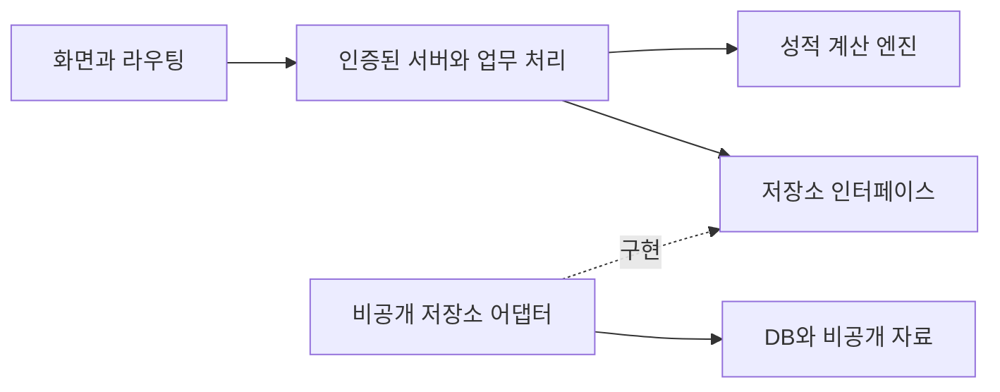

# 정시터치 3티어 개발구조

이 문서는 공통 명세 service_spec.json에서 생성한다. 현재 버전은 1.1.0이며 기획·라우팅·계층 문서를 같은 변경으로 갱신한다.

3티어는 화면·업무 처리·저장소의 책임과 접근 경계를 나눈다. 현재 계산 모듈의 경로를 보존하고 새 권한·저장소 인터페이스를 계층에 배치한다. 서버 세 대를 요구하는 설계가 아니며 운영 기술과 배포 방식은 후속 결정이다.

## 계층과 의존 방향

| 계층 | 코드 위치 | 책임 | 허용 의존 |
| --- | --- | --- | --- |
| 프레젠테이션 | apps/web | 검색·폼·화면 이동·결과 표시·리포트 UI. 현재 경로 계약과 기존 가상 화면 기준을 준비한다. | authorized_application_API |
| 애플리케이션 | src/jungsi_touch/application, src/jungsi_touch | 검증된 서버 문맥의 권한·소유권 판단과 공통 성적 엔진. 기존 루트 계산 모듈은 호환성을 유지하며 이 계층에 속한다. | application_ports, domain_engine |
| 데이터와 인프라 | src/jungsi_touch/infrastructure, database | 애플리케이션 포트의 저장소 어댑터와 DB 구조. 실제 값과 연결 비밀값은 제외 영역 또는 비공개 운영 저장소에 둔다. | application_ports |

애플리케이션은 구체 DB 어댑터를 가져오지 않고 자신이 정의한 포트에 의존한다. 인프라가 포트를 구현한다. 프레젠테이션은 허용된 API 결과만 표시하며 Python 엔진·DB 비밀값·전체 환산표·곡선·모델을 포함하지 않는다.

## 커밋된 코드와 새 기반

| 파일 | 계층 | 현재 상태 | 요구사항 |
| --- | --- | --- | --- |
| src/jungsi_touch/percentile.py | application | 공통 계산 기반 | REQ-02, REQ-07 |
| src/jungsi_touch/year_equating.py | application | 공통 계산 기반 | REQ-06 |
| src/jungsi_touch/university_conversion.py | application | 공통 계산 기반 | REQ-05, REQ-06 |
| src/jungsi_touch/admission_result_percentile.py | application | 공통 계산 기반 | REQ-08 |
| src/jungsi_touch/application/authorization.py | application | 권한 기반 모듈; 실제 인증과 HTTP 연결 전 | REQ-14 |
| src/jungsi_touch/application/ports.py | application | 저장소 인터페이스 | REQ-14, REQ-15, REQ-02, REQ-12 |
| src/jungsi_touch/infrastructure/memory_report_repository.py | data_infrastructure | 합성 검산 전용 어댑터 | REQ-14, REQ-15 |
| apps/web/route_catalog.json | presentation | 라우팅 계약; 웹 실행 앱 연결 전 | REQ-01, REQ-02, REQ-03, REQ-04 |
| src/jungsi_touch/application/overall_analysis.py | application | 2페이지 분석 서비스; HTTP·영속저장 연결 전 | REQ-02, REQ-07, REQ-12, REQ-14, REQ-15 |

기존 src/jungsi_touch 루트 계산 모듈은 애플리케이션의 엔진 라이브러리다. 경로를 옮겨 기존 사용자를 깨뜨리지 않는다. 새 application과 infrastructure를 통해 입출력·소유권·저장소를 연결한다. 메모리 어댑터는 합성 검산 전용으로 운영 연결을 의미하지 않는다.

## 데이터와 기술 결정

실제 원자료·학생 성적·입결·환산표·곡선·모델과 .env 계열은 모든 브랜치에서 제외한다. database에는 DB 구조·마이그레이션 코드만 둘 수 있다. 현재 DB 엔진·Supabase·웹 프레임워크·HTTP 서버 채택은 미정이며 연결 비밀값을 문서나 코드로 대신하지 않는다.

## 구현 순서

현재 계약과 권한 기반 검증 다음에 로그인·결제·운영 저장소를 연결한다. 이후 1페이지 공식 조회와 2페이지 입력·전체 누적, 3페이지 학과별 분석, 4페이지 추천·리포트와 실시간 집계를 순서대로 연결한다. 각 단계는 승인된 자료가 없는 값을 보류한다.

<!-- jungsi:generated spec_sha256=4b7b1445dd300dd66e9696069afed0b3655416e12be3bcae677d2ebf87200946 -->
