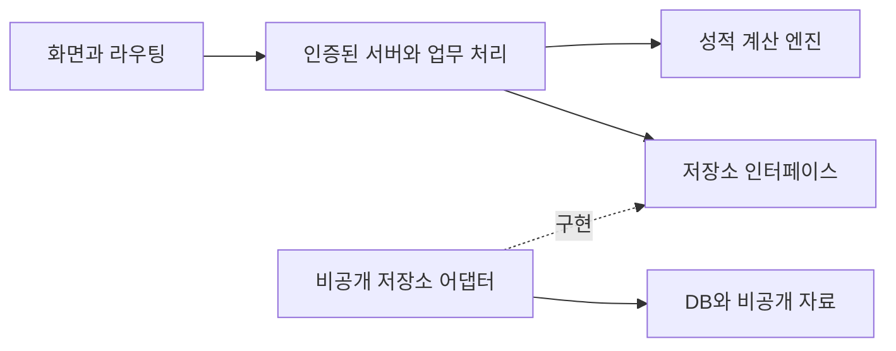

# 정시터치 3티어 개발구조

이 문서는 공통 명세 service_spec.json에서 생성한다. 현재 버전은 1.9.80이며 기획·라우팅·계층 문서를 같은 변경으로 갱신한다.

3티어는 화면·업무 처리·저장소의 책임과 접근 경계를 나눈다. 현재 계산 모듈의 경로를 보존하고 새 권한·저장소 인터페이스를 계층에 배치한다. 계층별 책임과 포트를 기준으로 구성하며 배포 환경과 실제 서버 연결 설정은 후속 구성이다.

## 계층과 의존 방향

| 계층 | 코드 위치 | 책임 | 허용 의존 |
| --- | --- | --- | --- |
| 프레젠테이션 | apps/web | 별도 프레젠테이션 작업자의 화면·입력·탐색·리포트 UI. 애플리케이션이 허용한 API 결과와 생성 경로 계약을 사용한다. | authorized_application_API |
| 애플리케이션 | src/jungsi_touch/application, src/jungsi_touch, supabase/functions/_shared/official_history_display.ts, supabase/functions/_shared/jungsi/domain, supabase/functions/_shared/jungsi/application | 현재 개발팀의 서버 권한·검증·계산·API 계약과 애플리케이션 소유 공급/저장 포트. 프레젠테이션과 구체 Drive/DB 어댑터에 의존하지 않는다. | application_ports, domain_engine |
| 데이터와 인프라 | src/jungsi_touch/infrastructure, database, supabase/functions/official-history-display, supabase/functions/_shared/official_history_postgres.ts, supabase/functions/_shared/jungsi/infrastructure | 현재 개발팀의 Google Drive API 공급/저장 어댑터와 DB 구조. 데이터팀의 정리 자료를 버전·검수 상태와 함께 연결하며 실제 값과 인증 설정은 Git 제외 영역에 둔다. 입결의 현재 조회·변경은 단일 정본과 출처/멱등 정정 이력을 따르고, 동결 C 역사 검수 공급자는 구분한다. | application_ports |



애플리케이션은 구체 DB 어댑터를 가져오지 않고 자신이 정의한 포트에 의존한다. 인프라가 포트를 구현한다. 프레젠테이션은 허용된 API 결과만 표시하며 Python 엔진·DB 비밀값·전체 환산표·곡선·모델을 포함하지 않는다.

## 커밋된 코드와 새 기반

| 파일 | 계층 | 현재 상태 | 요구사항 |
| --- | --- | --- | --- |
| src/jungsi_touch/percentile.py | application | 공통 계산 기반 | REQ-02, REQ-07 |
| src/jungsi_touch/year_equating.py | application | 공통 계산 기반 | REQ-06 |
| src/jungsi_touch/university_conversion.py | application | 공통 계산 기반 | REQ-05, REQ-06 |
| src/jungsi_touch/admission_result_percentile.py | application | 공통 계산 기반 | REQ-08 |
| src/jungsi_touch/application/authorization.py | application | reference_python_policy_hold_explicit_legacy_synthetic | REQ-14, REQ-15, REQ-16, REQ-24, REQ-25, REQ-26, REQ-27 |
| src/jungsi_touch/application/ports.py | application | 저장소 인터페이스 | REQ-14, REQ-15, REQ-02, REQ-12 |
| src/jungsi_touch/infrastructure/memory_report_repository.py | data_infrastructure | 합성 검산 전용 어댑터 | REQ-14, REQ-15 |
| apps/web/route_catalog.json | presentation | 라우팅 계약; 웹 실행 앱 연결 전 | REQ-01, REQ-02, REQ-03, REQ-04 |
| src/jungsi_touch/application/overall_analysis.py | application | stateless_engine_connected_by_persisted_workflow_and_HTTP | REQ-02, REQ-07, REQ-12, REQ-14, REQ-15 |
| src/jungsi_touch/application/platform.py | application | reference_python_policy_hold_explicit_legacy_synthetic | REQ-01, REQ-02, REQ-03, REQ-04, REQ-10, REQ-11, REQ-13, REQ-14, REQ-15, REQ-16, REQ-24, REQ-25, REQ-26, REQ-27 |
| src/jungsi_touch/application/platform_ports.py | application | implemented_scoped_synthetic_native_readonly_verified_integration_pending | REQ-12, REQ-14, REQ-15, REQ-19, REQ-16, REQ-24, REQ-25, REQ-26 |
| src/jungsi_touch/application/sessions.py | application | implemented_scoped_synthetic_native_readonly_verified_integration_pending | REQ-14, REQ-15, REQ-16, REQ-24, REQ-25, REQ-26 |
| src/jungsi_touch/application/time_contract.py | application | implemented_synthetic_verified_live_configuration_pending | REQ-12, REQ-14, REQ-15 |
| src/jungsi_touch/application/offering_analysis.py | application | implemented_synthetic_verified_live_configuration_pending | REQ-05, REQ-06, REQ-07, REQ-08, REQ-09, REQ-12 |
| src/jungsi_touch/application/publication.py | application | implemented_synthetic_verified_live_configuration_pending | REQ-11, REQ-14, REQ-17, REQ-19 |
| src/jungsi_touch/infrastructure/http_api.py | data_infrastructure | reference_python_policy_hold_explicit_legacy_synthetic | REQ-01, REQ-02, REQ-03, REQ-04, REQ-14, REQ-15, REQ-18, REQ-16, REQ-24, REQ-25, REQ-26, REQ-27 |
| src/jungsi_touch/infrastructure/postgres_repository.py | data_infrastructure | implemented_synthetic_verified_live_configuration_pending | REQ-10, REQ-11, REQ-14, REQ-15, REQ-17 |
| src/jungsi_touch/infrastructure/supabase_session.py | data_infrastructure | implemented_scoped_synthetic_native_readonly_verified_integration_pending | REQ-14, REQ-15, REQ-16, REQ-24, REQ-25, REQ-26 |
| src/jungsi_touch/infrastructure/drive_provider.py | data_infrastructure | implemented_synthetic_verified_live_configuration_pending | REQ-01, REQ-06, REQ-12, REQ-13, REQ-15, REQ-17, REQ-19 |
| src/jungsi_touch/infrastructure/settings.py | data_infrastructure | implemented_synthetic_verified_live_configuration_pending | REQ-15, REQ-19 |
| database/migrations/001_pre_data_platform.sql | data_infrastructure | additive_schema_prepared_not_applied_to_live_DB | REQ-10, REQ-11, REQ-14, REQ-15, REQ-17 |
| src/jungsi_touch/application/university_scoring.py | application | accepted_on_develop_synthetic_verified_live_rules_configuration_pending | REQ-05, REQ-06, REQ-12, REQ-14 |
| src/jungsi_touch/application/university_percentile.py | application | implemented_synthetic_verified_live_curve_publication_pending | REQ-05, REQ-06, REQ-08, REQ-12, REQ-14 |
| src/jungsi_touch/reported_score_mapping.py | application | reported_mapping_derivation | REQ-02, REQ-05, REQ-06, REQ-07, REQ-12, REQ-14, REQ-15, REQ-16 |
| src/jungsi_touch/estimated_profiles.py | application | candidate_profiles | REQ-02, REQ-05, REQ-06, REQ-07, REQ-12, REQ-14, REQ-15, REQ-16 |
| src/jungsi_touch/estimated_fitting.py | application | entropy_soft_reference | REQ-02, REQ-05, REQ-06, REQ-07, REQ-12, REQ-14, REQ-15, REQ-16 |
| src/jungsi_touch/estimated_validation.py | application | independent_validation | REQ-02, REQ-05, REQ-06, REQ-07, REQ-12, REQ-14, REQ-15, REQ-16 |
| src/jungsi_touch/estimated_curves.py | application | exact_aggregation | REQ-02, REQ-05, REQ-06, REQ-07, REQ-12, REQ-14, REQ-15, REQ-16 |
| src/jungsi_touch/application/estimated_population.py | application | private_workflow_and_server_adoption | REQ-02, REQ-05, REQ-06, REQ-07, REQ-12, REQ-14, REQ-15, REQ-16 |
| src/jungsi_touch/infrastructure/private_estimation.py | data_infrastructure | private_append_only_adapters | REQ-02, REQ-05, REQ-06, REQ-07, REQ-12, REQ-14, REQ-15, REQ-16 |
| apps/web/src/app/admissions/possibilities/page.tsx | presentation | page3_presentation_on_backend_DTO_synthetic_responses_no_live_API | REQ-03, REQ-05, REQ-08, REQ-11, REQ-13, REQ-14, REQ-18 |
| apps/web/src/lib/api/index.ts | presentation | presentation_API_client_synthetic_default_live_pending | REQ-14, REQ-15, REQ-18 |
| apps/web/src/app/admissions/favorable/page.tsx | presentation | page4_presentation_on_backend_DTO_synthetic_responses_no_live_API | REQ-04, REQ-05, REQ-08, REQ-09, REQ-10, REQ-11, REQ-14, REQ-18 |
| apps/web/src/app/admissions/results/page.tsx | presentation | page1_presentation_on_backend_DTO_synthetic_responses_no_live_API | REQ-01, REQ-13, REQ-14, REQ-18 |
| apps/web/src/lib/dto.ts | presentation | presentation_copy_of_backend_DTO_contract_1_2_2 | REQ-01, REQ-13, REQ-15 |
| apps/web/src/app/reports/me/page.tsx | presentation | page2_presentation_on_backend_DTO_synthetic_responses_no_live_API | REQ-02, REQ-11, REQ-12, REQ-14, REQ-18 |
| apps/web/src/app/reports/me/print/page.tsx | presentation | counseling_report_print_view_on_report_export_DTO | REQ-11, REQ-14 |
| apps/web/src/lib/report-ops.ts | presentation | report_bound_analysis_candidates_shortlist_calls_with_idempotency_and_revision_retry | REQ-04, REQ-05, REQ-06, REQ-10, REQ-11 |
| apps/web/src/proxy.ts | presentation | supabase_ssr_token_refresh_and_private_no_store_DEV006 | REQ-14, REQ-15, REQ-20 |
| apps/web/src/lib/supabase/server.ts | presentation | same_supabase_project_cookie_read_publishable_key_only | REQ-14, REQ-15, REQ-20 |
| apps/web/src/components/connection-notice.tsx | presentation | explicit_synthetic_only_connection_pending_notice_no_fallback | REQ-14, REQ-15, REQ-20 |
| apps/web/src/app/management/forecasts/page.tsx | presentation | ADMIN_FORECAST_management_screen_on_1_7_1_contract_synthetic_responses | REQ-08, REQ-09, REQ-14, REQ-20, REQ-21, REQ-22 |
| src/jungsi_touch/application/public_response.py | application | implemented_synthetic_verified_integration_pending | REQ-24, REQ-25, REQ-26 |
| src/jungsi_touch/application/public_response_schemas.json | application | implemented_synthetic_verified_integration_pending | REQ-24, REQ-25, REQ-26 |
| src/jungsi_touch/infrastructure/secured_http.py | data_infrastructure | reference_python_policy_hold_explicit_legacy_synthetic | REQ-24, REQ-25, REQ-26, REQ-27 |
| src/jungsi_touch/infrastructure/supabase_runtime.py | data_infrastructure | reference_python_policy_hold_explicit_legacy_synthetic | REQ-12, REQ-14, REQ-15, REQ-16, REQ-17, REQ-20, REQ-23, REQ-24, REQ-25, REQ-26, REQ-27 |
| src/jungsi_touch/infrastructure/official_history_display.py | data_infrastructure | implemented_scoped_synthetic_native_readonly_verified_integration_pending | REQ-01, REQ-08, REQ-12, REQ-20, REQ-24, REQ-25, REQ-26, REQ-14, REQ-15, REQ-16 |
| supabase/functions/_shared/official_history_display.ts | application | implemented_scoped_synthetic_verified_integration_pending | REQ-01, REQ-08, REQ-12, REQ-20, REQ-24, REQ-25, REQ-26 |
| supabase/functions/_shared/official_history_postgres.ts | data_infrastructure | implemented_scoped_synthetic_native_readonly_verified_integration_pending | REQ-01, REQ-08, REQ-12, REQ-20, REQ-24, REQ-25, REQ-26, REQ-14, REQ-15, REQ-16 |
| supabase/functions/official-history-display/index.ts | data_infrastructure | implemented_scoped_synthetic_verified_integration_pending | REQ-01, REQ-08, REQ-12, REQ-20, REQ-24, REQ-25, REQ-26 |
| supabase/functions/_shared/official_history_display_test.ts | data_infrastructure | implemented_scoped_synthetic_native_readonly_verified_integration_pending | REQ-01, REQ-08, REQ-12, REQ-20, REQ-24, REQ-25, REQ-26, REQ-14, REQ-15, REQ-16 |
| supabase/functions/_shared/node_compat_bootstrap.ts | data_infrastructure | implemented_native36_offline_bundle_verified_integrated_real_cloud_retest_pending | REQ-01, REQ-08, REQ-12, REQ-20, REQ-24, REQ-25, REQ-26 |
| supabase/functions/_shared/node_compat_bootstrap_test.ts | data_infrastructure | implemented_native36_offline_bundle_verified_integrated_real_cloud_retest_pending | REQ-01, REQ-08, REQ-12, REQ-20, REQ-24, REQ-25, REQ-26 |
| supabase/functions/_shared/current_admission_display.ts | application | implemented_current_cursor_exact_and_live_snapshot_namespace_verified | REQ-01, REQ-08, REQ-12, REQ-20, REQ-24, REQ-25, REQ-26 |
| supabase/functions/_shared/current_admission_display_test.ts | data_infrastructure | implemented_current_review_development_candidate_native41_offline_bundle_verified_actual_performance_failed_runtime_activation_pending | REQ-01, REQ-08, REQ-12, REQ-20, REQ-24, REQ-25, REQ-26 |
| supabase/functions/_shared/current_admission_review.ts | application | implemented_owner_v3_source_synthetic_operating_NOT_RUN | REQ-01, REQ-08, REQ-12, REQ-20, REQ-24, REQ-25, REQ-26 |
| supabase/functions/_shared/current_admission_review_postgres.ts | data_infrastructure | implemented_owner_v3_source_synthetic_operating_NOT_RUN | REQ-01, REQ-08, REQ-12, REQ-20, REQ-24, REQ-25, REQ-26 |
| supabase/functions/_shared/current_admission_review_test.ts | data_infrastructure | implemented_live_bounded_v2_actual_connection_verification_in_progress | REQ-01, REQ-08, REQ-12, REQ-20, REQ-24, REQ-25, REQ-26 |
| supabase/functions/current-admission-review/index.ts | data_infrastructure | implemented_live_bounded_v2_actual_connection_verification_in_progress | REQ-01, REQ-08, REQ-12, REQ-20, REQ-24, REQ-25, REQ-26 |
| supabase/functions/_shared/current_review_model_codec.ts | application | implemented_read_model_candidate_native40_distinct82registrations_independent_source_verified_actual_DB_activation_NOT_READY | REQ-01, REQ-08, REQ-12, REQ-20, REQ-24, REQ-25, REQ-26 |
| supabase/functions/_shared/current_review_model_validation.ts | application | implemented_read_model_candidate_native40_distinct82registrations_independent_source_verified_actual_DB_activation_NOT_READY | REQ-01, REQ-08, REQ-12, REQ-20, REQ-24, REQ-25, REQ-26 |
| supabase/functions/_shared/current_review_model_postgres.ts | data_infrastructure | implemented_read_model_candidate_native40_distinct82registrations_independent_source_verified_actual_DB_activation_NOT_READY | REQ-01, REQ-08, REQ-12, REQ-20, REQ-24, REQ-25, REQ-26 |
| database/migrations/004_current_review_model.prepared.sql | data_infrastructure | prepared_schema_candidate_static_reviewed_not_applied_source_freshness_job_seal_lineage_grant_adapters_NOT_READY | REQ-01, REQ-08, REQ-12, REQ-20, REQ-24, REQ-25, REQ-26 |
| supabase/functions/_shared/current_review_model_codec_test.ts | data_infrastructure | implemented_read_model_candidate_native40_distinct82registrations_independent_source_verified_actual_DB_activation_NOT_READY | REQ-01, REQ-08, REQ-12, REQ-20, REQ-24, REQ-25, REQ-26 |
| supabase/functions/_shared/current_review_model_validation_test.ts | data_infrastructure | implemented_read_model_candidate_native40_distinct82registrations_independent_source_verified_actual_DB_activation_NOT_READY | REQ-01, REQ-08, REQ-12, REQ-20, REQ-24, REQ-25, REQ-26 |
| supabase/functions/_shared/current_review_model_postgres_test.ts | data_infrastructure | implemented_read_model_candidate_native40_distinct82registrations_independent_source_verified_actual_DB_activation_NOT_READY | REQ-01, REQ-08, REQ-12, REQ-20, REQ-24, REQ-25, REQ-26 |
| src/jungsi_touch/application/forecast_policy.py | application | implemented_scoped_synthetic_native_readonly_verified_integration_pending | REQ-14, REQ-15, REQ-16, REQ-24, REQ-25, REQ-26 |
| src/jungsi_touch/application/forecast_ports.py | application | implemented_scoped_synthetic_native_readonly_verified_integration_pending | REQ-14, REQ-15, REQ-16, REQ-24, REQ-25, REQ-26 |
| src/jungsi_touch/infrastructure/local_verification.py | data_infrastructure | reference_python_policy_hold_explicit_legacy_synthetic | REQ-14, REQ-15, REQ-16, REQ-24, REQ-25, REQ-26, REQ-27 |
| src/jungsi_touch/infrastructure/memory_forecast_repository.py | data_infrastructure | implemented_scoped_synthetic_native_readonly_verified_integration_pending | REQ-14, REQ-15, REQ-16, REQ-24, REQ-25, REQ-26 |
| src/jungsi_touch/infrastructure/postgres_entitlements.py | data_infrastructure | implemented_scoped_synthetic_native_readonly_verified_integration_pending | REQ-14, REQ-15, REQ-16, REQ-24, REQ-25, REQ-26 |
| src/jungsi_touch/infrastructure/postgres_forecast_repository.py | data_infrastructure | implemented_scoped_synthetic_native_readonly_verified_integration_pending | REQ-14, REQ-15, REQ-16, REQ-24, REQ-25, REQ-26 |
| supabase/functions/_shared/jungsi/application/access.ts | application | synthetic_session_and_management_authorization_candidate_verified_runtime_NOT_RUN | REQ-14, REQ-15, REQ-20, REQ-24, REQ-25, REQ-26 |
| supabase/functions/_shared/jungsi/application/ports.ts | application | synthetic_session_and_management_authorization_candidate_verified_runtime_NOT_RUN | REQ-14, REQ-15, REQ-20, REQ-24, REQ-25, REQ-26, REQ-27 |
| supabase/functions/_shared/jungsi/application/research_offering.ts | application | implemented_synthetic_verified_runtime_NOT_RUN | REQ-06, REQ-12, REQ-15, REQ-23 |
| supabase/functions/_shared/jungsi/domain/conversion.ts | application | implemented_synthetic_verified_runtime_NOT_RUN | REQ-06, REQ-12, REQ-15 |
| supabase/functions/_shared/jungsi/domain/exact.ts | application | implemented_synthetic_verified_runtime_NOT_RUN | REQ-06, REQ-07, REQ-12, REQ-15 |
| supabase/functions/_shared/jungsi/domain/native_json.ts | application | implemented_synthetic_verified_runtime_NOT_RUN | REQ-12, REQ-15, REQ-17, REQ-24 |
| supabase/functions/_shared/jungsi/domain/percentile.ts | application | implemented_synthetic_verified_runtime_NOT_RUN | REQ-02, REQ-07, REQ-12, REQ-15 |
| supabase/functions/_shared/jungsi/domain/time.ts | application | implemented_synthetic_verified_runtime_NOT_RUN | REQ-12, REQ-13, REQ-15 |
| supabase/functions/_shared/jungsi/infrastructure/auth_relay.ts | data_infrastructure | synthetic_session_and_management_authorization_candidate_verified_runtime_NOT_RUN | REQ-14, REQ-15, REQ-20, REQ-24, REQ-25, REQ-26, REQ-27 |
| supabase/functions/_shared/jungsi/application/management_access.ts | application | synthetic_session_and_management_authorization_candidate_verified_runtime_NOT_RUN | REQ-21, REQ-24, REQ-25, REQ-26 |
| supabase/functions/_shared/jungsi/application/session_service.ts | application | synthetic_session_and_management_authorization_candidate_verified_runtime_NOT_RUN | REQ-20, REQ-24, REQ-25, REQ-26, REQ-27 |
| supabase/functions/_shared/jungsi/infrastructure/public_passes.ts | data_infrastructure | synthetic_session_and_management_authorization_candidate_verified_runtime_NOT_RUN | REQ-20, REQ-24, REQ-25, REQ-26, REQ-27 |
| supabase/functions/_shared/jungsi/infrastructure/session_http.ts | data_infrastructure | synthetic_session_and_management_authorization_candidate_verified_runtime_NOT_RUN | REQ-20, REQ-21, REQ-24, REQ-25, REQ-26 |
| supabase/functions/_shared/jungsi/infrastructure/verified_session.ts | data_infrastructure | synthetic_session_and_management_authorization_candidate_verified_runtime_NOT_RUN | REQ-20, REQ-24, REQ-25, REQ-26 |
| supabase/functions/_shared/jungsi/application/api_dispatch.ts | application | implemented_source_synthetic_verified_runtime_NOT_RUN | REQ-01, REQ-02, REQ-03, REQ-04, REQ-05, REQ-06, REQ-07, REQ-08, REQ-09, REQ-10, REQ-11, REQ-12, REQ-13, REQ-14, REQ-15, REQ-20, REQ-21, REQ-22, REQ-24, REQ-25, REQ-26, REQ-27 |
| supabase/functions/_shared/jungsi/application/catalog.ts | application | implemented_source_synthetic_verified_runtime_NOT_RUN | REQ-01, REQ-03, REQ-04, REQ-05, REQ-06, REQ-08, REQ-09, REQ-10, REQ-11, REQ-13, REQ-14, REQ-21, REQ-22, REQ-24, REQ-25, REQ-26 |
| supabase/functions/_shared/jungsi/application/forecast_assessment.ts | application | implemented_source_synthetic_verified_runtime_NOT_RUN | REQ-21, REQ-22, REQ-24, REQ-25, REQ-26 |
| supabase/functions/_shared/jungsi/application/forecast_calculation.ts | application | implemented_source_synthetic_verified_runtime_NOT_RUN | REQ-21, REQ-22, REQ-24, REQ-25, REQ-26 |
| supabase/functions/_shared/jungsi/application/forecast_dto.ts | application | implemented_source_synthetic_verified_runtime_NOT_RUN | REQ-21, REQ-22, REQ-24, REQ-25, REQ-26 |
| supabase/functions/_shared/jungsi/application/forecast_policy.ts | application | implemented_source_synthetic_verified_runtime_NOT_RUN | REQ-21, REQ-22, REQ-24, REQ-25, REQ-26 |
| supabase/functions/_shared/jungsi/application/forecast_ports.ts | application | implemented_source_synthetic_verified_runtime_NOT_RUN | REQ-21, REQ-22, REQ-24, REQ-25, REQ-26 |
| supabase/functions/_shared/jungsi/application/offering_analysis.ts | application | implemented_source_synthetic_verified_runtime_NOT_RUN | REQ-04, REQ-05, REQ-06, REQ-08, REQ-09, REQ-14, REQ-21, REQ-22, REQ-24, REQ-25, REQ-26 |
| supabase/functions/_shared/jungsi/application/overall_analysis.ts | application | implemented_source_synthetic_verified_runtime_NOT_RUN | REQ-02, REQ-04, REQ-05, REQ-06, REQ-07, REQ-08, REQ-09, REQ-10, REQ-11, REQ-12, REQ-14, REQ-15, REQ-21, REQ-22, REQ-24, REQ-25, REQ-26, REQ-27 |
| supabase/functions/_shared/jungsi/application/platform_repository.ts | application | implemented_source_synthetic_verified_runtime_NOT_RUN | REQ-02, REQ-04, REQ-05, REQ-06, REQ-07, REQ-08, REQ-09, REQ-10, REQ-11, REQ-12, REQ-14, REQ-15, REQ-21, REQ-22, REQ-24, REQ-25, REQ-26, REQ-27 |
| supabase/functions/_shared/jungsi/application/profile_reports.ts | application | implemented_source_synthetic_verified_runtime_NOT_RUN | REQ-02, REQ-04, REQ-05, REQ-06, REQ-07, REQ-08, REQ-09, REQ-10, REQ-11, REQ-12, REQ-14, REQ-15, REQ-21, REQ-22, REQ-24, REQ-25, REQ-26, REQ-27 |
| supabase/functions/_shared/jungsi/application/public_response.ts | application | implemented_source_synthetic_verified_runtime_NOT_RUN | REQ-01, REQ-02, REQ-03, REQ-04, REQ-05, REQ-06, REQ-07, REQ-08, REQ-09, REQ-10, REQ-11, REQ-12, REQ-13, REQ-14, REQ-15, REQ-20, REQ-21, REQ-22, REQ-24, REQ-25, REQ-26 |
| supabase/functions/_shared/jungsi/application/report_actions.ts | application | implemented_source_synthetic_verified_runtime_NOT_RUN | REQ-10, REQ-11, REQ-14, REQ-24, REQ-25, REQ-26 |
| supabase/functions/_shared/jungsi/application/request_budget.ts | application | implemented_source_synthetic_verified_runtime_NOT_RUN | REQ-01, REQ-02, REQ-03, REQ-04, REQ-05, REQ-06, REQ-07, REQ-08, REQ-09, REQ-10, REQ-11, REQ-12, REQ-13, REQ-14, REQ-15, REQ-20, REQ-21, REQ-22, REQ-24, REQ-25, REQ-26, REQ-27 |
| supabase/functions/_shared/jungsi/application/rule_explanations.ts | application | implemented_source_synthetic_verified_runtime_NOT_RUN | REQ-04, REQ-05, REQ-06, REQ-08, REQ-09, REQ-14, REQ-21, REQ-22, REQ-24, REQ-25, REQ-26 |
| supabase/functions/_shared/jungsi/application/university_analysis.ts | application | implemented_source_synthetic_verified_runtime_NOT_RUN | REQ-04, REQ-05, REQ-06, REQ-08, REQ-09, REQ-14, REQ-21, REQ-22, REQ-24, REQ-25, REQ-26, REQ-27 |
| supabase/functions/_shared/jungsi/application/university_percentile.ts | application | implemented_source_synthetic_verified_runtime_NOT_RUN | REQ-04, REQ-05, REQ-06, REQ-08, REQ-09, REQ-14, REQ-21, REQ-22, REQ-24, REQ-25, REQ-26 |
| supabase/functions/_shared/jungsi/application/university_scoring.ts | application | implemented_source_synthetic_verified_runtime_NOT_RUN | REQ-04, REQ-05, REQ-06, REQ-08, REQ-09, REQ-14, REQ-21, REQ-22, REQ-24, REQ-25, REQ-26 |
| supabase/functions/_shared/jungsi/application/usage_budget.ts | application | implemented_source_synthetic_verified_runtime_NOT_RUN | REQ-12, REQ-15, REQ-24, REQ-25, REQ-26 |
| supabase/functions/_shared/jungsi/application/usage_service.ts | application | implemented_source_synthetic_verified_runtime_NOT_RUN | REQ-01, REQ-02, REQ-03, REQ-04, REQ-05, REQ-06, REQ-07, REQ-08, REQ-09, REQ-10, REQ-11, REQ-12, REQ-13, REQ-14, REQ-15, REQ-20, REQ-21, REQ-22, REQ-24, REQ-25, REQ-26, REQ-27 |
| supabase/functions/_shared/jungsi/domain/conversion_release.ts | application | implemented_source_synthetic_verified_runtime_NOT_RUN | REQ-04, REQ-05, REQ-06, REQ-08, REQ-09, REQ-14, REQ-21, REQ-22, REQ-24, REQ-25, REQ-26 |
| supabase/functions/_shared/jungsi/domain/exam_pack.ts | application | implemented_source_synthetic_verified_runtime_NOT_RUN | REQ-02, REQ-04, REQ-05, REQ-06, REQ-07, REQ-08, REQ-09, REQ-10, REQ-11, REQ-12, REQ-14, REQ-15, REQ-21, REQ-22, REQ-24, REQ-25, REQ-26 |
| supabase/functions/_shared/jungsi/domain/json_value.ts | application | implemented_source_synthetic_verified_runtime_NOT_RUN | REQ-01, REQ-02, REQ-03, REQ-04, REQ-05, REQ-06, REQ-07, REQ-08, REQ-09, REQ-10, REQ-11, REQ-12, REQ-13, REQ-14, REQ-15, REQ-21, REQ-22, REQ-24, REQ-25, REQ-26 |
| supabase/functions/_shared/jungsi/domain/python_json_digest.ts | application | implemented_source_synthetic_verified_runtime_NOT_RUN | REQ-04, REQ-05, REQ-06, REQ-08, REQ-09, REQ-14, REQ-21, REQ-22, REQ-24, REQ-25, REQ-26 |
| supabase/functions/_shared/jungsi/domain/text.ts | application | implemented_source_synthetic_verified_runtime_NOT_RUN | REQ-01, REQ-03, REQ-04, REQ-05, REQ-06, REQ-08, REQ-09, REQ-10, REQ-11, REQ-13, REQ-14, REQ-21, REQ-22, REQ-24, REQ-25, REQ-26 |
| supabase/functions/_shared/jungsi/domain/total_model.ts | application | implemented_source_synthetic_verified_runtime_NOT_RUN | REQ-02, REQ-04, REQ-05, REQ-06, REQ-07, REQ-08, REQ-09, REQ-10, REQ-11, REQ-12, REQ-14, REQ-15, REQ-21, REQ-22, REQ-24, REQ-25, REQ-26 |
| supabase/functions/_shared/jungsi/domain/university_distribution.ts | application | implemented_source_synthetic_verified_runtime_NOT_RUN | REQ-04, REQ-05, REQ-06, REQ-08, REQ-09, REQ-14, REQ-21, REQ-22, REQ-24, REQ-25, REQ-26 |
| supabase/functions/_shared/jungsi/domain/year_equating.ts | application | implemented_source_synthetic_verified_runtime_NOT_RUN | REQ-04, REQ-05, REQ-06, REQ-08, REQ-09, REQ-14, REQ-21, REQ-22, REQ-24, REQ-25, REQ-26 |
| supabase/functions/_shared/jungsi/infrastructure/api_http.ts | data_infrastructure | implemented_source_synthetic_verified_runtime_NOT_RUN | REQ-01, REQ-02, REQ-03, REQ-04, REQ-05, REQ-06, REQ-07, REQ-08, REQ-09, REQ-10, REQ-11, REQ-12, REQ-13, REQ-14, REQ-15, REQ-20, REQ-21, REQ-22, REQ-24, REQ-25, REQ-26, REQ-27 |
| supabase/functions/_shared/jungsi/infrastructure/forecast_postgres.ts | data_infrastructure | implemented_source_synthetic_verified_runtime_NOT_RUN | REQ-01, REQ-02, REQ-03, REQ-04, REQ-05, REQ-06, REQ-07, REQ-08, REQ-09, REQ-10, REQ-11, REQ-12, REQ-13, REQ-14, REQ-15, REQ-20, REQ-21, REQ-22, REQ-24, REQ-25, REQ-26 |
| supabase/functions/_shared/jungsi/infrastructure/jsonb_value.ts | data_infrastructure | implemented_source_synthetic_verified_runtime_NOT_RUN | REQ-01, REQ-02, REQ-03, REQ-04, REQ-05, REQ-06, REQ-07, REQ-08, REQ-09, REQ-10, REQ-11, REQ-12, REQ-13, REQ-14, REQ-15, REQ-20, REQ-21, REQ-22, REQ-24, REQ-25, REQ-26 |
| supabase/functions/_shared/jungsi/infrastructure/management_postgres.ts | data_infrastructure | implemented_source_synthetic_verified_runtime_NOT_RUN | REQ-01, REQ-02, REQ-03, REQ-04, REQ-05, REQ-06, REQ-07, REQ-08, REQ-09, REQ-10, REQ-11, REQ-12, REQ-13, REQ-14, REQ-15, REQ-20, REQ-21, REQ-22, REQ-24, REQ-25, REQ-26 |
| supabase/functions/_shared/jungsi/infrastructure/native_data_provider.ts | data_infrastructure | implemented_source_synthetic_verified_runtime_NOT_RUN | REQ-01, REQ-02, REQ-03, REQ-04, REQ-05, REQ-06, REQ-07, REQ-08, REQ-09, REQ-10, REQ-11, REQ-12, REQ-13, REQ-14, REQ-15, REQ-20, REQ-21, REQ-22, REQ-24, REQ-25, REQ-26 |
| supabase/functions/_shared/jungsi/infrastructure/native_source_selection.ts | data_infrastructure | implemented_source_synthetic_verified_runtime_NOT_RUN | REQ-01, REQ-02, REQ-03, REQ-04, REQ-05, REQ-06, REQ-07, REQ-08, REQ-09, REQ-10, REQ-11, REQ-12, REQ-13, REQ-14, REQ-15, REQ-20, REQ-21, REQ-22, REQ-24, REQ-25, REQ-26 |
| supabase/functions/_shared/jungsi/infrastructure/platform_postgres.ts | data_infrastructure | implemented_source_synthetic_verified_runtime_NOT_RUN | REQ-01, REQ-02, REQ-03, REQ-04, REQ-05, REQ-06, REQ-07, REQ-08, REQ-09, REQ-10, REQ-11, REQ-12, REQ-13, REQ-14, REQ-15, REQ-20, REQ-21, REQ-22, REQ-24, REQ-25, REQ-26, REQ-27 |
| supabase/functions/_shared/jungsi/infrastructure/project_binding.ts | data_infrastructure | implemented_source_synthetic_verified_runtime_NOT_RUN | REQ-01, REQ-02, REQ-03, REQ-04, REQ-05, REQ-06, REQ-07, REQ-08, REQ-09, REQ-10, REQ-11, REQ-12, REQ-13, REQ-14, REQ-15, REQ-20, REQ-21, REQ-22, REQ-24, REQ-25, REQ-26 |
| supabase/functions/_shared/jungsi/infrastructure/sql_values.ts | data_infrastructure | implemented_source_synthetic_verified_runtime_NOT_RUN | REQ-01, REQ-02, REQ-03, REQ-04, REQ-05, REQ-06, REQ-07, REQ-08, REQ-09, REQ-10, REQ-11, REQ-12, REQ-13, REQ-14, REQ-15, REQ-20, REQ-21, REQ-22, REQ-24, REQ-25, REQ-26 |
| supabase/functions/_shared/jungsi/infrastructure/supabase_api_ingress.ts | data_infrastructure | implemented_source_synthetic_verified_runtime_NOT_RUN | REQ-01, REQ-02, REQ-03, REQ-04, REQ-05, REQ-06, REQ-07, REQ-08, REQ-09, REQ-10, REQ-11, REQ-12, REQ-13, REQ-14, REQ-15, REQ-20, REQ-21, REQ-22, REQ-24, REQ-25, REQ-26 |
| supabase/functions/_shared/jungsi/infrastructure/supabase_artifacts.ts | data_infrastructure | implemented_source_synthetic_verified_runtime_NOT_RUN | REQ-01, REQ-02, REQ-03, REQ-04, REQ-05, REQ-06, REQ-07, REQ-08, REQ-09, REQ-10, REQ-11, REQ-12, REQ-13, REQ-14, REQ-15, REQ-20, REQ-21, REQ-22, REQ-24, REQ-25, REQ-26 |
| supabase/functions/_shared/jungsi/infrastructure/supabase_auth.ts | data_infrastructure | implemented_source_synthetic_verified_runtime_NOT_RUN | REQ-01, REQ-02, REQ-03, REQ-04, REQ-05, REQ-06, REQ-07, REQ-08, REQ-09, REQ-10, REQ-11, REQ-12, REQ-13, REQ-14, REQ-15, REQ-20, REQ-21, REQ-22, REQ-24, REQ-25, REQ-26 |
| supabase/functions/_shared/jungsi/infrastructure/transaction_sql.ts | data_infrastructure | implemented_source_synthetic_verified_runtime_NOT_RUN | REQ-01, REQ-02, REQ-03, REQ-04, REQ-05, REQ-06, REQ-07, REQ-08, REQ-09, REQ-10, REQ-11, REQ-12, REQ-13, REQ-14, REQ-15, REQ-20, REQ-21, REQ-22, REQ-24, REQ-25, REQ-26, REQ-27 |
| supabase/functions/_shared/jungsi/infrastructure/usage_postgres.ts | data_infrastructure | implemented_source_synthetic_verified_runtime_NOT_RUN | REQ-01, REQ-02, REQ-03, REQ-04, REQ-05, REQ-06, REQ-07, REQ-08, REQ-09, REQ-10, REQ-11, REQ-12, REQ-13, REQ-14, REQ-15, REQ-20, REQ-21, REQ-22, REQ-24, REQ-25, REQ-26 |
| supabase/functions/jungsi-api/postgres_pool.ts | data_infrastructure | source_only_prepared_runtime_composition_NOT_RUN | REQ-12, REQ-15, REQ-24, REQ-25, REQ-26 |
| supabase/functions/_shared/jungsi/infrastructure/runtime_budget.ts | data_infrastructure | source_assembled_synthetic_verified_native_deployment_NOT_RUN | REQ-01, REQ-02, REQ-03, REQ-04, REQ-05, REQ-06, REQ-07, REQ-08, REQ-09, REQ-10, REQ-11, REQ-12, REQ-13, REQ-14, REQ-15, REQ-16, REQ-17, REQ-18, REQ-19, REQ-20, REQ-21, REQ-22, REQ-24, REQ-25, REQ-26, REQ-27 |
| supabase/functions/_shared/jungsi/infrastructure/runtime_composition.ts | data_infrastructure | source_assembled_synthetic_verified_native_deployment_NOT_RUN | REQ-01, REQ-02, REQ-03, REQ-04, REQ-05, REQ-06, REQ-07, REQ-08, REQ-09, REQ-10, REQ-11, REQ-12, REQ-13, REQ-14, REQ-15, REQ-16, REQ-17, REQ-18, REQ-19, REQ-20, REQ-21, REQ-22, REQ-24, REQ-25, REQ-26, REQ-27 |
| supabase/functions/_shared/jungsi/infrastructure/runtime_context.ts | data_infrastructure | source_assembled_synthetic_verified_native_deployment_NOT_RUN | REQ-01, REQ-02, REQ-03, REQ-04, REQ-05, REQ-06, REQ-07, REQ-08, REQ-09, REQ-10, REQ-11, REQ-12, REQ-13, REQ-14, REQ-15, REQ-16, REQ-17, REQ-18, REQ-19, REQ-20, REQ-21, REQ-22, REQ-24, REQ-25, REQ-26, REQ-27 |
| supabase/functions/_shared/jungsi/infrastructure/runtime_controls.ts | data_infrastructure | source_assembled_synthetic_verified_native_deployment_NOT_RUN | REQ-01, REQ-02, REQ-03, REQ-04, REQ-05, REQ-06, REQ-07, REQ-08, REQ-09, REQ-10, REQ-11, REQ-12, REQ-13, REQ-14, REQ-15, REQ-16, REQ-17, REQ-18, REQ-19, REQ-20, REQ-21, REQ-22, REQ-24, REQ-25, REQ-26 |
| supabase/functions/_shared/jungsi/infrastructure/runtime_settings.ts | data_infrastructure | source_assembled_synthetic_verified_native_deployment_NOT_RUN | REQ-01, REQ-02, REQ-03, REQ-04, REQ-05, REQ-06, REQ-07, REQ-08, REQ-09, REQ-10, REQ-11, REQ-12, REQ-13, REQ-14, REQ-15, REQ-16, REQ-17, REQ-18, REQ-19, REQ-20, REQ-21, REQ-22, REQ-24, REQ-25, REQ-26 |
| supabase/functions/jungsi-api/index.ts | data_infrastructure | source_assembled_synthetic_verified_native_deployment_NOT_RUN | REQ-01, REQ-02, REQ-03, REQ-04, REQ-05, REQ-06, REQ-07, REQ-08, REQ-09, REQ-10, REQ-11, REQ-12, REQ-13, REQ-14, REQ-15, REQ-16, REQ-17, REQ-18, REQ-19, REQ-20, REQ-21, REQ-22, REQ-24, REQ-25, REQ-26 |
| supabase/functions/_shared/jungsi/application/operating_policy.ts | application | implemented_candidate_scoped_synthetic_runtime_NOT_RUN | REQ-24, REQ-25, REQ-26, REQ-27 |
| supabase/functions/_shared/jungsi/application/score_input_ports.ts | application | implemented_candidate_scoped_synthetic_runtime_NOT_RUN | REQ-24, REQ-25, REQ-26, REQ-27 |
| supabase/functions/_shared/jungsi/application/score_input_service.ts | application | implemented_candidate_scoped_synthetic_runtime_NOT_RUN | REQ-24, REQ-25, REQ-26, REQ-27 |
| supabase/functions/_shared/jungsi/application/paid_result_components.ts | application | implemented_candidate_scoped_synthetic_runtime_NOT_RUN | REQ-24, REQ-25, REQ-26, REQ-27 |
| supabase/functions/_shared/jungsi/domain/score_input_rights.ts | application | implemented_candidate_scoped_synthetic_runtime_NOT_RUN | REQ-24, REQ-25, REQ-26, REQ-27 |
| supabase/functions/_shared/jungsi/infrastructure/score_input_postgres.ts | data_infrastructure | implemented_candidate_scoped_synthetic_runtime_NOT_RUN | REQ-24, REQ-25, REQ-26, REQ-27 |
| database/migrations/006_score_input_policy.prepared.sql | data_infrastructure | schema_applied_empty_not_activated | REQ-24, REQ-25, REQ-26, REQ-27 |
| database/migrations/006a_paid_first_use_server_rpc.prepared.sql | data_infrastructure | prepared_owner_execution_NOT_RUN | REQ-24, REQ-25, REQ-26, REQ-27 |
| supabase/functions/_shared/current_admission_owner.ts | application | implemented_owner_v3_source_synthetic_operating_NOT_RUN | REQ-01, REQ-08, REQ-12, REQ-20, REQ-24, REQ-25, REQ-26 |
| supabase/functions/_shared/current_admission_owner_sql.ts | infrastructure | implemented_owner_v3_source_synthetic_operating_NOT_RUN | REQ-01, REQ-08, REQ-12, REQ-20, REQ-24, REQ-25, REQ-26 |
| supabase/functions/_shared/current_admission_owner_test.ts | application | implemented_owner_v3_source_synthetic_operating_NOT_RUN | REQ-01, REQ-08, REQ-12, REQ-20, REQ-24, REQ-25, REQ-26 |
| supabase/functions/_shared/current_admission_review_sql.ts | infrastructure | implemented_owner_v3_source_synthetic_operating_NOT_RUN | REQ-01, REQ-08, REQ-12, REQ-20, REQ-24, REQ-25, REQ-26 |
| supabase/functions/_shared/current_public_catalog.ts | application | candidate_public_provider_synthetic46_operating_NOT_RUN | REQ-01, REQ-03, REQ-08, REQ-13, REQ-20, REQ-24, REQ-25, REQ-26 |
| supabase/functions/_shared/current_public_catalog_compat.ts | infrastructure | candidate_public_provider_synthetic46_operating_NOT_RUN | REQ-01, REQ-03, REQ-08, REQ-13, REQ-20, REQ-24, REQ-25, REQ-26 |
| supabase/functions/_shared/current_public_catalog_runtime.ts | infrastructure | candidate_public_provider_synthetic46_operating_NOT_RUN | REQ-01, REQ-03, REQ-08, REQ-13, REQ-20, REQ-24, REQ-25, REQ-26 |
| supabase/functions/_shared/current_public_catalog_sql.ts | infrastructure | candidate_public_provider_synthetic46_operating_NOT_RUN | REQ-01, REQ-03, REQ-08, REQ-13, REQ-20, REQ-24, REQ-25, REQ-26 |
| supabase/functions/_shared/current_public_catalog_sql_test.ts | infrastructure | candidate_public_provider_synthetic46_operating_NOT_RUN | REQ-01, REQ-03, REQ-08, REQ-13, REQ-20, REQ-24, REQ-25, REQ-26 |
| supabase/functions/_shared/current_public_catalog_test.ts | application | candidate_public_provider_synthetic46_operating_NOT_RUN | REQ-01, REQ-03, REQ-08, REQ-13, REQ-20, REQ-24, REQ-25, REQ-26 |
| supabase/functions/_shared/current_public_key_index.ts | application | candidate_public_provider_synthetic46_operating_NOT_RUN | REQ-01, REQ-03, REQ-08, REQ-13, REQ-20, REQ-24, REQ-25, REQ-26 |
| supabase/functions/_shared/current_public_key_index_test.ts | application | candidate_public_provider_synthetic46_operating_NOT_RUN | REQ-01, REQ-03, REQ-08, REQ-13, REQ-20, REQ-24, REQ-25, REQ-26 |
| supabase/functions/_shared/current_public_key_storage.ts | infrastructure | candidate_public_provider_synthetic46_operating_NOT_RUN | REQ-01, REQ-03, REQ-08, REQ-13, REQ-20, REQ-24, REQ-25, REQ-26 |
| supabase/functions/_shared/current_public_key_storage_test.ts | infrastructure | candidate_public_provider_synthetic46_operating_NOT_RUN | REQ-01, REQ-03, REQ-08, REQ-13, REQ-20, REQ-24, REQ-25, REQ-26 |

## 실제 인증·22 API·배포 진행

사용자가 실제 인증 연결·JWT/OTP 검수·22개 API 이식·운영 배포를 요청했다. 기존 Google Drive와 Supabase만 사용하며 코드 통합·합성 검산·실 연결·배포·공개 인수를 각각 기록한다.

Python990·Deno116·독립 oracle993 및 세션/관리 권한 foundation. 실제 Auth·업무22 API·TOTP·공개 배포 인수를 대신하지 않는다.

| 검수 단계 | 상태 |
| --- | --- |
| 실제 Auth·본인 profiles 연결 — 화면팀 기능 통과 보고 / 반례 검수 진행 | IN_PROGRESS |
| 실 JWT·만료·변조·타인 소유권 반례 | IN_PROGRESS |
| 계정 주인의 /admin TOTP 등록·aal2 관리 검수 | IN_PROGRESS |
| 기존 22 API의 업무 처리·DTO·정밀 계산 이식 | IN_PROGRESS |
| 보고서·초안·멱등·버전 충돌 실제 트랜잭션 | IN_PROGRESS |
| 기존 요금제·포함량·Spend Cap·승인된 원자적 예산 | IN_PROGRESS |
| 기존 프로젝트의 동일 후보 Edge 배포·실 HTTP 인수 | IN_PROGRESS |
| 허용 플랫폼 BFF·세션/CSRF·브라우저 비노출 | IN_PROGRESS |
| 응답·직접 권한·수집 방지 세 보안 gate | NOT_RUN |

| operation | 계약 경로 | Edge 코드 | 실 연결 검수 | 배포 인수 |
| --- | --- | --- | --- | --- |
| history.search | GET /api/v1/admission-history | PORTED | NOT_RUN | NOT_RUN |
| recruitment.read | GET /api/v1/offerings/{offering_id}/recruitment | PORTED | NOT_RUN | NOT_RUN |
| score-profile.create | POST /api/v1/score-profiles | PORTED | NOT_RUN | NOT_RUN |
| overall.analyze | POST /api/v1/overall-reports | PORTED | NOT_RUN | NOT_RUN |
| report.read | GET /api/v1/reports/{report_id} | PORTED | NOT_RUN | NOT_RUN |
| offerings.search | GET /api/v1/offerings/search | PORTED | NOT_RUN | NOT_RUN |
| offering.read | GET /api/v1/offerings/{offering_id} | PORTED | NOT_RUN | NOT_RUN |
| university.analyze | POST /api/v1/reports/{report_id}/university-results | PORTED | NOT_RUN | NOT_RUN |
| candidates.build | POST /api/v1/reports/{report_id}/candidates | PORTED | NOT_RUN | NOT_RUN |
| shortlist.update | PUT /api/v1/reports/{report_id}/shortlist/{offering_id} | PORTED | NOT_RUN | NOT_RUN |
| report.export | GET /api/v1/reports/{report_id}/print | PORTED | NOT_RUN | NOT_RUN |
| statistics.read | GET /api/v1/reports/{report_id}/offerings/{offering_id}/live-statistics | PORTED | NOT_RUN | NOT_RUN |
| session.read | GET /api/v1/me | PORTED | NOT_RUN | NOT_RUN |
| forecast.capabilities | GET /api/v1/forecast-capabilities | PORTED | NOT_RUN | NOT_RUN |
| forecast.list | GET /api/v1/forecast-drafts | PORTED | NOT_RUN | NOT_RUN |
| forecast.create | POST /api/v1/offerings/{offering_id}/forecast-drafts | PORTED | NOT_RUN | NOT_RUN |
| forecast.read | GET /api/v1/forecast-drafts/{draft_id} | PORTED | NOT_RUN | NOT_RUN |
| forecast.adjust | POST /api/v1/forecast-drafts/{draft_id}/adjustments | PORTED | NOT_RUN | NOT_RUN |
| forecast.validate | POST /api/v1/forecast-drafts/{draft_id}/validations | PORTED | NOT_RUN | NOT_RUN |
| forecast.approve | POST /api/v1/forecast-drafts/{draft_id}/approvals | PORTED | NOT_RUN | NOT_RUN |
| forecast.publish | POST /api/v1/forecast-drafts/{draft_id}/publications | PORTED | NOT_RUN | NOT_RUN |
| forecast.published.read | GET /api/v1/offerings/{offering_id}/forecast | PORTED | NOT_RUN | NOT_RUN |

계정 주인이 /admin에서 휴대폰 인증 앱으로 등록·입력한다. 검수 계정 식별자·비밀번호·JWT·QR·OTP 비밀키는 공개 명세에 저장하지 않는다. 2026-10-14 계정 주인의 Codex 브라우저 직접 로그인·MFA 완료 회신과 관리자 화면 진입을 수령했다. 입력 대기는 해소됐으며 서버의 실제 getUser·aal2·본인 상태·학교 권한 검수는 계속 진행한다. 이 회신이나 화면 진입만으로 실제 JWT/TOTP 검수 PASS를 기록하지 않는다.

승인된 비공개 운영 한도와 기존 요금제 근거가 필요하다. null·미확정 값을 무제한 또는 실제 0으로 치환하지 않는다. 애플리케이션 내부 quota만으로 플랫폼 추가 과금을 방지했다고 판정하지 않는다. 기존 조직의 요금제·모든 프로젝트 사용량·포함량과 해당되는 Spend Cap 범위를 확인한다. Free는 추가 과금하지 않으며 Spend Cap은 Pro에서 적용 가능한 일부 사용량만 대상으로 한다. 실패한 Edge 호출도 invocation 사용량에 포함되므로 신규 요금제·유료 항목·초과 과금 허용을 자동 선택하지 않는다. 공식 플랫폼 상한인 worker 수명 Free150초/유료400초, 요청 idle timeout150초, active CPU2초를 구분한다. 실제 운영 요금제에 맞는 worker 최대 수명과 시계 오차 여유보다 긴 동시작업 lease를 사용하고 클라이언트의 응답 대기 만료나 재시도가 아직 실행 중인 서버 계산의 동시 lease를 초기화하지 않도록 검수한다. 이 수치는 애플리케이션 요청량·계산량 한도나 승인된 실제 운영값을 대신하지 않는다.

동일 operation의 구현은 등록된 Edge 파일·SHA에 연결한다. 실제 검수·배포 PASS는 해당 후보 커밋과 비공개 영수증 SHA 및 검사 범위에 결속한다. 검증한 공통 명세에서 기획·라우팅·3티어·배포 문서를 함께 생성한다. 다음 에이전트는 최신 근거 이후의 Git 차이부터 확인한다. 최초 synthetic 화면 검수는 과거 이력이다. 현재 정상 /jeongsi의 Worker relay·live·실제 Bearer 세션 기능 통과는 2026-10-16 화면팀 보고로 수용한다. 보고된 부분 관측과 업무22 API·소유권/CSRF·배포 인수는 구분한다. 새 오류 분류를 포함한 고정 cb500f7/동일 tree develop1ba331c 번들을 기존 함수에 실제 배포하고 editor 전체 재조회를 확인했다. 새 코드 준비 health·거절 경계는 별도 실제 영수증으로 확인했다. 같은 BFF의 안전 오류 코드 표시만 부분 관측했으며 실제 HTTP·관리 aal2·업무 인수는 미완료다. P2 단일 제출 실패는 current_P2_attempt로 구분하고 성공으로 세지 않는다. 배포 영수증의 소스·tree·번들 해시를 결속하며 소스 배포를 검색 활성화나 operation별 배포 인수로 승격하지 않는다. 정상 Edge 소스 시험은 선택된 Git 스냅샷에서 operation의 등록 소스·해시 범위를 따로 기록한다. CODE_REGISTERED/PARTIAL_CODE_REGISTERED는 실제 JWT·DB 업무·Edge 배포 인수가 아니다. native_acceptance=NOT_VERIFIED_BY_SOURCE_SUITE와 해당 시험의 production_ready=false·운영 쓰기0을 유지한다. 후속 화면팀 P2 회신의 이전 Root 시도·새 Worker 배포 보고·별도 가상1건 실패를 frontend_P2_reply와 current_P2_attempt로 분리한다. source SHA 미제공·미푸시 Worker를 remote59f에 결속하지 않고 실패 HTTP·DB쓰기를 추정하지 않는다. 후속 관리자 UI 진입은 JWT·aal2 추적 인수와 분리한다. 최신 설치는 current_deployment의 ed978 실제 영수증을 따르며 cb500 actual_editor_deployment는 당시 이력이다. current_P2_attempt는 새 실제 시도이고 회신 당시 두 실패는 P2_attempt_history에서 원래 배포·unknown 상태로 보존한다. 소스·준비상태 PASS, 제한된 로그 상관관계, 범위조회 snapshot, UI 업무 인수는 분리한다.

### 서버 런타임 조립과 입력 계약

실제 API source032/spec1.9.70을 기존 함수에 설치·reload 결속했고 준비5경계를 검수했다. 새 정상 UI1회 저장·과목표시·GETreload와4point 표시검산은 한정 기능 관측이다. 전체누백·조합분포는 미발행pending, 정확HTTP/BFFactor 귀속은 미확정이며 전22native/배포인수0·보안3gate 미완료·production_ready=false다. cb500/ed978와 세실패·41/584 합성 이력은 보존한다.

| 소스 진입점 | 경로 | SHA-256 |
| --- | --- | --- |
| native_entry | supabase/functions/jungsi-api/index.ts | ef68f227b04705681d2f269babad5688bd3558dab33e3a889574b1b09b6321b2 |
| composition | supabase/functions/_shared/jungsi/infrastructure/runtime_composition.ts | b757ad470d5a3d9cb44b8ad08203ca7d42359dd2657d9d91581674c639e6f557 |

| 서버 설정 이름 | 허용된 기존 이름 | 현재 상태 | 입력의 의미 |
| --- | --- | --- | --- |
| SUPABASE_URL | 없음 | 기존프로젝트결속·등록후readiness200확인; 실사용자Auth별도 | 동일 Supabase 프로젝트의 HTTPS 원점 |
| SUPABASE_PUBLISHABLE_KEY | JUNGSI_DISPLAY_PUBLISHABLE_KEY | health/거절경로프로젝트공개키사용확인; 실사용자AuthNOT_RUN | getUser와 동일 Bearer의 본인 profiles RLS 조회용 공개 키 |
| DATABASE_URL | JUNGSI_DISPLAY_DATABASE_URL | 기존앱역할/TLS/RLS·005검수재사용·등록후schema조회readiness200; 업무트랜잭션별도 | 동일 프로젝트 jungsi_backend_app 전용 DSN |
| JUNGSI_DATABASE_CA | JUNGSI_DISPLAY_DATABASE_CA | 기존정확CA/TLS검수재사용·같은설정readiness200; 설정변경시해당범위재검수 | PEM 본문. 로컬 파일 경로가 아니며 framing 검사는 인증서 유효성 검증을 대신하지 않는다. |
| JUNGSI_RELAY_TOKEN | 없음 | 현재함수기능수용200·불일치403; Worker등록/BFF실사용자연결대기 | BFF와 Edge 사이의 서버 전용 relay 헤더 값 |
| SUPABASE_SECRET_KEY | JUNGSI_DISPLAY_STORAGE_SECRET | 기존nativeStorage검수재사용·등록후선택그래프200; 실사용자업무별도 | private Storage 읽기 전용 서버 경계에서만 사용 |
| JUNGSI_SUPABASE_STORAGE_BUCKET | 없음 | Owner등록보고·승인파일digest5/5대조수용; 실제readiness200; Dashboard독립재조회NOT_RUN | 공개가 아닌 버킷. 현재 metadata의 private·native 정수 상한을 확인 |
| JUNGSI_SUPABASE_STORAGE_PREFIX | 없음 | Owner등록보고·승인파일digest5/5대조수용; 실제readiness200; Dashboard독립재조회NOT_RUN | 승인된 control·artifact 객체가 속하는 prefix |
| JUNGSI_API_BINDING_JSON | 없음 | Owner등록보고·승인파일digest5/5대조수용; 실제readiness200; Dashboard독립재조회NOT_RUN | jungsi.edge-api-binding/v1: 승인 목적·scope·현재 head와 registry/selection/usage_policy 참조·명시 한도 |
| JUNGSI_API_BINDING_SHA256 | 없음 | Owner등록보고·승인파일digest5/5대조수용; 실제readiness200; Dashboard독립재조회NOT_RUN | 위 JSON 원본 UTF-8 바이트의 SHA-256 |
| JUNGSI_API_BINDING_MAX_BYTES | 없음 | Owner등록보고·승인파일digest5/5대조수용; 실제readiness200; Dashboard독립재조회NOT_RUN | 위 JSON의 양의 정수 바이트 상한. 기본값 없음 |

정식 설정 이름이 존재하면 빈 값·잘못된 값도 우선하며 오류를 유지한다. 정식 이름이 아예 없을 때만 위 네 기존 DISPLAY 별칭을 허용한다. 기본 privileged SUPABASE_DB_URL·migration DSN·service-role/anon 예전 키·복수 key 배열로 fallback하지 않는다. bucket/prefix·binding/head·예산에는 별칭이나 기본값을 적용하지 않으며 기존 display descriptor를 engine 승인으로 사용하지 않는다. 같은 프로젝트·실제 jungsi_backend_app·TLS·UTC/RLS guard를 유지한다.

서버 승인 binding의 operation·artifact(kind/key) 집합을 실제 selection과 먼저 대조한다. private registry의 선택 항목은 approved·engine_approved=true·production_allowed=true·archive_only=false를 모두 확인한 뒤 artifact를 읽는다. control 객체를 engine 승인 자료로 가장하지 않는다. 선택한 그래프의 원문 버전·연결을 preflight하고 선택하지 않은 모형·대학별 누적·분석 자료는 기존 보류 상태를 유지한다. 공식 과목 전용 선택에서는 후보조회 미사용 eligible_offering_count의 누락과 null을 보존한다. candidates.build가 승인된 경우에는 native 정수와 실제 선택 catalog의 대상 수 일치를 계속 요구한다. 과목 성적표·국수탐2 합을 catalog·전체모형 없이 계산하고 미승인 전체 위치는 pending/null로 반환하는 합성 검사를 추가했다. 같은 소스·라우팅·선언/의존성 색인을 결속하며 실제 서비스 승인과 배포 인수는 별도다.

control·선택 artifact는 원본 바이트 해시를 검증하고 native JSON의 정수·소수·유리수·조건·필드 존재 여부를 보존한다. 기존 정밀 엔진과 텍스트 SQL JSON·마이크로초 UTC 시각을 연결한다. Number 변환이나 새 모형 생성으로 대체하지 않는다. 기존 Python–Edge 독립 oracle 검산과 실제 자료·DB·엔진 실행 검수는 별개다.

동일 22 API/회원·소유권/학교 범위를 유지한다. relay → 실제 getUser의 동일 Bearer → 같은 Bearer 본인 profiles(role,status) → 현재 pass → 회원·소유권·관리 조건 → 입력 검증 → 해당 13 operation의 공유 예산 예약 → 업무·공개 DTO·최종 만료 확인 순서를 따른다. session.read는 데이터 binding이나 요청 예산을 요구하지 않으며 기존 검증된 active/admin/aal2 예외와 실제 pass 만료 우선을 유지한다.

CA 또는 필수 서버 설정이 없으면 pool 생성이나 자료 조회 전에 503이다. 데이터 binding·원본 SHA·바이트 상한·명시 한도·현재 head가 없거나 목적/승인/scope/만료가 다르면 데이터 경로는 503으로 닫힌다. /health/live는 최소 생존 확인이고 relay 보호 /health/ready는 기존 005 schema·pass metadata·선택 그래프 검사를 요구한다. 새 grant·RLS 변경·003 재적용·005 실행을 자동 수행하지 않는다.

binding의 sources는 private Storage object_key·정확한 bytes·SHA를 갖는다. 현재 head는 jungsi.native-selection-head/v1의 approved/purpose/project/scope/registry/selection/usage_policy/approval/expiry를 매번 확인하며 요청별 읽기 횟수·실제 바이트 예산을 공유한다. head가 바뀌면 기존 binding과 warm 결과를 거절하고 새 승인 binding이 필요하다. jungsi.runtime-usage-policy/v1은 5개 차원·작업별 비용·허용 시험/pack·최종 결과 바이트 및 worker 수명보다 긴 lease를 명시한다. 운영 한도의 기본값·무제한·합성값 자동 승격은 없다. binding JSON의 정상 pretty 표기·끝 LF/CRLF를 포함한 원본 UTF-8 바이트를 trim 없이 그대로 크기·SHA·native 파서에 전달한다. 빈/공백뿐인 값과 원본 해시가 다른 바이트는 거절한다. 짧은 식별자·URL·토큰의 앞뒤 공백 거절은 유지한다.

기존 C140·공식 시험·2027 규칙 등의 정리·발행 근거를 먼저 재사용한다. Python용 로컬 registry/selection 경로를 Edge Storage 승인 포인터로 자동 해석하지 않는다. 새 업로드·재수집 없이 기존 목적·scope·현재 hash·승인·expiry가 이 runtime 계약에 맞는지 확인하고, 미보유 포인터와 재검수가 필요한 값만 보완한다. 실제 원자료·CA·비밀값·승인 한도·정본 등록부는 Git에 넣지 않는다.

기존 source suite에 새 설정/현재 head/공유 읽기/예산 planner/조립/선택 그래프 합성검사 48건을 추가한다. 실제 entry는 고정 postgres@3.4.5 lock으로 별도 타입 검사하며 serve를 시작하지 않는다. 동일 후보 전체 훅·CI·oracle 통과 후에도 실제 JWT/TOTP·네이티브 업무 트랜잭션·요금제 근거·Edge/BFF/브라우저 인수가 없으면 운영 PASS를 기록하지 않는다. 과목 전용 누락/null 보존·후보 활성 시 정수 필수·모형 없는 과목 계산/보류·범위 밖 후보 조기 차단의 합성 검사 5건을 추가한다. 저장소 요청 상한은 최신성 확인과 예산 예약/정산을 포함한 실제 경로 측정에 맞춰 비공개 승인 설정에서 결속하고, 부족한 상한을 자동 확대하거나 확인을 생략하지 않는다.

| 실제 연결에 필요한 항목 | 대기 조건 |
| --- | --- |
| 현재 CA·프로젝트·앱 역할 — 기술 검수 완료 | 공식CA 체인/호스트와 기존 앱DSN·현재 프로젝트 결속·UTC/RLS의 기존 정확 영수증을 재사용한다. 다른 설정/실제 Edge 값이 선택되면 그 범위만 다시 검수한다. |
| 네이티브 DB005 — 실제 적용 완료 | 정확Git005의3개 신규 예산 테이블·자료형/제약/인덱스·RLS·최소권한과 기존 객체 메타데이터 보존을 확인했다. 같은 API 드라이버 read-only 재조회도 통과했다. 기존003/005를 다시 적용하지 않고 실제 원자 예산·보고서·소유권·멱등·버전 충돌 검수는 별도로 수행한다. |
| 공식 과목 시험팩 — 목적 승인·비공개 발행 완료 | 현재 decoder와 독립 산술 근거를 재사용한다. 승인 범위는 과목 성적표와 네 과목 표준점수 합이며, 불변 Storage 발행·정확 재조회와 native 선택 그래프 검수를 통과했다. 전체/대학 누백·연도 보정·판단·발행 승인은 승계하지 않는다. |
| 현재 catalog·모형 — 최소 후보 대기 | 최신 단일정본의 native 후보·검수·출처/타입/연도/모집행 맥락을 고정한다. C140/v21_1은 역사 검수로 보존하며 현재 catalog로 재승격하지 않는다. 미검증 추정모형은 미선택·pending을 유지한다. |
| 승인head·선택자료 — 기존발행재사용 / 등록후readiness통과 | 불변Storage·원문bytes/SHA와현재head선택그래프의기존근거를재사용했다. 등록후health200의구현경로에서binding/head/registry/selection/시험팩/사용정책·만료를검수했다. 실제사용자와업무인수는별도다. |
| 공유예산 — 기존격리SQL·실제만료검수재사용 / 실사용자업무별도 | 기존승인된과목전용정책·독립pool·동시성·재시작·멱등정산·상한거절과승인lease실시간만료의정확영수증을재사용한다. 검수행과이전실패본은보존한다. 등록후readiness는정책/현재head/만료검사통과이며실사용자의예약·정산·운영3gate인수는별도다. ceiling/GLOBAL을조직금액상한으로표시하지않고성공namespace를재실행하지않는다. |
| 새 설정5개 — Owner등록보고수용·readiness통과 | 기존Owner가새5개등록과원파일/digest5/5일치를보고했다. 서비스팀은실제readiness200·relay403·무Bearer401을확인했다. 기존DISPLAY/relay/Auth/RLS/JWT게이트는보존하고Worker서버relay·preview제한live·실사용자검수는다음단계다. |
| 현재 실연결 — 화면팀 기능 통과 보고 | Worker relay 등록·preview live·정상 Bearer aal1/aal2 세션 확인 보고를 수용했다. P2 본인 저장·분석·재조회와 소유권·CSRF·만료갱신은 NOT_RUN이며 검색은 미승인 작업 범위와 current catalog 준비를 분리한다. |

### 위치 그래프의 기준

| 표시 기준 | 산식 | 적용 범위 |
| --- | --- | --- |
| 전체 위치 — 탐구 2과목 합 | K + M + T1 + T2 | 현행 overall_analysis_contract 및 StandardScores.total 정의 |
| 국어+수학+탐구 — 2과목 평균 | K + M + (T1 + T2) / 2 | 화면 조합별 제안 필드; 전체 합과 다른 탐구 비중 |

같은 입력·산식·시험/자료 버전·비교 모집단·승인 모형·동점 기준의 위치는 같은 서버 계산 경로/결과를 사용한다. 합과 평균은 다른 정의이므로 수치 차이만으로 어느 쪽이 정확하다고 판정하지 않는다. 전체 합 정의를 조합 평균으로 임의 변경하지 않는다.

명시 합성 모드의 위치 그래프마다 화면 확인용 합성임을 표시한다. synthetic-report의 임의 곡선은 검증한 입시 예측/누백으로 표시하거나 실서비스 정확도 근거로 사용하지 않는다.

live는 승인/발행/선택된 서버 값만 표시한다. 조합별 서버 계약이 미채택이거나 승인 분포가 없으면 자료 대기다. 화면에서 임의 곡선을 만들거나 전체 누백으로 다른 조합을 대체하지 않는다.

화면 담당은 전체의 탐구 2과목 합과 조합의 2과목 평균을 각 그래프 안에서 명시하고 합성 모드 안내를 붙인다. 프레젠테이션 브랜치에서 최신 develop을 가져와 변경·검수하고 서버의 승인/보류 상태를 유지한다.

### API 연결 전 선행 준비

| 작업 | 담당 | 준비 상태 | 완료 조건 |
| --- | --- | --- | --- |
| PRE-01 현재 정본의 서비스 카탈로그 발행 준비 | 데이터팀 단일 writer / 개발팀 읽기 전용 연결 | IN_PROGRESS | 현재 모집행/입결 포인터와 해시·native 자료형·4개년 근거·PK·전형/군/학년도 범위를 고정하고, 별도 목적 승인을 받은 실행 catalog만 발행 후보로 구성한다. 이전 동결 C는 historical baseline으로 보존한다. |
| PRE-02 실제 대학별 환산 규칙 연결 준비 | 개발팀 / 데이터팀 근거 제공 | IN_PROGRESS | 기존 공식 규칙·변환표와 독립 검산 근거를 현재 decoder에 연결한다. 수집 요강 문구를 실행식으로 자동 승격하지 않으며 시험·적용 학년도·대학/캠퍼스·전형/군·offering/규칙 버전이 정확히 일치해야 한다. |
| PRE-03 전체·대학별 자체 추정 누백의 발행 준비 | 개발팀 / 데이터팀 독립 검수 | IN_PROGRESS | 기존 자체 추정 시범·공식 주변도수·holdout/민감도·가중치·직접 계산 근거를 재사용한다. 시험별 모형과 비교 모집단을 분리하고 source/local 승인·엔진 승인·운영 목적 승인을 구분한다. 한 학교 시범을 전국 발행 완료로 확대하지 않는다. Deno native v2는 점수의 정수 numerator/양수 denominator를 정확 유리수로 읽고 기존 v1과 가중치 의미를 유지한다. 공급자·공개 DTO 합성 검수와 저장 후보의 형식 읽기는 완료했으며 비교 모집단·현재 모집행·최종 후보·운영 승인은 별도다. |
| PRE-04 22 API 실연결 인수 입력·기대 결과 준비 | 기획팀 / 개발팀 / 외부 화면 담당 | PREPARED | 기존22 API의권한·소유권·DTO·입력·안전한재실행·기대결과를고정했다. 새5설정Owner등록보고와readiness200·relay403·무Bearer401통과. Workerrelay등록→preview제한live→계정주인정상로그인의동일Bearer→승인목적별1~4페이지순서로인수하며준비표를실제업무PASS로세지않는다. |

최신 검증 SHA와 비공개 현재 포인터/선택 자료의 해시·범위를 먼저 대조한다. 동일한 005·Storage·예산/실제 만료 검수를 반복하지 않는다. 변경되거나 빠진 연결·자료형·시험/모집단 경계만 추가 검수하고, 데이터팀의 진행 중인 단일 정본 쓰기를 읽기 전용 snapshot으로 고정한다.

session → 과목 전용 본인 profile/report → 별도 승인 catalog → 대학 환산/누백 → 후보·집계 → 권한 있는 관리 흐름 순서다. 해당 자료/기존 역할이 없으면 NOT_RUN 또는 계약상 pending/거절로 남긴다. 계정·JWT·OTP·실제 성적·원규칙·곡선·운영 한도는 Git/공개 인수표에 넣지 않는다. 실제 값을 취급하는 fixture·원문 영수증은 비공개 폴더에 보관한다. BFF 회신의 외부 소스/배포 보고는 bff_reply_intake를 따르며 실제 설정 등록·live 검수로 승격하지 않는다. 등록후현재상태와Workerrelay/제한live선행순서는post_registration_acceptance를따른다. 계정주인의동일BFF인증을위해토큰을별도수집하지않는다.

인수 영수증 필드: case_id, operation_id, candidate_commit, deployed_commit, BFF_commit, artifact_snapshot_sha256, policy_revision, request_class, expected, observed, result, receipt_sha256. 아래 표는 준비 조건이며 실제 native/deployment 증거가 아니다.

| operation / 계약 경로 | 실행 전 필요한 조건 | 인수 시 기대 결과 |
| --- | --- | --- |
| history.search / GET /api/v1/admission-history | 실 사용자·현재 정본의 범위 승인 catalog·명시 조회 예산 | 발행된 현재 입결·출처·학년도·전형/군 정의와 cursor 경계; 이번 판 미포함과 자료 없음 구분 |
| recruitment.read / GET /api/v1/offerings/{offering_id}/recruitment | 실 사용자·현재 정본의 범위 승인 catalog·명시 조회 예산 | 정확한 offering/학년도·전형/군 결속과 원문 미공개·조건부 이월 상태 보존 |
| score-profile.create / POST /api/v1/score-profiles | 실 사용자·같은 시험 승인 exam pack·과목 전용 예산·안전한 가상 입력 | 같은 시험의 유효 입력을 본인 확인 프로필로 저장; 재시도와 충돌·미응시 구분 |
| overall.analyze / POST /api/v1/overall-reports | 실 사용자·같은 시험 승인 exam pack·과목 전용 예산·안전한 가상 입력 | 승인 과목/총점 자료 범위에 따른 ready 또는 total_model_missing; 점수 저장과 판단 보류 독립 |
| report.read / GET /api/v1/reports/{report_id} | 실 사용자·본인 confirmed profile/report·revision·명시 예산 | 본인 report/revision의 허용 DTO만 재조회; 생성 당시 성공 점수와 pending 보존 |
| offerings.search / GET /api/v1/offerings/search | 실 사용자·현재 정본의 범위 승인 catalog·명시 조회 예산 | 정본 offering·필터·페이지 결속; 제한된 조회 범위와 잔여 cursor를 정직하게 표시 |
| offering.read / GET /api/v1/offerings/{offering_id} | 실 사용자·현재 정본의 범위 승인 catalog·명시 조회 예산 | 정확한 학년도·대학/캠퍼스·전형/군·PK의 공개 상세; 누락을 실제 0으로 치환하지 않음 |
| university.analyze / POST /api/v1/reports/{report_id}/university-results | paid 본인 report·같은 시험 실행 규칙/변환표·모집행·독립 누백 승인 | 승인된 실제 규칙의 정확 환산과 동점 포함/제외 누백; conversion·percentile·assessment의 독립 상태 |
| candidates.build / POST /api/v1/reports/{report_id}/candidates | paid 본인 report·전체 검색 catalog·승인 분석 자료·후보 수 예산 | 승인 전체 검색 catalog와 명시 예산·판단 자료 범위; 한 학교 시범을 전체 후보로 표시하지 않음 |
| shortlist.update / PUT /api/v1/reports/{report_id}/shortlist/{offering_id} | 실 사용자·본인 confirmed profile/report·revision·명시 예산 | 본인 report/revision·허용 offering을 대상으로 멱등 변경과 stale revision 충돌 구분 |
| report.export / GET /api/v1/reports/{report_id}/print | 실 사용자·본인 confirmed profile/report·revision·명시 예산 | 같은 본인 report/revision의 인쇄 DTO; 내부 규칙·전체 분포·비밀 미전달 |
| statistics.read / GET /api/v1/reports/{report_id}/offerings/{offering_id}/live-statistics | paid 본인 report·승인 집계와 최소집단 정책·명시 예산 | 정확한 report/offering·승인 집계 범위와 최소집단 조건; 개인·비공개 관측 비노출 |
| session.read / GET /api/v1/me | BFF 동일 사용자·실 getUser/본인 profiles·현재 pass | 동일 Bearer의 getUser·본인 profiles·현재 pass; active/admin/aal2 예외와 실제 만료 우선 |
| forecast.capabilities / GET /api/v1/forecast-capabilities | 실제 staff 역할·학교 scope·필요 aal2; 새 권한 발급 없음 | 실제 역할·aal2·학교 scope에 맞는 capability만 반환; staff와 paid를 구분 |
| forecast.list / GET /api/v1/forecast-drafts | 실제 staff 역할·학교 scope·필요 aal2; 새 권한 발급 없음 | 현재 actor의 허용 학교/상태 범위만 조회하며 타인·범위 밖 비노출 |
| forecast.create / POST /api/v1/offerings/{offering_id}/forecast-drafts | 기존 editor·학교 scope·고정 context·검수 전용 초안 namespace | 기존 editor/학교 scope의 새 초안과 안전한 멱등 재실행; 현재 발표 자료와 분리 |
| forecast.read / GET /api/v1/forecast-drafts/{draft_id} | 실제 staff 역할·학교 scope·필요 aal2; 새 권한 발급 없음 | 역할/학교 scope에 맞는 정확 draft/revision 조회; 허용 영수증 보존 |
| forecast.adjust / POST /api/v1/forecast-drafts/{draft_id}/adjustments | 기존 editor·학교 scope·고정 context·검수 전용 초안 namespace | editor·예상 revision·입력/정책/context 결속; 변경 이력 보존과 stale 충돌 |
| forecast.validate / POST /api/v1/forecast-drafts/{draft_id}/validations | 기존 editor·학교 scope·고정 context·검수 전용 초안 namespace | 같은 revision·입력/정책/context의 검증 영수증; 자료 부재/오류를 승인으로 처리하지 않음 |
| forecast.approve / POST /api/v1/forecast-drafts/{draft_id}/approvals | 기존 독립 approver·aal2·동일 revision/context·editor와 다른 actor | 독립 approver·aal2·학교 scope·검증 revision; 자기승인과 오래된 검증 거절 |
| forecast.publish / POST /api/v1/forecast-drafts/{draft_id}/publications | 기존 독립 approver·aal2·동일 revision/context·editor와 다른 actor | 같은 승인/revision·유효 context의 발행; 초안과 published_at/유효 발표본 구분 |
| forecast.published.read / GET /api/v1/offerings/{offering_id}/forecast | 실 사용자·정확한 모집행의 유효 승인 발행본·명시 조회 예산 | 승인된 해당 학년도/학교/모집행의 유효 발표본만 반환; 초안은 비노출 |

### 최초 화면 BFF 회신과 등록 이력

최초 synthetic 회신의 소스 검토와 등록 이력이다. 현재 실연결 상태는 아래 post_live_receipt의 2026-10-16 화면팀 보고를 기준으로 읽는다. 기존 증거와 NOT_RUN은 그 당시 범위로 보존한다.

| 소스/외부 보고 | 참조 |
| --- | --- |
| 화면 소스 | 72aa2de18944d0b044d31479d48a345f7b1e574e |
| 화면팀 보고 Worker / 배포 시각 | 6b532d27-b7c2-4e89-9243-91e6b5572978 / 2026-10-15T08:03:52Z |
| 실제 Worker 독립 관측 | NOT_RUN |
| 최초 회신 당시 모드 / 새 API 호출 | synthetic / 0 |
| Owner 설정 등록 | OWNER_REPORTED_REGISTERED |

| 연결 항목 | 소스에서 대조한 계약 |
| --- | --- |
| 정상 진입 / API base | /jeongsi / JUNGSI_API_URL 끝은 /functions/v1/jungsi-api |
| 경로 접미 / ingress 제거 | /api/v1 / /jungsi-api |
| 사용자 / 서버 헤더 | Authorization: Bearer / X-Jungsi-Relay-Token |
| 캐시 / 쓰기 멱등 | no-store / Idempotency-Key |

| 남은 인수 | 담당 | 상태 | 필요 증거 |
| --- | --- | --- | --- |
| OWNER_REGISTRATION | 기존 Supabase Owner/Administrator | OWNER_REPORTED_MATCHED | Owner의등록시각·대상·원파일bytes/SHA·5digest대조보고를수용했다. Dashboard독립재측정은NOT_RUN이며Worker설정은별도다. |
| EDGE_READY_AUTH | 서비스팀 / 계정 주인 | IN_PROGRESS | 실제readiness200·relay403·무Bearer401통과. 계정주인의정상로그인/OTP·같은Bearer getUser/본인profiles·active/aal2·현재pass·소유권반례는제한BFF live후검수한다. |
| API22_SCOPED | 서비스팀 / 승인 자료 담당 | NOT_RUN | 기존22 API 계획의 session→과목 전용 profile/report→별도 승인 catalog/규칙/곡선→관리 순서를 따른다. 미승인 자료는 pending/NOT_RUN이며 소스를 실연결 PASS로 바꾸지 않는다. |
| BFF_LIVE_BROWSER | 외부 화면팀 / 지정 소유자 | NOT_RUN | 실사용자검수 후 Worker설정이라는 순환대기를 해소한다. 기존Worker관리자가 검증relay를 등록하고 외부화면팀이 preview제한을 유지한live로 재배포한 뒤, 계정주인 정상로그인/OTP의 같은Bearer를 기존server-only BFF로 전달해 최초검수한다. JWT·OTP·쿠키를 별도전달받거나 새검사계정/권한으로 우회하지 않는다. |
| SECURITY_3_GATES | 서비스팀 / 외부 화면팀 / 기획팀 | NOT_RUN | security_response_artifacts·security_direct_authorization·security_harvest_controls를 같은 후보의 실제 증거로 인수한다. |

설정 본문과 다운로드 링크는 공개 요청서·채팅·Git에 넣지 않는다. 기존 Owner/Administrator를 수신자로 확정하고 지정 비공개 경로에서 별도로 전달한다.

실사용자검수 후 Worker설정이라는 순환대기를 해소한다. 기존Worker관리자가 검증relay를 등록하고 외부화면팀이 preview제한을 유지한live로 재배포한 뒤, 계정주인 정상로그인/OTP의 같은Bearer를 기존server-only BFF로 전달해 최초검수한다. JWT·OTP·쿠키를 별도전달받거나 새검사계정/권한으로 우회하지 않는다. 등록과health 준비통과를업무22/native/deployment/브라우저/운영gate완료로세지않는다.

005/003 재적용·승인 Storage 재업로드·성공한 예산 namespace 재실행·데이터 writer 재개 없이 기존 정확 근거를 재사용한다. 현재 단일 정본과 승인 목적을 유지하며 historical C140 및 연구곡선을 현재 운영 자료로 승격하지 않는다.

### 설정 등록 직후 준비 검수 이력

2026-10-15 설정 등록 직후의 제한 준비검수 이력이다. 당시 실사용자·Worker·BFF NOT_RUN은 보존하며, 이후 현재 상태는 2026-10-16 화면팀 실연결 회신으로 갱신한다. readiness와 업무 인수는 구분한다. 후속 새 함수 소스 배포는 actual_editor_deployment의 독립 영수증으로 구분한다.

| 확인 범위 | 현재 결과 | 증거 경계 |
| --- | --- | --- |
| 새5설정 | 5/5 digest 일치 / 2026-10-15T13:02:38Z | Owner 보고와 승인파일 대조; Dashboard 독립재측정 NOT_RUN |
| 같은 함수 readiness | 200 ready / 2026-10-15 22:52:45 KST | no-store; health 준비검수이며 업무 인수 아님 |
| 잘못된 relay | 403 relay_authentication_failed | 2026-10-15 22:54:57 KST / no-store |
| 실사용자 Bearer 누락 | 401 authentication_required | 실사용자 getUser/본인profiles/aal2 인수 아님 |
| 등록 직후 실사용자 / Worker등록 / BFF브라우저 | NOT_RUN / NOT_RUN / NOT_RUN | 정상로그인 같은BFF 통로로 다음 검수 |
| 업무native / 배포인수 | 0/22 / 0/22 | 지속성능·운영3gate·일반공개 미완료 |

이 준비검수 이후 Worker relay 등록·preview live 배포·정상로그인 Bearer 세션은 화면팀이 기능 통과로 보고했다. 다음 검수는 현재 실연결 회신의 P2 저장·분석·재조회 및 보안 반례 범위를 따른다.

현재선택된 과목전용5업무부터 성공점수와 total_model_missing 등 독립보류를 구분한다. 현재catalog·전체/대학누백·추천목적을 확대하거나 historical C140을 승격하지 않는다. 실제1~4페이지의pending/안전거절과 자료/계산성공을 구분하고 운영3gate를 별도로 인수한다.

### 최초 화면팀 실연결 회신 이력과 남은 검수

화면팀이 운영 정문의 Worker relay·live·실제 Bearer 세션 기능 통과를 보고했다. 서비스가 새 브라우저/토큰을 독립 관측한 것은 아니며, 업무22개·운영3gate·일반공개 완료로 승격하지 않는다. 최초 synthetic 회신과 등록 직후 NOT_RUN은 이력이다. 이 외부 회신 당시의 배포 전 관측은 보존하며 후속 실제 함수 소스 배포는 actual_editor_deployment의 독립 영수증을 따른다.

| 항목 | 화면팀 보고 / 검수 경계 |
| --- | --- |
| 회신 당시 화면 / Worker / 모드 | 59f01ad774917c57d0664b37698e9748104dc7c4 / 84c6703b-a095-43ac-a659-8456b421141b / live |
| Worker relay 등록 / 실제 Bearer 세션 | EXTERNAL_REPORTED_FUNCTIONAL_PASS / EXTERNAL_REPORTED_FUNCTIONAL_PASS |
| aal1 / aal2 세션 | aal1 일반 회원 / aal2 관리자 이용 paid+null; 정상 로그인·OTP 이후 탐색 중 세션 유지 보고. |
| P1 / P3 검색 | P1 양 세션 및 P3 aal2에서 503 security_policy_unavailable 보고. 현재 과목전용5작업 binding은 history.search·offerings.search를 제외한다. 고정 소스 합성 재현은 usage policy·업무·projection 전 차단이며 새 native 추적은 NOT_RUN. |
| P2 저장·분석·재조회 | NOT_RUN |
| P4 관측 | aal1 유료 gate / aal2 확인된 성적 없음 표시; 후보 생성 업무 성공 근거가 아니다. |
| 소유권 / CSRF / 만료갱신 | NOT_RUN / NOT_RUN / NOT_RUN |
| 업무 native / 배포 인수 | 0/22 / 0/22 |
| 서비스 오류 분류 | 배포한 소스는 유효한 승인 binding의 미선택 작업만 503 operation_scope_not_approved로 구분한다. 누락·손상·만료 binding 또는 사용정책·비용 누락은 503 security_policy_unavailable을 유지한다. 정확 번들 배포·editor 재조회까지 확인했으며 새 준비 health·거절 경계는 통과했고 후속 BFF 화면의 해당 코드 표시만 독립 관측했다. HTTP 상태 직접 캡처·관리 aal2·업무 인수는 미완료다. 성공 DTO·예산·데이터 승인은 바꾸지 않는다. |

후속 화면팀 P2 회신은 frontend_P2_reply, 현재 실패 시도는 current_P2_attempt, 이전 Root 실패는 P2_attempt_history를 따른다. 새 Worker 설정·getter 배포는 보고 범위이며 source SHA 미제공·미푸시다. 별도 가상1건 실패는 HTTP·단계·키·부분 생성·DB쓰기 미확정이므로 담당자의 안전한 서버 확인 전 재제출하지 않는다. 전체22업무·보안3gate·검색/자료/예산 승인을 확대하지 않는다.

### 이전 함수 소스 배포 이력과 당시 업무 인수

기존 jungsi-api 한 개에 정확 번들을 입력하고 copyback 전체 바이트/SHA, Deploy updates 완료와 reload 후 서버 editor 소스 전체 일치를 확인했다. 기존 verify_jwt=true와 설정·다른 함수를 유지했다. 배포 count3은 화면 관측값이며 고유 배포 버전·새 버전 health·실JWT 업무 인수의 대용이 아니다.

| 확인 범위 | 결과 |
| --- | --- |
| 소스 후보 / develop / tree | cb500f7ac10755de9f7b1977b60fa0eb77f2da3f / 1ba331c0577f709fb7a8f812f5e227cb9e355f19 / c7034d4a623f5b48d3687166caf66378421735ee |
| 고정 번들 | 1446299 bytes / SHA-256 d1b75c873a55417d59f0a462912d71ccb06c54ab7791b956f78fbc25235ba213 |
| 배포 관측 시각 | 2026-10-16T00:27:29.241Z |
| editor 입력·reload 재조회 | SOURCE_DEPLOYED_REMOTE_EDITOR_VERIFIED |
| 기존 함수 / verify_jwt | 기존 함수 유지 / true 유지 |
| 배포 영수증 SHA-256 | 9049d9a0b41978c3ea804701de05b99ecfaa9e35b2c210ef64c5a007b0c8a3b0 |
| 새 버전 health / 같은 BFF 안전 오류 관측 | NATIVE_READINESS_AND_BOUNDARY_PASS / SAFE_ERROR_CODE_VISIBLE_PARTIAL |
| P2 / 소유권 / CSRF / 만료갱신 | NOT_RUN / NOT_RUN / NOT_RUN / NOT_RUN |
| 업무 native / 배포 인수 | 0/22 / 0/22 |

9e 설치·준비 health·최초 synthetic/BFF 회신은 당시 이력으로 보존한다. 기존 승인 과목5작업·binding·Storage·예산·모집행 단일 writer를 유지한다. 9e 대비 전체 소스 차이4개는 오류분류2TS·기존 대학분포v2 1TS·생성 catalog1JSON이며 자료·검색·모형 목적 승인을 추가하지 않는다. 이후 기획 문서 커밋을 이 고정 배포 소스 커밋으로 소급 치환하지 않는다. 전체 업무0/22·운영3gate·본인P2·소유권·CSRF·만료갱신 미완료를 유지하고 정상 기존 세션의 안전 오류 표시와 현재 P2 단일 실패를 별도 영수증으로 기록한다. HTTP/단계·부분 성공·실제 시험/pack·관리 aal2는 미확정이며 재시도하지 않는다.

새 배포에서 live200·정상 relay readiness200·relay 누락/불일치403·사용자 Bearer 누락401과 5건 no-store를 실제 확인했다. 사용자 JWT 접근 없이 수행한 준비·거절 경계이며 실제 사용자 업무·소유권·보안3gate 인수가 아니다. 영수증 SHA-256 4b5cc87abc718fc4ad581e5f4d1d849efd9e8e3277895fe4c4e2a1a343d45494.

기존 정상 로그인 브라우저의 같은 BFF 화면에서 operation_scope_not_approved 코드가 표시되는 것을 독립 관측했다. 실제 HTTP 상태는 직접 캡처하지 않았고 머리글은 일반 회원이었다. 관리자 aal2·유료 권한·업무 성공을 확인한 관측이 아니다. 영수증 SHA-256 bfa56eaf3c4c75fa31f06581abc3a2c5f5f4b57303dc80342b43606e5c9a5995.

### 이전 화면팀 P2 저장 검수 회신 이력

원문 회신을 해시 결속한 외부 보고로 수용한다. 이전 Root 실패의 설명, 새 Worker 배포 보고, 화면팀 별도 가상1건 실패를 분리한다. 새 Worker source SHA가 제공·push되지 않아 공개 remote59f 소스와 같은 런타임으로 결속하지 않는다. source 배포 보고와 오류 표시 수정 배포대기·실제 업무 성공을 구분한다. 외부 Worker 배포 보고 수신은 신규 호스팅·추가 클라우드 승인이 아니며 Root 작업 환경은 Google Drive·기존 Supabase만 유지한다. 새 설정·한도·권한·요금 변경을 승인하거나 실행하지 않는다.

| 확인 범위 | 보고와 남은 확인 |
| --- | --- |
| 회신 원문 | 5439 bytes / SHA-256 0c26db23ca927ee8fde77250f1bb9586d3a5b7ea08e7343d6c62758e97c5c016 |
| 이전 Root 시도 | 화면팀은 이전 Root 합성 사례가 공개 시험·pack 설정2개 미설정으로 최초 profile 단계에서 거절됐다고 회신했다. 실제 HTTP422나 DB쓰기0은 별도 요청 영수증으로 확인되지 않아 미확정이다. 기존 Root 실패·가림 placeholder 정정 영수증을 보존한다. |
| 외부 Worker 배포 보고 | 3f5256fd-becb-4f80-b854-b73318d6ab86 / 2026-10-16T01:30:31Z / 당시 source SHA 미제공·미푸시 |
| 공개 저장소 화면 소스 | 59f01ad774917c57d0664b37698e9748104dc7c4; 당시 새 Worker와 소스 결속 미확인 |
| 화면팀 별도 시도 | 화면팀은 2026-10-16T01:45:00Z에 이전 Root 사례와 조합이 다른 가상386 한 건을1회 제출했고 일반 연결 실패 안내를 보았다고 보고했다. 이 문구의503 또는 네트워크 분류는 실제 HTTP503 확정이 아니다. stage·status·code·request_id·멱등키를 수집하지 않았고 profile 부분 생성·DB쓰기는 미확정이다. 재제출0·새로고침0이며 overall/report 성공은 NOT_RUN이다. 상세 합성 점수와 요청 본문은 공개 명세에 복사하지 않는다. |
| 오류 표시·관측 수정 | PENDING_DEPLOYMENT_AND_SOURCE_SHA / 당시 source SHA 미제공; 당시 배포·재검수 미완료 |
| 서버 전용 안전 관측 | stage, path, status, code, request_id |
| 사용자 화면 | stage, safe_error_code |

score-profile.create도 DB COMMIT 이후의 세션·응답 projection·현재 제어·예산 정산·최종 검사에서 실패할 수 있으므로 최초 프로필 단계503을 실제 관측하더라도 쓰기0으로 확정하지 않는다. 이번 실패는 실제 HTTP·단계가 미수집이므로 분석 단계였다고 단정하지 않고 부분 프로필 가능성을 유지한다.

화면팀이 제시한 Storage GET200은 객체 접근 관측만 뜻한다. Worker POST 완료 보고01:45:07Z보다 GET01:45:09Z·01:45:10Z가 늦고 timestamp/request_id 상관관계는 확인되지 않았으며 readiness도 같은 객체를 읽는다. 이P2요청의 사용정책 조회·bytes/SHA 일치·native 정책 검증·예산·업무 성공 근거로 사용하지 않는다.

회신§4의 UI·logging 수정은 source SHA 미제공·배포 대기이며 구현 통합·배포·재검수 완료로 세지 않는다. 서버에서 단계·정적 경로 template·HTTP status·안전 code·request_id만 관측하고 경로의 식별자·query·body·토큰·쿠키·키·stack은 기록하지 않는다. 사용자 화면은 단계와 안전 코드만 표시한다. 이번 기획 반영은 해당 로깅 구현이나 실제 원인 코드 확인을 뜻하지 않는다. 원문의 소유자 배포 승인 후 진행은 외부 대기 상태이며 이 회신 자체를 사용자 배포 승인으로 취급하지 않는다.

후속 정상 BFF 화면의 관리자 이용 표시·관리자 진입을 관측했다. 실제 API JWT·aal2 추적 인수가 아니며 이전 일반 회원 머리글 관측과는 시점이 달라 모순으로 처리하지 않는다. 영수증 SHA-256 40846893a42f9c85e3d058dff3074e5647fa79cfc5899cc3cbd1fd0c4ab86297.

### 이전 ed978 설치 당시 요청별 안전 관측 계약

당시 기록 원문: 현재 관측 코드 소스는 ed978/동일 tree의 develop2cf이며 실제 배포·전체 editor reload 확인은 current_deployment 영수증에 결속한다. 기존 합성41개·신규16개·전체 소스 훅/CI는 소스 검수이며 실제 사용자 업무·소유권·CSRF·운영3gate를 대신하지 않는다. 서버 허용5필드·요청별 문맥 격리·본문과 키·계정·원자료 미수집·기존 오류 DTO·인증·예산 한도는 유지한다. 이전 cb500 설치와 합성 당시의 NOT_RUN은 보존한다. 후속 P2 실패·제한된 로그 상관관계·전후 범위 조회는 current_P2_attempt의 별도 관측을 따르며 업무 인수0/22와 production_ready=false를 유지한다.

| 항목 | 계획 계약과 인수 경계 |
| --- | --- |
| 담당 | feature/application-pre-data-platform |
| 서버 전용 허용 필드 | operation, stage, status, code, request_id |
| 구현 / 검증 / 배포 | SOURCE_IMPLEMENTED / SYNTHETIC_FOCUSED_PASS / SOURCE_DEPLOYED_REMOTE_EDITOR_VERIFIED |
| 소스 결속 | 설치 당시 관측 계약·소스4개·테스트2개 고정; 새 수정 후보는 아래 현재 해시로 별도 검증 |

| 합성 후보 검증 | 범위와 결과 |
| --- | --- |
| 집중 검사 | 41 PASS / 0 FAIL; 신규 16개 |
| 전체 스냅샷 검사 | 584개는 설치 당시 소스 검수 이력; 새 후보의 전체 검사는 아래 별도 요구 |
| 집중 로그 SHA-256 | 39ed3638e3494f66c8ec916f5627352251feece05163b38bcd8c48da315d073d |
| 소스 배포 / 실제 업무·배포 인수 | SOURCE_DEPLOYED_REMOTE_EDITOR_VERIFIED / 0/22 · 0/22; 합성 검수와 실제 인수 분리 |

| 설치 당시 파일 | 고정 SHA-256 |
| --- | --- |
| supabase/functions/_shared/jungsi/infrastructure/api_http.ts | 1a46ee4dbf2ca40c4544ec0d3792d52e7e489856639876316fad56e7e267ec7b |
| supabase/functions/_shared/jungsi/infrastructure/runtime_budget.ts | cac4771eb472199188d797a04e32eefc95ac3f42317c5860251e514e0e61ccca |
| supabase/functions/_shared/jungsi/infrastructure/runtime_composition.ts | b757ad470d5a3d9cb44b8ad08203ca7d42359dd2657d9d91581674c639e6f557 |
| supabase/functions/jungsi-api/index.ts | ef68f227b04705681d2f269babad5688bd3558dab33e3a889574b1b09b6321b2 |
| tests/edge/test_runtime_composition.ts | 40670cf3423dca5f0d4718dcfda79ff387d181fae5b3f1c13f14b8ac43dabed6 |
| tests/edge/test_runtime_budget.ts | d819a63a5a0ca79810733d035d1606e3b567edbced771ed31f98f56c565732a0 |

### 보존된 후속 설치원장

| 증거 ID | 설치 소스 / bundle SHA-256 | 당시 상태 / 준비 / visible event 수 | 배포 영수증 SHA-256 |
| --- | --- | --- | --- |
| OPS-SAFE-OBSERVER-DEPLOYED-20261016 | ed978c74d8c89bd6fec867b891342c1b6c6c15a3 / 80d2be1e6da55fd585c01050f5897a54fc835a0a7512554a5a342165971ed83f | SOURCE_DEPLOYED_REMOTE_EDITOR_VERIFIED / NATIVE_READINESS_AND_BOUNDARY_PASS / 4 | cdfce56877c99ee1880ef5b9f2c82f9293429ea6841c22047a34559b23d5373f |

### 현재 실제 설치와 후속 준비상태

기존 함수에 source032/spec1.9.70을 설치하고 전체 editor reload bundle 일치와 legacy JWT ON을 확인했다. 준비5경계와 한정 P2 UI/표시/재조회는 개별 영수증이며 22업무·보안3gate 인수와 분리한다.

| 확인 범위 | 현재 설치 영수증 |
| --- | --- |
| 소스 후보 / develop / tree | 032a5647bc0b56e091eda279506aa534d559ea2f / 0024d665c48d73d79a3e2b496d4fa1f75f2415e8 / 442923a60630cbb935a12b090ddc400c3e843b43 |
| 번들 / source manifest | 1454143 bytes / e69d1d7482c855587d1e7461ced32bb26dd46593e0ab08a78db6e7b0063d7528 / 64개 |
| 배포 영수증 SHA-256 | 4e043184c64c0ba26f7cab5929f3548c5405148a94e108587ce242267c5fd3e4 |
| 전체 reload / legacy JWT | 일치 / ON |
| 새 배포 준비상태 | NATIVE_READINESS_AND_BOUNDARY_PASS |
| 업무 native / 배포 인수 | 0/22 / 0/22 |

설치032 bundle에 결속한 alive/ready/잘못된relay/누락relay/누락Bearer의5경계만 검수했다. 실제 사용자 업무·소유권·CSRF 인수가 아니다. 영수증 SHA-256 ca99826cb10eba4cce366f1d2e443077ac529f954a39f6b7b04deb76c7d08fc6.

이미 보존된5event 객체를 오프라인 검사하여 정확5키와 요청ID32lowerHEX를 확인했다. 원ID는 공개하지 않는다. 별도원관측 영수증 SHA d2670374cd63f6a77cb7fc3b78a6578e6c0cb07f85656cb02f18c33e8c5ea38f. 전체 로그 비노출·특정 BFF actor/요청 귀속·업무 성공은 증명하지 않는다. 영수증 SHA-256 9479cb119b31047c5245c46c788c6a90082164fa3767d8ba28c96ae160c82a6d.

| 관측 범위 | 상태 |
| --- | --- |
| visible event 형식 | 5개 / 허용5필드·32HEX 형식 확인 |
| 전체 로그 비노출 / 특정 BFF actor / 업무 성공 | 미증명 / 미증명 / 미증명 |

### 현재 설치 소스의 검수와 공통기획의 후속 검사

최종source032/spec1.9.70 및0024 merge의 정상1065/590/993·불일치0와 두source CI/merge CI만을 기록한다. 새공통기획1.9.71은 이 변경에서 미커밋이며 정상 전체검사·커밋·푸시·정확SHA CI는 별도다. 준비문서에 남은 freshP2 대기는 당시 이력이며 현재P2는 새Root receipt를 따른다.

| source spec1.9.70 검수 | 범위 |
| --- | --- |
| source / merge | 032a5647bc0b56e091eda279506aa534d559ea2f / 0024d665c48d73d79a3e2b496d4fa1f75f2415e8 |
| 정상 소스 검사 | 1065 Python / 590 Deno / 993 oracle / 불일치 0 |
| 업무 native / 배포 인수 | 0/22 / 0/22 |

| 정확 source CI | 검증 commit | 결과 |
| --- | --- | --- |
| 38852634961 | 032a5647bc0b56e091eda279506aa534d559ea2f | success |
| 38852775063 | 032a5647bc0b56e091eda279506aa534d559ea2f | success |
| 38853300254 | 0024d665c48d73d79a3e2b496d4fa1f75f2415e8 | success |

### 관리자 세션의 예산 연결 수정 · 소스 설치와 업무 인수 분리

합성 준비 당시 계약: SharedRequestBudget가 세션과 사용자 둘 다 이미 동결된 경우에만 검증된 원본 snapshot 참조를 보존한다. 가변 입력은 기존 독립 동결 복제를 유지하며 body·query·params의 복제/보호도 유지한다. WeakSet 등록이나 직렬화 adminOrigin·역할 문자열만으로 신뢰를 새로 만들지 않는다. 정식 active/admin/aal2·만료값 null 세션의 전체 예산 흐름을 합성 검수했고 위조·복제 관리자, 만료·inactive·aal1·일반 역할의 특권 위조, planner 권한 변조와 사용자 격리 반례를 검사했다. 승인된 meter5종·정수·정책·예산·기존 operation 범위는 바꾸지 않는다. 기존 ed978 실배포/관측41·전체584 및 P2 실패 기록은 부모7112의 관측 계약 전체 SHA로 고정하고 현재 후보의 소스·테스트 해시와 합성108·전체590 요구는 별도로 검증한다. 실제 P2 요청의 완전한 actor/BFF 요청ID 귀속은 미확정이다. 새 후보는 미배포·실업무 미검수이고 정상 전체 스냅샷·훅·정확 SHA CI가 필수다. 준비 시 부모7112는 로컬 훅 통과·원격 확인 대기이며 승인된 원격 확인 통지 전 origin push하지 않는다. 후속 패키지에서 자신의 정확한 최종 HEAD와 원격 근거를 결속한다.

| 확인 범위 | 현재 후보 |
| --- | --- |
| 출발 커밋 / 준비 당시 검증 | 7112f2c633c658f00494b44d6b430dd7e4aba5c1 / LOCAL_VERIFIED_COMMIT_ORIGIN_CI_PENDING_AT_PREPARATION |
| 구현 / 합성 / 실제 배포 | SOURCE_IMPLEMENTED / SYNTHETIC_FOCUSED_PASS / SOURCE_DEPLOYED_REMOTE_EDITOR_VERIFIED |
| 수정 전 / 후 집중 회귀 | 27 PASS / 4 FAIL → 108 PASS / 0 FAIL |
| 신규 / 전체 스냅샷 검사 | 6개 추가 / 590개 정상 훅·정확 SHA CI 필수 |
| 배포 관측 이력 고정 SHA-256 | dd2c9334439a9f5757fa9d1febf42d58050a4b3154ac8271711feac8eb83a551 |
| 합성 준비 당시 실제 요청·DB 조회 / 전체 업무 인수 | 0 / 0; 현재 실행은 아래 별도 관측 / 0/22 · 0/22 |

| 새 후보 파일 | 현재 소스 SHA-256 |
| --- | --- |
| supabase/functions/_shared/jungsi/application/usage_service.ts | 11c89eeb624783e231c65b4578db631eab4757be95cf4231f288490ea2518c2c |
| tests/edge/test_usage_service.ts | 1488f2be2b2197fb05fffa32d976e6b9ee972daacb08a13364baebbe7db0eb9b |
| tests/edge/test_runtime_budget.ts | be79bc0786bce16b28d76d46927d7bfc81e8acbb2f19524e3766ad332607d08e |

### 보존된 P2 시도 이력

| 증거 ID | 당시 상태 | 멱등키 문맥 | 영수증 SHA-256 |
| --- | --- | --- | --- |
| OPS-P2-ACTUAL-FAILURE-20261016 | ACTUAL_UI_SAVE_ATTEMPT_FAILED_UNDETAILED | BROWSER_VALUE_REDACTED_NOT_CAPTURED | c68d6fa3d8869e8e8af124e2d1eebf049dd5efeb2149aeab1862ccf13ae5236e |
| OPS-P2-FRONTEND-FAILURE-20261016 | ACTUAL_UI_SAVE_ATTEMPT_FAILED_UNDETAILED | NOT_COLLECTED_BY_FRONTEND | 0c26db23ca927ee8fde77250f1bb9586d3a5b7ea08e7343d6c62758e97c5c016 |
| OPS-P2-OBSERVER-ATTEMPT-20261016 | ACTUAL_STEPS_OBSERVED | NOT_COLLECTED | 947aa988b270b30c00834261797c87727f64436c5060a143cd4107072a2bfc89 |

### 현재 P2 실제 단일 제출과 제한된 후속 관측

새 설치 후 정상 UI 단일 제출에서 성적표 저장·과목별 결과 표시와 GET 새로고침 후 동일 보고서 표시를 관측했다. 전체 누백·조합분포는 미발행 pending이며 전체 위치 계산 완료가 아니다. 정확 HTTP·BFF요청/actor 귀속은 미포착이다. 해당 owner/case의 두 시점 집계는0→1 관측이며 모든 DB쓰기·브라우저subject 증명이 아니다. 기존 실패 폼은 보존했고 재제출은0이다.

| 확인 범위 | 현재 결과 |
| --- | --- |
| 실행 / 재시도 | 1회 / 0회 |
| 실제 상태 / 멱등키 문맥 | ACTUAL_STEPS_OBSERVED / PRIVATE_REFERENCE_ONLY |
| UI HTTP / code / 요청ID | 미확정 / 미확정 / 미노출 |
| 전체 DB쓰기 | 미확정; 아래 범위 snapshot과 구분 |
| 실제 시도 영수증 SHA-256 | 61e12484ef1059aec218e5603917d3238bf669f6c33f80da5b77c3411b3d58bd |

| 단계 | 정확 응답 관측/실행 상태 | 해당 단계 HTTP / code |
| --- | --- | --- |
| profile_create | UNCONFIRMED | None / None |
| overall_analyze | UNCONFIRMED | None / None |
| report_read | UNCONFIRMED | None / None |

| 한정 기능 관측 | UI 표시 상태 | 증거 ID |
| --- | --- | --- |
| save_analysis_ui | OBSERVED_SUCCESS | OPS-P2-ADMIN-SESSION-FIX-SAVE-UI-20261016 |
| report_reload_ui | OBSERVED_SUCCESS | OPS-P2-ADMIN-SESSION-FIX-RELOAD-UI-20261016 |

보고서 reload 1회; 폼 재제출과 별개다. UI 표시 성공·owner/case 집계·보고서 재조회는 정확 POST 응답/분석 완료·전체22업무/보안3gate 인수를 대신하지 않는다. HTTP201 또는 pending 리포트 생성만으로 계산 완료를 주장하지 않는다.

저장 프로필·과목별 결과의 한정 기능 관측이다. 전체 누백·조합분포는 미발행 pending이며 전체 위치 계산 완료는 미확정이다.

과목 표시 독립 검산 4개 일치; 실제 등급·상위% 숫자는 공개하지 않는다. 영수증 SHA-256 aaa0fddb1341bd0fc695797faf3731da5e0f4541ab6e597397cc5ddbc0f54f7b. 전체 누백·조합 계산/특정 BFF actor 결속을 증명하지 않는다.

| 시각 | operation / stage | 로그 HTTP / code | 귀속 범위 |
| --- | --- | --- | --- |
| 2026-10-16T05:01:26Z | score-profile.create / complete | 201 / 없음 | TIME_AND_OPERATION_ONLY; UI·actor·BFF 요청 결속 미증명 |
| 2026-10-16T05:01:30Z | overall.analyze / complete | 201 / 없음 | TIME_AND_OPERATION_ONLY; UI·actor·BFF 요청 결속 미증명 |

| 조회 시각 | profile / profile성공 / overall성공 / report | 증거 범위 | 영수증 SHA-256 |
| --- | --- | --- | --- |
| 2026-10-16T05:00:28.074847Z | 0 / 0 / 0 / 0 | OWNER_CASE_SNAPSHOT_ONLY; 전체 DB쓰기0·browser subject 결속 미증명 | 26c7178a76958a40d51fbd4d4bbada02389a4f351e13d97387ebfe3c9720dc22 |
| 2026-10-16T05:02:41.661832Z | 1 / 1 / 1 / 1 | OWNER_CASE_SNAPSHOT_ONLY; 전체 DB쓰기0·browser subject 결속 미증명 | 1931e93ed072fb05c9c78eaac88519ebca66af036a8d1b70a005c9be7abd9a36 |

cb500/ed978 설치 원장과 세 실패의 당시 unknown·영수증·정정은 보존한다. 실제 성적·계정·멱등키·요청ID·비공개URL을 공개하지 않는다. 한정 UI/표시·재조회 성공과 전체22업무·권한·CSRF·만료·보안3gate 인수를 구분한다.

### 현재 화면 BFF 배포 보고와 독립 소스 확인

소유자 회신의 Worker 배포 보고이다. Git 소스·CI는 독립 확인했으나 실제 Worker 바이트와 소스의 결속은 독립 검증하지 않았다. 설정값과 원문 본문은 비공개로 보존한다.

| 확인 범위 | 상태 |
| --- | --- |
| 화면 소스 / 부모 | 44bd51231f84b1fa76a77fcc9aba00182e4e6882 / 59f01ad774917c57d0664b37698e9748104dc7c4 |
| 소유자 보고 Worker / UTC | 49fcffd9-5aeb-4629-9bcc-d02148bf097b / 2026-10-16T07:09:11Z |
| 정확 소스 CI | 38866270866 / success; Worker 바이트 결속은 미확인 |
| 화면 소스의 기획 버전 | 1.9.62; 최신 develop 1.9.72 통합 대기 |
| 독립 Git 계보 | INDEPENDENTLY_GIT_VERIFIED; 양방향 ancestor 없음 |
| 소스 보완 | PREPARED_NOT_DEPLOYED / 검증 NOT_RUN_FINAL_INTEGRATED_SOURCE / 배포 NOT_RUN |
| 실제 API 소스 | 032a5647bc0b56e091eda279506aa534d559ea2f / spec1.9.70 유지 |
| 업무 native / 배포 인수 | 0/22 / 0/22; production_ready=false |

정확 44 소스와 push CI만 검증했다. 소스 기획은 1.9.62이며 현재 기획과 양방향 ancestor가 아니다. 최신 develop 1.9.72 통합, 기존 런타임 블롭·패치 확인과 정상 검사·빌드·배포가 필요하다. 소스 검토의 당시 대조 미확인은 후속 독립 대조 영수증으로 갱신했으며 업무 인수나 Worker 바이트 검증으로 승격하지 않는다.

### 검색 실패 응답 2건만의 정확 대조

화면팀이 보존한 실패 응답 2건의 요청 식별자와 기존 Edge 안전 로그를 정확 대조한 범위만 확인했다. 식별자 원문은 공개하지 않는다. JWT 주체·actor 권한·P2 정확 단계·22개 업무 인수의 증거가 아니다. 이전 P2 관측과 범위·자료·예산 승인은 그대로 유지한다. API 소스032 표기는 기존 설치 영수증에 근거하며 이번 로그 대조가 배포 바이트를 독립 검증했다는 뜻은 아니다.

| 화면 / operation | 단계 / HTTP / 안전코드 | UTC |
| --- | --- | --- |
| PAGE-01 / history.search | budget_initialize / 503 / operation_scope_not_approved | 2026-10-16T07:09:38Z |
| PAGE-03 / offerings.search | budget_initialize / 503 / operation_scope_not_approved | 2026-10-16T07:09:44Z |

Root는 P1/P3의 새 안내와 관리자 머리글 표시만 읽기 전용으로 확인했다. Root UI 요청 식별자를 수집하지 않아 앞의 화면팀 실패 응답 2건과 같은 요청이라는 결속은 미증명이다. 표시를 JWT·actor·관리자 AAL2·P2 성공으로 승격하지 않는다. GET 2 / POST 0 .

비공개 보완안만 준비되었으며 현재 배포의 수정 완료나 재검수로 기록하지 않는다. 로그의 HTTP·공개 코드의 길이 제한·문자 형식과 요청 식별자를 실행 중 검증하고 동적 경로와 genericError의 원문 경로·쿼리를 상수 경로 틀로 제한한다. 로그 오류는 업무 실행에 영향을 주지 않는다. 프로필 저장 후 전체분석 예외에도 저장 상태와 단계·안전코드를 보존하며 자동 재시도·새 키를 만들지 않는다. 실제 완료에는 후속 소스·정상 검사·배포 영수증이 필요하다. 별도 비공개 후보는 합성45건 통과 보고만 있으며 최종 develop 통합판 검증·Next 타입 검사·빌드·브라우저 재연결은 미실행이다. 후보는 원본에 미적용·미배포 상태다.

기존 cb500·ed978·032 설치 원장, 세 P2 실패와 현재 제한된 P2 기능 성공 근거는 그대로 보존한다. 이전 회신의 최종 SHA 미확보는 당시 이력이며 새 현재 상태는 이 객체를 따른다. 현재 API는 032/spec1.9.70이다. 새 화면 소스 검토는 조건부 수락이며 보완은 미배포·미검수다. 22개 native·배포 인수 0, 보안 3개 gate 미완료와 production_ready=false를 유지하며 범위·목적·예산·키·역할을 변경하지 않는다. 현재 공통기획1.9.72는 검증된 develop937/spec1.9.71에서 준비한 미커밋 변경이며 정상 훅·커밋·푸시·정확 SHA CI는 별도다.

기존 src/jungsi_touch 루트 계산 모듈은 애플리케이션의 엔진 라이브러리다. 경로를 옮겨 기존 사용자를 깨뜨리지 않는다. 새 application과 infrastructure를 통해 입출력·소유권·저장소를 연결한다. 메모리 어댑터는 합성 검산 전용으로 운영 연결을 의미하지 않는다.

## 데이터와 기술 결정

실제 원자료·학생 성적·입결·환산표·곡선·모델과 .env 계열은 모든 브랜치에서 제외한다. database에는 DB 구조·마이그레이션 코드만 둘 수 있다. FastAPI·Supabase PostgreSQL을 채택했다. UTC aware/timestamptz와 date를 구분하고 서버는 환경 설정만 읽는다. 제한된 실제 연결·자료 목적 승인·함수 배포의 현재 근거는 live_execution 원장을 따르며 전체 운영 인수는 미완료다.

## 구현과 운영 연결

현재 논리 API 계약은 기존22+확장3=25개다. Edge는 REQ-27 구현 후보이며 운영 활성화 전이다. Python은 기존22 업무의 명시 legacy_synthetic 회귀 경로를 보존하고 현재 운영 모드의 새 입력/분석·신규3은 미구현 503 hold다. 기존 실제 설치·배포·P2 증거는 아래 별도 이력으로 구분한다. 각 단계는 승인된 자료가 없는 값을 사유와 함께 보류한다.

## 계층별 담당과 브랜치

기획 정본은 시스템기획팀이 develop에서 직접 관리·배포한다. 실제 개발은 시스템·콘텐츠 담당과 프레젠테이션 담당 두 명이 각각 하나의 상시 브랜치를 재사용한다. 다른 팀은 develop의 기획을 가져가 담당 브랜치에서 구현하고 PR로 누적한다.

| 담당 영역 | 작업자 | 코드와 문서 위치 | 브랜치 |
| --- | --- | --- | --- |
| 공통 기획 | 시스템기획팀 | docs/current/service_spec.json, scripts/check_project_consistency.py | develop |
| 프레젠테이션 | 다른 PC의 프런트 전담 개발자 | apps/web | feature/presentation-foundation (상시); 등록된 presentation_task만 하위 작업 |
| 애플리케이션 | 시스템·콘텐츠 개발 담당 / 현재 개발팀 | src/jungsi_touch/application, src/jungsi_touch | feature/application-pre-data-platform |
| 데이터와 인프라 | 시스템·콘텐츠 개발 담당; 데이터팀은 비공개 자료 정리 담당 | src/jungsi_touch/infrastructure, database | feature/application-pre-data-platform |

시스템기획팀은 develop의 현재 HEAD와 원격 동기화 상태를 확인하고 기획 정본을 검증·공유한다. 서버 개발팀과 별도 프레젠테이션 담당은 최신 origin/develop의 기획 기준과 출발 SHA를 확인하고 각자의 기존 작업 브랜치를 재사용한다. 다른 작업자의 미커밋 변경을 기준으로 삼지 않는다. AGENTS.md와 외부접근_데이터보호_개발기준.md를 반드시 읽고 변경 operation의 SEC 통제를 확인한다.

시스템기획팀만 develop에서 기획·공통 관리 설정을 직접 관리한다. 시스템·콘텐츠 개발자는 feature/application-pre-data-platform, 화면 개발자는 feature/presentation-foundation을 상시 재사용한다. 다른 팀은 develop에서 직접 구현하지 않고 담당 브랜치의 PR로 누적한다. 3티어는 폴더·포트·의존 관계로 구분한다. 하위 작업은 필요 시 부모·담당·사유를 정본에 등록하며 작업 항목이나 에이전트마다 생성하지 않는다. 상시 시스템/화면 브랜치의 통합 대상은 develop이고, 하위 개발 작업은 등록된 직계 부모에 먼저 통합한다. main에는 작업이 모두 끝나고 최종 검증·인계가 정리된 develop만 PR로 반영하며 라이브 배포는 별도 승인한다.

현재 개발팀의 기존 브랜치는 feature/application-pre-data-platform이다. 화면 작업자는 feature/presentation-foundation를 화면 담당의 상시 브랜치로 재사용한다. 화면 상시 브랜치 feature/presentation-foundation는 유지하며 PR6 head6b2는 develop2624에 통합됐다. 두 CI success는 해당6b head에 한정한다. 347 빈 학교 표시 fix는 develop 미포함이고 Retry-After 보완과 함께 FE-05 후속 PR/정확 fullSHA·CI·브라우저 증거가 필요하다. PR5 closed/superseded head/ref와 PR7/9 종료 이력은 보존한다. 서비스·DB PR13/develop947 인수 이력도 그대로다. 실Caller/화면·보안·승인 수치/운영 인수는 별도 pending/NOT_RUN이다.

route_catalog.json과 생성 README/현재 문서는 직접 편집하지 않는다. 계약 변경은 service_spec.json과 생성 도구에서 수정하고 생성 결과를 같은 커밋에 포함한다.

두 개발 담당은 origin/develop의 같은 커밋에 있는 service_spec과 생성 문서를 가져가 구현한다. 계약·필드·오류/보류 사유가 바뀌면 시스템기획팀과 해당 계층 담당에게 인계한다. 통합되지 않은 feature의 코드·가상 응답을 develop에 구현된 기능으로 기록하지 않는다. 현재 기획팀과 서비스·DB 개발팀은 외부 프런트 담당에게 확정 공통 계약과 백엔드 인수 증거를 전달한다. 외부 프런트의 수정·브라우저 인수검증은 해당 담당자의 완료 증거를 별도로 확인한다.

Git 변경 범위와 해당 계약·필수 커밋 검산을 확인한다. 원자료 전수검수나 전국 재집계를 매 개발 작업에서 반복하지 않는다. 하위 브랜치 병합은 등록된 직계 부모 또는 승인된 develop 인입과 결속한 Git merge-tree 결과를 기준으로 확인한다. 충돌 해결 근거와 별도 직접 수정의 승인 범위를 구분하며 삭제 차단·팀 권한·main 승격·등록 부모·fast-forward 규칙을 유지한다. merge_scope_policy 표식이 있는 커밋부터 병합 재구성 정책을 적용한다. 과거 병합은 소급 판정하지 않으며, 기획 경로 충돌 해결과 비기획 자동 병합 결과를 구분한다.

## Google Drive 폴더 API 연동

Google Drive API 고정 폴더·파일 버전/해시·승인 읽기와 별도 결과 폴더 멱등 새 파일 쓰기 어댑터를 구현했다. 실제 계정·폴더·승인 자료·토큰 갱신·읽기/쓰기 검증은 설정 대기다.

프레젠테이션 → 우리 서비스 API → 애플리케이션 포트 ← Drive API 어댑터 → 비공개 Google Drive 폴더

애플리케이션은 자신이 정의한 포트에 의존한다. Drive API 호출·파일 변환·인증·재시도는 인프라 어댑터가 담당하며 전체 원자료와 인증값을 학생 응답에 넣지 않는다.

화면은 우리 서비스의 허용 API 결과만 이용한다. Google Drive API·폴더·토큰·전체 원자료에 직접 접근하지 않는다.

### 읽기와 쓰기

서버에 설정한 입력 폴더와 발행 버전만 읽는다. 파일 식별자·자료 버전·내용 해시·학년도/시험·출처·검수 상태를 연결하며 단순 최신 수정 파일을 승인 데이터로 자동 채택하지 않는다.

서버에 설정한 결과 폴더로 새 산출 파일 또는 새 버전을 기록한다. 원본·이전 버전은 보존하고 삭제·휴지통 이동·동기화 정리는 수행하지 않는다. 사용자 성적과 공개 산출물의 접근 범위를 구분한다.

실제 폴더 ID·인증 계정·키/토큰·자료·입결·곡선·모델·검수 결과는 Git 제외 설정/폴더 또는 비공개 저장소에 둔다. 코드에는 어댑터와 자료 형식 계약만 둔다.

파일·버전·권한·검수 상태가 준비되지 않으면 데이터 대기 또는 오류 사유를 반환한다. 다른 시험·연도·미승인 모형으로 대체하지 않는다.

### 남은 설정

- 실제 입출력 폴더·서버 계정 권한·OAuth와 갱신 설정
- 비공개 발행 명부/승인 자료 값과 형식 호환 검수
- 실제 읽기/쓰기·재시도/충돌·감사와 사용자 접근 검수

## 대학별 수능 환산 연결

[대학별 수능환산 엔진](대학별_수능환산_엔진.md)을 따른다. 구현 상태는 accepted_on_develop_synthetic_verified_live_rules_configuration_pending다. conversion.ready와 assessment.pending은 함께 존재할 수 있다. 대학 분포·입결·지원 판단·자격 미확인은 각각의 사유로 보존한다. 프레젠테이션은 독립 conversion 결과와 후속 지원 판단 상태를 표시하며 계산/조회표를 구현하지 않는다.

## 대학별 누백 연결

[대학별 누백 계산](대학별_누백_계산.md)을 따른다. 구현 상태는 implemented_synthetic_verified_live_curve_publication_pending다. conversion.ready / percentile.ready / assessment.pending은 함께 존재할 수 있다. conversion.ready / percentile.pending도 가능하며 환산 성공을 보존한다. 누백 준비만으로 지원 판단·자격·유불리를 승인하지 않는다. 프레젠테이션은 학교 환산 기준 상위 누백과 동점·자료 기준을 표시한다.

## 자체 추정분포 연결

[자체 추정분포 개발](자체_추정분포_개발.md)을 따른다. 상태는 integrated_on_develop_generic_engine_and_private_pilot_verified다. 제공된 공식 시험 자료의 주변도수와 응시/선택 조건, 비교 가능한 참고 총점 곡선을 이용해 공동 성적 조합과 가중치를 자체 추정한다. 이는 전체 학생 실제 점수를 복원했다는 의미가 아니며 실제 도수·관측 분포와 구분한다. 전체 학생의 실제 공동 성적 DB 부재는 작업 중단 조건이 아니다. 전체 누백은 overall.status=estimated, 대학 누백은 percentile.data_kind=estimated_weights로 구분한다. 기존 API 권한·시험 결속·애플리케이션 소유 포트와 프레젠테이션 담당을 유지한다.

## Supabase 운영 인수 상태

보관된 이전 운영 검수 이력: 현재 develop57f74b1daabd2d6a8e94de216f182e8bfe6557b7에 서비스phase2와 승인된 병합 하네스 수정이 통합됐다. 정상precommit/prepush/정확HEAD pushCI/PR병합시험CI/최종developCI각678PASS·실패/오류/skip0이며 main은 보존했다. 최소source-only draft18의신규2 ownerINSERT COMMIT/freshapp18과선별Storage18(fullGET/SHA·비인증72건본문미반환)을확인했다. 최종appTLS READONLY exact18/old16불변/new2exact 독립영수증도PASS이며003/13RLS24policy·공개/Storagebaseline보존을확인했다. 원수능AST source는 보존하고 모평적용child3의 source/applicationContext를 분리 확인했다. engine/production/runtimefalse·publishednull과 기본회원경로유지/명시DI만준비선택은 확정 유지다. 공식입결v2/v3의미실패는보존하고 최소선별v4의일부학교/학교년도local·remote native범위PASS를 수령했다. 신규2개DB메타등록을수령하고최소공식source2의독립native58/frozenRAM39를기록했으며전체draft18/발행0·전국완료false를유지한다. 최종freshapp18독립검수도완료했다. StorageRLS메타는현재보호bucket에클라이언트SELECT허용조건없음을확인했으나실제JWT HTTP/운영SECgate는NOT_RUN이다. v2설계승인·최신v1.1/14경로PLAN_ONLY구현계획은 준비됐으나 코드0·품질/newscopeFE공통계약/모형호환·계산채택은 미완료다. 실제JWT/APIorigin·22API/4페이지/보안운영·live배포는 미인수다. 과거제안/실패/fixture·관측은 보존한다.

2026-10-10 Owner 작업 준수(DEP-IO-01-WINDOW): 대량 작업은 매일 02:00~06:00 KST, 최대 4시간의 조건부 창에서 한 팀의 한 작업만 수행한다. 시작 전 경고가 있으면 그날 SKIP하고 일관된 체크포인트에서 중단하며 기존의 더 짧은 배치·bytes·5초·RLS·subject·승인/만료 한계를 유지한다. 소량 조회 예외는 과거57014 전수 쿼리나 요청 수·limit만으로 적용하지 않는다. CAP-03은 정확한 표·PK·열·영향·비삭제 대안의 별도 제거 승인 전 단계이며 registry/overlays를 보존한다. 정확 관측 시각 UNCONFIRMED·원인/예산 회복 미확정·I/O HOLD·컴퓨트 변경 보류다. Storage·정리·VACUUM·read model·배포·PIN/만료 연장·자동 실행은 이번에 수행하지 않았다. 공식 입결 DB 표시 연결 문서의 같은 ID 준수 절을 함께 따른다. 지표 확장/가산점 요약은 데이터팀·서비스팀의 미채택 CR 준비안 검토까지 완료했고 자료 발행·DTO/엔진/화면·실API/BFF 인수는 NOT_RUN이다.

2026-10-10 읽기 모델 수정 후보(spec1.9.33): 사용자 지시에 따라 개발팀은 현재 정본의 검색용 narrow model과 명시 provider/handler·typed 검증·prepared DDL7파일 후보를 구현하고 데이터팀·독립 검토·native 합성 HTTP를 준비한다. 서명 유효성과 전체 원형 census·source coverage/fence 완전성은 별도 판정이며 실제 trusted baseline receipt 부재는 NOT_READY다. 기존 전수5초57014 실패는 보존하고 실제 DDL/GRANT/RLS·model build·성능·새 승인 PIN4·배포·JWT/BFF/브라우저는 NOT_RUN이다. DB 정리·VACUUM·과금 변경은 수행하지 않는다. fresh UI에서는Healthy와 용량 증가만 확인했으며 IOPS/처리량/연결 그래프는 불러오지 못해 I/O 회복 미확정/HOLD를 유지한다.

[Supabase 운영 인수인계](Supabase_운영_인수인계.md)를 따른다. revision 2026.10.07.v9; HTTP 관측 시각 2026-10-06T08:40:54.349322Z.

[화면팀 최종 회신 요청](화면팀_회신요청_최종.md)의 RF-01~06과 로컬 요청 ①~⑥를 함께 인수한다. 문서 전달 준비 완료는 담당자 회신·실제 연결·운영 검수 완료를 뜻하지 않는다.

[화면팀 후속 작업 지시](화면팀_후속작업_지시.md)의 FE-01~05는 로컬 검수 보고 이후 발견한 결함·증거 보완·승인 자료 대조·후속 PR 통합을 담당한다.

PR13 adc684/74fd/947의493건·b66의530건·PR14 구현429/병합91과 문서816의 정상561건/정확CI는 확인된 이전 코드 인수 이력이다. 이번 문서 후보의 미실행 검사·미래 commit/CI와 실제 운영 완료를 뜻하지 않는다.

## DEV006⑦ 정확한 파일 삭제 승인 검사

기본값은 deny다. develop947 이후 등록·공통 검사는 시스템기획팀, 실제 삭제와 화면 검증은 외부 화면 개발팀의 범위다. 서비스 개발팀은 서비스 계층만 담당한다. 삭제 승인 등록 당시의 역사 관측 상태: observed_completed_external_not_integrated. 이 관측을 현재 PR 통합 상태로 취급하지 않는다. 별도 develop 선행 등록 전에는 후보가 스스로 승인할 수 없다.

| 정확한 경로 | mode | 고정 Git blob | 원본 바이트 SHA256 |
| --- | --- | --- | --- |
| apps/web/src/app/admissions/possibilities/actions.ts | 100644 | c1f0200bec8cdd20f23e49134125a7cff7b17fce | fe2fcf6e3e02c9a08c4d7922babd6e4c8c1d6a10ccdd3b7120493dfb3dfe5c68 |
| apps/web/src/components/pending-page.tsx | 100644 | 2bd4303143db69494460f8740977c90c2e4060c1 | 7fd9a61c79fc4b09296d6140db4318482974ee37a8a47dc034e72c53af08a9ec |
| apps/web/src/lib/api/synthetic-fixtures.ts | 100644 | a8e5bb68743d8f2f5a776964f8c042d09a97dc51 | bdc103cb6059e29f1192d22e40275da77ff17beb17a7414577df40c0fe245ede |
| apps/web/src/lib/contract.ts | 100644 | c12709ab04dba81d6f4748b3fea7a937b5a0d6c9 | 0456daf6671c4c2ba76b932dc7d7cf5022cd96b398a1baa10c219b0013f7e478 |

출발 브랜치: feature/presentation-foundation; 출발 커밋: f46c6635664a6c2315e6c71c4f700aa3e331c60c; 사용자 메시지: 01a10bf5-898b-7180-8442-3bfd4d1c2914; 요청서 SHA256: 686e51deb7f29cc259e5fb8d63e1c16456b16aebfa5fc9f4c04e9988d0d694e3. 원본과 이전 버전은 보존한다. 최초 삭제와 승인된 삭제의 부모 병합 승계를 구분하고 다른 경로·수정/복원 후 재사용·병렬 삭제 origin의 재소비·과거 소급·숨긴 sideparent·ref 삭제·force를 거절한다. 동일한 승인 삭제 origin을 develop/main으로 운반하는 정상 병합과 새로운 삭제 사건은 구분한다.

## 로컬 검증 연결 계약

[로컬 검증 연결](로컬_검증_연결.md)은 별도 loopback factory·메모리 저장소·네 시험 subject·수신PC DPAPI·신뢰 명부/선택명부와 출처 영수증을 규정한다. 이 로컬 factory의 성적·리포트·담기·시험 이용권·예측 초안/발행 내용은 메모리에만 있으므로 서버 재시작 시 사라진다. 원본 승인 파일·DPAPI 패키지 보존과 계산·저장 결과의 영속성은 별개이며 실제 학생의 저장 기능 인수에는 운영 DB 검수가 필요하다. 운영 factory/22API·DTO는 불변이다. 전체 분석에서 시험팩 미등록은 exam_not_available 503, 등록된 미채택 팩은 provider의 artifact_not_approved를 exam_data_unavailable 503으로 응답하는 조건이다. 이는 소스 조건이며 HTTP 관측은 별도 증거로 확인한다. 승인 시험팩이 있고 승인곡선이 없는 경우에는 HOLD와 계산에 성공한 총점 보존을 확인한다. 실제 DB/운영 인증/외부 브라우저 인수와 production_ready=false를 구분한다.

[명시 Supabase 실행 자료 연결·공급자별 readiness·운영 준비](Supabase_실행자료_연결.md)의 DEV-009 계약을 함께 따른다.

## 현재 운영 플랫폼과 화면 인계

[Google Drive·Supabase 전용 배포 계약](Supabase_배포_화면_후속작업.md)이 이전 별도 FastAPI 호스팅/외부 워커 인계보다 우선한다. Python 검산은 보존하고 Edge 호환과 실제 인수는 후속 작업이다. relay는 X-Jungsi-Relay-Token 확정 계약이며 발행 감지는 최신 승인 native 버전/해시를 사용한다. 화면 제공 범위와 요금제 포함량 검수는 완료 전 상태를 유지한다.

## 기존 입결 DB를 화면 API에 연결

[공식 입결 DB 표시 연결](DB_입결_화면연결.md)의 DEV-011을 따른다. 기존 DB를 별도 목적 범위로 명시 조회하며 기본 이용권·엔진/운영 원형 상태·22API/DTO·보안 gate를 유지한다. 코드 implemented_current_review_local_owner_intake_and_offline_four_page_diagnostics; C_plus_official_exam_local_native_HTTP_partial_success_and_exact_holds_verified; full_calculation_live_and_general_publication_pending; 실제 검수/운영 상태는 같은 문서의 항목별 증거로 확인한다.

## 1페이지 추정 2열과 초안 시사

[공식 자료·추정 표기·시사 계약](1페이지_공식자료_추정표기_시사.md)을 따른다. 추정 총 지원자·추정 탈락자 2열을 유지한다. 대학 발표 공식 지표와 분리된 화면 파생값이며 자체 누백/예상컷/개인 분석을 1페이지에 추가하지 않는다. 2026-10-19 사용자 채택: 1페이지의 자료 공급 범위는 현재 단일 정본의 서비스 대상 전국 전체다. 학교별 부분 발행 완료를 기다리는 조건을 이번 연결에 적용하지 않는다. 현재값을 읽는 공개 어댑터·명시 승인 binding과 페이지별 검수는 별도로 완료해야 하며, 자료가 부족한 셀은 보류/null로 보존한다. 동일 학년도/모집행/통계 분모와 결측·실제0·음수를 검사하고 실제 불합격자수와의 차이를 표시한다. API의 공식 history_metric과 회원 권한은 유지한다. 학교별 부분 발행은 단일 활성 catalog의 누적 불변 판으로 착수하며 source 승격·자동 병합을 하지 않는다. 실제 발행된 과거 입결의 목록/검수 계보·부분 조회를 화면에서 대조하고 승인·선택·수신·브라우저·운영 발행은 별도 인수다.

## 개발 변경과 문서 동기화

[현재 개발현황과 문서 동기화](개발현황_문서동기화.md) 및 [코드 색인](code_routing_index.json)을 먼저 읽는다. 최신 검증 커밋부터 Git 변경 파일과 연결된 요구사항·라우팅만 검토하고 공통 명세에서 모든 문서를 함께 생성한다. 모든 에이전트는 코드·기획·라우팅을 같은 커밋에서 일치시키고 필수 훅·CI를 통과해야 한다. 이미 검증한 원자료·전체 소스를 매 작업마다 다시 읽지 않는다. 범위 확대 사유와 실제 운영 미검증 상태는 별도로 기록한다.

## 공통 도구의 확인된 이전 인수 기준

| 범위 | 확인한 증거 |
| --- | --- |
| 공통 Git/CI 검사·명세·생성 문서 | b66c2274f0b0a27dc174555adde181cd16c68188; tree bd23bf5bd1ec0a05fed7c7f8db7db39621bf2748 |
| 정상 commit/push 훅 | 530건 PASS; 실패 0·오류 0·건너뜀 0 |
| 정확한 HEAD GitHub CI | [project-consistency](https://github.com/natural0448/Jungsi_touch/actions/runs/37324278331/job/111810898785): success |
| 서비스·DB 역사 기준 | adc684/74fd 구현과 develop947 통합의 493 PASS는 별도의 역사 인수 증거로 유지한다. |
| 당시 외부 프런트 관측 | d7b0279b2725a81ecd734cdec957c485ae5d6172; 4cc에서 필수3버전의 비어 있지 않은 문자열·정확동일성 보완과context17비교유지를관측했다. 실제Caller/브라우저/운영로그인인수는NOT_RUN이다. |
| 승인 등록 당시 외부 삭제 관측 | observed_completed_external_not_integrated; 이후 develop 통합과 실제 브라우저 인수는 각각의 정확한 증거로 구분한다. |
| 운영/외부 인수 | verification_pending; DB .env 추후; main not_ready |

확인된 이전 baseline b66까지만 증거로 명시한다. 후속 문서 커밋 자신의 미래 SHA나 미실행 CI 성공을 기록하지 않는다. 공통 Git/CI 검사·명세·생성 문서 인수 및 전체 합성 회귀. 운영 DB·외부 프런트·실제 데이터·모형 운영 승인을 뜻하지 않는다. 이전 e12/676 버전값 보완 pending은 역사이며 최신 소스 관측과 실제 프런트 인수 대기를 구분한다. 최소 profile 조건 읽기와 실제 로그인 JWT NOT_RUN, 실제 자료·모형 운영 미승인 상태를 유지한다.

## 외부 접근 데이터 보호: 개발 시작 전 필수

[외부접근 데이터보호 개발기준](외부접근_데이터보호_개발기준.md)을 작업 전에 반드시 읽는다. 정본은 service_spec.json의 security_contract와 workflow.development_harness이며 보안 revision은 2026.10.06.v1이다. REQ-24~26 / SEC-01~08은 화면·API·DB 개발의 공통 기준이다. 공개 응답의 재귀 허용목록, 서버 중계와 사용자 권한, 공유 누적 사용량 통제를 함께 구현한다. 기획·라우팅·route_catalog와 AGENTS 필수 참조는 동일 Git 스냅샷에서 하네스가 검사한다. 현재 운영 인수는 production_ready=false이고 3개 보안 release gate는 pending이다. 문서/계약 검사 통과는 런타임 차단 구현·브라우저·운영 DB 검수 완료와 구분한다.

## 2026-10-14 오픈 전 최신 확정

유료 이용권 원본은 public.jeongsi_passes이며 관리자 접근 예외는 동일 검증 Bearer·본인 role=admin/status=active·aal2·요청 내부 origin이 모두 필요하다. 실제 만료 우선, 예외만 paid+null, 일반 paid 만료 누락503과 FE-ADMIN-ACCESS-01을 따른다. 관리 8경로의 검증 aal2·본인 active 상태·기존 학교 권한을 결합한다. 이 문서에 남은 과거 어댑터/명시 연결 전용 결정은 당시 이력이다. 현재 변경 범위와 검수 상태는 [오픈 전 보안운영 변경](오픈전_보안운영_변경.md)와 opening_security_operations_contract를 우선한다. API22/session3·자료 승인/보존 경계는 유지한다.


<!-- jungsi:generated spec_sha256=52380be3561422348c004455ec1bfccba0149d72115cd39297b30227b3fe0005 -->

## 학과별 예상 기준 산출과 관리

현재 상태: implemented_synthetic_HTTP_contract_verified_live_readiness_pending

[작업 항목](../../docs/work_items/DEV-007-forecast-policy.json)

### 적용 요구사항

- REQ-21
- REQ-22

### 담당 계층과 구현 위치

계산은 src/jungsi_touch/forecasting.py, 업무·포트는 application, SQL/Drive/JSON 어댑터는 infrastructure와 database. 화면은 우리 HTTP API만 호출한다.

### atomic_unit

학년도·대학·캠퍼스·모집단위·전형·모집군이 결속된 offering_id. 학교는 필터·권한 범위이며 학과로 동일 판단을 복사하지 않는다.

### input_rules

- 서버 승인 입력·정책 ID와 version을 결속한다. 클라이언트에서 원자료·원점수·모형 상태·작성자·승인자·회원 역할을 신뢰하지 않는다.
- 2024~2026 동일 입결 지표의 원값과 비교값을 분리한다. 동일 지표 정의·단위·공통 척도·모집단과 승인된 4개년 모집행 연결/연도 변환 영수증이 필요하다.
- 대학 환산 원점수와 표준점수를 연도 간 직접 회귀하지 않는다. 70%컷 한 점을 학생용 과목 보정 함수에 넣지 않는다.
- 예상70%와 판단용 합격권은 각각 별도의 승인 근거/자료 요건이다. 한쪽 미준비 시 준비된 결과를 유지한다. 70%만으로 최저점·합격확률을 생성하지 않는다.
- 각 정책의 min_years, 허용 비교 척도, 출력 단위/범위/표시 정밀도, 기준/폭/가중치와 검산 근거를 명시한다. 합성 수치를 운영 기본값으로 사용하지 않는다.
- 올해 모집/반영 변화는 사실과 상담 가설, 근거, 중복 관련 이슈를 구분한다. 수치 효과가 미확인인 이슈는 null이며 임의 +점/%p로 적용하지 않는다.

### calculation_methods

- latest_comparable
- weighted_mean
- linear_trend

### method_rules

- 정확한 유리수 계산 후 정책 지정 위치에서만 표시 반올림한다. 연도와 가중치 정합/합계, 연속성, 최소 자료 수를 검사한다.
- linear_trend는 승인된 공통 척도 비교값의 연도별 최소제곱 추세다. 적용 여부/추세 상한/대상 연도는 명시 정책이며 회귀 오차를 합격확률이나 95% 신뢰구간으로 명명하지 않는다.
- 판단용 구간은 별도 calibration 근거와 정책에서 생성하며 경계 [lower,upper), 비중복, 허용 category를 검증한다. 단위와 higher/lower 방향을 검사한다.

### state_flow

- draft
- validated
- approved
- published

### authority_rules

- ForecastAuthorityRepository의 editor/approver와 허용 university_ids를 사용한다. 유료 등급이나 Supabase user_metadata로 관리 권한을 부여하지 않는다.
- 편집과 승인은 별도 capability이다. 정책 require_independent_approver=true이면 작성/조정자와 다른 승인자가 필요하다. false인 명시 정책과 두 capability가 있으면 개인 운영자의 승인도 가능하다. 누락 정책은 자동 false로 채택하지 않는다.
- 미허용 관리 기능은403; 조회 범위 밖 draft는 존재하지 않는 draft와 동일404이다. 클라이언트는 status/역할/작성자/승인자/검증 통과값을 지정하지 않는다.

### revision_rules

- 모든 POST는 Idempotency-Key를 요구한다. 생성 이후 expected_revision/base_result_hash/policy_version을 결속한다.
- 조정은 reason과 server-verified evidence_refs, 동일 단위의 명시 replacement를 새 revision으로 저장한다. 기본값과 이전 revision을 보존하고 조정이 재시도마다 더해지지 않는다.
- 조정은 검증/승인 승계를 해제한다. 검증/승인 hash는 정확한 채택값과 revision/자료 버전에 결속한다.
- 현재 자료/정책/카탈로그/규칙/곡선 변경과 동시 수정은409이며 미검증·미승인 값을 발행하지 않는다. 발행은 새 불변 release를 보존한다.

### public_fields

- forecast_release_version
- basis_summary
- issue_summaries
- recommendation_reasons
- adjustment_summary

### reason_rules

- 확인된 대학 반영 방법과 해당 학생 계산 결과/위치 및 학과 판단의 설명만 공개한다. 내부 전체trace·계수표·곡선·가중치·담당자 ID를 공개하지 않는다.
- 추천 이유는 {code,text,evidence_refs}로 서버가 생성한다. 정책 추세 근거와 학생 유불리 설명을 구분하고 확인되지 않은 인과를 확정 표현하지 않는다.
- 내부 판단 기준 수치 비노출과 정상 공개 근거 보존은 함께 적용한다. 학생 분석의 채택본에 결속된 이슈·상담조정 요약·버전은 최신 별도 발표본이 null/409/다른판이어도 삭제하거나 새 발표본으로 덮어쓰지 않는다. 성공한 환산점수·누백·공식 입결은 비교/판단 보류와 독립적으로 유지한다.

### 인수검증 기준

- 원점수/연도/지표/단위/집단 혼용 거부; 최소 자료/정책 부재와 미확인 이슈 null 보존
- 예상70%와 합격권 독립 상태 및 독립 환산/누백 성공값 보존
- 편집/승인 범위·위조 역할·자기 승인 정책·동시 수정·정확 해시·멱등 재시도·새 revision 검증
- 새 공개 근거가 3/4페이지에 연결되고 학생에게 내부 자료가 노출되지 않음
- 학생 점수 54.001과 정확 경계 54.004를 사용하는 합성 사례에서 표시 54.00 때문에 핵심으로 바뀌지 않는다. 표시 자릿수와 exact 판정을 분리한다.
- converted_score/university_top_percent의 지표·단위·방향·동점 정책과 population을 검사하며 전체 overall 누백 대체를 거부한다.
- 발표본 조회와 학생 분석의 공통 검증으로 catalog/analysis/input/policy 변경 및 일부 context 누락을 동일하게 차단한다.
- 게시 전후 2024~2026 공식 historical_metrics·출처·연도별 추정 환산과 성공 conversion/percentile을 보존한다.
- DTO 키 집합·관리 민감 필드·공개 projection·이유 코드 종류·outside/ineligible/pending 분할을 검증한다.
- 기획/라우팅 생성 검사, 백엔드 합성/HTTP 검증, 실제 운영 DB002 검증, 외부 프런트 검증을 각각 기록한다.
- 모든 판단이 outside/ineligible로 완료된 추천0 결과는 ready-empty이며, 전부 실제 보류인 pending과 혼용하지 않는다. 혼합 결과의 완료·보류 수도 분리해 검증한다.

### 남은 작업

- 실제 자료의 비교값·연도 보정·정책별 숫자와 근거 승인
- DB001/002/003 적용과 명시 포트의 DB002 forecast metadata 검수는 PASS다. 실제 사용자 JWT·editor/approver 범위·독립 승인·운영 발행 HTTP/전체 readiness는 NOT_RUN이며 검수 토큰과 Drive/승인자료 준비가 필요하다.
- 전국 대학 산출 정확도·예측 성능 검증
- 외부 프런트 담당의 새 context/version/base_result, 후보 분할, 이유 코드 소비 수정 및 브라우저 검증
- PR13의서비스·DB 코드는develop947cee8에통합완료. 운영배포·검수사용자·DB/Drive·외부프런트·예측정확도는별도증거대기다.

### 이번 범위에서 제외

- 리포트/인쇄 확장
- 학생별 개별 수동 판정
- 군별 지원 조합
- 실제 입결 수집/정본 변경
- 실제 대학 지원자 확률
- 라이브 배포

### 검증 상태

code_verified_live_NOT_RUN

### 공개 context 허용 필드와 결속 기준

```json
{
  "format": "jungsi.publication-context-contract/v1",
  "field": "context",
  "fields": [
    "offering_id",
    "academic_year",
    "exam_id",
    "source_pack_version",
    "catalog_version",
    "rule_id",
    "rule_version",
    "curve_version",
    "analysis_version",
    "score_scale_id",
    "score_scope",
    "bonus_treatment",
    "population_id",
    "comparison_metric",
    "unit",
    "direction",
    "tie_policy"
  ],
  "source": "검증한 서버 승인 context의 공개 허용 projection. 없는 값을 학생 성적·이름·올해 자료에서 추론하거나 기본값으로 채우지 않는다.",
  "required_identity_versions": [
    "offering_id",
    "academic_year",
    "exam_id",
    "source_pack_version",
    "catalog_version",
    "rule_id",
    "rule_version",
    "curve_version",
    "analysis_version",
    "score_scale_id",
    "score_scope",
    "bonus_treatment",
    "population_id"
  ],
  "required_comparison_fields": [
    "comparison_metric",
    "unit",
    "direction",
    "tie_policy"
  ],
  "nullable_fields": {
    "tie_policy": "converted_score 비교에서는 해당 없음 null; university_top_percent는 include_equal이 필요하다."
  },
  "missing_behavior": "필수 context 값이 없거나 불일치하면 자료 미준비/결속 사유로 지원 판단만 pending이다. 성공한 conversion/percentile과 과거 발표 지표는 보존한다.",
  "private_fields_excluded": [
    "input_hash",
    "policy_hash",
    "release_hash",
    "validation_hash",
    "approval_hash",
    "created_by",
    "published_by",
    "contributors",
    "raw_rows",
    "curve_nodes",
    "model_weights",
    "rule_trace",
    "access_token"
  ],
  "population_display_rule": "population_scope와 data_kind는 percentile DTO에서 각각 전체/반영 필수 비교집단 및 관측/추정을 표시한다. 공개 발표본 context는17필드이며 이 두 표시 필드를 임의로 추가하지 않는다."
}
```

### 학생 분석과 발표본의 동일 근거 결합 조건

```json
{
  "responses": [
    "forecast_public",
    "assessment.decision_evidence"
  ],
  "same_context_projection": true,
  "same_context_field": "context",
  "release_fields": {
    "forecast_public": "release_version",
    "assessment.decision_evidence": "forecast_release_version"
  },
  "version_fields": [
    "policy_version",
    "input_version"
  ],
  "join_rule": "release ID·policy_version·input_version·context의 모든 공개 항목이 일치할 때만 같은 근거로 결합한다. 문자열/형/null을 보존하며 ID나 같은 대학명만으로 합치지 않는다.",
  "adopted_analysis_rule": "学生分析は計算時に採用した発表本の版を維持する。新しい発表本を古い判定に上書きしない。差異がある場合は再分析待ちとし新しい分析revisionで再採用する。",
  "stages_checked": [
    "draft_create",
    "adjust",
    "validate",
    "approve",
    "publish",
    "published_read",
    "student_assessment_adoption"
  ],
  "current_binding_fields": [
    "catalog_version",
    "offering_id",
    "academic_year",
    "exam_id",
    "source_pack_version",
    "rule_id",
    "rule_version",
    "curve_version",
    "analysis_version",
    "score_scale_id",
    "score_scope",
    "bonus_treatment",
    "population_id",
    "comparison_metric",
    "unit",
    "direction",
    "tie_policy",
    "input_version",
    "policy_version"
  ],
  "version_conflict": "관리 변경/발표본 조회의 현재 결속 불일치는409 forecast_base_version_conflict다. 학생 분석은pending과 공개reason_code를 반환하며 성공 계산과 과거 공개값은 보존한다."
}
```

### 판정 비교 지표·단위·방향·동점 기준

```json
{
  "comparison_metric_values": [
    "converted_score",
    "university_top_percent"
  ],
  "converted_score": {
    "source": "ScoringResult의 승인 반영식/공식 지정 노드 반올림을 적용한 내부 정확 환산값",
    "direction": "higher_is_better",
    "tie_policy": null,
    "unit": "점",
    "rules": [
      "승인 환산 척도의 점수이며 score_scale_id·score_scope·bonus_treatment도 일치해야 한다. 다른 척도/등급/원점수는 점 단위 문자열로 치환하지 않는다."
    ]
  },
  "university_top_percent": {
    "source": "승인 대학 환산 분포의 percentile.top_percent에 대응하는 내부 정확 누적비율",
    "direction": "lower_is_better",
    "tie_policy": "include_equal",
    "unit": "%"
  },
  "total_overall_is_allowed_comparator": false,
  "rules": [
    "university_top_percent는 해당 모집행 대학 환산 분포의 값만 사용한다. 전체 국수탐2 overall 누백을 대신 넣지 않는다.",
    "숫자 문자열이 같아도 척도·단위·방향·모집단·보너스·동점 정책이 다르면 비교하지 않는다.",
    "converted_score에 lower_is_better 또는 university_top_percent에 higher_is_better를 지정한 정책은 거부한다.",
    "자료에 tie_policy가 없는 상태와 converted_score의 해당 없음 null을 구분한다.",
    "모집단이 whole_complete가 아닌 경우 전체 누백과의 유불리는 별도 승인한 동일 모집단 근거가 있어야 한다.",
    "PAGE-03 과거 입결과 연도별 학생 환산점수는 연도·모집행·통계 정의/단계·점수 척도·단위·범위·보너스·모집집단 일치를 입증한 경우에만 비교한다. 같은 70% 이름의 첫 지표나 현재 분석 context17은 연도별 비교 증거가 아니다. 평균백분위/등급/다른 만점·집단이면 개별 공개값을 보존하고 비교를 보류한다. 과거와 올해 판정의 방향 차이만으로 올해 기준 변화의 원인을 단정하지 않는다."
  ]
}
```

### 정확한 판정과 표시 값의 분리

```json
{
  "storage_shape_status": "internal_implementation_detail_not_fixed",
  "comparison_source": "internal_exact_values",
  "display_strings_are_comparison_inputs": false,
  "rules": [
    "예상 기준과 구간 경계는 내부 정확 유리수로 계산·저장·검증·판정한다. 개발팀 확인 전 특정 내부 필드명/JSON 저장 모양을 고정하지 않는다.",
    "display_places/rounding_mode는 공개 표시만 정한다. 반올림한 DTO 값으로 판정하거나 경계를 다시 만들지 않는다.",
    "공식 판단에서도 반올림이 필요한 경우 표시 정책과 별도의 명시적 승인 판정 규칙으로 결속한다.",
    "검증·승인·발행 영수증은 정확한 채택값과 현재revision·자료·정책 버전에 결속한다. 공개 표시만 바뀌어도 이전 영수증을 임의 승계하지 않는다.",
    "[lower,upper)의 하한 포함·상한 제외를 정확히 유지하고 표시 자릿수 때문에 학생의 구간을 바꾸지 않는다."
  ]
}
```

### 과거 공식 입결 근거 보존

```json
{
  "source": "동일 승인 모집행 연결과 검증된 공식 발표 근거. 데이터팀 정본을 변경하지 않는다.",
  "fields": [
    "academic_year",
    "metric_name",
    "metric_definition",
    "value",
    "unit",
    "original_scale",
    "publication_status",
    "source_url",
    "source_as_of"
  ],
  "rules": [
    "발표한 원값과 비교/동등화 값 및 올해 예상값은 별도다.",
    "예상 기준을 새로 게시/재분석해도 검증된 과거historical_metrics와 승인 연도별 개인 환산 결과를 버리지 않는다.",
    "새 발표본에 과거값이 없으면 같은 context로 검증한 기존 공식 근거를 보존하거나 공식 근거 공급 포트로 결속한다. 근거 부재를 실제 0이나 예측값으로 채우지 않는다.",
    "70%만 준비되거나 합격권만 준비된 발표본에서도 준비된 값과 과거 공개값은 유지한다."
  ]
}
```

### 추천 이유의 종류와 공개 범위

```json
{
  "fields": [
    "code",
    "text",
    "evidence_refs"
  ],
  "groups": {
    "rule_application": {
      "codes": [
        "best_inquiry_one",
        "ranked_areas",
        "english_deduction",
        "english_grade_table"
      ],
      "meaning": "승인 반영식에서 실제 실행한 반영 방법. 이 사실만으로 학생에게 유리했다고 표현하지 않는다."
    },
    "support_assessment": {
      "codes": [
        "adopted_support_range",
        "approved_forecast_70",
        "approved_acceptance_range"
      ],
      "meaning": "채택한 예상 기준·별도 합격권·지원 판단의 근거. 70%를 최저점이나 합격확률로 바꾸지 않는다."
    },
    "conversion_advantage": {
      "codes": [
        "converted_score_position_gain",
        "converted_score_position_loss",
        "converted_score_position_equal"
      ],
      "meaning": "같은 시험·연도·모집단·동점 기준의 보정 총점 위치와 대학 환산 위치를 정확히 비교한 유불리. 필요한 근거가 없으면 생성하지 않는다."
    }
  },
  "unknown_code_behavior": "새 코드의 종류·의미는 공통 계약에 함께 등록한다. 외부 프런트는 알 수 없는 코드를 유리한 이유로 추정하지 않는다.",
  "private_trace_allowed": false
}
```

### 추천·범위 밖·미충족·보류의 구분

```json
{
  "recommended_categories": [
    "challenge",
    "core",
    "room"
  ],
  "basic_university_groups": "status=ready 및 category=challenge/core/room인 학과만 학교별로 묶는다. 대학 전체 category를 학과에 복사하지 않는다.",
  "wildcards": "동일 추천 조건의 간호/보건/교육이며 담기와 집계에서 중복을 제거한다.",
  "outside_offerings": {
    "fields": [
      "offering_id",
      "category",
      "reason_code"
    ],
    "category": "outside",
    "meaning": "판단 완료 후 추천 범위 밖. 자료 부족/보류 수에 포함하지 않는다."
  },
  "ineligible_offerings": {
    "fields": [
      "offering_id",
      "category",
      "reason_code"
    ],
    "category": "ineligible",
    "meaning": "확인된 지원 조건 미충족. 자격 미확인과 구분한다."
  },
  "pending_offerings": {
    "fields": [
      "offering_id",
      "category",
      "reason_code"
    ],
    "category": "pending",
    "meaning": "입력·자료·승인·자격 확인 부족 또는 현재 버전 불일치로 판단 보류."
  },
  "catalog_search_is_filtered_by_recommendation": false,
  "status_rules": [
    "승인 카탈로그와 계산 완료 결과에서 추천 학교가0개여도 outside/ineligible 판단이 완료되어 있으면 status=ready인 빈 추천 결과다. 자료 부족 pending으로 바꾸지 않는다.",
    "계산 완료 영역과 실제 pending_offerings를 함께 반환한다. 일부 학과만 보류인 경우 완료된 판단을 숨기지 않는다.",
    "대상 분석이 모두 실제 보류이거나 승인 카탈로그/분석 공급이 미준비이면 status=pending과 정확한 사유를 반환한다.",
    "승인 카탈로그의 검색 대상 자체가 비어 있는 정상 결과와 공급 자료 부재를 구분한다. 정상 빈 결과는 ready다."
  ]
}
```

### DB002 운영 검증 대기 조건

```json
{
  "migration": "database/migrations/002_forecast_policy.sql",
  "status": "NOT_RUN",
  "production_ready": false,
  "migration_001_dependency": "001_pre_data_platform을 적용·검증한 후002를 추가 적용한다. 자동 reset/drop/delete는 허용하지 않는다.",
  "checks": [
    "002의 forecast_authorities/drafts/revisions/releases/requests 테이블, PK/UNIQUE/FK 및 불변 revision 저장 계약",
    "서버 역할 권한과 anon/authenticated 직접 접근 차단 및 권한 없는 학교 조회 404",
    "실제 PostgreSQL의 revision 동시 수정 1승자, 멱등 재시도, 승인/게시와 레코드 저장의 원자적 트랜잭션",
    "승인된 draft revision과 정확 결과 해시를 결속한 불변 release 및 변경 이력 보존",
    "최신 release의 결정적 조회, UTC timestamptz와 공개 UTC Z, 운영 백업/복원/추가 적용 검수"
  ],
  "evidence_required": "실제 Supabase DB/서버 역할의 실행 영수증. 메모리 저장소·가짜 SQL 연결·합성 HTTP 통과로 대체하지 않는다.",
  "missing_behavior": "DB002/schema/권한 미준비는 forecast storage readiness의 503으로 구분한다. 이용권 강등·가짜 발행·다른 학생/학교 자료 대체를 하지 않는다."
}
```

### implementation_commit

adc684be2e9d22f8edad766d044b81894676036d

### implementation_acceptance

```json
{
  "status": "service_DB_code_accepted_synthetic_HTTP_contract_verified",
  "implementation_commit": "adc684be2e9d22f8edad766d044b81894676036d",
  "source_parent_commit": "262e6ba283d37c9e2e446619e6bf1235f4881170",
  "accepted_on": "2026-10-05",
  "scope": "확정 Git 스냅샷의 서비스·DB 코드와 공통 계약·합성 HTTP/권한/회귀 검사 인수. 실제 운영·외부 프런트·예측 정확도 인수를 뜻하지 않는다.",
  "normal_commit_push_hooks": {
    "tests_run": 493,
    "failures": 0,
    "errors": 0,
    "skipped": 0,
    "successful": true,
    "snapshot": "adc684be2e9d22f8edad766d044b81894676036d"
  },
  "dto_allowlist_comparison": {
    "checks": 40,
    "passed": true,
    "scope": "합성 서비스 응답의 허용 필드 집합 대조. 운영 연결·전체 응답값·예측 정확도 검증으로 확대하지 않는다."
  },
  "remote_checks": {
    "head": "adc684be2e9d22f8edad766d044b81894676036d",
    "check_name": "project-consistency",
    "successful_count": 2,
    "source": "부모의 정확한 HEAD GitHub API 독립 확인"
  },
  "byte_equivalence": {
    "service_test_files": 16,
    "common_contract_generator_files": 25,
    "same_or_lf_normalized": true
  },
  "validated_source_spec": {
    "original_sha256": "37a155ede2d9048b2eb071ba7446ce32e19106aa734be8943a3c738e986472b7",
    "committed_content_sha256": "8bd3b6cbb9d87875b00533219b56448cbfc26858eac052232465468845d99d42",
    "difference": "LF normalization only"
  },
  "develop_integration": {
    "status": "merged_verified",
    "pull_request": "https://github.com/natural0448/Jungsi_touch/pull/13",
    "pull_request_state": "merged",
    "merge_method": "merge",
    "integrated_develop_commit": "947cee82f0a91b0ed337753d6e0ae9619e49a78b",
    "status_document_commit": "74fd795099cc25762481c0498c76065f91048003",
    "merge_tree_equals_tested_HEAD": true,
    "CI": {
      "conclusion": "success",
      "url": "https://github.com/natural0448/Jungsi_touch/actions/runs/37302190441/job/111737291613"
    },
    "live_API_Supabase_DB_Drive": "NOT_RUN",
    "operational_migration_002": "NOT_APPLIED",
    "external_frontend_acceptance": "NOT_RUN",
    "forecast_accuracy": "NOT_RUN"
  },
  "live_API_Supabase_DB_Drive": "NOT_RUN",
  "operational_migration_002": "NOT_APPLIED",
  "operational_DB002_readiness": "NOT_RUN",
  "external_frontend_acceptance": "NOT_RUN",
  "forecast_accuracy": "NOT_RUN",
  "local_evidence": [
    "outputs/service_review/20261005T104545255261Z/planning-acceptance.json",
    "outputs/service_review/20261005T104545255261Z/service-fix-byte-verification.json"
  ],
  "post_acceptance_readiness_guard": "후보 상태와 서비스·DB 코드 인수 완료 상태 모두에서 운영 DB002 미실행 NOT_RUN/production_ready=false를 검사한다. 코드 인수 사실만으로 실제 운영 DB 인수를 주장하지 못하도록 공통 검사 한 조건을 강화하며 기능 계약·tests·실제 DB/서비스/프런트 코드는 변경하지 않는다.",
  "historical_develop_integration_at_adc684_acceptance": {
    "status": "pending",
    "pull_request": "https://github.com/natural0448/Jungsi_touch/pull/13",
    "pull_request_state_at_acceptance": "open_draft"
  }
}
```

### historical_remaining_at_adc684_acceptance

- 실제 자료의 비교값·연도 보정·정책별 숫자와 근거 승인
- 실제 Supabase/DB/Drive 설정 및 운영 마이그레이션·발행 검증
- 전국 대학 산출 정확도·예측 성능 검증
- 외부 프런트 담당의 새 context/version/base_result, 후보 분할, 이유 코드 소비 수정 및 브라우저 검증
- 확정 서비스·DB 구현 adc684be2e9d22f8edad766d044b81894676036d의 PR #13 develop 통합. 현재 open/draft이며 운영 배포 완료가 아니다.


## 성적 분석 화면과 실제 세션 연결

현재 상태: approved_for_implementation

[작업 항목](../../docs/work_items/DEV-006-analysis-connection.json)

### source_commit

d7b0279b2725a81ecd734cdec957c485ae5d6172

### authentication

- 같은 Supabase 프로젝트/쿠키를 @supabase/ssr로 읽고 refresh를 쿠키 쓰기 가능 경계에서 처리한다.
- 화면은 access token을 HTTP Authorization으로 전달하고 사용자 신원·회원 등급은 우리 API에서 검증한다. 서비스 권한을 클라이언트에서 변경하지 않는다.
- Supabase publishable key와 URL만 Auth client에 사용하고 운영 DB/내부 엔진/비공개 저장소에 접근하지 않는다.
- 회원 개인 응답과 token refresh 응답은 no-store/private이며 다른 사용자의 CDN 캐시로 공유하지 않는다.

### display_rules

- conversion/percentile/assessment의 준비 상태를 각각 표시한다. 판정 pending만으로 성공 환산/누백을 숨기지 않는다.
- observed_counts와 estimated_weights의 의미를 표시하고 전체 국수탐2/규칙 필수입력 비교집단의 차이를 명시한다.
- 동점 구간 {lower,upper}, UTC Z 시각의 서울 표시, 실제 수능/모평/연도보정 추정을 구분한다.
- 3페이지 전체 유료 검색을 유지하고4페이지 학과별 도전/핵심/여유/보류 및 와일드카드에서 근거를 표시한다.
- 관리 화면은 소비자 4개 탭과 분리하고 서버 관리 capability/허용 학교로 생성·검증·조정·승인·발행을 수행한다.
- 1페이지 추정 2열은 history_presentation_contract의 공식 지표 분리·동일 학년도/모집행/통계 분모·정확 소수·오차/산술 한계·결측/0/음수 정책을 따른다. 공식 history_metric DTO와 발행 자료는 불변이다.
- 초안 시사는 기존 로컬 경로의 최소 catalog 후보 준비부터 진행한다. 별도 preview 상태/DTO나 source-only 승인 우회를 도입하지 않으며 운영 native 발행·4페이지 수치 검수와 구분한다.
- PAGE-03 과거 입결과 연도별 학생 환산점수는 연도·모집행·통계 정의/단계·점수 척도·단위·범위·보너스·모집집단 일치를 입증한 경우에만 비교한다. 같은 70% 이름의 첫 지표나 현재 분석 context17은 연도별 비교 증거가 아니다. 평균백분위/등급/다른 만점·집단이면 개별 공개값을 보존하고 비교를 보류한다. 과거와 올해 판정의 방향 차이만으로 올해 기준 변화의 원인을 단정하지 않는다.
- 내부 판단 기준 수치 비노출과 정상 공개 근거 보존은 함께 적용한다. 학생 분석의 채택본에 결속된 이슈·상담조정 요약·버전은 최신 별도 발표본이 null/409/다른판이어도 삭제하거나 새 발표본으로 덮어쓰지 않는다. 성공한 환산점수·누백·공식 입결은 비교/판단 보류와 독립적으로 유지한다.
- 유불리 설명은 등록된 converted_score_position_gain/loss/equal 코드·ready 상태·정확한 부호와 일치시킨다. 음수는 반영식에 잘 맞는다는 설명으로 표현하지 않고, 0은 상승/하락이 아닌 같은 위치로 설명한다. 알 수 없는 코드·보류 delta는 정상 이유 텍스트와 상태를 보존하고 새 이득 이유로 해석하지 않는다.

### mode_rules

- 합성 모드는 명시적 synthetic 설정만 사용하며 실서버 실패에서 자동 합성 대체하지 않는다.
- 미설정 운영 연결은 설정/연결 대기로 표시하고 일반회원 또는 가짜 점수로 대체하지 않는다.

### official_sources

- https://supabase.com/docs/guides/auth/server-side/creating-a-client
- https://nextjs.org/docs/app/api-reference/file-conventions/proxy

### 인수검증 기준

- 실제 어댑터의401/403/404/409/503와 권한 상태
- 불완전 판정에서도 독립 환산/누백·추정/집단 표시
- 관리 업무의 요청 형식·변경 충돌·서버 거부 표시
- TypeScript·lint·명시적 합성/HTTP 연결 검사
- DEV006② 관리 객체/원본/조정 항목/검증·승인 hash/감사 항목 소비 형식 일치
- DEV006③ 새 발표본과 채택 학생 분석의 release/version/context 불일치 시 결합 금지 및 재분석 표시
- 외부 프런트 담당의 수정 커밋·TypeScript/lint·브라우저 흐름 검증은 별도 인수 증거이며 현재 verification_pending

### 남은 작업

- 기존 최소 Supabase HTTP 조회와 명시 포트의 실제 DB metadata 검수는 별도 증거로 확인됐다. 검수 사용자·이용권 행·관리 capability·Drive/승인자료·우리 22API의 실사용자 HTTP와 기존 쿠키/배포 연결은 NOT_RUN이다. .env 파일 보관과 운영 프로세스 환경 주입은 구분한다.
- 실제 계정/이용권/관리 capability의 전체 연결 검증
- v1.7.1 후보의 DTO allowlist/base_result/context/version/이유 코드/후보 분할을 외부 프런트 담당에게 확정 백엔드 커밋과 전달
- DB001/002/003 적용과 명시 포트의 metadata·24정책·합성 멱등/소유권 영속성 검수는 PASS다. 실제 사용자 JWT·전체 발행 HTTP readiness·운영 동시성/부하·backup/restore는 NOT_RUN이며 default factory는 유지한다.
- DB 연결 설정은 비공개로 수령했고 실제 app/owner TLS 및 명시 포트 metadata를 검수했다. 운영에는 app DATABASE_URL만 전달하고 owner URL은 이관 전용으로 분리한다. 실제 사용자 토큰·배포 환경 주입·Drive/승인자료·운영 전체 검수는 별도 대기이며 .env 자체는 필수 파일이 아니다.
- RF-01~06: BFF/CSRF/서버신원·관리자 CR·DDL/사용자키·모드·정확 PR/SHA/증거·로컬 명부/네 subject/기대값 수령을 회신받는다. 현재 22API/DTO/session v1·보안은 불변이다.

### 이번 범위에서 제외

- 리포트/인쇄 확장
- 라이브 배포

### 검증 상태

verification_pending

### 외부 프런트 담당

다른 PC의 프런트 전담 개발자

### 우리 팀 담당 범위

시스템 기획·서비스·DB 계약과 백엔드 인수검증. 외부 프런트 소스를 구현·수정하지 않는다.

### backend_reference_commit

262e6ba283d37c9e2e446619e6bf1235f4881170

### 관리·공개 응답의 허용 필드

```json
{
  "forecast_draft": {
    "format": "jungsi.forecast-draft/v1",
    "fields": [
      "format",
      "draft_id",
      "offering_id",
      "revision",
      "status",
      "base_result_hash",
      "policy_version",
      "result",
      "adjustments",
      "validation",
      "approval",
      "audit_events",
      "base_result",
      "context",
      "created_at",
      "updated_at"
    ],
    "rules": [
      "허용 학교의 관리 사용자만 조회한다. 기본·조정·채택 결과, immutable revision, 근거/출처/정책/보정 버전, 작성/검증/승인/발행 이력을 보존한다.",
      "검증과 승인 영수증은 정확한 revision과 채택값 hash에 결속한다. 조정은 새 revision을 만들고 이전 검증/승인을 승계하지 않는다.",
      "result는 현재 revision의 검증 대상 채택 객체이고 base_result는 조정 전 서버 산출 원본이다. 조정과 검증·승인은 base_result를 수정하지 않는다.",
      "관리 권한과 학교 범위를 확인한 사용자만 직원 actor·관리 영수증 해시를 조회한다. 학생/forecast_public 응답에는 반환하지 않는다.",
      "draft의 최상위 응답은 fields 허용목록으로 투영한다. 내부 record 전체·contributors·created_by·events·상위 input_hash/policy_hash를 암묵적으로 반환하지 않는다.",
      "관리 draft.context는 학교·캠퍼스·전형·모집군 등 관리 확인용20필드이며 공개 발표본 context17필드와 같은 객체가 아니다.",
      "created_at/updated_at은UTC Z 문자열이다. draft 최상위 input_version은 반환하지 않으며 생성 요청의 검수된 input_version과 공개 발표본의 input_version 계약을 구분한다.",
      "result/base_result는 공개용 기준선·합격권·지원 구간의3필드 projection이다. 내부 exact 저장 객체·원자료·계수·trace를 포함하지 않는다.",
      "validation/approval의허용목록밖input_hash/policy_hash/actor를암묵적으로반환하지않는다. 감사actor는audit_events와허용조정항목에만포함한다."
    ],
    "nested": {
      "context": [
        "offering_id",
        "offering_lineage_id",
        "academic_year",
        "university_id",
        "campus",
        "department",
        "track",
        "group",
        "exam_id",
        "source_pack_version",
        "catalog_version",
        "analysis_version",
        "rule_id",
        "rule_version",
        "curve_version",
        "population_id",
        "score_scope",
        "score_scale_id",
        "bonus_treatment",
        "unit"
      ],
      "result": [
        "forecast_70",
        "acceptance_range",
        "category_ranges"
      ],
      "base_result": [
        "forecast_70",
        "acceptance_range",
        "category_ranges"
      ],
      "result.forecast_70": [
        "status",
        "reason_code",
        "value",
        "unit",
        "definition",
        "version"
      ],
      "result.acceptance_range": [
        "status",
        "reason_code",
        "lower",
        "upper",
        "unit",
        "definition",
        "policy_version"
      ],
      "result.category_ranges": [
        "category",
        "lower",
        "upper"
      ],
      "base_result.forecast_70": [
        "status",
        "reason_code",
        "value",
        "unit",
        "definition",
        "version"
      ],
      "base_result.acceptance_range": [
        "status",
        "reason_code",
        "lower",
        "upper",
        "unit",
        "definition",
        "policy_version"
      ],
      "base_result.category_ranges": [
        "category",
        "lower",
        "upper"
      ],
      "adjustments": [
        "target",
        "replacement",
        "reason",
        "evidence_refs",
        "actor",
        "at",
        "base_result_hash"
      ],
      "adjustments.replacement.forecast_70": [
        "value",
        "unit"
      ],
      "adjustments.replacement.acceptance_range": [
        "lower",
        "upper",
        "unit"
      ],
      "adjustments.replacement.category_ranges": [
        "ranges"
      ],
      "adjustments.replacement.category_ranges.ranges": [
        "category",
        "lower",
        "upper"
      ],
      "validation": [
        "status",
        "reason_code",
        "checks",
        "validated_revision",
        "result_hash",
        "receipt_hash",
        "at"
      ],
      "approval": [
        "approved_revision",
        "result_hash",
        "validation_hash",
        "approval_hash",
        "reason",
        "at"
      ],
      "audit_events": [
        "action",
        "actor",
        "at"
      ]
    }
  },
  "forecast_list": {
    "format": "jungsi.forecast-list/v1",
    "fields": [
      "format",
      "items"
    ],
    "rules": [
      "허용 학교만 조회한다. 목록은 실제 draft가 없을 때 []이며 저장소 장애는 503이다. 페이지/limit 계약은 후속 대규모 운영 검증에서 확장한다."
    ]
  },
  "forecast_public": {
    "format": "jungsi.forecast-public/v1",
    "fields": [
      "format",
      "status",
      "reason_code",
      "offering_id",
      "release_version",
      "forecast_70",
      "expected_acceptance_range",
      "category_ranges",
      "basis_summary",
      "issue_summaries",
      "recommendation_reasons",
      "adjustment_summary",
      "context",
      "policy_version",
      "input_version"
    ],
    "rules": [
      "발행된 정확한 모집행/시험/규칙/곡선/정책 버전만 공개한다. 미발행은 pending/null과 사유이다. 내부 원자료·가중치·trace·담당자 ID와 내부 감사 기록은 제외한다.",
      "이 조회는 대학 유료 분석의 근거 조회이며 실제 지원자 확률이나 최저 합격점으로 표시하지 않는다.",
      "status는 published|pending이다. pending이면 release_version/context/policy_version/input_version/forecast_70/expected_acceptance_range는 null이다.",
      "context는 승인 발표본의 공개 허용 projection이며 학생 decision_evidence와 동일하다. 없는 값을 기본값으로 가공하지 않는다."
    ],
    "nested": {
      "context": [
        "offering_id",
        "academic_year",
        "exam_id",
        "source_pack_version",
        "catalog_version",
        "rule_id",
        "rule_version",
        "curve_version",
        "analysis_version",
        "score_scale_id",
        "score_scope",
        "bonus_treatment",
        "population_id",
        "comparison_metric",
        "unit",
        "direction",
        "tie_policy"
      ],
      "recommendation_reasons": [
        "code",
        "text",
        "evidence_refs"
      ],
      "issue_summaries": [
        "issue_id",
        "title",
        "summary",
        "numeric_effect_applied"
      ],
      "adjustment_summary": [
        "applied",
        "reason",
        "version"
      ],
      "forecast_70": [
        "status",
        "reason_code",
        "value",
        "unit",
        "definition",
        "version"
      ],
      "expected_acceptance_range": [
        "status",
        "reason_code",
        "lower",
        "upper",
        "unit",
        "definition",
        "policy_version"
      ],
      "category_ranges": [
        "category",
        "lower",
        "upper"
      ]
    }
  }
}
```

### 공개 context 허용 필드와 결속 기준

```json
{
  "format": "jungsi.publication-context-contract/v1",
  "field": "context",
  "fields": [
    "offering_id",
    "academic_year",
    "exam_id",
    "source_pack_version",
    "catalog_version",
    "rule_id",
    "rule_version",
    "curve_version",
    "analysis_version",
    "score_scale_id",
    "score_scope",
    "bonus_treatment",
    "population_id",
    "comparison_metric",
    "unit",
    "direction",
    "tie_policy"
  ],
  "source": "검증한 서버 승인 context의 공개 허용 projection. 없는 값을 학생 성적·이름·올해 자료에서 추론하거나 기본값으로 채우지 않는다.",
  "required_identity_versions": [
    "offering_id",
    "academic_year",
    "exam_id",
    "source_pack_version",
    "catalog_version",
    "rule_id",
    "rule_version",
    "curve_version",
    "analysis_version",
    "score_scale_id",
    "score_scope",
    "bonus_treatment",
    "population_id"
  ],
  "required_comparison_fields": [
    "comparison_metric",
    "unit",
    "direction",
    "tie_policy"
  ],
  "nullable_fields": {
    "tie_policy": "converted_score 비교에서는 해당 없음 null; university_top_percent는 include_equal이 필요하다."
  },
  "missing_behavior": "필수 context 값이 없거나 불일치하면 자료 미준비/결속 사유로 지원 판단만 pending이다. 성공한 conversion/percentile과 과거 발표 지표는 보존한다.",
  "private_fields_excluded": [
    "input_hash",
    "policy_hash",
    "release_hash",
    "validation_hash",
    "approval_hash",
    "created_by",
    "published_by",
    "contributors",
    "raw_rows",
    "curve_nodes",
    "model_weights",
    "rule_trace",
    "access_token"
  ],
  "population_display_rule": "population_scope와 data_kind는 percentile DTO에서 각각 전체/반영 필수 비교집단 및 관측/추정을 표시한다. 공개 발표본 context는17필드이며 이 두 표시 필드를 임의로 추가하지 않는다."
}
```

### 학생 분석과 발표본의 동일 근거 결합 조건

```json
{
  "responses": [
    "forecast_public",
    "assessment.decision_evidence"
  ],
  "same_context_projection": true,
  "same_context_field": "context",
  "release_fields": {
    "forecast_public": "release_version",
    "assessment.decision_evidence": "forecast_release_version"
  },
  "version_fields": [
    "policy_version",
    "input_version"
  ],
  "join_rule": "release ID·policy_version·input_version·context의 모든 공개 항목이 일치할 때만 같은 근거로 결합한다. 문자열/형/null을 보존하며 ID나 같은 대학명만으로 합치지 않는다.",
  "adopted_analysis_rule": "学生分析は計算時に採用した発表本の版を維持する。新しい発表本を古い判定に上書きしない。差異がある場合は再分析待ちとし新しい分析revisionで再採用する。",
  "stages_checked": [
    "draft_create",
    "adjust",
    "validate",
    "approve",
    "publish",
    "published_read",
    "student_assessment_adoption"
  ],
  "current_binding_fields": [
    "catalog_version",
    "offering_id",
    "academic_year",
    "exam_id",
    "source_pack_version",
    "rule_id",
    "rule_version",
    "curve_version",
    "analysis_version",
    "score_scale_id",
    "score_scope",
    "bonus_treatment",
    "population_id",
    "comparison_metric",
    "unit",
    "direction",
    "tie_policy",
    "input_version",
    "policy_version"
  ],
  "version_conflict": "관리 변경/발표본 조회의 현재 결속 불일치는409 forecast_base_version_conflict다. 학생 분석은pending과 공개reason_code를 반환하며 성공 계산과 과거 공개값은 보존한다."
}
```

### 외부 프런트가 소비할 이유 코드 종류

```json
{
  "rule_application": {
    "codes": [
      "best_inquiry_one",
      "ranked_areas",
      "english_deduction",
      "english_grade_table"
    ],
    "meaning": "승인 반영식에서 실제 실행한 반영 방법. 이 사실만으로 학생에게 유리했다고 표현하지 않는다."
  },
  "support_assessment": {
    "codes": [
      "adopted_support_range",
      "approved_forecast_70",
      "approved_acceptance_range"
    ],
    "meaning": "채택한 예상 기준·별도 합격권·지원 판단의 근거. 70%를 최저점이나 합격확률로 바꾸지 않는다."
  },
  "conversion_advantage": {
    "codes": [
      "converted_score_position_gain",
      "converted_score_position_loss",
      "converted_score_position_equal"
    ],
    "meaning": "같은 시험·연도·모집단·동점 기준의 보정 총점 위치와 대학 환산 위치를 정확히 비교한 유불리. 필요한 근거가 없으면 생성하지 않는다."
  }
}
```

### 추천·범위 밖·미충족·보류의 구분

```json
{
  "recommended_categories": [
    "challenge",
    "core",
    "room"
  ],
  "basic_university_groups": "status=ready 및 category=challenge/core/room인 학과만 학교별로 묶는다. 대학 전체 category를 학과에 복사하지 않는다.",
  "wildcards": "동일 추천 조건의 간호/보건/교육이며 담기와 집계에서 중복을 제거한다.",
  "outside_offerings": {
    "fields": [
      "offering_id",
      "category",
      "reason_code"
    ],
    "category": "outside",
    "meaning": "판단 완료 후 추천 범위 밖. 자료 부족/보류 수에 포함하지 않는다."
  },
  "ineligible_offerings": {
    "fields": [
      "offering_id",
      "category",
      "reason_code"
    ],
    "category": "ineligible",
    "meaning": "확인된 지원 조건 미충족. 자격 미확인과 구분한다."
  },
  "pending_offerings": {
    "fields": [
      "offering_id",
      "category",
      "reason_code"
    ],
    "category": "pending",
    "meaning": "입력·자료·승인·자격 확인 부족 또는 현재 버전 불일치로 판단 보류."
  },
  "catalog_search_is_filtered_by_recommendation": false,
  "status_rules": [
    "승인 카탈로그와 계산 완료 결과에서 추천 학교가0개여도 outside/ineligible 판단이 완료되어 있으면 status=ready인 빈 추천 결과다. 자료 부족 pending으로 바꾸지 않는다.",
    "계산 완료 영역과 실제 pending_offerings를 함께 반환한다. 일부 학과만 보류인 경우 완료된 판단을 숨기지 않는다.",
    "대상 분석이 모두 실제 보류이거나 승인 카탈로그/분석 공급이 미준비이면 status=pending과 정확한 사유를 반환한다.",
    "승인 카탈로그의 검색 대상 자체가 비어 있는 정상 결과와 공급 자료 부재를 구분한다. 정상 빈 결과는 ready다."
  ]
}
```

### DEV006 응답 소비 규칙

- DEV006②: forecast_draft.result는 최종 채택 객체, base_result는 조정 전 산출 원본이며 각각 읽기 전용이다. 수정은 허용 POST와 revision/hash/policy로 수행한다.
- adjustments의 각 항목은 target/replacement/reason/evidence_refs/actor/at/base_result_hash다. validation.receipt_hash와 approval.approval_hash는 서버가 생성한 현재 revision의 영수증이다.
- audit_events는 action/actor/at만 소비하고 직원 actor·관리 해시를 학생 화면/로그/공개 서버 데이터에 복사하지 않는다.
- 관리 draft에는context·created_at·updated_at·base_result가있으며최상위input_version은없다. result/base_result는forecast_70·acceptance_range·category_ranges이다. 공개발표본은input_version을반환한다.
- DEV006③: forecast_public.status는 published|pending이다. 학생 analysis의 forecast_release_version와 발표본 release_version 및 context/policy_version/input_version이 모두 일치할 때만 합친다.
- 학생 판정은 분석 채택 버전을 유지한다. 새 발표본/입력/규칙/곡선/카탈로그와 다르면 재분석을 요구하고 기존 분석에 새 컷만 붙이지 않는다.
- 외부 프런트는 반영 방법 code를 유리한 이유로 읽지 않고 outside/ineligible/pending을 각각 표시한다.
- API 허용 필드 또는 오류/보류 사유가 추가되면 외부 프런트 담당의 계약 수정과 별도 검증이 필요하다. 이 기획 후보 작업의 완료로 대체하지 않는다.

### management_context_rule

관리 draft.context의20필드와 공개 발표본/학생decision_evidence.context의17필드를 구분한다. 관리context로학생근거를결합하지않는다.

### backend_contract_acceptance

```json
{
  "status": "service_DB_code_accepted_synthetic_HTTP_contract_verified",
  "implementation_commit": "adc684be2e9d22f8edad766d044b81894676036d",
  "source_parent_commit": "262e6ba283d37c9e2e446619e6bf1235f4881170",
  "accepted_on": "2026-10-05",
  "scope": "확정 Git 스냅샷의 서비스·DB 코드와 공통 계약·합성 HTTP/권한/회귀 검사 인수. 실제 운영·외부 프런트·예측 정확도 인수를 뜻하지 않는다.",
  "normal_commit_push_hooks": {
    "tests_run": 493,
    "failures": 0,
    "errors": 0,
    "skipped": 0,
    "successful": true,
    "snapshot": "adc684be2e9d22f8edad766d044b81894676036d"
  },
  "dto_allowlist_comparison": {
    "checks": 40,
    "passed": true,
    "scope": "합성 서비스 응답의 허용 필드 집합 대조. 운영 연결·전체 응답값·예측 정확도 검증으로 확대하지 않는다."
  },
  "remote_checks": {
    "head": "adc684be2e9d22f8edad766d044b81894676036d",
    "check_name": "project-consistency",
    "successful_count": 2,
    "source": "부모의 정확한 HEAD GitHub API 독립 확인"
  },
  "byte_equivalence": {
    "service_test_files": 16,
    "common_contract_generator_files": 25,
    "same_or_lf_normalized": true
  },
  "validated_source_spec": {
    "original_sha256": "37a155ede2d9048b2eb071ba7446ce32e19106aa734be8943a3c738e986472b7",
    "committed_content_sha256": "8bd3b6cbb9d87875b00533219b56448cbfc26858eac052232465468845d99d42",
    "difference": "LF normalization only"
  },
  "develop_integration": {
    "status": "merged_verified",
    "pull_request": "https://github.com/natural0448/Jungsi_touch/pull/13",
    "pull_request_state": "merged",
    "merge_method": "merge",
    "integrated_develop_commit": "947cee82f0a91b0ed337753d6e0ae9619e49a78b",
    "status_document_commit": "74fd795099cc25762481c0498c76065f91048003",
    "merge_tree_equals_tested_HEAD": true,
    "CI": {
      "conclusion": "success",
      "url": "https://github.com/natural0448/Jungsi_touch/actions/runs/37302190441/job/111737291613"
    },
    "live_API_Supabase_DB_Drive": "NOT_RUN",
    "operational_migration_002": "NOT_APPLIED",
    "external_frontend_acceptance": "NOT_RUN",
    "forecast_accuracy": "NOT_RUN"
  },
  "live_API_Supabase_DB_Drive": "NOT_RUN",
  "operational_migration_002": "NOT_APPLIED",
  "operational_DB002_readiness": "NOT_RUN",
  "external_frontend_acceptance": "NOT_RUN",
  "forecast_accuracy": "NOT_RUN",
  "local_evidence": [
    "outputs/service_review/20261005T104545255261Z/planning-acceptance.json",
    "outputs/service_review/20261005T104545255261Z/service-fix-byte-verification.json"
  ],
  "post_acceptance_readiness_guard": "후보 상태와 서비스·DB 코드 인수 완료 상태 모두에서 운영 DB002 미실행 NOT_RUN/production_ready=false를 검사한다. 코드 인수 사실만으로 실제 운영 DB 인수를 주장하지 못하도록 공통 검사 한 조건을 강화하며 기능 계약·tests·실제 DB/서비스/프런트 코드는 변경하지 않는다.",
  "historical_develop_integration_at_adc684_acceptance": {
    "status": "pending",
    "pull_request": "https://github.com/natural0448/Jungsi_touch/pull/13",
    "pull_request_state_at_acceptance": "open_draft"
  }
}
```

### historical_frontend_source_before_20261006

01b8fe6461ad60c10649f07349f796b00051d903

### external_source_observation

```json
{
  "version_fix_commit": "4cc849a39ebbadf82f348d37995f3d84a938a8c9",
  "version_fix": "observed_implemented",
  "approved_four_file_deletion": "observed_completed_external_not_integrated",
  "PR6": "open_unmerged",
  "exact_HEAD_CI_jobs": "NOT_REVIEWED_for_latest_head",
  "browser_and_real_connection": "NOT_RUN",
  "local_SSR_Caller": "SSR/로컬시험Caller 자동상호대체를보장하지않는다. 최신PR6 실Caller/운영JWT/브라우저는외부별도인수.",
  "observed_at": "2026-10-06T05:32Z",
  "observed_head": "ff2a8e412c7adc16eb61af34a6219a2c5c2d072b",
  "base": "81672e7214e34ff929639492319896420bd62196"
}
```

### historical_external_source_observation_before_supabase_handoff_v1

```json
{
  "version_fix_commit": "4cc849a39ebbadf82f348d37995f3d84a938a8c9",
  "version_fix": "observed_implemented",
  "approved_four_file_deletion": "observed_completed_external_not_integrated",
  "PR6": "open_unmerged",
  "exact_HEAD_CI_jobs": "two_success",
  "browser_and_real_connection": "NOT_RUN",
  "local_SSR_Caller": "Supabase SSR쿠키없이는고정local token을자동취득하지못한다. 서버전용연결은외부담당후속이며운영로그인인수와구분한다."
}
```

### security_contract_ref

security_contract

### security_transition_status

pending_runtime_implementation

### latest_followup_ref

supabase_operations_handoff_contract.current_followup

### history_display_ref

history_presentation_contract


## DEV-010 foundation TypeScript 등록과 검산

상태: required. domain은 애플리케이션 내부 계산 라이브러리다. TS 선언·기본값·반환형·import graph는 고정 snapshot에서 Deno doc/info로 대조한다.

| 파일 | 계층 | 등록 심볼 |
| --- | --- | --- |
| supabase/functions/_shared/jungsi/application/access.ts | application | AccessError, authorizeCurrent, authorizeReport, authorizeUser |
| supabase/functions/_shared/jungsi/application/api_dispatch.ts | application | API_OPERATION_IDS, ApiBusinessPort, ApiExecution, ApiOperationId, ApiRoutePolicy, LEGACY_API_OPERATION_IDS, SCORE_POLICY_OPERATION_IDS |
| supabase/functions/_shared/jungsi/application/catalog.ts | application | CATALOG_OPERATIONS, CatalogDataPort, CatalogRelease, CatalogService, OFFERING_FIELDS, offeringDto, publicSourceUrl |
| supabase/functions/_shared/jungsi/application/forecast_assessment.ts | application | evaluateForecastRelease |
| supabase/functions/_shared/jungsi/application/forecast_calculation.ts | application | forecastDecimal, forecastDigest, forecastNumber, forecastObject, forecastPolicyDecimal, forecastRequire, forecastTruthy, generateForecast, validateForecastDirection, validateForecastPolicyResult, validateForecastRanges, validateForecastResult |
| supabase/functions/_shared/jungsi/application/forecast_dto.ts | application | FORECAST_PUBLIC_CONTEXT_FIELDS, forecastDraftDto, forecastResultDto, pendingPublicForecast, publicForecastContext, publishedForecastDto |
| supabase/functions/_shared/jungsi/application/forecast_policy.ts | application | FORECAST_OPERATIONS, ForecastPolicyService |
| supabase/functions/_shared/jungsi/application/forecast_ports.ts | application | ForecastDraftScope, ForecastInputPort, ForecastRepositoryPort, ForecastTransactionPort |
| supabase/functions/_shared/jungsi/application/management_access.ts | application | MANAGEMENT_OPERATIONS, ManagementDecision, ManagementOperation, authorizeManagement, requireManagementUniversity |
| supabase/functions/_shared/jungsi/application/offering_analysis.ts | application | NativeOfferingAnalysisRelease, OfferingAnalysisDataPort, OfferingAnalysisSettings, YearBridge, blockedOffering, decisionEvidenceDto, evaluateOffering, scoreEligibility |
| supabase/functions/_shared/jungsi/application/overall_analysis.ts | application | OverallAnalysisService, OverallDataPort, TotalModelBinding, validateScoreInput, validateScoreStructure |
| supabase/functions/_shared/jungsi/application/platform_repository.ts | application | PlatformRepositoryPort, ProfileWrite, ReportWrite, StoredMutation, StoredProfile, StoredReport |
| supabase/functions/_shared/jungsi/application/ports.ts | application | CurrentEntitlement, EntitlementPort, ForecastAuthorityPort, ForecastAuthorityState, ManagementResourcePort, ManagementResourceScope, PublicPassPort, PublicPassState, ReportAccess, ReportAccessPort, RequestClockPort, UserSessionPort, VerifiedUser |
| supabase/functions/_shared/jungsi/application/profile_reports.ts | application | PROFILE_REPORT_OPERATIONS, ProfileReportService, profileDto, reportDto, ScoreWorkflowMode |
| supabase/functions/_shared/jungsi/application/public_response.ts | application | PublicResponseProjection, publicJsonText |
| supabase/functions/_shared/jungsi/application/report_actions.ts | application | REPORT_ACTION_OPERATIONS, ReportActionService |
| supabase/functions/_shared/jungsi/application/request_budget.ts | application | BUDGET_OPERATIONS, BudgetRequest, RequestBudgetPort, RequestLimitError |
| supabase/functions/_shared/jungsi/application/research_offering.ts | application | SyntheticOfferingPort, calculateSyntheticOffering |
| supabase/functions/_shared/jungsi/application/rule_explanations.ts | application | explainRule |
| supabase/functions/_shared/jungsi/application/session_service.ts | application | SessionDto, SessionSnapshot, readSessionSnapshot, requirePaidSession, sessionDto, isVerifiedAdminSnapshot |
| supabase/functions/_shared/jungsi/application/university_analysis.ts | application | PublishedForecastPort, UNIVERSITY_ANALYSIS_OPERATIONS, UniversityAnalysisDataPort, UniversityAnalysisService, candidateGroups |
| supabase/functions/_shared/jungsi/application/university_percentile.ts | application | PercentileResult, PercentileState, UniversityPercentileDataPort, UniversityPercentileRelease, UniversityPercentileService, resultForUniversityCurve |
| supabase/functions/_shared/jungsi/application/university_scoring.ts | application | CONVERSION_CONTEXT_FIELDS, ScoringResult, ScoringState, UniversityConversionRelease, UniversityScoringDataPort, UniversityScoringService, publicVersion |
| supabase/functions/_shared/jungsi/application/usage_budget.ts | application | BUDGET_KINDS, BudgetKind, UsageBudgetStorePort, UsageDemand, UsageLease, UsageReservationDecision, UsageReservationRequest, UsageStoreLimits |
| supabase/functions/_shared/jungsi/application/usage_service.ts | application | ApprovedUsagePlan, RepositoryUsageReplays, SharedRequestBudget, UsagePlanningPort, UsageReplayVerificationPort, PreparedUsageAdmission |
| supabase/functions/_shared/jungsi/domain/conversion.ts | application | Calculation, ConversionRule, Row, row |
| supabase/functions/_shared/jungsi/domain/conversion_release.ts | application | NativeConversionRelease, NativeConversionRule, conversionBindingKey |
| supabase/functions/_shared/jungsi/domain/exact.ts | application | ContractError, Rational, RoundingMode, displayExact, exact, requireContract, roundExact |
| supabase/functions/_shared/jungsi/domain/exam_pack.ts | application | ExamRow, NativeExamAnalysis, NativeExamPack, OVERALL_METRIC_ID, OVERALL_POPULATION_ID, examSubjectKey |
| supabase/functions/_shared/jungsi/domain/json_value.ts | application | NativeObject, cloneNativeJson, nativeJsonSha256, nativeJsonText |
| supabase/functions/_shared/jungsi/domain/native_json.ts | application | JsonFloat, NativeJson, canonicalIntegerKeys, parseNativeJson, parseNativeObject |
| supabase/functions/_shared/jungsi/domain/percentile.ts | application | ExactFrequencyDistribution, Frequency |
| supabase/functions/_shared/jungsi/domain/python_json_digest.ts | application | pythonDecimalText, pythonDefaultStrJsonSha256 |
| supabase/functions/_shared/jungsi/domain/text.ts | application | hasAsciiControl, pythonTrim, unicodeCasefold, unicodeCompare |
| supabase/functions/_shared/jungsi/domain/time.ts | application | calendarDate, seoulDateRange, utcInstant, utcText |
| supabase/functions/_shared/jungsi/domain/total_model.ts | application | NativeExamTotalModel |
| supabase/functions/_shared/jungsi/domain/university_distribution.ts | application | NativeUniversityScoreDistribution, PublicationInterval, UNIVERSITY_MATCH_FIELDS, UNIVERSITY_SCORE_METRIC, publicationInterval, universityNumber |
| supabase/functions/_shared/jungsi/domain/year_equating.ts | application | EQUATING_AREAS, EQUATING_YEARS, NativeBridgePolicy, NativeRankDistribution, RankBundle, TailRank, estimateYear, prepareEquatedProfile |
| supabase/functions/_shared/jungsi/infrastructure/api_http.ts | data_infrastructure | ApiHttpPorts, createApiHandler, API_REQUEST_STAGES, ApiRequestStage |
| supabase/functions/_shared/jungsi/infrastructure/auth_relay.ts | data_infrastructure | BoundaryPorts, RelayBoundary, authorizeRelayed, safeFailure |
| supabase/functions/_shared/jungsi/infrastructure/forecast_postgres.ts | data_infrastructure | FORECAST_APPROVAL_POLICY_PROVENANCE_SQL, FORECAST_CURRENT_SCHOOL_SQL, FORECAST_DRAFT_INSERT_SQL, FORECAST_DRAFT_LIST_SQL, FORECAST_DRAFT_READ_SQL, FORECAST_DRAFT_SCOPE_LOCK_SQL, FORECAST_DRAFT_UPDATE_SQL, FORECAST_PUBLISHED_MANY_SQL, FORECAST_PUBLISH_INSERT_SQL, FORECAST_REQUEST_INSERT_SQL, FORECAST_REQUEST_READ_SQL, FORECAST_REQUEST_SCOPE_SQL, FORECAST_REVISION_INSERT_SQL, ForecastSqlLimits, SupabaseForecastRepository |
| supabase/functions/_shared/jungsi/infrastructure/jsonb_value.ts | data_infrastructure | nativeJsonbText |
| supabase/functions/_shared/jungsi/infrastructure/management_postgres.ts | data_infrastructure | FORECAST_AUTHORITY_SQL, FORECAST_SCOPE_SQL, SupabaseForecastAuthorities, SupabaseManagementResources, forecastAuthorityState |
| supabase/functions/_shared/jungsi/infrastructure/native_data_provider.ts | data_infrastructure | NativeDataProvider, NativeForecastInputs, NativeSelectionFreshness, NativeSelectionHeadPort |
| supabase/functions/_shared/jungsi/infrastructure/native_source_selection.ts | data_infrastructure | NATIVE_RUNTIME_KINDS, NativePayloadMode, NativeRuntimeKind, NativeSourceSelection, PinnedSourceBytes, SelectedNativeArtifact |
| supabase/functions/_shared/jungsi/infrastructure/platform_postgres.ts | data_infrastructure | AUDIT_INSERT_SQL, PROFILE_INSERT_SQL, PROFILE_READ_SQL, REPORT_ACCESS_SQL, REPORT_INSERT_SQL, REPORT_READ_SQL, REPORT_REVISION_SQL, REPORT_UPDATE_SQL, REQUEST_INSERT_SQL, REQUEST_LOCK_SQL, REQUEST_REPLAY_SQL, REVISION_INSERT_SQL, SupabasePlatformRepository |
| supabase/functions/_shared/jungsi/infrastructure/project_binding.ts | data_infrastructure | assertSupabaseProjectBinding, databaseProjectRef |
| supabase/functions/_shared/jungsi/infrastructure/public_passes.ts | data_infrastructure | PASS_STATE_SQL, PublicJeongsiPassesReader, ReadonlyPassSqlPort |
| supabase/functions/_shared/jungsi/infrastructure/runtime_budget.ts | data_infrastructure | RuntimeExamBudget, RuntimeUsagePolicy, RuntimeRequestBudget, RUNTIME_BUDGET_STAGES, RuntimeBudgetStage |
| supabase/functions/_shared/jungsi/infrastructure/runtime_composition.ts | data_infrastructure | RuntimeRoutePolicy, RuntimeComposition, NativeRuntimeApi, SafeRuntimeObservation, observeRuntimeResponse |
| supabase/functions/_shared/jungsi/infrastructure/runtime_context.ts | data_infrastructure | NativeRuntimeRequest |
| supabase/functions/_shared/jungsi/infrastructure/runtime_controls.ts | data_infrastructure | RuntimeReadBudget, SupabaseRuntimeControls |
| supabase/functions/_shared/jungsi/infrastructure/runtime_settings.ts | data_infrastructure | RuntimeEnvironment, BasicRuntimeSettings, CONTROL_SOURCE_NAMES, ControlSourceName, PinnedControlReference, RuntimeReadLimits, RuntimeRepositoryLimits, ApprovedRuntimeBinding, runtimeInteger, readBasicRuntimeSettings, readApprovedRuntimeBinding, resolveRuntimeEnvironment |
| supabase/functions/_shared/jungsi/infrastructure/session_http.ts | data_infrastructure | ManagementGuardPorts, ManagementRoute, SessionReadPorts, createSyntheticManagementGuard, createSyntheticSessionReadHandler, managementRoute |
| supabase/functions/_shared/jungsi/infrastructure/sql_values.ts | data_infrastructure | requireSqlTextColumns, sqlArrayText, sqlDateText, sqlDecimalText, sqlIntegerText, sqlJsonText, sqlObjectText, sqlUtcText |
| supabase/functions/_shared/jungsi/infrastructure/supabase_api_ingress.ts | data_infrastructure | JUNGSI_API_FUNCTION_NAME, createSupabaseApiIngress |
| supabase/functions/_shared/jungsi/infrastructure/supabase_artifacts.ts | data_infrastructure | StorageArtifactLimits, StorageArtifactReuse, StorageArtifactSettings, SupabaseArtifactClient, VerifiedArtifactCache, VerifiedStorageArtifact |
| supabase/functions/_shared/jungsi/infrastructure/supabase_auth.ts | data_infrastructure | SupabaseAuthSettings, SupabaseNativeAuth |
| supabase/functions/_shared/jungsi/infrastructure/transaction_sql.ts | data_infrastructure | NativeSqlPool, NativeSqlTransaction, RUNTIME_ROLE_SQL, SUBJECT_CONTEXT_SQL, SupabaseSqlTransport |
| supabase/functions/_shared/jungsi/infrastructure/usage_postgres.ts | data_infrastructure | SupabaseUsageBudgetStore, USAGE_ACTIVE_EXPIRY_SQL, USAGE_EXPIRED_SQL, USAGE_IDENTITY_INSERT_SQL, USAGE_IDENTITY_READ_SQL, USAGE_LEASE_FINISH_SQL, USAGE_LEASE_INSERT_SQL, USAGE_LEASE_READ_SQL, USAGE_LOCK_SQL, USAGE_NOW_SQL, USAGE_VERSION_SQL, USAGE_WINDOW_CHANGE_SQL, USAGE_WINDOW_INSERT_SQL, USAGE_WINDOW_READ_SQL |
| supabase/functions/_shared/jungsi/infrastructure/verified_session.ts | data_infrastructure | BoundVerifiedSessionProvider, NativeSessionReceipt, NativeSessionVerificationPort, OwnProfileReceipt, OwnProfileVerificationPort, bearerSha256 |
| tests/edge/fixture.ts | verification | assert, equal, rejects, syncPromise, syntheticFixture |
| tests/edge/parity_driver.ts | verification |  |
| tests/edge/synthetic_api_contract.ts | verification | syntheticApiPolicies |
| tests/edge/synthetic_catalog.ts | verification | syntheticCatalog |
| tests/edge/synthetic_exam_pack.ts | verification | syntheticNativeModelData, syntheticNativePackData |
| tests/edge/synthetic_forecast.ts | verification | syntheticForecastFixture |
| tests/edge/synthetic_forecast_repository.ts | verification | SyntheticForecastRepository |
| tests/edge/synthetic_offering_analysis.ts | verification | syntheticOfferingAnalysisFixture |
| tests/edge/synthetic_platform_repository.ts | verification | SyntheticNativeRepository |
| tests/edge/synthetic_runtime_binding.ts | verification | SYNTHETIC_RUNTIME_URL, SYNTHETIC_RUNTIME_NOW, syntheticRuntimePin, syntheticRuntimeBinding |
| tests/edge/synthetic_university.ts | verification | SyntheticUniversityData |
| tests/edge/synthetic_university_curve.ts | verification | syntheticUniversityCurveData |
| tests/edge/synthetic_year_equating.ts | verification | syntheticBridgeFixture, syntheticRankBundle, syntheticRankRaw |
| tests/edge/test_access_contract.ts | verification |  |
| tests/edge/test_api_http.ts | verification |  |
| tests/edge/test_catalog.ts | verification |  |
| tests/edge/test_conversion_release.ts | verification |  |
| tests/edge/test_exam_pack.ts | verification |  |
| tests/edge/test_forecast_assessment.ts | verification |  |
| tests/edge/test_forecast_calculation.ts | verification |  |
| tests/edge/test_forecast_policy.ts | verification |  |
| tests/edge/test_forecast_postgres.ts | verification |  |
| tests/edge/test_foundation.ts | verification |  |
| tests/edge/test_json_value.ts | verification |  |
| tests/edge/test_jsonb_value.ts | verification |  |
| tests/edge/test_management_postgres.ts | verification |  |
| tests/edge/test_native_auth.ts | verification |  |
| tests/edge/test_native_data_provider.ts | verification |  |
| tests/edge/test_native_source_selection.ts | verification |  |
| tests/edge/test_native_sql.ts | verification |  |
| tests/edge/test_offering_analysis.ts | verification |  |
| tests/edge/test_official_subject_runtime.ts | verification |  |
| tests/edge/test_overall_service.ts | verification |  |
| tests/edge/test_platform_postgres.ts | verification |  |
| tests/edge/test_profile_reports.ts | verification |  |
| tests/edge/test_project_binding.ts | verification |  |
| tests/edge/test_public_projection.ts | verification |  |
| tests/edge/test_python_json_digest.ts | verification |  |
| tests/edge/test_report_actions.ts | verification |  |
| tests/edge/test_runtime_budget.ts | verification |  |
| tests/edge/test_runtime_composition.ts | verification |  |
| tests/edge/test_runtime_context.ts | verification |  |
| tests/edge/test_runtime_controls.ts | verification |  |
| tests/edge/test_runtime_settings.ts | verification |  |
| tests/edge/test_session_candidate.ts | verification |  |
| tests/edge/test_sql_values.ts | verification |  |
| tests/edge/test_supabase_api_ingress.ts | verification |  |
| tests/edge/test_supabase_artifacts.ts | verification |  |
| tests/edge/test_university_analysis.ts | verification |  |
| tests/edge/test_university_distribution.ts | verification |  |
| tests/edge/test_university_percentile.ts | verification |  |
| tests/edge/test_university_scoring.ts | verification |  |
| tests/edge/test_usage_postgres.ts | verification |  |
| tests/edge/test_usage_service.ts | verification |  |
| tests/edge/test_year_equating.ts | verification |  |
| supabase/functions/_shared/jungsi/application/operating_policy.ts | application | OperatingPolicyBinding, StageBudgetProof, verifyStageBudgetProof, ApprovedOperatingPolicy |
| supabase/functions/_shared/jungsi/application/score_input_ports.ts | application | ApprovedScoreStage, ScoreInputContext, ScoreInputAttempt, ScoreCorrectionCommand, ScoreCorrectionReceipt, PaidResultOriginWrite, SavedSnapshotScope, PaidResultDelivery, ScoreInputRepositoryPort, ScoreInputPolicyPort, ScoreInputWorkflowPort |
| supabase/functions/_shared/jungsi/application/score_input_service.ts | application | SCORE_CONTENT_REJECTION_CODES, ScoreInputService |
| supabase/functions/_shared/jungsi/application/paid_result_components.ts | application | resultObject, personalAssessment, personalResultComponents |
| supabase/functions/_shared/jungsi/domain/score_input_rights.ts | application | SCORE_INPUT_STAGES, ScoreInputStage, ScoreInputState, ScoreInputBalance, assertScoreInputState, initialScoreInputState, scoreInputBalance, consumeScoreInput, grantScoreCorrection |
| supabase/functions/_shared/jungsi/infrastructure/score_input_postgres.ts | data_infrastructure | SupabaseScoreInputRepository, isCommittedScoreRejection |
| tests/edge/test_score_input_policy.ts | verification |  |
| tests/edge/public_api_contract_fixture.ts | verification | canonicalApiPolicies, canonicalPublicResponseSchemas |

같은 Git snapshot에서 기존 Python 전체 검산 다음에 Deno check/lint/fmt·656 단위검산·Python–Deno 993 합성 대조를 실행한다. 로컬 훅은 명시한 Deno 경로를 사용한다. CI는 edge-runtime.lock.json의 공식 Deno 2.9.7 배포 파일을 scripts/bootstrap_edge_runtime.py로 새 보존 폴더에 공급하고 아카이브 해시·크기·실행 버전을 검증한다. 기존 폴더 덮어쓰기·삭제·시스템 설치·최신 버전 대체는 없다. 미설치·비호환·파서 실패·결과 누락은 실패이고 skip 성공은 없다. foundation 소스가 없는 공통 준비 단계는 NOT_APPLICABLE_NO_FOUNDATION_SOURCE이며 실행 검산 완료가 아니다. 실행기 공급 영수증도 서비스 단위검산·oracle 통과를 대신하지 않는다. 기존 공개 Edge 소스는 현재 문서 동기화 색인으로 결속하며 foundation 선언·graph·단위검산·oracle 결과에 포함하지 않는다.

## 기존 운영 조회의 후속 검수

RECOVERY_READINESS_VERIFIED_REPORT_OWNER_REPORTED. 기존 운영 조회의 구성 복구 보고 및 독립 준비 확인을 수신했다. 실제 저장 결과 재조회 성공은 Owner의 외부 증거이며 별도 요청을 재실행한 검수와 구분한다. 상세 운영 근거는 비공개 영수증에 보존한다. 새 정책 후보의 배포·활성화와 분리한다. 이전 성공 증거는 보존한다. 복구 상태는 READINESS_VERIFIED_REPORT_READ_EXTERNAL_EVIDENCE로 구분한다.


## REQ-27 서비스 정책 후보

서비스 API/DTO·애플리케이션·저장소·준비 SQL·검증. 화면 구현은 화면팀 담당이다.

기존22 API와 신규3 API를 각각 검증한 현재 계약은 총25개다. session/v1은 기존3개 공개 필드를 유지한다. 신규 경로: score-input.status.read, score-input.correction.grant, report.sample.read.

예산 예약은 먼저 독립 원자 커밋하여 실패 요청의 빈도 기록을 보존한다. 요청별 SQL fork의 동일 transaction frame에 프로필·입력권·예산 정산을 참여시켜 응답 투영·직렬화·마지막 인증/정책 검증 뒤 커밋한다. 실패 frame은 롤백 후 기존 lease를 정산하며 COMMIT 전송 확인 불명은 동일 key/status 복구로 구분한다. 성공한 프로필 POST 이후 분리된 overall 5xx는 기존 프로필/소비를 보존하고 profile_id로 재개한다.

개인 일일 distinct_scores/calculation_cost는 단계별 최초1회+관리자 정정1회로 대체하며 빈도·공유 동시성·요청당 물리 비용/시간·반환량·저장소 보호를 유지한다. 미설정·legacy 미전환·미승인 단계는 fail closed다.

첫 유료 결과는 해당 유료 작업의 공개 숫자 결과를 기준으로 생성 출처 이용권/현재 접근 이용권을 분리한다. 본인 read/export는 저장 원결과의 미전달 근거만 복구한다. 고정 가상 견본·단순 페이지 진입·통계·관리·전부 pending은 소비로 기록하지 않는다.

런타임별 상태: 서비스 구현 후보; 새 승인 usage-policy/v2·006·전환·범위/비용/배포 검수 전 개인 입력 503 hold / REQ-27 입력권/정정/첫사용 미구현. 운영 경로는 개인 새 입력/분석 및 신규 API를 503 hold; legacy_synthetic 검증은 명시적 모드로 분리한다.. 006 상태: APPLIED_EMPTY_SCHEMA_NOT_ACTIVATED. 공개 RPC·기존 프로필 전환·신규 scope/비용·정책 활성화·배포/실계정 검수: NOT_RUN. 기존003 승인은 새006의 실행 승인이 아니다.


## 서비스 성능 후보와 P1 조회 계약

CR-SERVICE-PERFORMANCE-20261018-01 / SOURCE_CANDIDATE_NOT_DEPLOYED. SHA·길이·버전이 검증된 불변 본문만 worker 메모리에서 재사용한다. 최대16항목·원문4MiB·60초이며 파싱 트리의 추가 heap 비용이 있다. 현재 head·만료·registry/selection·버킷 비공개/상한·relay/JWT·현재 이용권/소유권·공유 원자 사용량은 매 요청 검사한다. 적중도 논리 요청/바이트를 차감하고 실제 GET/바이트를 별도 계수한다. 사용자 응답·권한·예산·진행 Promise는 저장하지 않는다. 동시 miss는 독립된 요청 한도/timeout으로 읽으며 공유 큐가 없다.

첫 캐시 후보의 검증은 기존624+신규20=644 합성 회귀와 기존 oracle993이다. 오프라인 fake-fetch 계수는 실 지연/전체HTTP 인수를 증명하지 않는다. 실제 Auth/DB/Storage 및 배포는 NOT_RUN.

CR-P1-BOUNDED-READ-20261018-01는 PROPOSED_NOT_IMPLEMENTED다. 기존 history.search의 academic_year 생략을 채택한다. 전체 조회에서 최대6페이지/100개/600지표 상한을 명시하며, 기존과 같은 총량이라고 주장하지 않는다. 반환된 원래 학년도·PK만 묶고 미해소 cursor와 마지막 미완전 모집행을 보류한다. 미래 학년도로 바꾸지 않는다. historical offering_id does not imply a target2027 offering. Use explicit verified school4year mapping and exact target ID; never prefix/name substitution. Existing public history DTO has no mapped target field. Skip target recruitment request unless independently verified target ID is available; missing link remains pending. 신규 합성/batch API는 여전히 미채택이다. 이번에는 기존 history.search 선택 필드를 사용한다. 새 operation을 추가하려면 별도 DTO·권한·예산·확장 검증이 필요하다. one bounded in-memory catalog pass or parameterized selected-ID ANY/unnest JOIN; at most one bounded recruitment query for unique verified target IDs; no N+1, bulk hidden loop, inferred merge or widened school scope

재시도: Do not retry generic429 after an unconditional3seconds. Parse safe Retry-After (seconds or HTTP date), keep finite retry count and UI deadline; unknown/long wait requires user action. Do not promise a lease expiry is the actual completion time. No automatic quota retry. Each retry repeats JWT/current entitlement/ownership/head/shared atomic admission; POST/PUT preserve identical body and Idempotency-Key. 서버 대기는 별도 설계이며 현재 추가하지 않는다.

배포 차이: NOT_ACCEPTED; usage/v1 data-only smoke does not accept rights-mode HTTP. New save/analysis needs approved operating policy and rollout; preserve503 hold. exact develop+REQ27 candidate requires complete transition before deployment; cache-only032 alternative requires planning-registered maintenance parent/target/source manifest and separate exact-source proof before any branch or bundle. Never mix unbound032/9c files or turn off policy guards. 006a·기존 프로필 전환·usage/v2·신규3 scope·실제 반례·배포/활성화는 NOT_RUN이다.


## 카탈로그 전용 본문 선택 로딩 후속 후보

CR-CATALOG-PAYLOAD-SCOPE-20261018-01 / SOURCE_CANDIDATE_NOT_DEPLOYED. 별도 보존한 첫 캐시 후보7d53dda는 정상 훅/source·PR CI Python1125·Edge644·oracle993 PASS다. 현재 후속은 기존644+신규12=656 합성 회귀로 따로 검수한다.

history.search, recruitment.read, offerings.search, offering.read만 catalog 본문을 읽는다. registry/selection의 전체선택 참조·승인·scope·형식·크기와 fresh 비공개 버킷의 전체선택 최대길이를 검사한다. policy exam의 선택참조 version/명시year도 일치시킨다. 실제 소비 catalog의 SHA·길이·버전·native decode는 그대로다. 사용하지 않은 exam/conversion 본문은 읽지도 검증했다고 기록하지도 않는다. 잘못된 참조 메타데이터는 이 분리로 통과시키지 않는다.

미로딩 scoring 자료를 요구하면 runtime_dependency_not_loaded503이며 미선택 null/pending과 구분한다. 카탈로그 preflight는 catalog_payload_and_all_selected_reference_metadata만 검증했다고 기록한다. 나머지21 operation은 자료가 필요한 기존 경로에서 전체 선택 그래프 검사를 유지하고 health.ready도 전체 검사를 유지한다. JWT/현재권한/소유권/head·만료·공유 원자 예산·기존 작업 비용·반환량·읽기/시간 상한은 바꾸지 않는다. 캐시 적중은 해당 소비 본문의 cold 논리읽기 차감을 유지한다.

Source 합성/오프라인 I/O 계수와 실제 응답시간 인수는 별도다. 새 API·운영 승인 확대·REQ27전환·032 drop-in·실제 DB/배포/활성화는 NOT_RUN이다.


## 현재 정본 전국 공개 연결 · 최신 채택

CR-CURRENT-NATIONAL-PUBLIC-20261019-01 / ADOPTED_IMPLEMENTATION_AND_HOSTED_ACTIVATION_PENDING. 2026-10-19 사용자 채택: 1페이지의 자료 공급 범위는 현재 단일 정본의 서비스 대상 전국 전체다. 학교별 부분 발행 완료를 기다리는 조건을 이번 연결에 적용하지 않는다. 현재값을 읽는 공개 어댑터·명시 승인 binding과 페이지별 검수는 별도로 완료해야 하며, 자료가 부족한 셀은 보류/null로 보존한다.

적용 경로: /admissions/results, /admissions/possibilities. 기존 작업: history.search, offerings.search, offering.read, recruitment.read. P1 standard/paid without a personal score; P3 offerings/search/detail remains paid, existing active+aal2 admin exception and ownership/auth/relay rules unchanged

All currently available eligible national canonical rows, not only an approved school subset; preserve active_service=false and actual-practical exclusions. All searchable does not mean a single unbounded response or automatic bulk retrieval.

No DB production_allowed/engine_approved/source release flag rewrite; authorise the explicit read provider and public projection separately. Missing unpublished fields remain distinct from source eligibility.

Existing public history/offering/recruitment DTO and recursive allowlist. Preserve original statistic/cohort/score kind/scale/unit/year/source and scalar types allowed by that DTO; unrepresentable source fields are explicit pending, not fabricated.

Missing value, unread/unqualified metadata, officially unpublished, inapplicable and actual zero are distinct. Never fill missing cells with 0 or estimates. Final reserve number is not additional admitted count. 2024-2026 observations are not 2027 offerings. Target recruitment only uses the exact verified target PK; no prefix/name replacement, automatic lineage merge, or invented future-year quota.

P1은 기존 history.search에서 academic_year를 생략해 2024·2025·2026을 함께 읽는다. 전체 UI 조회는 최대6페이지×100=600지표이며 기존 서버의 요청별 상한과 계정 공유 예산을 보존한다. 이 값은 새 전역 상한이지 이전의 연도별 합산과 같다는 주장이 아니다. 잔여 cursor는 조회 미완료이며 마지막 미완전 모집행을 보류한다. 신규 batch API는 미채택이다.

Parameterized bounded page query and selected-page IDs JOIN, stable deterministic cursor sorting with query/user/source binding and head-change409. No per-row DB fetch, N+1, hidden cursor drain, COUNT(*) census, full payload download or implicit new materialization.

Fresh verified JWT, relay, public.jeongsi_passes, active+aal2 admin exception, RLS app role, no-store, recursive output filtering, shared atomic quota and timeout/read/result caps unchanged. No bypass to repair409.

기존 학교별 부분 발행/C 묶음 설명은 이전 절차의 보존 이력이다. 이번 전국 검색 공급의 선행 조건으로 다시 적용하지 않는다. Source registration/006a/profile migration/usage-v2/new policy activation remain separate and are not accepted by this read-provider change.

Existing DB stays readable while national numerical supplementation is prepared locally and cross-reviewed, followed by one final authorised writer batch. No per-school DB upload/recombine/COPY/full reread for this request.

현재 구현 CANDIDATE_SOURCE_AND_SYNTHETIC_VERIFIED_PUBLICATION_PROTOCOL_REVIEW_PENDING · hosted 전환 NOT_RUN · 전국 브라우저 인수 NOT_RUN. 자료 보완 중인 상태와 연결 구현/배포 완료를 혼동하지 않는다.

### 서비스 어댑터 후보와 미채택 공급 방식

PROPOSED_METADATA_KEY_INDEX_NOT_ADOPTED_OR_ACTIVATED. 분할된 비공개 메타데이터 키에서 최대101개를 선택하고 현재 DB의 같은 READ ONLY 스냅샷에서 원래 값과 요강을 다시 읽는다. 원성적·입결값·모형은 키 인덱스에 저장하지 않는다. source head·schema·8개 기존 요강 command 상태와 키·원행 지문이 달라지면 첫503/후속409로 거절한다. 새 DB 표·인덱스·RPC는 만들지 않는다.

전국 공개 결정 자체는 채택됐으나 이 새 키 인덱스 공급 방식은 기획 검토 대상이다. 실제 전체 정본 snapshot/coverage 검수 영수증과 그 head에 고정된 immutable key objects 및 명시 승인 publication/v2가 없으면 fail closed다. 오프라인 준비 도구의 해시·행수 일치는 실제 DB 전수 검수나 일반 공개 승인이 아니다.

032a5647bc0b56e091eda279506aa534d559ea2f의 runtime_composition/index 두 정확 입력 해시만 확인해 조립하는 별도 recipe다. consumer14와 usage-v1 및 기존 점수·저장 결과를 유지한다. REQ27/006a/profile migration/usage-v2를 활성화하지 않는다. 새로운 publication의 만료가 기존 consumer 승인을 연장하지 않는다.

기존 strict registry를 복제한 history/recruitment 전용 root에서만 scalar 원형·statistic_label·cohort·value_json_type와 quota_value·quota_literal_state를 확장한다. 모집정보 보류 코드는 해당 root의 명시 enum 두 개로 제한한다. 기존 전역 safe_code와 나머지 operation root는 보존한다. 원래 offering PK에 연도를 덧붙이지 않는다.

요청당 최대12개 키 shard, shard당256개 키, 반환 최대100개+다음 판정1개다. 물리 읽기 상한에 닿으면 빈 결과에도 다음 cursor를 보존하며 전체 무결과로 표시하지 않는다. 이 제한과 UI 최대6페이지/600지표의 드문 검색어·부분 모집행 동작은 실제 인수 대기다. 12개 lookup shard를 넘는 새 ID 배치는 false404 대신 fail closed다.

현재 인덱스 공급 방식 검토·실제 DB 전체 coverage 및 키 snapshot·새 binding/ref readback·전국 검색/모집 연계/실권한/공유 예산·브라우저 검수는 NOT_RUN이다. raw metric_kind와 학년도별 native PK를 P1 표시/검증된 학년도 연결로 소비하는 화면 계약도 별도 인수한다. source PASS를 운영 완료로 기록하지 않는다.
