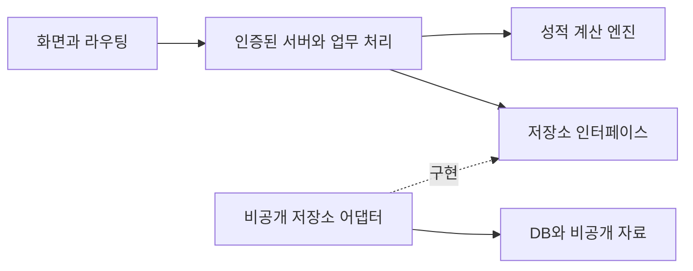

# 정시터치 3티어 개발구조

이 문서는 공통 명세 service_spec.json에서 생성한다. 현재 버전은 1.7.0이며 기획·라우팅·계층 문서를 같은 변경으로 갱신한다.

3티어는 화면·업무 처리·저장소의 책임과 접근 경계를 나눈다. 현재 계산 모듈의 경로를 보존하고 새 권한·저장소 인터페이스를 계층에 배치한다. 계층별 책임과 포트를 기준으로 구성하며 배포 환경과 실제 서버 연결 설정은 후속 구성이다.

## 계층과 의존 방향

| 계층 | 코드 위치 | 책임 | 허용 의존 |
| --- | --- | --- | --- |
| 프레젠테이션 | apps/web | 별도 프레젠테이션 작업자의 화면·입력·탐색·리포트 UI. 애플리케이션이 허용한 API 결과와 생성 경로 계약을 사용한다. | authorized_application_API |
| 애플리케이션 | src/jungsi_touch/application, src/jungsi_touch | 현재 개발팀의 서버 권한·검증·계산·API 계약과 애플리케이션 소유 공급/저장 포트. 프레젠테이션과 구체 Drive/DB 어댑터에 의존하지 않는다. | application_ports, domain_engine |
| 데이터와 인프라 | src/jungsi_touch/infrastructure, database | 현재 개발팀의 Google Drive API 공급/저장 어댑터와 DB 구조. 데이터팀의 정리 자료를 버전·검수 상태와 함께 연결하며 실제 값과 인증 설정은 Git 제외 영역에 둔다. | application_ports |

애플리케이션은 구체 DB 어댑터를 가져오지 않고 자신이 정의한 포트에 의존한다. 인프라가 포트를 구현한다. 프레젠테이션은 허용된 API 결과만 표시하며 Python 엔진·DB 비밀값·전체 환산표·곡선·모델을 포함하지 않는다.

## 커밋된 코드와 새 기반

| 파일 | 계층 | 현재 상태 | 요구사항 |
| --- | --- | --- | --- |
| src/jungsi_touch/percentile.py | application | 공통 계산 기반 | REQ-02, REQ-07 |
| src/jungsi_touch/year_equating.py | application | 공통 계산 기반 | REQ-06 |
| src/jungsi_touch/university_conversion.py | application | 공통 계산 기반 | REQ-05, REQ-06 |
| src/jungsi_touch/admission_result_percentile.py | application | 공통 계산 기반 | REQ-08 |
| src/jungsi_touch/application/authorization.py | application | server_policy_connected_by_HTTP_session_adapter | REQ-14 |
| src/jungsi_touch/application/ports.py | application | 저장소 인터페이스 | REQ-14, REQ-15, REQ-02, REQ-12 |
| src/jungsi_touch/infrastructure/memory_report_repository.py | data_infrastructure | 합성 검산 전용 어댑터 | REQ-14, REQ-15 |
| apps/web/route_catalog.json | presentation | 라우팅 계약; 웹 실행 앱 연결 전 | REQ-01, REQ-02, REQ-03, REQ-04 |
| src/jungsi_touch/application/overall_analysis.py | application | stateless_engine_connected_by_persisted_workflow_and_HTTP | REQ-02, REQ-07, REQ-12, REQ-14, REQ-15 |
| src/jungsi_touch/application/platform.py | application | implemented_synthetic_verified_live_configuration_pending | REQ-01, REQ-02, REQ-03, REQ-04, REQ-10, REQ-11, REQ-13, REQ-14 |
| src/jungsi_touch/application/platform_ports.py | application | implemented_synthetic_verified_live_configuration_pending | REQ-12, REQ-14, REQ-15, REQ-19 |
| src/jungsi_touch/application/sessions.py | application | implemented_synthetic_verified_live_configuration_pending | REQ-14, REQ-15 |
| src/jungsi_touch/application/time_contract.py | application | implemented_synthetic_verified_live_configuration_pending | REQ-12, REQ-14, REQ-15 |
| src/jungsi_touch/application/offering_analysis.py | application | implemented_synthetic_verified_live_configuration_pending | REQ-05, REQ-06, REQ-07, REQ-08, REQ-09, REQ-12 |
| src/jungsi_touch/application/publication.py | application | implemented_synthetic_verified_live_configuration_pending | REQ-11, REQ-14, REQ-17, REQ-19 |
| src/jungsi_touch/infrastructure/http_api.py | data_infrastructure | implemented_synthetic_verified_live_configuration_pending | REQ-01, REQ-02, REQ-03, REQ-04, REQ-14, REQ-15, REQ-18 |
| src/jungsi_touch/infrastructure/postgres_repository.py | data_infrastructure | implemented_synthetic_verified_live_configuration_pending | REQ-10, REQ-11, REQ-14, REQ-15, REQ-17 |
| src/jungsi_touch/infrastructure/supabase_session.py | data_infrastructure | implemented_synthetic_verified_live_configuration_pending | REQ-14, REQ-15 |
| src/jungsi_touch/infrastructure/drive_provider.py | data_infrastructure | implemented_synthetic_verified_live_configuration_pending | REQ-01, REQ-06, REQ-12, REQ-13, REQ-15, REQ-17, REQ-19 |
| src/jungsi_touch/infrastructure/settings.py | data_infrastructure | implemented_synthetic_verified_live_configuration_pending | REQ-15, REQ-19 |
| database/migrations/001_pre_data_platform.sql | data_infrastructure | additive_schema_prepared_not_applied_to_live_DB | REQ-10, REQ-11, REQ-14, REQ-15, REQ-17 |
| src/jungsi_touch/application/university_scoring.py | application | accepted_on_develop_synthetic_verified_live_rules_configuration_pending | REQ-05, REQ-06, REQ-12, REQ-14 |
| src/jungsi_touch/application/university_percentile.py | application | implemented_synthetic_verified_live_curve_publication_pending | REQ-05, REQ-06, REQ-08, REQ-12, REQ-14 |
| src/jungsi_touch/reported_score_mapping.py | application | reported_mapping_derivation | REQ-02, REQ-05, REQ-06, REQ-07, REQ-12, REQ-14, REQ-15, REQ-16 |
| src/jungsi_touch/estimated_profiles.py | application | candidate_profiles | REQ-02, REQ-05, REQ-06, REQ-07, REQ-12, REQ-14, REQ-15, REQ-16 |
| src/jungsi_touch/estimated_fitting.py | application | entropy_soft_reference | REQ-02, REQ-05, REQ-06, REQ-07, REQ-12, REQ-14, REQ-15, REQ-16 |
| src/jungsi_touch/estimated_validation.py | application | independent_validation | REQ-02, REQ-05, REQ-06, REQ-07, REQ-12, REQ-14, REQ-15, REQ-16 |
| src/jungsi_touch/estimated_curves.py | application | exact_aggregation | REQ-02, REQ-05, REQ-06, REQ-07, REQ-12, REQ-14, REQ-15, REQ-16 |
| src/jungsi_touch/application/estimated_population.py | application | private_workflow_and_server_adoption | REQ-02, REQ-05, REQ-06, REQ-07, REQ-12, REQ-14, REQ-15, REQ-16 |
| src/jungsi_touch/infrastructure/private_estimation.py | data_infrastructure | private_append_only_adapters | REQ-02, REQ-05, REQ-06, REQ-07, REQ-12, REQ-14, REQ-15, REQ-16 |

기존 src/jungsi_touch 루트 계산 모듈은 애플리케이션의 엔진 라이브러리다. 경로를 옮겨 기존 사용자를 깨뜨리지 않는다. 새 application과 infrastructure를 통해 입출력·소유권·저장소를 연결한다. 메모리 어댑터는 합성 검산 전용으로 운영 연결을 의미하지 않는다.

## 데이터와 기술 결정

실제 원자료·학생 성적·입결·환산표·곡선·모델과 .env 계열은 모든 브랜치에서 제외한다. database에는 DB 구조·마이그레이션 코드만 둘 수 있다. FastAPI·Supabase PostgreSQL을 채택했다. UTC aware/timestamptz와 date를 구분하고 서버는 환경 설정만 읽는다. 실제 연결 설정·자료 승인·운영 배포는 대기다.

## 구현과 운영 연결

FastAPI 12개 경로와 업무 서비스·Supabase/Drive 어댑터를 구현했다. 코드 합성 검증과 실제 운영 연결은 구분한다. [API DTO 계약](API_DTO_계약.md)과 [백엔드 운영 준비](백엔드_운영준비.md)를 함께 읽는다. 각 단계는 승인된 자료가 없는 값을 사유와 함께 보류한다.

## 계층별 담당과 브랜치

기획 정본은 시스템기획팀이 develop에서 직접 관리·배포한다. 실제 개발은 시스템·콘텐츠 담당과 프레젠테이션 담당 두 명이 각각 하나의 상시 브랜치를 재사용한다. 다른 팀은 develop의 기획을 가져가 담당 브랜치에서 구현하고 PR로 누적한다.

| 담당 영역 | 작업자 | 코드와 문서 위치 | 브랜치 |
| --- | --- | --- | --- |
| 공통 기획 | 시스템기획팀 | docs/current/service_spec.json, scripts/check_project_consistency.py | develop |
| 프레젠테이션 | 별도 프레젠테이션 작업자 | apps/web | feature/presentation-foundation (상시); 등록된 presentation_task만 하위 작업 |
| 애플리케이션 | 시스템·콘텐츠 개발 담당 / 현재 개발팀 | src/jungsi_touch/application, src/jungsi_touch | feature/application-pre-data-platform |
| 데이터와 인프라 | 시스템·콘텐츠 개발 담당; 데이터팀은 비공개 자료 정리 담당 | src/jungsi_touch/infrastructure, database | feature/application-pre-data-platform |

시스템기획팀은 develop의 현재 HEAD와 원격 동기화 상태를 확인하고 기획 정본을 검증·공유한다. 서버 개발팀과 별도 프레젠테이션 담당은 최신 origin/develop의 기획 기준과 출발 SHA를 확인하고 각자의 기존 작업 브랜치를 재사용한다. 다른 작업자의 미커밋 변경을 기준으로 삼지 않는다.

시스템기획팀만 develop에서 기획·공통 관리 설정을 직접 관리한다. 시스템·콘텐츠 개발자는 feature/application-pre-data-platform, 화면 개발자는 feature/presentation-foundation을 상시 재사용한다. 다른 팀은 develop에서 직접 구현하지 않고 담당 브랜치의 PR로 누적한다. 3티어는 폴더·포트·의존 관계로 구분한다. 하위 작업은 필요 시 부모·담당·사유를 정본에 등록하며 작업 항목이나 에이전트마다 생성하지 않는다. 상시 시스템/화면 브랜치의 통합 대상은 develop이고, 하위 개발 작업은 등록된 직계 부모에 먼저 통합한다. main에는 작업이 모두 끝나고 최종 검증·인계가 정리된 develop만 PR로 반영하며 라이브 배포는 별도 승인한다.

현재 개발팀의 기존 브랜치는 feature/application-pre-data-platform이다. 화면 작업자는 feature/presentation-foundation를 화면 담당의 상시 브랜치로 재사용한다. feature/presentation-foundation은 화면 담당의 상시 브랜치다. PR #7은 여기에 병합됐고 #9는 종료됐으며 그 head가 상시 화면 HEAD에 포함되어 있다. 열린 PR #6으로 develop 통합/검토가 남아 있다. 두 종료 임시 ref는 보존하며 새 작업에 재사용하지 않는다. 열린 session.read 제안 PR #5는 develop의 공통 계약 검토용 임시 노드이고 확정 전 운영 계약으로 간주하지 않는다.

route_catalog.json과 생성 README/현재 문서는 직접 편집하지 않는다. 계약 변경은 service_spec.json과 생성 도구에서 수정하고 생성 결과를 같은 커밋에 포함한다.

두 개발 담당은 origin/develop의 같은 커밋에 있는 service_spec과 생성 문서를 가져가 구현한다. 계약·필드·오류/보류 사유가 바뀌면 시스템기획팀과 해당 계층 담당에게 인계한다. 통합되지 않은 feature의 코드·가상 응답을 develop에 구현된 기능으로 기록하지 않는다.

Git 변경 범위와 해당 계약·필수 커밋 검산을 확인한다. 원자료 전수검수나 전국 재집계를 매 개발 작업에서 반복하지 않는다.

## Google Drive 폴더 API 연동

Google Drive API 고정 폴더·파일 버전/해시·승인 읽기와 별도 결과 폴더 멱등 새 파일 쓰기 어댑터를 구현했다. 실제 계정·폴더·승인 자료·토큰 갱신·읽기/쓰기 검증은 설정 대기다.

프레젠테이션 → 우리 서비스 API → 애플리케이션 포트 ← Drive API 어댑터 → 비공개 Google Drive 폴더

애플리케이션은 자신이 정의한 포트에 의존한다. Drive API 호출·파일 변환·인증·재시도는 인프라 어댑터가 담당하며 전체 원자료와 인증값을 학생 응답에 넣지 않는다.

화면은 우리 서비스의 허용 API 결과만 이용한다. Google Drive API·폴더·토큰·전체 원자료에 직접 접근하지 않는다.

### 읽기와 쓰기

서버에 설정한 입력 폴더와 발행 버전만 읽는다. 파일 식별자·자료 버전·내용 해시·학년도/시험·출처·검수 상태를 연결하며 단순 최신 수정 파일을 승인 데이터로 자동 채택하지 않는다.

서버에 설정한 결과 폴더로 새 산출 파일 또는 새 버전을 기록한다. 원본·이전 버전은 보존하고 삭제·휴지통 이동·동기화 정리는 수행하지 않는다. 사용자 성적과 공개 산출물의 접근 범위를 구분한다.

실제 폴더 ID·인증 계정·키/토큰·자료·입결·곡선·모델·검수 결과는 Git 제외 설정/폴더 또는 비공개 저장소에 둔다. 코드에는 어댑터와 자료 형식 계약만 둔다.

파일·버전·권한·검수 상태가 준비되지 않으면 데이터 대기 또는 오류 사유를 반환한다. 다른 시험·연도·미승인 모형으로 대체하지 않는다.

### 남은 설정

- 실제 입출력 폴더·서버 계정 권한·OAuth와 갱신 설정
- 비공개 발행 명부/승인 자료 값과 형식 호환 검수
- 실제 읽기/쓰기·재시도/충돌·감사와 사용자 접근 검수

## 대학별 수능 환산 연결

[대학별 수능환산 엔진](대학별_수능환산_엔진.md)을 따른다. 구현 상태는 accepted_on_develop_synthetic_verified_live_rules_configuration_pending다. conversion.ready와 assessment.pending은 함께 존재할 수 있다. 대학 분포·입결·지원 판단·자격 미확인은 각각의 사유로 보존한다. 프레젠테이션은 독립 conversion 결과와 후속 지원 판단 상태를 표시하며 계산/조회표를 구현하지 않는다.

## 대학별 누백 연결

[대학별 누백 계산](대학별_누백_계산.md)을 따른다. 구현 상태는 implemented_synthetic_verified_live_curve_publication_pending다. conversion.ready / percentile.ready / assessment.pending은 함께 존재할 수 있다. conversion.ready / percentile.pending도 가능하며 환산 성공을 보존한다. 누백 준비만으로 지원 판단·자격·유불리를 승인하지 않는다. 프레젠테이션은 학교 환산 기준 상위 누백과 동점·자료 기준을 표시한다.

## 자체 추정분포 연결

[자체 추정분포 개발](자체_추정분포_개발.md)을 따른다. 상태는 integrated_on_develop_generic_engine_and_private_pilot_verified다. 제공된 공식 시험 자료의 주변도수와 응시/선택 조건, 비교 가능한 참고 총점 곡선을 이용해 공동 성적 조합과 가중치를 자체 추정한다. 이는 전체 학생 실제 점수를 복원했다는 의미가 아니며 실제 도수·관측 분포와 구분한다. 전체 학생의 실제 공동 성적 DB 부재는 작업 중단 조건이 아니다. 전체 누백은 overall.status=estimated, 대학 누백은 percentile.data_kind=estimated_weights로 구분한다. 기존 API 권한·시험 결속·애플리케이션 소유 포트와 프레젠테이션 담당을 유지한다.

<!-- jungsi:generated spec_sha256=824390686ae071bae1525a9f4915573b59cf07fd5bd48fa05c6945325ebca88b -->

## 학과별 예상 기준 산출과 관리

현재 상태: approved_for_implementation

[작업 항목](../../docs/work_items/DEV-007-forecast-policy.json)

### requirements

- REQ-21
- REQ-22

### placement

계산은 src/jungsi_touch/forecasting.py, 업무·포트는 application, SQL/Drive/JSON 어댑터는 infrastructure와 database. 화면은 우리 HTTP API만 호출한다.

### atomic_unit

학년도·대학·캠퍼스·모집단위·전형·모집군이 결속된 offering_id. 학교는 필터·권한 범위이며 학과로 동일 판단을 복사하지 않는다.

### input_rules

- 서버 승인 입력·정책 ID와 version을 결속한다. 클라이언트에서 원자료·원점수·모형 상태·작성자·승인자·회원 역할을 신뢰하지 않는다.
- 2024~2026 동일 입결 지표의 원값과 비교값을 분리한다. 동일 지표 정의·단위·공통 척도·모집단과 승인된 4개년 모집행 연결/연도 변환 영수증이 필요하다.
- 대학 환산 원점수와 표준점수를 연도 간 직접 회귀하지 않는다. 70%컷 한 점을 학생용 과목 보정 함수에 넣지 않는다.
- 예상70%와 판단용 합격권은 각각 별도의 승인 근거/자료 요건이다. 한쪽 미준비 시 준비된 결과를 유지한다. 70%만으로 최저점·합격확률을 생성하지 않는다.
- 각 정책의 min_years, 허용 비교 척도, 출력 단위/범위/표시 정밀도, 기준/폭/가중치와 검산 근거를 명시한다. 합성 수치를 운영 기본값으로 사용하지 않는다.
- 올해 모집/반영 변화는 사실과 상담 가설, 근거, 중복 관련 이슈를 구분한다. 수치 효과가 미확인인 이슈는 null이며 임의 +점/%p로 적용하지 않는다.

### calculation_methods

- latest_comparable
- weighted_mean
- linear_trend

### method_rules

- 정확한 유리수 계산 후 정책 지정 위치에서만 표시 반올림한다. 연도와 가중치 정합/합계, 연속성, 최소 자료 수를 검사한다.
- linear_trend는 승인된 공통 척도 비교값의 연도별 최소제곱 추세다. 적용 여부/추세 상한/대상 연도는 명시 정책이며 회귀 오차를 합격확률이나 95% 신뢰구간으로 명명하지 않는다.
- 판단용 구간은 별도 calibration 근거와 정책에서 생성하며 경계 [lower,upper), 비중복, 허용 category를 검증한다. 단위와 higher/lower 방향을 검사한다.

### state_flow

- draft
- validated
- approved
- published

### authority_rules

- ForecastAuthorityRepository의 editor/approver와 허용 university_ids를 사용한다. 유료 등급이나 Supabase user_metadata로 관리 권한을 부여하지 않는다.
- 편집과 승인은 별도 capability이다. 정책 require_independent_approver=true이면 작성/조정자와 다른 승인자가 필요하다. false인 명시 정책과 두 capability가 있으면 개인 운영자의 승인도 가능하다. 누락 정책은 자동 false로 채택하지 않는다.
- 미허용 관리 기능은403; 조회 범위 밖 draft는 존재하지 않는 draft와 동일404이다. 클라이언트는 status/역할/작성자/승인자/검증 통과값을 지정하지 않는다.

### revision_rules

- 모든 POST는 Idempotency-Key를 요구한다. 생성 이후 expected_revision/base_result_hash/policy_version을 결속한다.
- 조정은 reason과 server-verified evidence_refs, 동일 단위의 명시 replacement를 새 revision으로 저장한다. 기본값과 이전 revision을 보존하고 조정이 재시도마다 더해지지 않는다.
- 조정은 검증/승인 승계를 해제한다. 검증/승인 hash는 정확한 채택값과 revision/자료 버전에 결속한다.
- 현재 자료/정책/카탈로그/규칙/곡선 변경과 동시 수정은409이며 미검증·미승인 값을 발행하지 않는다. 발행은 새 불변 release를 보존한다.

### public_fields

- forecast_release_version
- basis_summary
- issue_summaries
- recommendation_reasons
- adjustment_summary

### reason_rules

- 확인된 대학 반영 방법과 해당 학생 계산 결과/위치 및 학과 판단의 설명만 공개한다. 내부 전체trace·계수표·곡선·가중치·담당자 ID를 공개하지 않는다.
- 추천 이유는 {code,text,evidence_refs}로 서버가 생성한다. 정책 추세 근거와 학생 유불리 설명을 구분하고 확인되지 않은 인과를 확정 표현하지 않는다.

### acceptance

- 원점수/연도/지표/단위/집단 혼용 거부; 최소 자료/정책 부재와 미확인 이슈 null 보존
- 예상70%와 합격권 독립 상태 및 독립 환산/누백 성공값 보존
- 편집/승인 범위·위조 역할·자기 승인 정책·동시 수정·정확 해시·멱등 재시도·새 revision 검증
- 새 공개 근거가 3/4페이지에 연결되고 학생에게 내부 자료가 노출되지 않음

### remaining

- 실제 자료의 비교값·연도 보정·정책별 숫자와 근거 승인
- 실제 Supabase/DB/Drive 설정 및 운영 마이그레이션·발행 검증
- 전국 대학 산출 정확도·예측 성능 검증

### scope_excludes

- 리포트/인쇄 확장
- 학생별 개별 수동 판정
- 군별 지원 조합
- 실제 입결 수집/정본 변경
- 실제 대학 지원자 확률
- 라이브 배포

## 성적 분석 화면과 실제 세션 연결

현재 상태: approved_for_implementation

[작업 항목](../../docs/work_items/DEV-006-analysis-connection.json)

### source_commit

01b8fe6461ad60c10649f07349f796b00051d903

### authentication

- 같은 Supabase 프로젝트/쿠키를 @supabase/ssr로 읽고 refresh를 쿠키 쓰기 가능 경계에서 처리한다.
- 화면은 access token을 HTTP Authorization으로 전달하고 사용자 신원·회원 등급은 우리 API에서 검증한다. 서비스 권한을 클라이언트에서 변경하지 않는다.
- Supabase publishable key와 URL만 Auth client에 사용하고 운영 DB/내부 엔진/비공개 저장소에 접근하지 않는다.
- 회원 개인 응답과 token refresh 응답은 no-store/private이며 다른 사용자의 CDN 캐시로 공유하지 않는다.

### display_rules

- conversion/percentile/assessment의 준비 상태를 각각 표시한다. 판정 pending만으로 성공 환산/누백을 숨기지 않는다.
- observed_counts와 estimated_weights의 의미를 표시하고 전체 국수탐2/규칙 필수입력 비교집단의 차이를 명시한다.
- 동점 구간 {lower,upper}, UTC Z 시각의 서울 표시, 실제 수능/모평/연도보정 추정을 구분한다.
- 3페이지 전체 유료 검색을 유지하고4페이지 학과별 도전/핵심/여유/보류 및 와일드카드에서 근거를 표시한다.
- 관리 화면은 소비자 4개 탭과 분리하고 서버 관리 capability/허용 학교로 생성·검증·조정·승인·발행을 수행한다.

### mode_rules

- 합성 모드는 명시적 synthetic 설정만 사용하며 실서버 실패에서 자동 합성 대체하지 않는다.
- 미설정 운영 연결은 설정/연결 대기로 표시하고 일반회원 또는 가짜 점수로 대체하지 않는다.

### official_sources

- https://supabase.com/docs/guides/auth/server-side/creating-a-client
- https://nextjs.org/docs/app/api-reference/file-conventions/proxy

### acceptance

- 실제 어댑터의401/403/404/409/503와 권한 상태
- 불완전 판정에서도 독립 환산/누백·추정/집단 표시
- 관리 업무의 요청 형식·변경 충돌·서버 거부 표시
- TypeScript·lint·명시적 합성/HTTP 연결 검사

### remaining

- 운영 Supabase/백엔드 설정과 기존 에듀터치의 동일 프로젝트/쿠키 배포 설정 확인
- 실제 계정/이용권/관리 capability의 전체 연결 검증

### scope_excludes

- 리포트/인쇄 확장
- 라이브 배포

