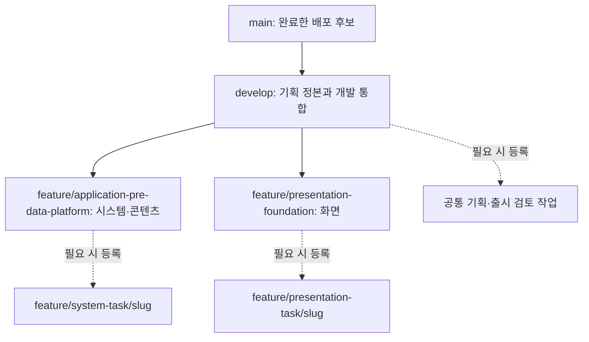

# 정시터치 개발 브랜치와 문서 운영

이 문서는 공통 명세 service_spec.json에서 생성한다. 현재 버전은 1.9.72이며 기획·라우팅·계층 문서를 같은 변경으로 갱신한다.

main은 모든 작업 완료 후 최종 코드·문서·검증·인계를 정리하는 라이브 배포 전 후보다. develop은 시스템기획팀의 현재 문서 공유와 두 개발 담당의 PR 통합 환경이다. 시스템·콘텐츠와 프레젠테이션 개발은 각각 하나의 상시 브랜치를 사용한다. 과거 기획·시안은 이력으로 보존한다.

## 브랜치 흐름

담당 임시 작업 → 해당 상시 개발 브랜치 → develop → 최종 정리·검증 PR → main → 별도 승인한 라이브 배포

초기 기반을 main에 넣었던 부트스트랩 예외는 종료됐다. 이후 main은 전체 완료·정리·검증한 develop의 배포 후보만 PR로 받으며, main 병합 자체가 라이브 배포를 뜻하지 않는다.

## 기본 4개 노드와 담당

| 브랜치 | 직접 담당 | 부모/PR 대상 | 관리 목적 |
| --- | --- | --- | --- |
| main | 시스템기획팀 최종 정리; 두 개발 담당 검토 | 최상위 배포 후보 | 전체 작업 완료 후 코드·문서·검증·인계 자료를 정리한 배포 후보. 라이브 적용은 별도 승인. |
| develop | 시스템기획팀 직접 문서 관리; 개발 담당 PR 통합 | main | 현재 개발 환경과 확정 기획의 공유 정본. 다른 팀의 구현은 PR로 누적. |
| feature/application-pre-data-platform | 시스템·콘텐츠 개발 담당 1인 / 현재 개발팀 | develop | 시스템·콘텐츠 계약, 애플리케이션, 엔진, 인증/API, DB·Drive 인프라. 기존 이름을 상시 재사용. |
| feature/presentation-foundation | 프레젠테이션 개발 담당 1인 / 별도 화면 작업자 | develop | 화면 구성·입력·이동·노출·인쇄와 허용 API 표시. PR #6의 head와 이름 보존. |



위 화살표는 출발/관리 관계다. 구현 PR은 하위 작업에서 부모로 올라간다. Git 브랜치는 네이티브 폴더 트리가 아니다. 이 문서의 부모는 출발 커밋과 PR 통합 경로를 뜻한다. 상시 브랜치명 뒤에 /를 붙인 하위 ref는 이름 충돌을 일으킬 수 있으므로 별도 task 접두어와 부모 등록을 사용한다.

기획팀은 develop의 service_spec.json·생성 문서와 브랜치/검사 설정을 직접 갱신한다. 다른 팀은 develop의 자료를 가져가 자기 상시 브랜치에서 개발하고 PR로 통합한다. 3티어는 코드와 포트의 구분이며 각 티어/작업/에이전트마다 브랜치를 만들지 않는다.

## 브랜치 등록부와 최신 통합 관측

정책 등록일 2026-10-04 (Asia/Seoul), 등록 기준 d666a5f2bdbc846c65b5503de35c17d6d90088db. 등록부의 상시 4개, 진행 임시 0개, 종료 이력 5개로 분류한다. 현재 원격 전체 ref 재조회 결과와 구분한다. 관측 커밋은 당시 증거이며 작업 브랜치의 미래 HEAD를 고정하는 값이 아니다.

최신 통합 관측일 2026-10-06, develop 3d90bc461c57102fc9ee8868cec7edac498470d4. root의 PR15 고정 head/CI2/GitHub merge 및 develop source 영수증 대조; 원격 전체 ref/main/server 재조회 아님

| 브랜치 | 분류/담당 | 부모와 PR 대상 | 현재 작업/근거 |
| --- | --- | --- | --- |
| feature/planning-presentation-contracts | retired_superseded; 화면 작업자의 계약 제안; 시스템기획팀 검토·정본 반영 | develop | 기존 PR #5: session.read·화면 기술 계약 제안. 미확정 계약을 현행 운영 구현으로 기록하지 않는다.; PR #5; 원격 ref: retained_closed_superseded_no_deletion_authorization |
| feature/presentation-favorable | retired_merged; 별도 프레젠테이션 작업자 | feature/presentation-foundation | 이전 PR7의종료/부모통합이력과원격ref는보존한다. 최신 PR15 source는develop3d90에merged/CI2확인됐으며원original347ancestor를새로주장하지않는다. 실browser·수치·권한·보안운영과FE-01R/FE-ORIGIN/FE-SOURCE-01은pending이다. 새개발은등록된상시부모를사용한다.; PR #7; 원격 ref: retained_finished_temporary_ref_no_deletion_authorization |
| feature/presentation-results | retired_integrated_closed; 별도 프레젠테이션 작업자 | feature/presentation-favorable | 이전 PR9의종료/부모통합이력과원격ref는보존한다. 최신 PR15 source는develop3d90에merged/CI2확인됐으며원original347ancestor를새로주장하지않는다. 실browser·수치·권한·보안운영과FE-01R/FE-ORIGIN/FE-SOURCE-01은pending이다. 새개발은등록된상시부모를사용한다.; PR #9; 원격 ref: retained_finished_temporary_ref_no_deletion_authorization |
| feature/overall-analysis-service | retired_merged; 현재 개발팀 / 과거 DEV-001 | 종료: 새 PR 금지 | develop 조상 및 진행 PR 없음 확인 후 사용자 허용 범위의 원격 참조만 삭제 완료. 새 작업 금지. 로컬 브랜치와 작업 파일은 보존. 사용자가 정확히 허용한 GitHub 원격 refs/heads/feature/overall-analysis-service만 삭제했다. develop의 커밋과 로컬 브랜치·파일·worktree·원격 추적 캐시는 보존한다.; 병합 PR #2; 원격 ref: deleted_2026-10-04_user_authorized_remote_ref_only |
| feature/planning-layer-ownership | retired_merged; 시스템기획팀 / 과거 소유권 기획 | 종료: 새 PR 금지 | develop 조상 및 진행 PR 없음 확인 후 사용자 허용 범위의 원격 참조만 삭제 완료. 새 작업 금지. 로컬 브랜치와 작업 파일은 보존. 사용자가 정확히 허용한 GitHub 원격 refs/heads/feature/planning-layer-ownership만 삭제했다. develop의 커밋과 로컬 브랜치·파일·worktree·원격 추적 캐시는 보존한다.; 병합 PR #3; 원격 ref: deleted_2026-10-04_user_authorized_remote_ref_only |

PR5closed·ref보존과PR6통합역사는유지한다. 최신PR15 ef7b7c08 exactCI2·develop3d90정상merge/삭제0·화면branch보존을확인했다. FE05빈학교fix는source통합됐으나 FE-01R/FE-ORIGIN/FE-SOURCE-01·실browser/권한/수치/보안운영은pending이다. 원격전체ref계수/등록부checked시각·main/server미재조회값은과거관측그대로이며새조회·삭제허가로확대하지않는다.

PR #5의 중복 제안은 종료됐고 head/ref는 보존한다. 정식 session.read 계약과 동적 경로 제목 검사는 현행 공통 도구로 계승했다. 화면 상시 브랜치 feature/presentation-foundation는 유지하며 PR6 head6b2는 develop2624에 통합됐다. 두 CI success는 해당6b head에 한정한다. 347 빈 학교 표시 fix는 develop 미포함이고 Retry-After 보완과 함께 FE-05 후속 PR/정확 fullSHA·CI·브라우저 증거가 필요하다. PR5 closed/superseded head/ref와 PR7/9 종료 이력은 보존한다. 서비스·DB PR13/develop947 인수 이력도 그대로다. 실Caller/화면·보안·승인 수치/운영 인수는 별도 pending/NOT_RUN이다. 종료 ref는 새 개발에서 제외하고 보존한다. 후속 PR 담당은 최신 develop과 충돌을 해결한 뒤 등록 부모에 통합한다.

기본 노드는 상시 4개뿐이다. 임시 작업은 등록 후 필요할 때만 만들며 종료 시 status=retired_merged와 병합 PR/커밋을 기록한다. 브랜치 ref·로컬 파일·worktree·캐시·잠금 파일 삭제는 자동화하지 않는다. 삭제 대상·범위를 사용자에게 명시해 허용받기 전 보존한다.

## 필요한 하위 작업만 등록

| 필요 시 이름 | 부모/PR 대상 | 담당 | 생성 사유 |
| --- | --- | --- | --- |
| feature/system-task/<slug> | feature/application-pre-data-platform | 시스템·콘텐츠 개발 담당 | 독립 리뷰·충돌 분리 등 분리가 필요한 개발 작업 |
| feature/presentation-task/<slug> | feature/presentation-foundation | 프레젠테이션 개발 담당 | 독립 리뷰·화면 병렬 작업 등 필요한 분리 |
| feature/planning-task/<slug> | develop | 시스템기획팀 | 공통 계약 제안·별도 문서 검토 |
| feature/release-task/<slug> | develop | 시스템기획팀과 두 개발 담당 | 배포 전 종합 검증·문서 정리. main으로 직접 우회하지 않음 |

새 하위 브랜치 생성 전 시스템기획팀이 develop 정본의 additional_branches에 name·kind·owner·parent·pr_target·status·temporary=true·purpose·base_commit을 기록한다. 출발 SHA는 부모의 실제 커밋이어야 한다. 최초 생성 후 부모 변경은 협의해 명세와 PR base를 함께 갱신한다. 상시 노드뿐 아니라 같은 담당의 등록 임시 노드 아래에도 꼭 필요하면 작업을 등록할 수 있다. allowed_parent_kinds가 허용한 부모 역할만 사용하며 직계 부모를 건너뛰지 않는다.

각 노드에서 분리가 필요한 작업을 제안할 수 있다. main 배포 검토 작업도 develop의 release_task에서 정리해 develop으로 먼저 올리고, 최종 develop → main 경로를 유지한다. 임시 작업이 없으면 상시 브랜치 하나를 계속 사용한다.

## 작업 시작·동기화·PR

origin/develop의 최신 기획·HEAD를 확인해 자기 상시 브랜치에 일반 merge로 가져온다. 충돌은 해당 담당이 현재 공통 명세와 코드 변경 범위로 해결한다. 다른 체크아웃을 reset하거나 원자료를 재집계하지 않는다.

임시 개발 작업은 등록된 직계 부모에 먼저 PR한다. 일반적으로 부모는 담당 상시 브랜치이며 기존 PR #9처럼 등록한 임시 부모가 있으면 그 단계를 따른다. 상시 시스템/화면 브랜치는 develop에 PR한다. 최종 main PR은 develop에서만 연다. GitHub 병합은 merge commit으로 수행해 상시 브랜치의 이력을 이어 간다.

develop의 기획/계약 최종 검토와 통합 조율은 시스템기획팀이 담당한다. 두 개발자는 담당 브랜치에서 작업한다. 계약 변경에는 작업 요구사항·API·DTO·소유권·계층과 변경 검증을 같은 커밋에 포함한다. 상시 브랜치 간 직접 병합으로 develop을 우회하지 않는다. REQ-24~26·보안 개발기준은 모든 구현의 필수 참조이며 보안 gate/operation/증거 누락은 인수하지 않는다.

```text
git status --short --branch
git fetch --no-prune origin
git rev-parse origin/develop
# 담당 상시 브랜치에서 기획을 가져온다
git merge --no-edit origin/develop
# 하위 작업 PR: base는 등록된 parent
# 상시 시스템/화면 PR: base=develop
# 전체 인수 완료 후 최종 PR: head=develop, base=main
```

GitHub 병합은 merge commit만 허용하고 squash/rebase 병합과 병합 후 자동 브랜치 삭제를 끈다. 상시 브랜치의 이력이 이어지고 통합 뒤 다시 같은 브랜치에서 개발할 수 있다. 미커밋 변경이 있으면 먼저 보존·검토하고 강제 checkout/reset/clean 없이 진행한다.

## develop 직접 변경 범위와 적용 검사

| 검사 지점 | 검사/실제 한계 |
| --- | --- |
| local | pre-commit은 등록·활성 브랜치와 파일 삭제 금지를 검사한다. develop은 planning 선언 및 허용 문서/관리 경로만 직접 stage할 수 있다. pre-push는 main 직접 푸시·ref 삭제·non-fast-forward와 develop 범위 위반을 차단한다. 각 clone에서 훅 활성화가 필요하다. |
| CI | PR head/base를 정본의 부모 경로와 검사하고 planning task는 문서/관리 변경만 허용한다. push는 등록 브랜치·develop의 직접 커밋 범위·non-fast-forward를 검사한다. 모든 merge commit PR을 사용하며 이전 정책 도입 전 커밋은 새로운 시행 커밋 이전 이력으로 보존한다. |
| limits | 현재 비공개 GitHub 요금제의 보호 API는 403이다. 원격 권한·PR 승인·검사 통과를 서버에서 강제할 수 없다. 로컬 planning 선언은 신원 인증이 아니며 훅 우회/API 직접 변경을 기술적으로 막지 못한다. CI 실패는 반영 자체를 되돌리지 않으므로 시스템기획팀이 결과를 확인한다. |

기획팀의 직접 허용 범위는 docs/·.github/·.githooks/와 아래 공통 관리 파일, 생성된 현재 문서/카탈로그/README다. 업무·화면 실행 코드·DB 마이그레이션·런타임 잠금은 담당 개발 PR로만 누적한다.

- README.md
- AGENTS.md
- .gitignore
- .gitattributes
- scripts/check_project_consistency.py
- scripts/check_branch_policy.py
- tests/test_branch_policy.py
- tests/test_project_consistency.py
- tests/test_ci_snapshot_preservation.py
- tests/test_deletion_approval.py
- tests/test_session_contract.py
- scripts/audit_documentation_sync.py
- tests/test_documentation_sync.py
- docs/current/code_routing_index.json
- scripts/check_edge_contract.py
- scripts/run_edge_tests.py
- tests/test_edge_harness.py
- tests/test_edge_source_scope.py
- scripts/edge_source_scope.py
- scripts/run_committed_tests.py
- scripts/bootstrap_edge_runtime.py
- tests/test_edge_runtime_supply.py
- edge-runtime.lock.json

기획팀은 현재 셸 세션에서만 아래처럼 역할을 선언한다. .env 파일을 만들거나 GitHub 인증정보를 기록하지 않는다. JUNGSI_TEAM=planning (해당 셸 세션에만 설정; 신원 인증이나 GitHub 권한 분리는 아님).

```powershell
$env:JUNGSI_TEAM = "planning"
python -B scripts/check_branch_policy.py --staged
```

## main 최종 반영과 라이브 적용

현재 release_gate.state=not_ready. 전체 작업 완료와 최종 자료 정리가 확인될 때에만 ready로 바꾸고 각 항목에 증거 경로/PR/커밋을 남긴다. main 병합 후에도 라이브 배포 승인은 별도다.

| 최종 인수 항목 | 상태 | 확인할 증거 |
| --- | --- | --- |
| system_contracts | passed | 정식22 API/session/forecast 서비스·DB 계약은493개 정상Git스냅샷 검사와PR13/develop947cee8 CI를 거쳐 인수·통합완료. 실제로그인/이용권/DB/Drive와외부프런트는다른pending gate로분리한다. |
| presentation | pending | PR15 ef7b7c08/CI2·develop3d90통합·삭제0/branch보존은source인수다. FE-01R/FE-ORIGIN/FE-SOURCE-01·실browser/유효action·권한/전달물·실429/숫자·보안gate는pending이다. |
| live_connections | pending | SQL001002003/fresh권한metadata·UTC/타입·master명시port와합성10행별도process지속성은제한PASS다. 기본factorylegacy유지·실JWT/유료rows·livehost/승인자료/Drive·22API/security운영은미인수다. |
| approved_data | pending | 승인 자료/모형 공급 및 실제 결과 검수 대기. GitHub에 실제 데이터 업로드하지 않음 |
| release_validation | pending | 최종 develop SHA의 문서·경로·계층·데이터 제외·CI 및 통합 검증 필요 |
| handoff | pending | 최소자료staged/보류·app/owner배포설정경계와직접인간기본경로유지결정을기록했다. backup/restore·실권한/자료활성화·후보sameSHA/CI·별도배포승인은pending이다. |
| security_response_artifacts | pending | 모든 역할 HTTP 응답과 실제 외부 화면 빌드/브라우저 노출 검수 NOT_RUN |
| security_direct_authorization | pending | 서버 중계·실세션/이용권·소유권·관리 범위와 직접 접근 거절 NOT_RUN |
| security_harvest_controls | pending | 공유 원자적 예산·무료 누백/paid 후보·동시성/재시작/429 검수 NOT_RUN; 운영 숫자 승인 필요 |

최종 PR에는 배포 후보 develop SHA·문서/계약 버전·CI/통합 검증·실제 연결 검수·운영/복구 인계 근거를 담는다. 모든 체크가 passed이고 증거가 있을 때만 ready로 확정한다. main 병합 뒤 별도 승인한 배포를 실행한다. 기능 완료·합성 테스트 성공만으로 실제 데이터와 라이브 준비 완료를 표시하지 않는다.

현재 기준의 출발 커밋은 87dba635ebc5119e53e9c7e3c5f456636a9c50e9이다. 작업 시작 시 현재 브랜치·HEAD·변경 목록을 확인한다. 커밋하지 않은 다른 작업자의 코드나 로컬 전용 검수 결과를 구현의 확정 기준으로 취급하지 않는다.

## 한 변경에 포함할 내용

요구사항과 페이지/API 경로를 공통 명세에 반영하고 해당 계층의 코드를 수정한다. 문서와 경로 카탈로그를 생성하고 검사·검산한 뒤 같은 커밋으로 올린다. 코드·공유 도구·워크플로·테스트 변경이 있으면 공통 명세와 현재 기획·라우팅 문서가 같은 변경 목록에 있어야 한다. 변경 메모에 실제 구현 범위를 기록한다. develop에서 검증한 PR만 main에 반영한다. main 반영 후에도 develop을 통합 개발 기준으로 유지한다.

## 문서 생성과 검사 명령

```text
python -B scripts/audit_documentation_sync.py --sync
# 검토한 이번 작업 파일만 경로를 명시하여 stage
git add -- <reviewed-work-item-paths>
python -B scripts/check_project_consistency.py --staged
python -B scripts/run_committed_tests.py --staged
```

검산은 선택한 Git 인덱스 또는 커밋의 파일을 새 outputs 폴더에 복사해서 실행한다. 커밋하지 않은 코드와 제외된 실제 데이터 의존 테스트를 섞지 않는다. 기존 파일·검산 폴더를 정리하거나 삭제하지 않는다.

## 로컬 훅과 GitHub 검사

공통 문서·경로 계약·훅·새 계층 코드의 줄바꿈은 .gitattributes에서 LF로 고정해 Windows와 CI의 바이트 검사를 일치시킨다. 각 체크아웃에서 git config --local core.hooksPath .githooks를 설정한다. Python 경로가 필요하면 git config --local jungsi.python으로 실행기를 지정한다. pre-commit은 등록 브랜치·develop 직접 범위·파일 보존과 스테이징된 문서·코드·데이터 제외·합성 테스트를 검사한다. pre-push는 main 직접 푸시·ref 삭제·강제 갱신·develop 직접 범위를 차단한다. GitHub Actions의 검사 이름은 project-consistency다.

GitHub는 현재 비공개 저장소 보호 조회에 HTTP 403과 요금제 업그레이드 요구를 반환했다. 따라서 원격 PR·검사 통과 강제 보호는 활성화되지 않았다. 로컬 훅은 각 체크아웃에 적용되며 서버의 강제 보호와 같지 않다. 보호 지원 요금제에서 main에 PR·검사 통과, 강제 푸시·브랜치 삭제 금지 규칙을 적용한다. 저장소 비공개 상태는 유지한다.

## 파일을 보존하는 CI 스냅샷

| 항목 | 실행 기준 |
| --- | --- |
| runner | GitHub-hosted ubuntu-24.04의 사전 설치 Git/CPython 3.12를 사용하고, Deno 2.9.7은 고정 공식 아카이브를 새 outputs/ci_edge_runtime에 명시적으로 공급한다. checkout/setup-python/외부 설치 액션·시스템 설치·최신 버전 대체는 사용하지 않는다. |
| destination | GITHUB_WORKSPACE/retained_snapshots/run_<run_id>_attempt_<run_attempt>가 존재하거나 symlink이면 중단한다. 새 비존재 경로만 생성하고 기존 경로·파일을 보존한다. |
| commit | git init 후 github.sha와 전체 부모 이력, refs/heads/develop 및 refs/heads/feature/presentation-foundation을 fetch한다. 두 origin tracking ref의 고정 SHA가 확인돼야 지정 github.sha를 최초 detached checkout한다. 각 HEAD/ref가 확보된 SHA와 다르면 실패한다. |
| credentials | GitHub token은 fetch subprocess의 GIT_CONFIG_* http extraheader 환경으로만 전달한다. argv/로그/파일과 init/checkout/test subprocess에는 전달하지 않는다. Git trace 및 외부 config 입력을 차단하며 실패는 원문 진단 없이 안전한 사유로 기록한다. |
| preservation | gc.auto=0, maintenance.auto=false와 fetch --no-auto-maintenance를 적용한다. clean/reset/drop/기존 경로 초기화/temp cleanup을 호출하지 않는다. 생성 runtime/다운로드/검산 스냅샷은 정리하지 않는다. |
| verification | 보존/ref/인증 범위 합성 검사를 포함한 b66의 정상 commit/push 훅 530건 PASS와 정확한 HEAD project-consistency CI success를 확인했다. 이후 문서 커밋의 미래 SHA/미실행 CI를 성공으로 기록하지 않는다. 기존 경로·출처 보존과 실제 운영/외부 프런트 미검증 경계는 유지한다. |

## 공유 실행 도구

- scripts/calculate_overall_percentile.py
- scripts/analyze_exam_score.py
- scripts/compare_year_scores.py
- scripts/demo_profile_percentile.py
- scripts/demo_school_screening.py
- scripts/demo_total_curve_principle_20260927.py
- scripts/import_kice_exam.py
- scripts/check_project_consistency.py
- scripts/run_committed_tests.py
- scripts/bootstrap_backend_runtime.py
- scripts/probe_backend_connection.py
- scripts/check_branch_policy.py
- scripts/audit_documentation_sync.py
- scripts/check_edge_contract.py
- scripts/run_edge_tests.py
- scripts/edge_source_scope.py
- scripts/bootstrap_edge_runtime.py

실제 모집표·매핑·상담자료가 든 나머지 작업 도구와 원자료 검증 결과는 로컬 전용이다. 새 공통 도구를 공유하려면 명세의 공유 목록과 .gitignore를 함께 갱신한다.

## 공식 설정 근거

[GitHub 브랜치 보호](https://docs.github.com/en/repositories/configuring-branches-and-merges-in-your-repository/managing-protected-branches/about-protected-branches)와 [Python 자동 검사](https://docs.github.com/en/actions/tutorials/build-and-test-code/python)를 참고한다.

## 계층별 담당과 브랜치

기획 정본은 시스템기획팀이 develop에서 직접 관리·배포한다. 실제 개발은 시스템·콘텐츠 담당과 프레젠테이션 담당 두 명이 각각 하나의 상시 브랜치를 재사용한다. 다른 팀은 develop의 기획을 가져가 담당 브랜치에서 구현하고 PR로 누적한다.

| 담당 영역 | 작업자 | 코드와 문서 위치 | 브랜치 |
| --- | --- | --- | --- |
| 공통 기획 | 시스템기획팀 | docs/current/service_spec.json, scripts/check_project_consistency.py | develop |
| 프레젠테이션 | 다른 PC의 프런트 전담 개발자 | apps/web | feature/presentation-foundation (상시); 등록된 presentation_task만 하위 작업 |
| 애플리케이션 | 시스템·콘텐츠 개발 담당 / 현재 개발팀 | src/jungsi_touch/application, src/jungsi_touch | feature/application-pre-data-platform |
| 데이터와 인프라 | 시스템·콘텐츠 개발 담당; 데이터팀은 비공개 자료 정리 담당 | src/jungsi_touch/infrastructure, database | feature/application-pre-data-platform |

시스템기획팀은 develop의 현재 HEAD와 원격 동기화 상태를 확인하고 기획 정본을 검증·공유한다. 서버 개발팀과 별도 프레젠테이션 담당은 최신 origin/develop의 기획 기준과 출발 SHA를 확인하고 각자의 기존 작업 브랜치를 재사용한다. 다른 작업자의 미커밋 변경을 기준으로 삼지 않는다. AGENTS.md와 외부접근_데이터보호_개발기준.md를 반드시 읽고 변경 operation의 SEC 통제를 확인한다.

시스템기획팀만 develop에서 기획·공통 관리 설정을 직접 관리한다. 시스템·콘텐츠 개발자는 feature/application-pre-data-platform, 화면 개발자는 feature/presentation-foundation을 상시 재사용한다. 다른 팀은 develop에서 직접 구현하지 않고 담당 브랜치의 PR로 누적한다. 3티어는 폴더·포트·의존 관계로 구분한다. 하위 작업은 필요 시 부모·담당·사유를 정본에 등록하며 작업 항목이나 에이전트마다 생성하지 않는다. 상시 시스템/화면 브랜치의 통합 대상은 develop이고, 하위 개발 작업은 등록된 직계 부모에 먼저 통합한다. main에는 작업이 모두 끝나고 최종 검증·인계가 정리된 develop만 PR로 반영하며 라이브 배포는 별도 승인한다.

현재 개발팀의 기존 브랜치는 feature/application-pre-data-platform이다. 화면 작업자는 feature/presentation-foundation를 화면 담당의 상시 브랜치로 재사용한다. 화면 상시 브랜치 feature/presentation-foundation는 유지하며 PR6 head6b2는 develop2624에 통합됐다. 두 CI success는 해당6b head에 한정한다. 347 빈 학교 표시 fix는 develop 미포함이고 Retry-After 보완과 함께 FE-05 후속 PR/정확 fullSHA·CI·브라우저 증거가 필요하다. PR5 closed/superseded head/ref와 PR7/9 종료 이력은 보존한다. 서비스·DB PR13/develop947 인수 이력도 그대로다. 실Caller/화면·보안·승인 수치/운영 인수는 별도 pending/NOT_RUN이다.

route_catalog.json과 생성 README/현재 문서는 직접 편집하지 않는다. 계약 변경은 service_spec.json과 생성 도구에서 수정하고 생성 결과를 같은 커밋에 포함한다.

두 개발 담당은 origin/develop의 같은 커밋에 있는 service_spec과 생성 문서를 가져가 구현한다. 계약·필드·오류/보류 사유가 바뀌면 시스템기획팀과 해당 계층 담당에게 인계한다. 통합되지 않은 feature의 코드·가상 응답을 develop에 구현된 기능으로 기록하지 않는다. 현재 기획팀과 서비스·DB 개발팀은 외부 프런트 담당에게 확정 공통 계약과 백엔드 인수 증거를 전달한다. 외부 프런트의 수정·브라우저 인수검증은 해당 담당자의 완료 증거를 별도로 확인한다.

Git 변경 범위와 해당 계약·필수 커밋 검산을 확인한다. 원자료 전수검수나 전국 재집계를 매 개발 작업에서 반복하지 않는다. 하위 브랜치 병합은 등록된 직계 부모 또는 승인된 develop 인입과 결속한 Git merge-tree 결과를 기준으로 확인한다. 충돌 해결 근거와 별도 직접 수정의 승인 범위를 구분하며 삭제 차단·팀 권한·main 승격·등록 부모·fast-forward 규칙을 유지한다. merge_scope_policy 표식이 있는 커밋부터 병합 재구성 정책을 적용한다. 과거 병합은 소급 판정하지 않으며, 기획 경로 충돌 해결과 비기획 자동 병합 결과를 구분한다.

## Supabase 운영 인수 상태

보관된 이전 운영 검수 이력: 현재 develop57f74b1daabd2d6a8e94de216f182e8bfe6557b7에 서비스phase2와 승인된 병합 하네스 수정이 통합됐다. 정상precommit/prepush/정확HEAD pushCI/PR병합시험CI/최종developCI각678PASS·실패/오류/skip0이며 main은 보존했다. 최소source-only draft18의신규2 ownerINSERT COMMIT/freshapp18과선별Storage18(fullGET/SHA·비인증72건본문미반환)을확인했다. 최종appTLS READONLY exact18/old16불변/new2exact 독립영수증도PASS이며003/13RLS24policy·공개/Storagebaseline보존을확인했다. 원수능AST source는 보존하고 모평적용child3의 source/applicationContext를 분리 확인했다. engine/production/runtimefalse·publishednull과 기본회원경로유지/명시DI만준비선택은 확정 유지다. 공식입결v2/v3의미실패는보존하고 최소선별v4의일부학교/학교년도local·remote native범위PASS를 수령했다. 신규2개DB메타등록을수령하고최소공식source2의독립native58/frozenRAM39를기록했으며전체draft18/발행0·전국완료false를유지한다. 최종freshapp18독립검수도완료했다. StorageRLS메타는현재보호bucket에클라이언트SELECT허용조건없음을확인했으나실제JWT HTTP/운영SECgate는NOT_RUN이다. v2설계승인·최신v1.1/14경로PLAN_ONLY구현계획은 준비됐으나 코드0·품질/newscopeFE공통계약/모형호환·계산채택은 미완료다. 실제JWT/APIorigin·22API/4페이지/보안운영·live배포는 미인수다. 과거제안/실패/fixture·관측은 보존한다.

2026-10-10 Owner 작업 준수(DEP-IO-01-WINDOW): 대량 작업은 매일 02:00~06:00 KST, 최대 4시간의 조건부 창에서 한 팀의 한 작업만 수행한다. 시작 전 경고가 있으면 그날 SKIP하고 일관된 체크포인트에서 중단하며 기존의 더 짧은 배치·bytes·5초·RLS·subject·승인/만료 한계를 유지한다. 소량 조회 예외는 과거57014 전수 쿼리나 요청 수·limit만으로 적용하지 않는다. CAP-03은 정확한 표·PK·열·영향·비삭제 대안의 별도 제거 승인 전 단계이며 registry/overlays를 보존한다. 정확 관측 시각 UNCONFIRMED·원인/예산 회복 미확정·I/O HOLD·컴퓨트 변경 보류다. Storage·정리·VACUUM·read model·배포·PIN/만료 연장·자동 실행은 이번에 수행하지 않았다. 공식 입결 DB 표시 연결 문서의 같은 ID 준수 절을 함께 따른다. 지표 확장/가산점 요약은 데이터팀·서비스팀의 미채택 CR 준비안 검토까지 완료했고 자료 발행·DTO/엔진/화면·실API/BFF 인수는 NOT_RUN이다.

2026-10-10 읽기 모델 수정 후보(spec1.9.33): 사용자 지시에 따라 개발팀은 현재 정본의 검색용 narrow model과 명시 provider/handler·typed 검증·prepared DDL7파일 후보를 구현하고 데이터팀·독립 검토·native 합성 HTTP를 준비한다. 서명 유효성과 전체 원형 census·source coverage/fence 완전성은 별도 판정이며 실제 trusted baseline receipt 부재는 NOT_READY다. 기존 전수5초57014 실패는 보존하고 실제 DDL/GRANT/RLS·model build·성능·새 승인 PIN4·배포·JWT/BFF/브라우저는 NOT_RUN이다. DB 정리·VACUUM·과금 변경은 수행하지 않는다. fresh UI에서는Healthy와 용량 증가만 확인했으며 IOPS/처리량/연결 그래프는 불러오지 못해 I/O 회복 미확정/HOLD를 유지한다.

[Supabase 운영 인수인계](Supabase_운영_인수인계.md)를 따른다. revision 2026.10.07.v9; HTTP 관측 시각 2026-10-06T08:40:54.349322Z.

[화면팀 최종 회신 요청](화면팀_회신요청_최종.md)의 RF-01~06과 로컬 요청 ①~⑥를 함께 인수한다. 문서 전달 준비 완료는 담당자 회신·실제 연결·운영 검수 완료를 뜻하지 않는다.

[화면팀 후속 작업 지시](화면팀_후속작업_지시.md)의 FE-01~05는 로컬 검수 보고 이후 발견한 결함·증거 보완·승인 자료 대조·후속 PR 통합을 담당한다.

PR13 adc684/74fd/947의493건·b66의530건·PR14 구현429/병합91과 문서816의 정상561건/정확CI는 확인된 이전 코드 인수 이력이다. 이번 문서 후보의 미실행 검사·미래 commit/CI와 실제 운영 완료를 뜻하지 않는다.

## DEV006⑦ 정확한 파일 삭제 승인 검사

기본값은 deny다. develop947 이후 등록·공통 검사는 시스템기획팀, 실제 삭제와 화면 검증은 외부 화면 개발팀의 범위다. 서비스 개발팀은 서비스 계층만 담당한다. 삭제 승인 등록 당시의 역사 관측 상태: observed_completed_external_not_integrated. 이 관측을 현재 PR 통합 상태로 취급하지 않는다. 별도 develop 선행 등록 전에는 후보가 스스로 승인할 수 없다.

| 정확한 경로 | mode | 고정 Git blob | 원본 바이트 SHA256 |
| --- | --- | --- | --- |
| apps/web/src/app/admissions/possibilities/actions.ts | 100644 | c1f0200bec8cdd20f23e49134125a7cff7b17fce | fe2fcf6e3e02c9a08c4d7922babd6e4c8c1d6a10ccdd3b7120493dfb3dfe5c68 |
| apps/web/src/components/pending-page.tsx | 100644 | 2bd4303143db69494460f8740977c90c2e4060c1 | 7fd9a61c79fc4b09296d6140db4318482974ee37a8a47dc034e72c53af08a9ec |
| apps/web/src/lib/api/synthetic-fixtures.ts | 100644 | a8e5bb68743d8f2f5a776964f8c042d09a97dc51 | bdc103cb6059e29f1192d22e40275da77ff17beb17a7414577df40c0fe245ede |
| apps/web/src/lib/contract.ts | 100644 | c12709ab04dba81d6f4748b3fea7a937b5a0d6c9 | 0456daf6671c4c2ba76b932dc7d7cf5022cd96b398a1baa10c219b0013f7e478 |

출발 브랜치: feature/presentation-foundation; 출발 커밋: f46c6635664a6c2315e6c71c4f700aa3e331c60c; 사용자 메시지: 01a10bf5-898b-7180-8442-3bfd4d1c2914; 요청서 SHA256: 686e51deb7f29cc259e5fb8d63e1c16456b16aebfa5fc9f4c04e9988d0d694e3. 원본과 이전 버전은 보존한다. 최초 삭제와 승인된 삭제의 부모 병합 승계를 구분하고 다른 경로·수정/복원 후 재사용·병렬 삭제 origin의 재소비·과거 소급·숨긴 sideparent·ref 삭제·force를 거절한다. 동일한 승인 삭제 origin을 develop/main으로 운반하는 정상 병합과 새로운 삭제 사건은 구분한다.

[명시 Supabase 실행 자료 연결·공급자별 readiness·운영 준비](Supabase_실행자료_연결.md)의 DEV-009 계약을 함께 따른다.

## 현재 운영 플랫폼과 화면 인계

[Google Drive·Supabase 전용 배포 계약](Supabase_배포_화면_후속작업.md)이 이전 별도 FastAPI 호스팅/외부 워커 인계보다 우선한다. Python 검산은 보존하고 Edge 호환과 실제 인수는 후속 작업이다. relay는 X-Jungsi-Relay-Token 확정 계약이며 발행 감지는 최신 승인 native 버전/해시를 사용한다. 화면 제공 범위와 요금제 포함량 검수는 완료 전 상태를 유지한다.

## 기존 입결 DB를 화면 API에 연결

[공식 입결 DB 표시 연결](DB_입결_화면연결.md)의 DEV-011을 따른다. 기존 DB를 별도 목적 범위로 명시 조회하며 기본 이용권·엔진/운영 원형 상태·22API/DTO·보안 gate를 유지한다. 코드 implemented_current_review_local_owner_intake_and_offline_four_page_diagnostics; C_plus_official_exam_local_native_HTTP_partial_success_and_exact_holds_verified; full_calculation_live_and_general_publication_pending; 실제 검수/운영 상태는 같은 문서의 항목별 증거로 확인한다.

## 1페이지 추정 2열과 초안 시사

[공식 자료·추정 표기·시사 계약](1페이지_공식자료_추정표기_시사.md)을 따른다. 추정 총 지원자·추정 탈락자 2열을 유지한다. 대학 발표 공식 지표와 분리된 화면 파생값이며 자체 누백/예상컷/개인 분석을 1페이지에 추가하지 않는다. 동일 학년도/모집행/통계 분모와 결측·실제0·음수를 검사하고 실제 불합격자수와의 차이를 표시한다. API의 공식 history_metric과 회원 권한은 유지한다. 학교별 부분 발행은 단일 활성 catalog의 누적 불변 판으로 착수하며 source 승격·자동 병합을 하지 않는다. 실제 발행된 과거 입결의 목록/검수 계보·부분 조회를 화면에서 대조하고 승인·선택·수신·브라우저·운영 발행은 별도 인수다.

## 개발 변경과 문서 동기화

[현재 개발현황과 문서 동기화](개발현황_문서동기화.md) 및 [코드 색인](code_routing_index.json)을 먼저 읽는다. 최신 검증 커밋부터 Git 변경 파일과 연결된 요구사항·라우팅만 검토하고 공통 명세에서 모든 문서를 함께 생성한다. 모든 에이전트는 코드·기획·라우팅을 같은 커밋에서 일치시키고 필수 훅·CI를 통과해야 한다. 이미 검증한 원자료·전체 소스를 매 작업마다 다시 읽지 않는다. 범위 확대 사유와 실제 운영 미검증 상태는 별도로 기록한다.

## 공통 도구의 확인된 이전 인수 기준

| 범위 | 확인한 증거 |
| --- | --- |
| 공통 Git/CI 검사·명세·생성 문서 | b66c2274f0b0a27dc174555adde181cd16c68188; tree bd23bf5bd1ec0a05fed7c7f8db7db39621bf2748 |
| 정상 commit/push 훅 | 530건 PASS; 실패 0·오류 0·건너뜀 0 |
| 정확한 HEAD GitHub CI | [project-consistency](https://github.com/natural0448/Jungsi_touch/actions/runs/37324278331/job/111810898785): success |
| 서비스·DB 역사 기준 | adc684/74fd 구현과 develop947 통합의 493 PASS는 별도의 역사 인수 증거로 유지한다. |
| 당시 외부 프런트 관측 | d7b0279b2725a81ecd734cdec957c485ae5d6172; 4cc에서 필수3버전의 비어 있지 않은 문자열·정확동일성 보완과context17비교유지를관측했다. 실제Caller/브라우저/운영로그인인수는NOT_RUN이다. |
| 승인 등록 당시 외부 삭제 관측 | observed_completed_external_not_integrated; 이후 develop 통합과 실제 브라우저 인수는 각각의 정확한 증거로 구분한다. |
| 운영/외부 인수 | verification_pending; DB .env 추후; main not_ready |

확인된 이전 baseline b66까지만 증거로 명시한다. 후속 문서 커밋 자신의 미래 SHA나 미실행 CI 성공을 기록하지 않는다. 공통 Git/CI 검사·명세·생성 문서 인수 및 전체 합성 회귀. 운영 DB·외부 프런트·실제 데이터·모형 운영 승인을 뜻하지 않는다. 이전 e12/676 버전값 보완 pending은 역사이며 최신 소스 관측과 실제 프런트 인수 대기를 구분한다. 최소 profile 조건 읽기와 실제 로그인 JWT NOT_RUN, 실제 자료·모형 운영 미승인 상태를 유지한다.

## 외부 접근 데이터 보호: 개발 시작 전 필수

[외부접근 데이터보호 개발기준](외부접근_데이터보호_개발기준.md)을 작업 전에 반드시 읽는다. 정본은 service_spec.json의 security_contract와 workflow.development_harness이며 보안 revision은 2026.10.06.v1이다. REQ-24~26 / SEC-01~08은 화면·API·DB 개발의 공통 기준이다. 공개 응답의 재귀 허용목록, 서버 중계와 사용자 권한, 공유 누적 사용량 통제를 함께 구현한다. 기획·라우팅·route_catalog와 AGENTS 필수 참조는 동일 Git 스냅샷에서 하네스가 검사한다. 현재 운영 인수는 production_ready=false이고 3개 보안 release gate는 pending이다. 문서/계약 검사 통과는 런타임 차단 구현·브라우저·운영 DB 검수 완료와 구분한다.

## 2026-10-14 오픈 전 최신 확정

유료 이용권 원본은 public.jeongsi_passes이며 관리자 접근 예외는 동일 검증 Bearer·본인 role=admin/status=active·aal2·요청 내부 origin이 모두 필요하다. 실제 만료 우선, 예외만 paid+null, 일반 paid 만료 누락503과 FE-ADMIN-ACCESS-01을 따른다. 관리 8경로의 검증 aal2·본인 active 상태·기존 학교 권한을 결합한다. 이 문서에 남은 과거 어댑터/명시 연결 전용 결정은 당시 이력이다. 현재 변경 범위와 검수 상태는 [오픈 전 보안운영 변경](오픈전_보안운영_변경.md)와 opening_security_operations_contract를 우선한다. API22/session3·자료 승인/보존 경계는 유지한다.


<!-- jungsi:generated spec_sha256=4192e6c9bf67b9faf5028e64e80cbfa32e03fee1fddc97a8562b3401858f72d5 -->


## DEV-010 foundation TypeScript 등록과 검산

상태: required. domain은 애플리케이션 내부 계산 라이브러리다. TS 선언·기본값·반환형·import graph는 고정 snapshot에서 Deno doc/info로 대조한다.

| 파일 | 계층 | 등록 심볼 |
| --- | --- | --- |
| supabase/functions/_shared/jungsi/application/access.ts | application | AccessError, authorizeCurrent, authorizeReport, authorizeUser |
| supabase/functions/_shared/jungsi/application/api_dispatch.ts | application | API_OPERATION_IDS, ApiBusinessPort, ApiExecution, ApiOperationId, ApiRoutePolicy |
| supabase/functions/_shared/jungsi/application/catalog.ts | application | CATALOG_OPERATIONS, CatalogDataPort, CatalogRelease, CatalogService, OFFERING_FIELDS, offeringDto, publicSourceUrl |
| supabase/functions/_shared/jungsi/application/forecast_assessment.ts | application | evaluateForecastRelease |
| supabase/functions/_shared/jungsi/application/forecast_calculation.ts | application | forecastDecimal, forecastDigest, forecastNumber, forecastObject, forecastPolicyDecimal, forecastRequire, forecastTruthy, generateForecast, validateForecastDirection, validateForecastPolicyResult, validateForecastRanges, validateForecastResult |
| supabase/functions/_shared/jungsi/application/forecast_dto.ts | application | FORECAST_PUBLIC_CONTEXT_FIELDS, forecastDraftDto, forecastResultDto, pendingPublicForecast, publicForecastContext, publishedForecastDto |
| supabase/functions/_shared/jungsi/application/forecast_policy.ts | application | FORECAST_OPERATIONS, ForecastPolicyService |
| supabase/functions/_shared/jungsi/application/forecast_ports.ts | application | ForecastDraftScope, ForecastInputPort, ForecastRepositoryPort, ForecastTransactionPort |
| supabase/functions/_shared/jungsi/application/management_access.ts | application | MANAGEMENT_OPERATIONS, ManagementDecision, ManagementOperation, authorizeManagement, requireManagementUniversity |
| supabase/functions/_shared/jungsi/application/offering_analysis.ts | application | NativeOfferingAnalysisRelease, OfferingAnalysisDataPort, OfferingAnalysisSettings, YearBridge, blockedOffering, decisionEvidenceDto, evaluateOffering, scoreEligibility |
| supabase/functions/_shared/jungsi/application/overall_analysis.ts | application | OverallAnalysisService, OverallDataPort, TotalModelBinding, validateScoreInput |
| supabase/functions/_shared/jungsi/application/platform_repository.ts | application | PlatformRepositoryPort, ProfileWrite, ReportWrite, StoredMutation, StoredProfile, StoredReport |
| supabase/functions/_shared/jungsi/application/ports.ts | application | CurrentEntitlement, EntitlementPort, ForecastAuthorityPort, ForecastAuthorityState, ManagementResourcePort, ManagementResourceScope, PublicPassPort, PublicPassState, ReportAccess, ReportAccessPort, RequestClockPort, UserSessionPort, VerifiedUser |
| supabase/functions/_shared/jungsi/application/profile_reports.ts | application | PROFILE_REPORT_OPERATIONS, ProfileReportService, profileDto, reportDto |
| supabase/functions/_shared/jungsi/application/public_response.ts | application | PublicResponseProjection, publicJsonText |
| supabase/functions/_shared/jungsi/application/report_actions.ts | application | REPORT_ACTION_OPERATIONS, ReportActionService |
| supabase/functions/_shared/jungsi/application/request_budget.ts | application | BUDGET_OPERATIONS, BudgetRequest, RequestBudgetPort, RequestLimitError |
| supabase/functions/_shared/jungsi/application/research_offering.ts | application | SyntheticOfferingPort, calculateSyntheticOffering |
| supabase/functions/_shared/jungsi/application/rule_explanations.ts | application | explainRule |
| supabase/functions/_shared/jungsi/application/session_service.ts | application | SessionDto, SessionSnapshot, readSessionSnapshot, requirePaidSession, sessionDto |
| supabase/functions/_shared/jungsi/application/university_analysis.ts | application | PublishedForecastPort, UNIVERSITY_ANALYSIS_OPERATIONS, UniversityAnalysisDataPort, UniversityAnalysisService, candidateGroups |
| supabase/functions/_shared/jungsi/application/university_percentile.ts | application | PercentileResult, PercentileState, UniversityPercentileDataPort, UniversityPercentileRelease, UniversityPercentileService, resultForUniversityCurve |
| supabase/functions/_shared/jungsi/application/university_scoring.ts | application | CONVERSION_CONTEXT_FIELDS, ScoringResult, ScoringState, UniversityConversionRelease, UniversityScoringDataPort, UniversityScoringService, publicVersion |
| supabase/functions/_shared/jungsi/application/usage_budget.ts | application | BUDGET_KINDS, BudgetKind, UsageBudgetStorePort, UsageDemand, UsageLease, UsageReservationDecision, UsageReservationRequest, UsageStoreLimits |
| supabase/functions/_shared/jungsi/application/usage_service.ts | application | ApprovedUsagePlan, RepositoryUsageReplays, SharedRequestBudget, UsagePlanningPort, UsageReplayVerificationPort |
| supabase/functions/_shared/jungsi/domain/conversion.ts | application | Calculation, ConversionRule, Row, row |
| supabase/functions/_shared/jungsi/domain/conversion_release.ts | application | NativeConversionRelease, NativeConversionRule, conversionBindingKey |
| supabase/functions/_shared/jungsi/domain/exact.ts | application | ContractError, Rational, RoundingMode, displayExact, exact, requireContract, roundExact |
| supabase/functions/_shared/jungsi/domain/exam_pack.ts | application | ExamRow, NativeExamAnalysis, NativeExamPack, OVERALL_METRIC_ID, OVERALL_POPULATION_ID, examSubjectKey |
| supabase/functions/_shared/jungsi/domain/json_value.ts | application | NativeObject, cloneNativeJson, nativeJsonSha256, nativeJsonText |
| supabase/functions/_shared/jungsi/domain/native_json.ts | application | JsonFloat, NativeJson, canonicalIntegerKeys, parseNativeJson, parseNativeObject |
| supabase/functions/_shared/jungsi/domain/percentile.ts | application | ExactFrequencyDistribution, Frequency |
| supabase/functions/_shared/jungsi/domain/python_json_digest.ts | application | pythonDecimalText, pythonDefaultStrJsonSha256 |
| supabase/functions/_shared/jungsi/domain/text.ts | application | hasAsciiControl, pythonTrim, unicodeCasefold, unicodeCompare |
| supabase/functions/_shared/jungsi/domain/time.ts | application | calendarDate, seoulDateRange, utcInstant, utcText |
| supabase/functions/_shared/jungsi/domain/total_model.ts | application | NativeExamTotalModel |
| supabase/functions/_shared/jungsi/domain/university_distribution.ts | application | NativeUniversityScoreDistribution, PublicationInterval, UNIVERSITY_MATCH_FIELDS, UNIVERSITY_SCORE_METRIC, publicationInterval, universityNumber |
| supabase/functions/_shared/jungsi/domain/year_equating.ts | application | EQUATING_AREAS, EQUATING_YEARS, NativeBridgePolicy, NativeRankDistribution, RankBundle, TailRank, estimateYear, prepareEquatedProfile |
| supabase/functions/_shared/jungsi/infrastructure/api_http.ts | data_infrastructure | ApiHttpPorts, createApiHandler, API_REQUEST_STAGES, ApiRequestStage |
| supabase/functions/_shared/jungsi/infrastructure/auth_relay.ts | data_infrastructure | BoundaryPorts, RelayBoundary, authorizeRelayed, safeFailure |
| supabase/functions/_shared/jungsi/infrastructure/forecast_postgres.ts | data_infrastructure | FORECAST_APPROVAL_POLICY_PROVENANCE_SQL, FORECAST_CURRENT_SCHOOL_SQL, FORECAST_DRAFT_INSERT_SQL, FORECAST_DRAFT_LIST_SQL, FORECAST_DRAFT_READ_SQL, FORECAST_DRAFT_SCOPE_LOCK_SQL, FORECAST_DRAFT_UPDATE_SQL, FORECAST_PUBLISHED_MANY_SQL, FORECAST_PUBLISH_INSERT_SQL, FORECAST_REQUEST_INSERT_SQL, FORECAST_REQUEST_READ_SQL, FORECAST_REQUEST_SCOPE_SQL, FORECAST_REVISION_INSERT_SQL, ForecastSqlLimits, SupabaseForecastRepository |
| supabase/functions/_shared/jungsi/infrastructure/jsonb_value.ts | data_infrastructure | nativeJsonbText |
| supabase/functions/_shared/jungsi/infrastructure/management_postgres.ts | data_infrastructure | FORECAST_AUTHORITY_SQL, FORECAST_SCOPE_SQL, SupabaseForecastAuthorities, SupabaseManagementResources, forecastAuthorityState |
| supabase/functions/_shared/jungsi/infrastructure/native_data_provider.ts | data_infrastructure | NativeDataProvider, NativeForecastInputs, NativeSelectionFreshness, NativeSelectionHeadPort |
| supabase/functions/_shared/jungsi/infrastructure/native_source_selection.ts | data_infrastructure | NATIVE_RUNTIME_KINDS, NativeRuntimeKind, NativeSourceSelection, PinnedSourceBytes, SelectedNativeArtifact |
| supabase/functions/_shared/jungsi/infrastructure/platform_postgres.ts | data_infrastructure | AUDIT_INSERT_SQL, PROFILE_INSERT_SQL, PROFILE_READ_SQL, REPORT_ACCESS_SQL, REPORT_INSERT_SQL, REPORT_READ_SQL, REPORT_REVISION_SQL, REPORT_UPDATE_SQL, REQUEST_INSERT_SQL, REQUEST_LOCK_SQL, REQUEST_REPLAY_SQL, REVISION_INSERT_SQL, SupabasePlatformRepository |
| supabase/functions/_shared/jungsi/infrastructure/project_binding.ts | data_infrastructure | assertSupabaseProjectBinding, databaseProjectRef |
| supabase/functions/_shared/jungsi/infrastructure/public_passes.ts | data_infrastructure | PASS_STATE_SQL, PublicJeongsiPassesReader, ReadonlyPassSqlPort |
| supabase/functions/_shared/jungsi/infrastructure/runtime_budget.ts | data_infrastructure | RuntimeExamBudget, RuntimeUsagePolicy, RuntimeRequestBudget, RUNTIME_BUDGET_STAGES, RuntimeBudgetStage |
| supabase/functions/_shared/jungsi/infrastructure/runtime_composition.ts | data_infrastructure | RuntimeRoutePolicy, RuntimeComposition, NativeRuntimeApi, SafeRuntimeObservation, observeRuntimeResponse |
| supabase/functions/_shared/jungsi/infrastructure/runtime_context.ts | data_infrastructure | NativeRuntimeRequest |
| supabase/functions/_shared/jungsi/infrastructure/runtime_controls.ts | data_infrastructure | RuntimeReadBudget, SupabaseRuntimeControls |
| supabase/functions/_shared/jungsi/infrastructure/runtime_settings.ts | data_infrastructure | RuntimeEnvironment, BasicRuntimeSettings, CONTROL_SOURCE_NAMES, ControlSourceName, PinnedControlReference, RuntimeReadLimits, RuntimeRepositoryLimits, ApprovedRuntimeBinding, runtimeInteger, readBasicRuntimeSettings, readApprovedRuntimeBinding, resolveRuntimeEnvironment |
| supabase/functions/_shared/jungsi/infrastructure/session_http.ts | data_infrastructure | ManagementGuardPorts, ManagementRoute, SessionReadPorts, createSyntheticManagementGuard, createSyntheticSessionReadHandler, managementRoute |
| supabase/functions/_shared/jungsi/infrastructure/sql_values.ts | data_infrastructure | requireSqlTextColumns, sqlArrayText, sqlDateText, sqlDecimalText, sqlIntegerText, sqlJsonText, sqlObjectText, sqlUtcText |
| supabase/functions/_shared/jungsi/infrastructure/supabase_api_ingress.ts | data_infrastructure | JUNGSI_API_FUNCTION_NAME, createSupabaseApiIngress |
| supabase/functions/_shared/jungsi/infrastructure/supabase_artifacts.ts | data_infrastructure | StorageArtifactLimits, StorageArtifactSettings, SupabaseArtifactClient, VerifiedStorageArtifact |
| supabase/functions/_shared/jungsi/infrastructure/supabase_auth.ts | data_infrastructure | SupabaseAuthSettings, SupabaseNativeAuth |
| supabase/functions/_shared/jungsi/infrastructure/transaction_sql.ts | data_infrastructure | NativeSqlPool, NativeSqlTransaction, RUNTIME_ROLE_SQL, SUBJECT_CONTEXT_SQL, SupabaseSqlTransport |
| supabase/functions/_shared/jungsi/infrastructure/usage_postgres.ts | data_infrastructure | SupabaseUsageBudgetStore, USAGE_ACTIVE_EXPIRY_SQL, USAGE_EXPIRED_SQL, USAGE_IDENTITY_INSERT_SQL, USAGE_IDENTITY_READ_SQL, USAGE_LEASE_FINISH_SQL, USAGE_LEASE_INSERT_SQL, USAGE_LEASE_READ_SQL, USAGE_LOCK_SQL, USAGE_NOW_SQL, USAGE_VERSION_SQL, USAGE_WINDOW_CHANGE_SQL, USAGE_WINDOW_INSERT_SQL, USAGE_WINDOW_READ_SQL |
| supabase/functions/_shared/jungsi/infrastructure/verified_session.ts | data_infrastructure | BoundVerifiedSessionProvider, NativeSessionReceipt, NativeSessionVerificationPort, OwnProfileReceipt, OwnProfileVerificationPort, bearerSha256 |
| tests/edge/fixture.ts | verification | assert, equal, rejects, syncPromise, syntheticFixture |
| tests/edge/parity_driver.ts | verification |  |
| tests/edge/synthetic_api_contract.ts | verification | syntheticApiPolicies |
| tests/edge/synthetic_catalog.ts | verification | syntheticCatalog |
| tests/edge/synthetic_exam_pack.ts | verification | syntheticNativeModelData, syntheticNativePackData |
| tests/edge/synthetic_forecast.ts | verification | syntheticForecastFixture |
| tests/edge/synthetic_forecast_repository.ts | verification | SyntheticForecastRepository |
| tests/edge/synthetic_offering_analysis.ts | verification | syntheticOfferingAnalysisFixture |
| tests/edge/synthetic_platform_repository.ts | verification | SyntheticNativeRepository |
| tests/edge/synthetic_runtime_binding.ts | verification | SYNTHETIC_RUNTIME_URL, SYNTHETIC_RUNTIME_NOW, syntheticRuntimePin, syntheticRuntimeBinding |
| tests/edge/synthetic_university.ts | verification | SyntheticUniversityData |
| tests/edge/synthetic_university_curve.ts | verification | syntheticUniversityCurveData |
| tests/edge/synthetic_year_equating.ts | verification | syntheticBridgeFixture, syntheticRankBundle, syntheticRankRaw |
| tests/edge/test_access_contract.ts | verification |  |
| tests/edge/test_api_http.ts | verification |  |
| tests/edge/test_catalog.ts | verification |  |
| tests/edge/test_conversion_release.ts | verification |  |
| tests/edge/test_exam_pack.ts | verification |  |
| tests/edge/test_forecast_assessment.ts | verification |  |
| tests/edge/test_forecast_calculation.ts | verification |  |
| tests/edge/test_forecast_policy.ts | verification |  |
| tests/edge/test_forecast_postgres.ts | verification |  |
| tests/edge/test_foundation.ts | verification |  |
| tests/edge/test_json_value.ts | verification |  |
| tests/edge/test_jsonb_value.ts | verification |  |
| tests/edge/test_management_postgres.ts | verification |  |
| tests/edge/test_native_auth.ts | verification |  |
| tests/edge/test_native_data_provider.ts | verification |  |
| tests/edge/test_native_source_selection.ts | verification |  |
| tests/edge/test_native_sql.ts | verification |  |
| tests/edge/test_offering_analysis.ts | verification |  |
| tests/edge/test_official_subject_runtime.ts | verification |  |
| tests/edge/test_overall_service.ts | verification |  |
| tests/edge/test_platform_postgres.ts | verification |  |
| tests/edge/test_profile_reports.ts | verification |  |
| tests/edge/test_project_binding.ts | verification |  |
| tests/edge/test_public_projection.ts | verification |  |
| tests/edge/test_python_json_digest.ts | verification |  |
| tests/edge/test_report_actions.ts | verification |  |
| tests/edge/test_runtime_budget.ts | verification |  |
| tests/edge/test_runtime_composition.ts | verification |  |
| tests/edge/test_runtime_context.ts | verification |  |
| tests/edge/test_runtime_controls.ts | verification |  |
| tests/edge/test_runtime_settings.ts | verification |  |
| tests/edge/test_session_candidate.ts | verification |  |
| tests/edge/test_sql_values.ts | verification |  |
| tests/edge/test_supabase_api_ingress.ts | verification |  |
| tests/edge/test_supabase_artifacts.ts | verification |  |
| tests/edge/test_university_analysis.ts | verification |  |
| tests/edge/test_university_distribution.ts | verification |  |
| tests/edge/test_university_percentile.ts | verification |  |
| tests/edge/test_university_scoring.ts | verification |  |
| tests/edge/test_usage_postgres.ts | verification |  |
| tests/edge/test_usage_service.ts | verification |  |
| tests/edge/test_year_equating.ts | verification |  |

같은 Git snapshot에서 기존 Python 전체 검산 다음에 Deno check/lint/fmt·590 단위검산·Python–Deno 993 합성 대조를 실행한다. 로컬 훅은 명시한 Deno 경로를 사용한다. CI는 edge-runtime.lock.json의 공식 Deno 2.9.7 배포 파일을 scripts/bootstrap_edge_runtime.py로 새 보존 폴더에 공급하고 아카이브 해시·크기·실행 버전을 검증한다. 기존 폴더 덮어쓰기·삭제·시스템 설치·최신 버전 대체는 없다. 미설치·비호환·파서 실패·결과 누락은 실패이고 skip 성공은 없다. foundation 소스가 없는 공통 준비 단계는 NOT_APPLICABLE_NO_FOUNDATION_SOURCE이며 실행 검산 완료가 아니다. 실행기 공급 영수증도 서비스 단위검산·oracle 통과를 대신하지 않는다. 기존 공개 Edge 소스는 현재 문서 동기화 색인으로 결속하며 foundation 선언·graph·단위검산·oracle 결과에 포함하지 않는다.