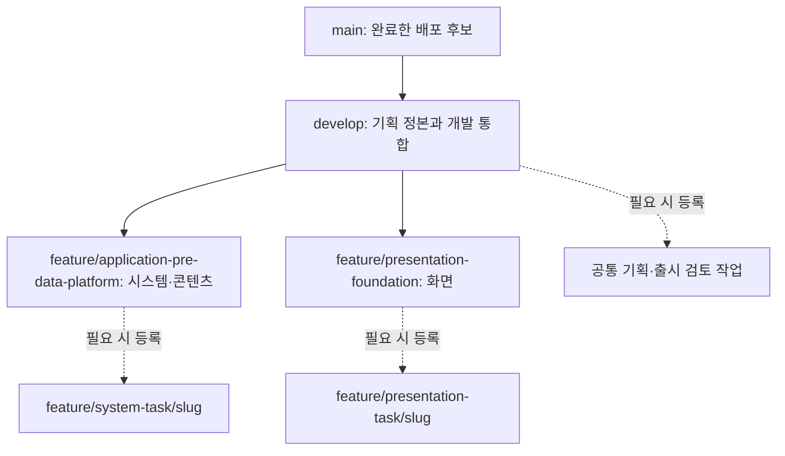

# 정시터치 개발 브랜치와 문서 운영

이 문서는 공통 명세 service_spec.json에서 생성한다. 현재 버전은 1.9.157이며 기획·라우팅·계층 문서를 같은 변경으로 갱신한다.

main은 모든 작업 완료 후 최종 코드·문서·검증·인계를 정리하는 라이브 배포 전 후보다. develop은 시스템기획팀의 현재 문서 공유와 두 개발 담당의 PR 통합 환경이다. 시스템·콘텐츠와 프레젠테이션 개발은 각각 하나의 상시 브랜치를 사용한다. 과거 기획·시안은 이력으로 보존한다.

## 브랜치 흐름

담당 임시 작업 → 해당 상시 개발 브랜치 → develop → 최종 정리·검증 PR → main → 별도 승인한 라이브 배포

초기 기반을 main에 넣었던 부트스트랩 예외는 종료됐다. 이후 main은 전체 완료·정리·검증한 develop의 배포 후보만 PR로 받으며, main 병합 자체가 라이브 배포를 뜻하지 않는다.

## 기본 4개 노드와 담당

| 브랜치 | 직접 담당 | 부모/PR 대상 | 관리 목적 |
| --- | --- | --- | --- |
| main | 시스템기획팀 최종 정리; 두 개발 담당 검토 | 최상위 배포 후보 | 전체 작업 완료 후 코드·문서·검증·인계 자료를 정리한 배포 후보. 라이브 적용은 별도 승인. |
| develop | 시스템기획팀 직접 문서 관리; 개발 담당 PR 통합 | main | 현재 개발 환경과 확정 기획의 공유 정본. 다른 팀의 구현은 PR로 누적. |
| feature/application-pre-data-platform | 시스템·콘텐츠 개발 담당 1인 / 현재 개발팀 | develop | 사용자 주도 DB·정본/저장소·산출 본체와 시스템 서비스. 화면팀과 서비스 함수 공동 개발; DB/산출 소유권 유지. |
| feature/presentation-foundation | 프레젠테이션 개발 담당 1인 / 별도 화면 작업자 | develop | 화면·BFF와 허용 서비스/애플리케이션 함수·DTO/API 흐름 공동 개발. DB/산출 보호 범위 제외. 기존 상시 브랜치 재사용. |



위 화살표는 출발/관리 관계다. 구현 PR은 하위 작업에서 부모로 올라간다. Git 브랜치는 네이티브 폴더 트리가 아니다. 이 문서의 부모는 출발 커밋과 PR 통합 경로를 뜻한다. 상시 브랜치명 뒤에 /를 붙인 하위 ref는 이름 충돌을 일으킬 수 있으므로 별도 task 접두어와 부모 등록을 사용한다.

기획팀은 develop의 service_spec.json·생성 문서와 브랜치/검사 설정을 직접 갱신한다. 다른 팀은 develop의 자료를 가져가 자기 상시 브랜치에서 개발하고 PR로 통합한다. 3티어는 코드와 포트의 구분이며 각 티어/작업/에이전트마다 브랜치를 만들지 않는다.

## 브랜치 등록부와 최신 통합 관측

정책 등록일 2026-10-04 (Asia/Seoul), 등록 기준 d666a5f2bdbc846c65b5503de35c17d6d90088db. 등록부의 상시 4개, 진행 임시 1개, 종료 이력 5개로 분류한다. 현재 원격 전체 ref 재조회 결과와 구분한다. 관측 커밋은 당시 증거이며 작업 브랜치의 미래 HEAD를 고정하는 값이 아니다.

최신 통합 관측일 2026-10-06, develop 3d90bc461c57102fc9ee8868cec7edac498470d4. root의 PR15 고정 head/CI2/GitHub merge 및 develop source 영수증 대조; 원격 전체 ref/main/server 재조회 아님

| 브랜치 | 분류/담당 | 부모와 PR 대상 | 현재 작업/근거 |
| --- | --- | --- | --- |
| feature/planning-presentation-contracts | retired_superseded; 화면 작업자의 계약 제안; 시스템기획팀 검토·정본 반영 | develop | 기존 PR #5: session.read·화면 기술 계약 제안. 미확정 계약을 현행 운영 구현으로 기록하지 않는다.; PR #5; 원격 ref: retained_closed_superseded_no_deletion_authorization |
| feature/presentation-favorable | retired_merged; 별도 프레젠테이션 작업자 | feature/presentation-foundation | 이전 PR7의종료/부모통합이력과원격ref는보존한다. 최신 PR15 source는develop3d90에merged/CI2확인됐으며원original347ancestor를새로주장하지않는다. 실browser·수치·권한·보안운영과FE-01R/FE-ORIGIN/FE-SOURCE-01은pending이다. 새개발은등록된상시부모를사용한다.; PR #7; 원격 ref: retained_finished_temporary_ref_no_deletion_authorization |
| feature/presentation-results | retired_integrated_closed; 별도 프레젠테이션 작업자 | feature/presentation-favorable | 이전 PR9의종료/부모통합이력과원격ref는보존한다. 최신 PR15 source는develop3d90에merged/CI2확인됐으며원original347ancestor를새로주장하지않는다. 실browser·수치·권한·보안운영과FE-01R/FE-ORIGIN/FE-SOURCE-01은pending이다. 새개발은등록된상시부모를사용한다.; PR #9; 원격 ref: retained_finished_temporary_ref_no_deletion_authorization |
| feature/overall-analysis-service | retired_merged; 현재 개발팀 / 과거 DEV-001 | 종료: 새 PR 금지 | develop 조상 및 진행 PR 없음 확인 후 사용자 허용 범위의 원격 참조만 삭제 완료. 새 작업 금지. 로컬 브랜치와 작업 파일은 보존. 사용자가 정확히 허용한 GitHub 원격 refs/heads/feature/overall-analysis-service만 삭제했다. develop의 커밋과 로컬 브랜치·파일·worktree·원격 추적 캐시는 보존한다.; 병합 PR #2; 원격 ref: deleted_2026-10-04_user_authorized_remote_ref_only |
| feature/planning-layer-ownership | retired_merged; 시스템기획팀 / 과거 소유권 기획 | 종료: 새 PR 금지 | develop 조상 및 진행 PR 없음 확인 후 사용자 허용 범위의 원격 참조만 삭제 완료. 새 작업 금지. 로컬 브랜치와 작업 파일은 보존. 사용자가 정확히 허용한 GitHub 원격 refs/heads/feature/planning-layer-ownership만 삭제했다. develop의 커밋과 로컬 브랜치·파일·worktree·원격 추적 캐시는 보존한다.; 병합 PR #3; 원격 ref: deleted_2026-10-04_user_authorized_remote_ref_only |
| feature/system-task/p3p4-cpu-budget | active; 시스템·콘텐츠 개발 담당 / 정시터치 부담당자 대행 | feature/application-pre-data-platform | 3·4페이지 Edge CPU 한도 초과(546) 수정: 4페이지 후보를 운영 환산 보유 모집행으로 먼저 거르고, 참고 환산 decode 재사용, 준비된 선택본 단일 실행 캐시(최대 4). 운영 배포·참고 환산 재연결은 최종 관리자 확인 뒤.; PR 등록 전 |

PR5closed·ref보존과PR6통합역사는유지한다. 최신PR15 ef7b7c08 exactCI2·develop3d90정상merge/삭제0·화면branch보존을확인했다. FE05빈학교fix는source통합됐으나 FE-01R/FE-ORIGIN/FE-SOURCE-01·실browser/권한/수치/보안운영은pending이다. 원격전체ref계수/등록부checked시각·main/server미재조회값은과거관측그대로이며새조회·삭제허가로확대하지않는다.

PR #5의 중복 제안은 종료됐고 head/ref는 보존한다. 정식 session.read 계약과 동적 경로 제목 검사는 현행 공통 도구로 계승했다. PR43 headebb3d2d가 develop e789313/기획1.9.81을 일반 merge했다. 정상 --write 생성/검사와 정확 head push39213665734·PR39213667946 CI success 및 MERGEABLE/CLEAN을 확인했다. Draft·미병합이며 e806 대비 화면 소스/package/wrangler 변경0으로 운영 재배포는 없다. 화면팀이 서비스 함수 공동 개발 범위를 수용했고 새 서비스 구현 완료로 확대하지 않는다. 이후 기획 변경은 기존 브랜치의 정상 merge/생성/검사를 따른다. 종료 ref는 새 개발에서 제외하고 보존한다. 후속 PR 담당은 최신 develop과 충돌을 해결한 뒤 등록 부모에 통합한다.

기본 노드는 상시 4개뿐이다. 임시 작업은 등록 후 필요할 때만 만들며 종료 시 status=retired_merged와 병합 PR/커밋을 기록한다. 브랜치 ref·로컬 파일·worktree·캐시·잠금 파일 삭제는 자동화하지 않는다. 삭제 대상·범위를 사용자에게 명시해 허용받기 전 보존한다.

## 필요한 하위 작업만 등록

| 필요 시 이름 | 부모/PR 대상 | 담당 | 생성 사유 |
| --- | --- | --- | --- |
| feature/system-task/<slug> | feature/application-pre-data-platform | 시스템·콘텐츠 개발 담당 | 독립 리뷰·충돌 분리 등 분리가 필요한 개발 작업 |
| feature/presentation-task/<slug> | feature/presentation-foundation | 프레젠테이션 개발 담당 | 독립 리뷰·화면 병렬 작업 등 필요한 분리 |
| feature/planning-task/<slug> | develop | 시스템기획팀 | 공통 계약 제안·별도 문서 검토 |
| feature/release-task/<slug> | develop | 시스템기획팀과 두 개발 담당 | 배포 전 종합 검증·문서 정리. main으로 직접 우회하지 않음 |

새 하위 브랜치 생성 전 시스템기획팀이 develop 정본의 additional_branches에 name·kind·owner·parent·pr_target·status·temporary=true·purpose·base_commit을 기록한다. 출발 SHA는 부모의 실제 커밋이어야 한다. 최초 생성 후 부모 변경은 협의해 명세와 PR base를 함께 갱신한다. 상시 노드뿐 아니라 같은 담당의 등록 임시 노드 아래에도 꼭 필요하면 작업을 등록할 수 있다. allowed_parent_kinds가 허용한 부모 역할만 사용하며 직계 부모를 건너뛰지 않는다.

각 노드에서 분리가 필요한 작업을 제안할 수 있다. main 배포 검토 작업도 develop의 release_task에서 정리해 develop으로 먼저 올리고, 최종 develop → main 경로를 유지한다. 임시 작업이 없으면 상시 브랜치 하나를 계속 사용한다.

## 작업 시작·동기화·PR

origin/develop의 최신 기획·HEAD를 확인해 자기 상시 브랜치에 일반 merge로 가져온다. 충돌은 해당 담당이 현재 공통 명세와 코드 변경 범위로 해결한다. 다른 체크아웃을 reset하거나 원자료를 재집계하지 않는다. 관련 PR이 develop에 병합되거나 계약이 바뀌면 다음 작업 전 대조하고, 각 담당 PR 제출·갱신 전에도 기준 SHA를 확인한다. 명세 충돌에는 검증 기준 커밋과 인덱스에 결속된 병합 미리보기를 사용할 수 있다. 같은 키·배열의 판단 불가 충돌과 생성물 외 충돌은 중단하며, 실제 생성 목록을 재생성하고 동일 스냅샷 검사를 별도로 통과한다. 미리보기는 작업본·인덱스·ref를 자동 수정하지 않는다. 충돌 단계 1·2·3을 유일 공통 조상과 양쪽 부모의 명세 파일 mode·blob에 각각 결속하며 불일치 시 중단한다. 무관한 정상 신규 파일은 허용한다. 명세가 stage 0이거나 부모별 변경 경로가 256개를 넘는 경우 이 도구는 보수적으로 중단하고 별도 검토한다.

임시 개발 작업은 등록된 직계 부모에 먼저 PR한다. 일반적으로 부모는 담당 상시 브랜치이며 기존 PR #9처럼 등록한 임시 부모가 있으면 그 단계를 따른다. 상시 시스템/화면 브랜치는 develop에 PR한다. 최종 main PR은 develop에서만 연다. GitHub 병합은 merge commit으로 수행해 상시 브랜치의 이력을 이어 간다.

develop의 기획/계약 최종 검토와 통합 조율은 시스템기획팀이 담당한다. 두 개발자는 담당 브랜치에서 작업한다. 계약 변경에는 작업 요구사항·API·DTO·소유권·계층과 변경 검증을 같은 커밋에 포함한다. 상시 브랜치 간 직접 병합으로 develop을 우회하지 않는다. REQ-24~26·보안 개발기준은 모든 구현의 필수 참조이며 보안 gate/operation/증거 누락은 인수하지 않는다. 2026-10-19 서비스 함수 공동 개발은 service_delegation_policy를 따른다. 허용 기능은 함수별 사전 승인 없이 화면팀이 구현하고 정상 PR로 통합한다. 시스템기획팀은 공통 명세·기획·라우팅을, 개발팀은 서비스 구현을 검토한다. DB·환산 엔진의 기존 사용자 주도 범위를 유지하고 PR 준비·병합·운영 배포 상태를 구분한다.

```text
git status --short --branch
git fetch --no-prune origin
git rev-parse origin/develop
# 담당 상시 브랜치에서 기획을 가져온다
git merge --no-edit origin/develop
# 하위 작업 PR: base는 등록된 parent
# 상시 시스템/화면 PR: base=develop
# 전체 인수 완료 후 최종 PR: head=develop, base=main
```

GitHub 병합은 merge commit만 허용하고 squash/rebase 병합과 병합 후 자동 브랜치 삭제를 끈다. 상시 브랜치의 이력이 이어지고 통합 뒤 다시 같은 브랜치에서 개발할 수 있다. 미커밋 변경이 있으면 먼저 보존·검토하고 강제 checkout/reset/clean 없이 진행한다.

## develop 직접 변경 범위와 적용 검사

| 검사 지점 | 검사/실제 한계 |
| --- | --- |
| local | pre-commit은 등록·활성 브랜치와 파일 삭제 금지를 검사한다. develop은 planning 선언 및 허용 문서/관리 경로만 직접 stage할 수 있다. pre-push는 main 직접 푸시·ref 삭제·non-fast-forward와 develop 범위 위반을 차단한다. 각 clone에서 훅 활성화가 필요하다. |
| CI | PR head/base를 정본의 부모 경로와 검사하고 planning task는 문서/관리 변경만 허용한다. push는 등록 브랜치·develop의 직접 커밋 범위·non-fast-forward를 검사한다. 모든 merge commit PR을 사용하며 이전 정책 도입 전 커밋은 새로운 시행 커밋 이전 이력으로 보존한다. |
| limits | 현재 비공개 GitHub 요금제의 보호 API는 403이다. 원격 권한·PR 승인·검사 통과를 서버에서 강제할 수 없다. 로컬 planning 선언은 신원 인증이 아니며 훅 우회/API 직접 변경을 기술적으로 막지 못한다. CI 실패는 반영 자체를 되돌리지 않으므로 시스템기획팀이 결과를 확인한다. |

기획팀의 직접 허용 범위는 docs/·.github/·.githooks/와 아래 공통 관리 파일, 생성된 현재 문서/카탈로그/README다. 업무·화면 실행 코드·DB 마이그레이션·런타임 잠금은 담당 개발 PR로만 누적한다.

- README.md
- AGENTS.md
- .gitignore
- .gitattributes
- scripts/check_project_consistency.py
- scripts/check_branch_policy.py
- tests/test_branch_policy.py
- tests/test_project_consistency.py
- tests/test_ci_snapshot_preservation.py
- tests/test_deletion_approval.py
- tests/test_session_contract.py
- scripts/audit_documentation_sync.py
- tests/test_documentation_sync.py
- docs/current/code_routing_index.json
- scripts/check_edge_contract.py
- scripts/run_edge_tests.py
- tests/test_edge_harness.py
- tests/test_edge_source_scope.py
- scripts/edge_source_scope.py
- scripts/run_committed_tests.py
- scripts/bootstrap_edge_runtime.py
- tests/test_edge_runtime_supply.py
- edge-runtime.lock.json
- tests/test_owner_system_professional_contract.py
- tests/test_committed_runner_progress.py
- tests/test_incident_recovery_harness.py
- tests/test_edge_unit_aggregation.py
- tests/test_stage_projection_guard_registration.py
- scripts/merge_branch_generated.py
- tests/test_merge_branch_generated.py

기획팀은 현재 셸 세션에서만 아래처럼 역할을 선언한다. .env 파일을 만들거나 GitHub 인증정보를 기록하지 않는다. JUNGSI_TEAM=planning (해당 셸 세션에만 설정; 신원 인증이나 GitHub 권한 분리는 아님).

```powershell
$env:JUNGSI_TEAM = "planning"
python -B scripts/check_branch_policy.py --staged
```

## main 최종 반영과 라이브 적용

현재 release_gate.state=not_ready. 전체 작업 완료와 최종 자료 정리가 확인될 때에만 ready로 바꾸고 각 항목에 증거 경로/PR/커밋을 남긴다. main 병합 후에도 라이브 배포 승인은 별도다.

| 최종 인수 항목 | 상태 | 확인할 증거 |
| --- | --- | --- |
| system_contracts | passed | 정식22 API/session/forecast 서비스·DB 계약은493개 정상Git스냅샷 검사와PR13/develop947cee8 CI를 거쳐 인수·통합완료. 실제로그인/이용권/DB/Drive와외부프런트는다른pending gate로분리한다. |
| presentation | pending | PR15 ef7b7c08/CI2·develop3d90통합·삭제0/branch보존은source인수다. FE-01R/FE-ORIGIN/FE-SOURCE-01·실browser/유효action·권한/전달물·실429/숫자·보안gate는pending이다. |
| live_connections | pending | SQL001002003/fresh권한metadata·UTC/타입·master명시port와합성10행별도process지속성은제한PASS다. 기본factorylegacy유지·실JWT/유료rows·livehost/승인자료/Drive·22API/security운영은미인수다. |
| approved_data | pending | 승인 자료/모형 공급 및 실제 결과 검수 대기. GitHub에 실제 데이터 업로드하지 않음 |
| release_validation | pending | 최종 develop SHA의 문서·경로·계층·데이터 제외·CI 및 통합 검증 필요 |
| handoff | pending | 최소자료staged/보류·app/owner배포설정경계와직접인간기본경로유지결정을기록했다. backup/restore·실권한/자료활성화·후보sameSHA/CI·별도배포승인은pending이다. |
| security_response_artifacts | pending | 모든 역할 HTTP 응답과 실제 외부 화면 빌드/브라우저 노출 검수 NOT_RUN |
| security_direct_authorization | pending | 서버 중계·실세션/이용권·소유권·관리 범위와 직접 접근 거절 NOT_RUN |
| security_harvest_controls | pending | 공유 원자적 예산·무료 누백/paid 후보·동시성/재시작/429 검수 NOT_RUN; 운영 숫자 승인 필요 |

최종 PR에는 배포 후보 develop SHA·문서/계약 버전·CI/통합 검증·실제 연결 검수·운영/복구 인계 근거를 담는다. 모든 체크가 passed이고 증거가 있을 때만 ready로 확정한다. main 병합 뒤 별도 승인한 배포를 실행한다. 기능 완료·합성 테스트 성공만으로 실제 데이터와 라이브 준비 완료를 표시하지 않는다.

현재 기준의 출발 커밋은 87dba635ebc5119e53e9c7e3c5f456636a9c50e9이다. 작업 시작 시 현재 브랜치·HEAD·변경 목록을 확인한다. 커밋하지 않은 다른 작업자의 코드나 로컬 전용 검수 결과를 구현의 확정 기준으로 취급하지 않는다.

## 한 변경에 포함할 내용

요구사항과 페이지/API 경로를 공통 명세에 반영하고 해당 계층의 코드를 수정한다. 문서와 경로 카탈로그를 생성하고 검사·검산한 뒤 같은 커밋으로 올린다. 코드·공유 도구·워크플로·테스트 변경이 있으면 공통 명세와 현재 기획·라우팅 문서가 같은 변경 목록에 있어야 한다. 변경 메모에 실제 구현 범위를 기록한다. develop에서 검증한 PR만 main에 반영한다. main 반영 후에도 develop을 통합 개발 기준으로 유지한다.

## 문서 생성과 검사 명령

```text
python -B scripts/audit_documentation_sync.py --sync
# 검토한 이번 작업 파일만 경로를 명시하여 stage
git add -- <reviewed-work-item-paths>
python -B scripts/check_project_consistency.py --staged
python -B scripts/run_committed_tests.py --staged
```

검산은 선택한 Git 인덱스 또는 커밋의 파일을 새 outputs 폴더에 복사해서 실행한다. 커밋하지 않은 코드와 제외된 실제 데이터 의존 테스트를 섞지 않는다. 기존 파일·검산 폴더를 정리하거나 삭제하지 않는다.

## 로컬 훅과 GitHub 검사

공통 문서·경로 계약·훅·새 계층 코드의 줄바꿈은 .gitattributes에서 LF로 고정해 Windows와 CI의 바이트 검사를 일치시킨다. 각 체크아웃에서 git config --local core.hooksPath .githooks를 설정한다. Python 경로가 필요하면 git config --local jungsi.python으로 실행기를 지정한다. pre-commit은 등록 브랜치·develop 직접 범위·파일 보존과 스테이징된 문서·코드·데이터 제외·합성 테스트를 검사한다. pre-push는 main 직접 푸시·ref 삭제·강제 갱신·develop 직접 범위를 차단한다. GitHub Actions의 검사 이름은 project-consistency다.

GitHub는 현재 비공개 저장소 보호 조회에 HTTP 403과 요금제 업그레이드 요구를 반환했다. 따라서 원격 PR·검사 통과 강제 보호는 활성화되지 않았다. 로컬 훅은 각 체크아웃에 적용되며 서버의 강제 보호와 같지 않다. 보호 지원 요금제에서 main에 PR·검사 통과, 강제 푸시·브랜치 삭제 금지 규칙을 적용한다. 저장소 비공개 상태는 유지한다.

## 파일을 보존하는 CI 스냅샷

| 항목 | 실행 기준 |
| --- | --- |
| runner | GitHub-hosted ubuntu-24.04의 사전 설치 Git/CPython 3.12를 사용하고, Deno 2.9.7은 고정 공식 아카이브를 새 outputs/ci_edge_runtime에 명시적으로 공급한다. checkout/setup-python/외부 설치 액션·시스템 설치·최신 버전 대체는 사용하지 않는다. |
| destination | GITHUB_WORKSPACE/retained_snapshots/run_<run_id>_attempt_<run_attempt>가 존재하거나 symlink이면 중단한다. 새 비존재 경로만 생성하고 기존 경로·파일을 보존한다. |
| commit | git init 후 github.sha와 전체 부모 이력, refs/heads/develop 및 refs/heads/feature/presentation-foundation을 fetch한다. 두 origin tracking ref의 고정 SHA가 확인돼야 지정 github.sha를 최초 detached checkout한다. 각 HEAD/ref가 확보된 SHA와 다르면 실패한다. |
| credentials | GitHub token은 fetch subprocess의 GIT_CONFIG_* http extraheader 환경으로만 전달한다. argv/로그/파일과 init/checkout/test subprocess에는 전달하지 않는다. Git trace 및 외부 config 입력을 차단하며 실패는 원문 진단 없이 안전한 사유로 기록한다. |
| preservation | gc.auto=0, maintenance.auto=false와 fetch --no-auto-maintenance를 적용한다. clean/reset/drop/기존 경로 초기화/temp cleanup을 호출하지 않는다. 생성 runtime/다운로드/검산 스냅샷은 정리하지 않는다. |
| verification | 보존/ref/인증 범위 합성 검사를 포함한 b66의 정상 commit/push 훅 530건 PASS와 정확한 HEAD project-consistency CI success를 확인했다. 이후 문서 커밋의 미래 SHA/미실행 CI를 성공으로 기록하지 않는다. 기존 경로·출처 보존과 실제 운영/외부 프런트 미검증 경계는 유지한다. |

## 공유 실행 도구

- scripts/calculate_overall_percentile.py
- scripts/analyze_exam_score.py
- scripts/compare_year_scores.py
- scripts/demo_profile_percentile.py
- scripts/demo_school_screening.py
- scripts/demo_total_curve_principle_20260927.py
- scripts/import_kice_exam.py
- scripts/check_project_consistency.py
- scripts/run_committed_tests.py
- scripts/bootstrap_backend_runtime.py
- scripts/probe_backend_connection.py
- scripts/check_branch_policy.py
- scripts/audit_documentation_sync.py
- scripts/check_edge_contract.py
- scripts/run_edge_tests.py
- scripts/edge_source_scope.py
- scripts/bootstrap_edge_runtime.py
- scripts/merge_branch_generated.py

실제 모집표·매핑·상담자료가 든 나머지 작업 도구와 원자료 검증 결과는 로컬 전용이다. 새 공통 도구를 공유하려면 명세의 공유 목록과 .gitignore를 함께 갱신한다.

## 공식 설정 근거

[GitHub 브랜치 보호](https://docs.github.com/en/repositories/configuring-branches-and-merges-in-your-repository/managing-protected-branches/about-protected-branches)와 [Python 자동 검사](https://docs.github.com/en/actions/tutorials/build-and-test-code/python)를 참고한다.

## 계층별 담당과 브랜치

기획 정본은 시스템기획팀이 develop에서 관리한다. 사용자 주도 DB·산출 담당자는 DB/엔진 본체를 유지하고, 화면 담당자는 화면과 허용 서버 서비스 함수를 기존 상시 브랜치에서 자율 개발한다. 두 담당은 develop PR로 통합하며 실행3티어·데이터/보안 경계는 유지한다.

| 담당 영역 | 작업자 | 코드와 문서 위치 | 브랜치 |
| --- | --- | --- | --- |
| 공통 기획 | 시스템기획팀 | docs/current/service_spec.json, scripts/check_project_consistency.py | develop |
| 프레젠테이션 | 다른 PC의 프런트 전담 개발자 | apps/web | feature/presentation-foundation (상시); 등록된 presentation_task만 하위 작업 |
| 애플리케이션 | 기존 DB·산출 담당과 화면구현팀 공동(보호 본체 제외) | src/jungsi_touch/application, src/jungsi_touch | feature/application-pre-data-platform 또는 feature/presentation-foundation |
| 데이터와 인프라 | 사용자 주도 기존 DB·산출 담당; 데이터팀 비공개 자료 정리 | src/jungsi_touch/infrastructure, database | feature/application-pre-data-platform |

시스템기획팀은 develop의 현재 HEAD와 원격 동기화 상태를 확인하고 기획 정본을 검증·공유한다. 서버 개발팀과 별도 프레젠테이션 담당은 최신 origin/develop의 기획 기준과 출발 SHA를 확인하고 각자의 기존 작업 브랜치를 재사용한다. 다른 작업자의 미커밋 변경을 기준으로 삼지 않는다. AGENTS.md와 외부접근_데이터보호_개발기준.md를 반드시 읽고 변경 operation의 SEC 통제를 확인한다.

시스템기획팀만 develop에서 기획·공통 관리 설정을 직접 관리한다. 시스템·콘텐츠 개발자는 feature/application-pre-data-platform, 화면 개발자는 feature/presentation-foundation을 상시 재사용한다. 다른 팀은 develop에서 직접 구현하지 않고 담당 브랜치의 PR로 누적한다. 3티어는 폴더·포트·의존 관계로 구분한다. 하위 작업은 필요 시 부모·담당·사유를 정본에 등록하며 작업 항목이나 에이전트마다 생성하지 않는다. 상시 시스템/화면 브랜치의 통합 대상은 develop이고, 하위 개발 작업은 등록된 직계 부모에 먼저 통합한다. main에는 작업이 모두 끝나고 최종 검증·인계가 정리된 develop만 PR로 반영하며 라이브 배포는 별도 승인한다.

현재 개발팀의 기존 브랜치는 feature/application-pre-data-platform이다. 화면 작업자는 feature/presentation-foundation를 화면 담당의 상시 브랜치로 재사용한다. PR43 headebb3d2d가 develop e789313/기획1.9.81을 일반 merge했다. 정상 --write 생성/검사와 정확 head push39213665734·PR39213667946 CI success 및 MERGEABLE/CLEAN을 확인했다. Draft·미병합이며 e806 대비 화면 소스/package/wrangler 변경0으로 운영 재배포는 없다. 화면팀이 서비스 함수 공동 개발 범위를 수용했고 새 서비스 구현 완료로 확대하지 않는다. 이후 기획 변경은 기존 브랜치의 정상 merge/생성/검사를 따른다.

route_catalog.json과 생성 README/현재 문서는 직접 편집하지 않는다. 계약 변경은 service_spec.json과 생성 도구에서 수정하고 생성 결과를 같은 커밋에 포함한다.

두 개발 담당은 origin/develop의 같은 커밋에 있는 service_spec과 생성 문서를 가져가 구현한다. 계약·필드·오류/보류 사유가 바뀌면 시스템기획팀과 해당 계층 담당에게 인계한다. 통합되지 않은 feature의 코드·가상 응답을 develop에 구현된 기능으로 기록하지 않는다. 현재 기획팀과 서비스·DB 개발팀은 외부 프런트 담당에게 확정 공통 계약과 백엔드 인수 증거를 전달한다. 외부 프런트의 수정·브라우저 인수검증은 해당 담당자의 완료 증거를 별도로 확인한다. 화면팀은 service_delegation_policy의 허용 서비스 함수를 스스로 구현한다. 새 DB/산출 작업만 기존 담당에게 인계하며 일반 노출 필드/서비스 함수마다 사전 승인을 요구하지 않는다. 공유 DB 용량 후속은 최신 사용자 지시인 테이블 단위 필요성 검증·불필요 테이블 제거로 진행한다. 행별 작업은 검증된 커밋 경계에서 닫았고 데이터팀에 writer 창을 반환했다. 실제 사용/예정 테이블·현재 head·원자료·산출/CDF·파일을 보존하고, 정확 의존·원형 복구 근거와 데이터팀 신규 반영 이후의 OID/head 및 직렬 작업 창을 확인한 DROP RESTRICT만 실행한다. 전국 로컬 준비와 승인된 최종 단일 writer는 별도 현재 체크포인트를 따른다.

Git 변경 범위와 해당 계약·필수 커밋 검산을 확인한다. 원자료 전수검수나 전국 재집계를 매 개발 작업에서 반복하지 않는다. 하위 브랜치 병합은 등록된 직계 부모 또는 승인된 develop 인입과 결속한 Git merge-tree 결과를 기준으로 확인한다. 충돌 해결 근거와 별도 직접 수정의 승인 범위를 구분하며 삭제 차단·팀 권한·main 승격·등록 부모·fast-forward 규칙을 유지한다. merge_scope_policy 표식이 있는 커밋부터 병합 재구성 정책을 적용한다. 과거 병합은 소급 판정하지 않으며, 기획 경로 충돌 해결과 비기획 자동 병합 결과를 구분한다.

## 화면팀 서비스 함수 공동 개발 · 2026-10-19·2026-10-21 사용자 지시

| 업무 | 담당과 허용 범위 |
| --- | --- |
| 화면과 서비스 함수 | 화면 담당 Owner·화면구현팀(서버 시스템/서비스·화면·운영 연결 책임) / 기존 승인 저장소 포트·엔진 결과를 이용하는 서버 조회·조합·업무 흐름·입력 검증·오류 매핑·DTO·공개 응답/경로·표시용 파생값을 직접 신규 작성·수정한다. 표시용 단위·상태·문자열·페이지 건수와 승인된 기존 표시 추정식을 재사용하며 새로운 환산·누백·분포·지원판정 산출을 만들지 않는다. Owner는 승인된 DB/엔진 포트 위의 시스템 서비스, 실제 Auth/JWT/OTP 상태 검증·기관/학생 권한·CSRF/relay·현재 입력권/예산 흐름·오류/DTO·감사 호출·런타임 설정 파싱/조립·기존 Supabase/화면 배포 도구·독립 검수와 회신까지 맡는다. 새 서비스·상담 문장·합성 응답은 함수마다 다시 승인받지 않는다. |
| DB·저장소와 산출 본체 | 사용자 주도 기존 DB·산출 담당 / feature/application-pre-data-platform / DB 스키마/마이그레이션·SQL·실저장소/공급 어댑터·정본/발행 writer 및 수능/대학 환산·누백·동등화·분포/모형·지원판정 산출 본체·가중치와 집단/동점 정의. |
| 사전 승인과 통합 | 허용 서비스 함수는 매 함수별 사전 승인 없이 기존 화면 브랜치에서 자율 개발한다. 코드·명세·라우팅·검증을 같은 커밋에 포함해 develop PR로 통합한다. 정본 기획/공통 검사 직접 수정은 기획팀이 담당하고, 기능 계약 변경 제안은 해당 feature PR에 함께 둔다. 새 DB/산출 본체 작업이 필요할 때만 기존 담당 범위로 인계한다. 이미 확정된 계약 범위에서 코드/검수/기존 운영 연결은 Owner가 자율 완결한다. 새 DB/SQL/RLS·자료 writer·산출/수치 근거는 사용자 담당에게 필요한 포트·스키마 요청만 묶어 전달하고 나머지 시스템 작업을 멈추지 않는다. 기획/라우팅은 같은 PR에 갱신하고 develop 직접/공통 보호정책은 기획팀이 유지한다. |
| 계층·보안 | 개발자 권한과 실행 계층을 구분한다. 화면팀이 작성한 서비스 함수도 서버 application에서 승인된 포트와 엔진을 이용한다. 브라우저 DB/비공개 모형 접근, 실제 값 하드코딩, 결측의0/ready 치환,인증·소유권·입력권·멱등·예산·relay·응답 허용목록 우회를 허용하지 않는다. Owner는 사용자가 지정한 기존 Supabase 프로젝트의 자기 Owner/Administrator 권한으로 최종 Secrets와 승인된 코드/자료 연결을 등록한다. 이 위임은 새 DB 역할/권한 확대·요금제/추가 과금·승인 업무규칙 변경·보호된 DB/엔진 코드 변경을 허용하지 않는다. OTP는 계속 계정 주인이 직접 입력한다. |
| 혼합 파일 | 혼합 Python platform.py의 서비스 조회/조합/DTO는 공동 수정하되 PlatformService.statistics의 산출 AST·참조 전역 바인딩·클래스 기반은 유지한다. TypeScript report_actions/paid_result_components와 산출 혼합 본체는 현 보호 파일로 유지하고 화면 확장은 별도 application 서비스 함수에서 기존 포트/엔진을 호출한다. 기존 승인 표시 추정식의 계약은 유지한다. |

담당 브랜치: feature/presentation-foundation → develop. 최신 검증 develop부터 변경 범위만 확인하고 기획·라우팅·요구사항·권한/소유권·계층·검증 상태를 같은 명세/커밋에서 일치시킨다. 정상 pre-commit/pre-push·정확 SHA CI·기존 보안/데이터 제외 검사를 유지한다.

| 분류 | 경로 |
| --- | --- |
| 기존 DB/엔진 보호 prefix | database/, src/jungsi_touch/infrastructure/, supabase/functions/_shared/jungsi/domain/, supabase/functions/_shared/jungsi/infrastructure/ |
| DB/SQL 보호 pattern | *.sql, supabase/functions/**/*_sql.ts, supabase/functions/**/*_postgres.ts, supabase/functions/**/postgres_pool.ts |
| 계산/혼합 본체 보호 파일 | src/jungsi_touch/admission_result_percentile.py, src/jungsi_touch/application/estimated_population.py, src/jungsi_touch/application/forecast_assessment.py, src/jungsi_touch/application/forecast_policy.py, src/jungsi_touch/application/offering_analysis.py, src/jungsi_touch/application/overall_analysis.py, src/jungsi_touch/application/university_percentile.py, src/jungsi_touch/application/university_scoring.py, src/jungsi_touch/estimated_curves.py, src/jungsi_touch/estimated_fitting.py, src/jungsi_touch/estimated_profiles.py, src/jungsi_touch/estimated_validation.py, src/jungsi_touch/exam_pack.py, src/jungsi_touch/forecasting.py, src/jungsi_touch/joint_distribution.py, src/jungsi_touch/percentile.py, src/jungsi_touch/percentile_cli.py, src/jungsi_touch/profile_percentile.py, src/jungsi_touch/reference_curve.py, src/jungsi_touch/reported_score_mapping.py, src/jungsi_touch/school_screening.py, src/jungsi_touch/university_conversion.py, src/jungsi_touch/year_comparison.py, src/jungsi_touch/year_equating.py, supabase/functions/_shared/current_review_model_codec.ts, supabase/functions/_shared/current_review_model_validation.ts, supabase/functions/_shared/jungsi/application/forecast_assessment.ts, supabase/functions/_shared/jungsi/application/forecast_calculation.ts, supabase/functions/_shared/jungsi/application/offering_analysis.ts, supabase/functions/_shared/jungsi/application/overall_analysis.ts, supabase/functions/_shared/jungsi/application/paid_result_components.ts, supabase/functions/_shared/jungsi/application/report_actions.ts, supabase/functions/_shared/jungsi/application/university_percentile.ts, supabase/functions/_shared/jungsi/application/university_scoring.ts |
| 공동 수정 HTTP 어댑터 | src/jungsi_touch/infrastructure/http_api.py, src/jungsi_touch/infrastructure/secured_http.py, supabase/functions/_shared/jungsi/infrastructure/api_http.ts, supabase/functions/_shared/jungsi/infrastructure/supabase_api_ingress.ts, supabase/functions/_shared/jungsi/infrastructure/professional_http.ts |
| Owner 시스템·인증·런타임 공동 경로 | supabase/functions/_shared/jungsi/infrastructure/auth_relay.ts, supabase/functions/_shared/jungsi/infrastructure/supabase_auth.ts, supabase/functions/_shared/jungsi/infrastructure/verified_session.ts, supabase/functions/_shared/jungsi/infrastructure/session_http.ts, supabase/functions/_shared/jungsi/infrastructure/project_binding.ts, supabase/functions/_shared/jungsi/infrastructure/runtime_settings.ts, supabase/functions/_shared/jungsi/infrastructure/runtime_context.ts, supabase/functions/_shared/jungsi/infrastructure/runtime_composition.ts, supabase/functions/_shared/jungsi/infrastructure/runtime_controls.ts, supabase/functions/_shared/jungsi/infrastructure/runtime_budget.ts, supabase/functions/_shared/jungsi/infrastructure/read_view_catalog_runtime.ts, supabase/functions/_shared/jungsi/infrastructure/own_report_cursor.ts, supabase/functions/_shared/jungsi/infrastructure/professional_runtime.ts |
| 보호 경로 안의 생성 문서 | database/README.md |
| 혼합 Python 산출 보호 | src/jungsi_touch/application/platform.py: PlatformService.statistics |

로컬 훅/CI는 등록 경로·보호 Python 산출 AST/바인딩·정본 소유 정책을 검사하며 승인된 develop 인입을 새 화면 변경과 구분한다. TypeScript 혼합 본체는 파일 단위로 보호한다. 이는 GitHub 계정/DB 권한 분리나 모든 의미 변경의 자동 증명이 아니다. 공통 명세·보안/3티어·회귀 검토를 유지한다. 정책 변경은 기획 develop에서만 하고 기존 브랜치·원본·파일은 삭제하지 않는다.

## Supabase 운영 인수 상태

보관된 이전 운영 검수 이력: 현재 develop57f74b1daabd2d6a8e94de216f182e8bfe6557b7에 서비스phase2와 승인된 병합 하네스 수정이 통합됐다. 정상precommit/prepush/정확HEAD pushCI/PR병합시험CI/최종developCI각678PASS·실패/오류/skip0이며 main은 보존했다. 최소source-only draft18의신규2 ownerINSERT COMMIT/freshapp18과선별Storage18(fullGET/SHA·비인증72건본문미반환)을확인했다. 최종appTLS READONLY exact18/old16불변/new2exact 독립영수증도PASS이며003/13RLS24policy·공개/Storagebaseline보존을확인했다. 원수능AST source는 보존하고 모평적용child3의 source/applicationContext를 분리 확인했다. engine/production/runtimefalse·publishednull과 기본회원경로유지/명시DI만준비선택은 확정 유지다. 공식입결v2/v3의미실패는보존하고 최소선별v4의일부학교/학교년도local·remote native범위PASS를 수령했다. 신규2개DB메타등록을수령하고최소공식source2의독립native58/frozenRAM39를기록했으며전체draft18/발행0·전국완료false를유지한다. 최종freshapp18독립검수도완료했다. StorageRLS메타는현재보호bucket에클라이언트SELECT허용조건없음을확인했으나실제JWT HTTP/운영SECgate는NOT_RUN이다. v2설계승인·최신v1.1/14경로PLAN_ONLY구현계획은 준비됐으나 코드0·품질/newscopeFE공통계약/모형호환·계산채택은 미완료다. 실제JWT/APIorigin·22API/4페이지/보안운영·live배포는 미인수다. 과거제안/실패/fixture·관측은 보존한다.

2026-10-10 Owner 작업 준수(DEP-IO-01-WINDOW): 대량 작업은 매일 02:00~06:00 KST, 최대 4시간의 조건부 창에서 한 팀의 한 작업만 수행한다. 시작 전 경고가 있으면 그날 SKIP하고 일관된 체크포인트에서 중단하며 기존의 더 짧은 배치·bytes·5초·RLS·subject·승인/만료 한계를 유지한다. 소량 조회 예외는 과거57014 전수 쿼리나 요청 수·limit만으로 적용하지 않는다. CAP-03은 정확한 표·PK·열·영향·비삭제 대안의 별도 제거 승인 전 단계이며 registry/overlays를 보존한다. 정확 관측 시각 UNCONFIRMED·원인/예산 회복 미확정·I/O HOLD·컴퓨트 변경 보류다. Storage·정리·VACUUM·read model·배포·PIN/만료 연장·자동 실행은 이번에 수행하지 않았다. 공식 입결 DB 표시 연결 문서의 같은 ID 준수 절을 함께 따른다. 지표 확장/가산점 요약은 데이터팀·서비스팀의 미채택 CR 준비안 검토까지 완료했고 자료 발행·DTO/엔진/화면·실API/BFF 인수는 NOT_RUN이다.

2026-10-10 읽기 모델 수정 후보(spec1.9.33): 사용자 지시에 따라 개발팀은 현재 정본의 검색용 narrow model과 명시 provider/handler·typed 검증·prepared DDL7파일 후보를 구현하고 데이터팀·독립 검토·native 합성 HTTP를 준비한다. 서명 유효성과 전체 원형 census·source coverage/fence 완전성은 별도 판정이며 실제 trusted baseline receipt 부재는 NOT_READY다. 기존 전수5초57014 실패는 보존하고 실제 DDL/GRANT/RLS·model build·성능·새 승인 PIN4·배포·JWT/BFF/브라우저는 NOT_RUN이다. DB 정리·VACUUM·과금 변경은 수행하지 않는다. fresh UI에서는Healthy와 용량 증가만 확인했으며 IOPS/처리량/연결 그래프는 불러오지 못해 I/O 회복 미확정/HOLD를 유지한다.

[Supabase 운영 인수인계](Supabase_운영_인수인계.md)를 따른다. revision 2026.10.07.v9; HTTP 관측 시각 2026-10-06T08:40:54.349322Z.

[화면팀 최종 회신 요청](화면팀_회신요청_최종.md)의 RF-01~06과 로컬 요청 ①~⑥를 함께 인수한다. 문서 전달 준비 완료는 담당자 회신·실제 연결·운영 검수 완료를 뜻하지 않는다.

[화면팀 후속 작업 지시](화면팀_후속작업_지시.md)의 FE-01~05는 로컬 검수 보고 이후 발견한 결함·증거 보완·승인 자료 대조·후속 PR 통합을 담당한다.

PR13 adc684/74fd/947의493건·b66의530건·PR14 구현429/병합91과 문서816의 정상561건/정확CI는 확인된 이전 코드 인수 이력이다. 이번 문서 후보의 미실행 검사·미래 commit/CI와 실제 운영 완료를 뜻하지 않는다.

## DEV006⑦ 정확한 파일 삭제 승인 검사

기본값은 deny다. develop947 이후 등록·공통 검사는 시스템기획팀, 실제 삭제와 화면 검증은 외부 화면 개발팀의 범위다. 서비스 개발팀은 서비스 계층만 담당한다. 삭제 승인 등록 당시의 역사 관측 상태: observed_completed_external_not_integrated. 이 관측을 현재 PR 통합 상태로 취급하지 않는다. 별도 develop 선행 등록 전에는 후보가 스스로 승인할 수 없다.

| 정확한 경로 | mode | 고정 Git blob | 원본 바이트 SHA256 |
| --- | --- | --- | --- |
| apps/web/src/app/admissions/possibilities/actions.ts | 100644 | c1f0200bec8cdd20f23e49134125a7cff7b17fce | fe2fcf6e3e02c9a08c4d7922babd6e4c8c1d6a10ccdd3b7120493dfb3dfe5c68 |
| apps/web/src/components/pending-page.tsx | 100644 | 2bd4303143db69494460f8740977c90c2e4060c1 | 7fd9a61c79fc4b09296d6140db4318482974ee37a8a47dc034e72c53af08a9ec |
| apps/web/src/lib/api/synthetic-fixtures.ts | 100644 | a8e5bb68743d8f2f5a776964f8c042d09a97dc51 | bdc103cb6059e29f1192d22e40275da77ff17beb17a7414577df40c0fe245ede |
| apps/web/src/lib/contract.ts | 100644 | c12709ab04dba81d6f4748b3fea7a937b5a0d6c9 | 0456daf6671c4c2ba76b932dc7d7cf5022cd96b398a1baa10c219b0013f7e478 |

출발 브랜치: feature/presentation-foundation; 출발 커밋: f46c6635664a6c2315e6c71c4f700aa3e331c60c; 사용자 메시지: 01a10bf5-898b-7180-8442-3bfd4d1c2914; 요청서 SHA256: 686e51deb7f29cc259e5fb8d63e1c16456b16aebfa5fc9f4c04e9988d0d694e3. 원본과 이전 버전은 보존한다. 최초 삭제와 승인된 삭제의 부모 병합 승계를 구분하고 다른 경로·수정/복원 후 재사용·병렬 삭제 origin의 재소비·과거 소급·숨긴 sideparent·ref 삭제·force를 거절한다. 동일한 승인 삭제 origin을 develop/main으로 운반하는 정상 병합과 새로운 삭제 사건은 구분한다.

### 별도 정확 승인 FE-P1-RAW-METRICS-20261020

| 정확한 경로 | mode | 고정 Git blob | 원본 바이트 SHA256 |
| --- | --- | --- | --- |
| apps/web/src/app/admissions/results/raw-metrics.tsx | 100644 | 68ffdd44d08cbcc2e6019166b3cfd2b0541b1eb7 | 1a00f2971e85408ea7ddc6327889594c80822abf65f3f57ffde183475719f121 |

사용자 답: 이 파일 1개 삭제 승인; 근거 질문: call_e73eb92e24064873800e5fd807712c6f; 출발 커밋: f4d0bfc4f8453fc4aaa9d20464556ba845df29a8. 사용자가 정확 1개 삭제를 승인했고 이후 이번 네 동시성 수정과 함께 정상 삭제·검수까지 명시했다. 새 snapshot-table로 대체되어 참조 없는 raw-metrics만 제거한다. 이전 4개 승인 기록은 보존한다. 이 별도 1개에도 선행 develop 등록·정확 원문 지문·최초 삭제 1회·정상 부모 승계 검사를 동일하게 적용한다. 실제 실행 결과는 별도 정확 커밋으로 기록한다.

[명시 Supabase 실행 자료 연결·공급자별 readiness·운영 준비](Supabase_실행자료_연결.md)의 DEV-009 계약을 함께 따른다.

## 현재 운영 플랫폼과 화면 인계

[Google Drive·Supabase 전용 배포 계약](Supabase_배포_화면_후속작업.md)이 이전 별도 FastAPI 호스팅/외부 워커 인계보다 우선한다. Python 검산은 보존하고 Edge 호환과 실제 인수는 후속 작업이다. relay는 X-Jungsi-Relay-Token 확정 계약이며 발행 감지는 최신 승인 native 버전/해시를 사용한다. 화면 제공 범위와 요금제 포함량 검수는 완료 전 상태를 유지한다.

## 기존 입결 DB를 화면 API에 연결

[공식 입결 DB 표시 연결](DB_입결_화면연결.md)의 DEV-011을 따른다. 기존 DB를 별도 목적 범위로 명시 조회하며 기본 이용권·엔진/운영 원형 상태·22API/DTO·보안 gate를 유지한다. 코드 implemented_current_review_local_owner_intake_and_offline_four_page_diagnostics; C_plus_official_exam_local_native_HTTP_partial_success_and_exact_holds_verified; full_calculation_live_and_general_publication_pending; 실제 검수/운영 상태는 같은 문서의 항목별 증거로 확인한다.

## 1페이지 추정 2열과 초안 시사

[공식 자료·추정 표기·시사 계약](1페이지_공식자료_추정표기_시사.md)을 따른다. 추정 총 지원자·추정 탈락자 2열을 유지한다. 대학 발표 공식 지표와 분리된 화면 파생값이며 자체 누백/예상컷/개인 분석을 1페이지에 추가하지 않는다. 2026-10-19 사용자 채택: 1페이지의 자료 공급 범위는 현재 단일 정본의 서비스 대상 전국 전체다. 학교별 부분 발행 완료를 기다리는 조건을 이번 연결에 적용하지 않는다. 현재값을 읽는 공개 어댑터·명시 승인 binding과 페이지별 검수는 별도로 완료해야 하며, 자료가 부족한 셀은 보류/null로 보존한다. 2026-11-02 Owner 확인(충원 열): 충원 표시는 최종 합격 예비번호 한 열로 통일하고 원문 명칭이 마지막 순번을 뜻한다고 검증된 경우에만 그 항목에 연결한다. 실제 추가 합격 인원은 내부 산술 입력으로 유지한다. 2026-11-02 사용자 직접 선택(성적 공란): 입결 성적 null은 공식 근거로 해당 조건 미발표 또는 3인 이하가 확인된 경우에만 해당 문구를 구분하며 사유 미확인은 보존한다. 동일 학년도/모집행/통계 분모와 결측·실제0·음수를 검사하고 실제 불합격자수와의 차이를 표시한다. API의 공식 history_metric과 회원 권한은 유지한다. 학교별 부분 발행은 단일 활성 catalog의 누적 불변 판으로 착수하며 source 승격·자동 병합을 하지 않는다. 실제 발행된 과거 입결의 목록/검수 계보·부분 조회를 화면에서 대조하고 승인·선택·수신·브라우저·운영 발행은 별도 인수다.

## 개발 변경과 문서 동기화

[현재 개발현황과 문서 동기화](개발현황_문서동기화.md) 및 [코드 색인](code_routing_index.json)을 먼저 읽는다. 최신 검증 커밋부터 Git 변경 파일과 연결된 요구사항·라우팅만 검토하고 공통 명세에서 모든 문서를 함께 생성한다. 모든 에이전트는 코드·기획·라우팅을 같은 커밋에서 일치시키고 필수 훅·CI를 통과해야 한다. 이미 검증한 원자료·전체 소스를 매 작업마다 다시 읽지 않는다. 범위 확대 사유와 실제 운영 미검증 상태는 별도로 기록한다.

## 공통 도구의 확인된 이전 인수 기준

| 범위 | 확인한 증거 |
| --- | --- |
| 공통 Git/CI 검사·명세·생성 문서 | b66c2274f0b0a27dc174555adde181cd16c68188; tree bd23bf5bd1ec0a05fed7c7f8db7db39621bf2748 |
| 정상 commit/push 훅 | 530건 PASS; 실패 0·오류 0·건너뜀 0 |
| 정확한 HEAD GitHub CI | [project-consistency](https://github.com/natural0448/Jungsi_touch/actions/runs/37324278331/job/111810898785): success |
| 서비스·DB 역사 기준 | adc684/74fd 구현과 develop947 통합의 493 PASS는 별도의 역사 인수 증거로 유지한다. |
| 당시 외부 프런트 관측 | d7b0279b2725a81ecd734cdec957c485ae5d6172; 4cc에서 필수3버전의 비어 있지 않은 문자열·정확동일성 보완과context17비교유지를관측했다. 실제Caller/브라우저/운영로그인인수는NOT_RUN이다. |
| 승인 등록 당시 외부 삭제 관측 | observed_completed_external_not_integrated; 이후 develop 통합과 실제 브라우저 인수는 각각의 정확한 증거로 구분한다. |
| 운영/외부 인수 | verification_pending; DB .env 추후; main not_ready |

확인된 이전 baseline b66까지만 증거로 명시한다. 후속 문서 커밋 자신의 미래 SHA나 미실행 CI 성공을 기록하지 않는다. 공통 Git/CI 검사·명세·생성 문서 인수 및 전체 합성 회귀. 운영 DB·외부 프런트·실제 데이터·모형 운영 승인을 뜻하지 않는다. 이전 e12/676 버전값 보완 pending은 역사이며 최신 소스 관측과 실제 프런트 인수 대기를 구분한다. 최소 profile 조건 읽기와 실제 로그인 JWT NOT_RUN, 실제 자료·모형 운영 미승인 상태를 유지한다.

## 외부 접근 데이터 보호: 개발 시작 전 필수

[외부접근 데이터보호 개발기준](외부접근_데이터보호_개발기준.md)을 작업 전에 반드시 읽는다. 정본은 service_spec.json의 security_contract와 workflow.development_harness이며 보안 revision은 2026.10.06.v1이다. REQ-24~26 / SEC-01~08은 화면·API·DB 개발의 공통 기준이다. 공개 응답의 재귀 허용목록, 서버 중계와 사용자 권한, 공유 누적 사용량 통제를 함께 구현한다. 기획·라우팅·route_catalog와 AGENTS 필수 참조는 동일 Git 스냅샷에서 하네스가 검사한다. 현재 운영 인수는 production_ready=false이고 3개 보안 release gate는 pending이다. 문서/계약 검사 통과는 런타임 차단 구현·브라우저·운영 DB 검수 완료와 구분한다.

## 2026-10-14 오픈 전 최신 확정

유료 이용권 원본은 public.jeongsi_passes이며 관리자 접근 예외는 동일 검증 Bearer·본인 role=admin/status=active·aal2·요청 내부 origin이 모두 필요하다. 실제 만료 우선, 예외만 paid+null, 일반 paid 만료 누락503과 FE-ADMIN-ACCESS-01을 따른다. 관리 8경로의 검증 aal2·본인 active 상태·기존 학교 권한을 결합한다. 이 문서에 남은 과거 어댑터/명시 연결 전용 결정은 당시 이력이다. 현재 변경 범위와 검수 상태는 [오픈 전 보안운영 변경](오픈전_보안운영_변경.md)와 opening_security_operations_contract를 우선한다. API22/session3·자료 승인/보존 경계는 유지한다.


<!-- jungsi:generated spec_sha256=16e483aa8a83759a143d1ee766a31a1dd8115e350def734f23c51359e271aa67 -->


## 회원별 관심대학 JSON API

MEMBER-SHORTLIST-01 / SOURCE_REGISTERED_NOT_ACTIVATED. 회원·대상 학년도별 비공개 JSON 관심대학을 기존 리포트와 분리한다. 저장 판정 동봉 A안을 채택하고 기존 report-bound API와 전문가용은 유지한다.

| 항목 | 계약 |
| --- | --- |
| storage | 기존 Supabase 비공개 Storage 불변 JSON/리비전과 작은 기존 원자 메타데이터를 사용한다. 새 결과/관심대학 DB 테이블·신규 서비스·키·과금은 만들지 않는다. 기존 성적/리포트/입력권·원본은 보존한다. |
| access | 검증 JWT에서 본인 UUID를 결정한다. 두 신규 경로는 기존 paid 판정과 active·aal2 관리자 예외를 따르며, 클라이언트 UUID/파일 경로는 받지 않는다. 공개 DB/Storage 직접 접근·서명 URL 노출 없이 기존 relay·CSRF·RLS/소유권·현재 권한·공유 예산·no-store를 유지한다. |
| legacy | 기존 PUT /api/v1/reports/{report_id}/shortlist/{offering_id}와 shortlist.update의 의미·권한·DTO는 바꾸지 않는다. 신규 두 operation만 명시 등록한 뒤 28→30이며 계약 준비만으로 현재 binding/배포를 넓히지 않는다. /pro 학생별 고정 리포트는 이번 범위에서 제외한다. |
| assessment | A안: 선택 보고서/성적 버전의 저장된 허용 assessment만 목록에 함께 붙인다. 없으면 null+명시 상태/사유를 반환한다. report_id가 있으면 그 본인 보고서의 버전을 결속하며, 생략 시 선택한 본인 해당학년도 보고서 문맥을 응답에 명시한다. GET/리포트 열람·목록읽기에서 계산·분석 POST·입력권 차감·결과 쓰기를 하지 않는다. 필요한 표시/판정은 한 번의 제한된 배치/공유 저장본 읽기로 해결하며 학교별 N+1·회원 전체 JSON 순회는 금지한다. |
| concurrency | expected_revision과 이전 JSON SHA/유효한 fencing을 결속해 한 세대만 게시한다. 같은 상태 쓰기는 revision을 올리거나 결과 객체를 다시 쓰지 않는다. 같은 키/동일 본문·경로는 최초 고정 응답을 현재 권한으로 재검증하고 다른 본문은409다. 단순 Storage upsert를 CAS로 가정하지 않는다. 응답 중단·게시 전후 실패·두 기기 충돌을 복구하며 모든 이전 파일과 후보를 보존한다. 원 보고서 revision·응답 지문을 결속하며 카탈로그 변경 등으로 원 응답을 재현할 수 없으면 다른 내용으로 성공시키지 않고409로 닫는다. |
| retry | revision_conflict는 한 번 다시 GET한 뒤 새 expected_revision과 새 Idempotency-Key로 같은 selected 의도를 한 번만 재시도한다. 통신 결과가 불명확하면 원래 키와 동일 본문으로 먼저 복구한다. 이미 확정된 명령의 본문을 같은 키로 바꾸지 않는다. |
| error | 기존 {status:error,error:{code},request_id} 봉투를 유지한다. current_revision 오류 추가 필드는 필수가 아니며 재조회 응답으로 확인한다. 선언된 사용자표시 상한만 공개 가능하고 내부 요청/동시성/물리 한도는 반환하지 않는다. 개수/본문 초과는 shortlist_limit_exceeded로 원래 상태를 보존한다. 실제 수치 상한·허용 학년도·물리 비용은 기존 승인 정책을 재사용/결속하며 임의 값·null→무제한을 만들지 않는다. |
| migration | GET에는 쓰기를 넣지 않는다. 새 JSON이 없으면 가장 최근의 본인·해당학년도 보고서 shortlist를 origin=legacy_report, revision=0, legacy_source={report_id,report_version}로 읽기 전용 표시한다. 첫 실제 변경 PUT은 예상 legacy source와 현재 원본/본인 소유권을 확인하고 기존 목록을 보존한 JSON revision1에 그 변경만 적용한다. 동시 legacy 변경은409이며 예전 true만 합쳐 해제 학교를 되살리지 않는다. 이미 초기화한 회원 JSON을 legacy로 덮지 않는다. 동일 상태 no-op는 초기화 쓰기도 하지 않는다. |
| printing | 기존 무query report.export 권리는 유지한다. 새 명시 year/expected_report_version/shortlist_revision 요청은 본인 선택 성적 보고서와 정확 관심목록을 독립 결속한다. revision0에서만 optional 쌍 legacy_source_report_id/legacy_source_report_version으로 GET legacy_source의 정확 본인·동일연도 report revision 목록을 읽는다. GET 후 최신 legacy가 바뀌어도 그 목록을 보존하며 JSON 생성·입력권 차감·새 산출은 없다. 쌍을 생략하면 선택보고서가 최신 legacy 원본과 일치할 때만 성공하며 불일치는409다. 쌍 한쪽·잘못된 형식·rev>0의 쌍은422, 타인·다른연도·없는 exact 원본은404다. rev>0은 정확 불변 JSON revision을 사용하고 최신으로 치환하지 않는다. |
| frontend | 화면팀 shortlist.ts의 selectedIds/readPicks/setPick를 전환 지점으로 삼는다. 2·3·4페이지·와일드카드·트레이·인쇄가 같은 회원 목록을 쓰며, 판정 없음은 미산출 안내로 유지하고 GET 진입에 숨은 분석 요청을 붙이지 않는다. 새 operation·설정·정확 배포판의 Owner 영수증 전까지 기존 연결을 유지한다. |

| operation | method | path |
| --- | --- | --- |
| member-shortlist.read | GET | /api/v1/me/shortlist |
| member-shortlist.update | PUT | /api/v1/me/shortlist/{offering_id} |

검수 기준:

- 본인/타인 UUID·만료/일반·paid·active aal2와 relay/CSRF·RLS 검수
- GET/로그인/동일상태 no-op의 계산0·객체 PUT0·큰 DB본문 쓰기0·입력권 차감0
- 표시/assessment 배치조회 횟수가 관심대학 수에 비례해 증가하지 않음
- 빈 목록·실제0·null·pending·참고 환산을 구분하고 native 값을 보존
- legacy 최초복사·동시변경·무목록·원본보존·새JSON우선 검수
- 두기기 한세대 게시·멱등타임아웃·stale fence·키/본문충돌 검수
- 인쇄 후 관심대학/성적변경에도 요청 당시 두 revision·정확목록 보존
- 새2 API·실저장 어댑터·실제 런타임·허용 DTO·현재성 검사 종단 검수
- 기존28 API/기존656와 전용추가시험·정확SHA 정상CI 유지
- Owner 실제 객체/권한/소스/설정/정문 검수 전 운영완료 표시 금지

## DEV-010 foundation TypeScript 등록과 검산

상태: required. domain은 애플리케이션 내부 계산 라이브러리다. TS 선언·기본값·반환형·import graph는 고정 snapshot에서 Deno doc/info로 대조한다.

| 파일 | 계층 | 등록 심볼 |
| --- | --- | --- |
| supabase/functions/_shared/jungsi/application/recruitment_final_qualification.ts | application | RecruitmentQualificationError, TrustedQualificationAuthority, nativeValueSha256, prepareRecruitmentFinalCandidates |
| supabase/functions/_shared/jungsi/application/p1_quota_fingerprint_adapter.ts | application | TrustedCellEvidenceBatchPort, bindP1QuotaFingerprintBatch |
| supabase/functions/_shared/jungsi/application/history_score_context_review.ts | application | TrustedScoreContextAuthority, reviewHistoryScoreContexts |
| supabase/functions/_shared/jungsi/application/access.ts | application | AccessError, authorizeCurrent, authorizeReport, authorizeUser |
| supabase/functions/_shared/jungsi/application/administrator_usage_policy.ts | application | ADMINISTRATOR_DAILY_KINDS, AdministratorUsageBinding, AdministratorUsageProof, ApprovedAdministratorUsagePolicy, verifyAdministratorUsageProof |
| supabase/functions/_shared/jungsi/application/api_dispatch.ts | application | API_OPERATION_IDS, ApiBusinessPort, ApiExecution, ApiOperationId, ApiRoutePolicy, COMBINED_POLICY_CONSUMER_OPERATION_IDS, LEGACY_API_OPERATION_IDS, LEGACY_CONSUMER_OPERATION_IDS, MEMBER_SHORTLIST_CONSUMER_OPERATION_IDS, MEMBER_SHORTLIST_OPERATION_IDS, MEMBER_SHORTLIST_ROUTE_PATHS, READ_VIEW_CONSUMER_OPERATION_IDS, READ_VIEW_OPERATION_IDS, READ_VIEW_REGISTERED_API_OPERATION_IDS, READ_VIEW_ROUTE_PATHS, REGISTERED_API_OPERATION_IDS, SCORE_POLICY_OPERATION_IDS, CURRENT_PAGE_OPERATION_ID, CURRENT_PAGE_ROUTE_PATH, isCurrentPagePolicy |
| supabase/functions/_shared/jungsi/application/catalog.ts | application | CATALOG_OPERATIONS, CatalogDataPort, CatalogRelease, CatalogService, OFFERING_FIELDS, offeringDto, publicSourceUrl |
| supabase/functions/_shared/jungsi/application/forecast_assessment.ts | application | evaluateForecastRelease |
| supabase/functions/_shared/jungsi/application/forecast_calculation.ts | application | forecastDecimal, forecastDigest, forecastNumber, forecastObject, forecastPolicyDecimal, forecastRequire, forecastTruthy, generateForecast, validateForecastDirection, validateForecastPolicyResult, validateForecastRanges, validateForecastResult |
| supabase/functions/_shared/jungsi/application/forecast_dto.ts | application | FORECAST_PUBLIC_CONTEXT_FIELDS, forecastDraftDto, forecastResultDto, pendingPublicForecast, publicForecastContext, publishedForecastDto |
| supabase/functions/_shared/jungsi/application/forecast_policy.ts | application | FORECAST_OPERATIONS, ForecastPolicyService |
| supabase/functions/_shared/jungsi/application/forecast_ports.ts | application | ForecastDraftScope, ForecastInputPort, ForecastRepositoryPort, ForecastTransactionPort |
| supabase/functions/_shared/jungsi/application/guide_rule_reference.ts | application | GUIDE_REFERENCE_FIELDS, GuideRuleQuery, GuideRuleSourceResult, GuideRuleReferencePort, guideRuleQuery, GuideRuleReferenceService |
| supabase/functions/_shared/jungsi/application/history_field_qualification.ts | application | VerifiedQualificationPublication, assertFieldQualificationPublication, bindFieldQualificationPublication, detachedQualificationSnapshot, validateFieldServiceQualification |
| supabase/functions/_shared/jungsi/application/history_metric_alias.ts | application | HistoryAliasEvidence, HistoryAliasScope, HistorySemanticFamily, currentHistoryServiceItem, p1MetricSlotAlias, resolveHistoryMetricAlias |
| supabase/functions/_shared/jungsi/application/history_r27_scope_index.ts | application | R27ScopeIndexPins, VerifiedR27ScopeIndex, bindR27ScopeIndex, assertR27ScopeIndex, assertCompleteR27ScopeIndex, R27PartialCoverage, readR27PartialCoverage |
| supabase/functions/_shared/jungsi/application/history_reference_estimates.ts | application | HISTORICAL_REFERENCE_FIELD, HISTORICAL_REFERENCE_METRIC, VerifiedHistoricalReferencePublication, assertHistoricalReferenceBody, bindHistoricalReferencePublication, validateHistoricalReferenceList |
| supabase/functions/_shared/jungsi/application/history_snapshot.ts | application | HISTORY_PUBLICATION_STATUSES, HISTORY_SNAPSHOT_SLOTS, HistorySnapshotPort, HistorySnapshotService, SnapshotPart, SnapshotPublication, validateHistorySnapshotPayload, validateQualifiedHistorySnapshotPayload, SnapshotPayloadCounts |
| supabase/functions/_shared/jungsi/application/management_access.ts | application | MANAGEMENT_OPERATIONS, ManagementDecision, ManagementOperation, authorizeManagement, requireManagementUniversity |
| supabase/functions/_shared/jungsi/application/member_json_results.ts | application | MemberAssessmentContext, MemberJsonResults, MemberSavedResultsPort |
| supabase/functions/_shared/jungsi/application/member_shortlist.ts | application | LegacyShortlistSource, MemberSelection, MemberShortlistCatalogPort, MemberShortlistCommit, MemberShortlistDocument, MemberShortlistLegacyPort, MemberShortlistPort, MemberShortlistReplay, MemberShortlistReplyProof, MemberShortlistService, PublishedMemberShortlist, validateMemberShortlist |
| supabase/functions/_shared/jungsi/application/member_shortlist_schema.ts | application | legacyReadViewRegistration, memberShortlistPolicies, memberShortlistResponseSchemas |
| supabase/functions/_shared/jungsi/application/offering_analysis.ts | application | NativeOfferingAnalysisRelease, OfferingAnalysisDataPort, OfferingAnalysisSettings, YearBridge, blockedOffering, decisionEvidenceDto, evaluateOffering, scoreEligibility |
| supabase/functions/_shared/jungsi/application/operating_policy.ts | application | OperatingPolicyBinding, StageBudgetProof, verifyStageBudgetProof, ApprovedOperatingPolicy |
| supabase/functions/_shared/jungsi/application/overall_analysis.ts | application | OverallAnalysisService, OverallDataPort, TotalModelBinding, validateScoreInput, validateScoreStructure |
| supabase/functions/_shared/jungsi/application/own_report_list.ts | application | OWN_REPORT_LIST_MAX_LIMIT, OwnReportCursorPort, OwnReportListPort, OwnReportListRow, OwnReportListService, OwnReportPosition |
| supabase/functions/_shared/jungsi/application/p1_r27_composition.ts | application | P1R27Pins, BoundP1R27Evidence, bindP1R27Evidence, P1R27ByteSource, P1BaselineBatchPort, P1R27Limits, P1R27Candidate, composeP1R27Candidate, buildCandidateR27ScopeIndex, buildCandidateR27PartialScopeIndex, buildCandidateR27PartialBody, assertSealedR27Publication, P1R27RebindAuthorityPort, rebindP1R27Candidate, P1MultipartInputPreflight, P1MultipartInputLimits, P1AbsentCampusProof, preflightP1MultipartInputs |
| supabase/functions/_shared/jungsi/application/p1_r27_consumer_gate.ts | application | VerifiedP1R27ConsumerGate, P1R27ConsumerPins, bindP1R27ConsumerGate, assertP1R27ConsumerGate |
| supabase/functions/_shared/jungsi/application/p1_r27_delivery_digest.ts | application | p1R27DeliveryDigest |
| supabase/functions/_shared/jungsi/application/p1_r27_delivery_mode.ts | application | assertP1R27DeliveryMode |
| supabase/functions/_shared/jungsi/application/p1_r27_global_parts.ts | application | validateP1PreparedPartsGlobal |
| supabase/functions/_shared/jungsi/application/p1_r27_release_gate.ts | application | P1R27GateLimits, prepareP1R27GlobalReceipt |
| supabase/functions/_shared/jungsi/application/paid_result_components.ts | application | resultObject, personalAssessment, personalResultComponents |
| supabase/functions/_shared/jungsi/application/platform_repository.ts | application | PlatformRepositoryPort, ProfileWrite, ReportWrite, StoredMutation, StoredProfile, StoredReport |
| supabase/functions/_shared/jungsi/application/ports.ts | application | CurrentEntitlement, EntitlementPort, ForecastAuthorityPort, ForecastAuthorityState, ManagementResourcePort, ManagementResourceScope, PublicPassPort, PublicPassState, ReportAccess, ReportAccessPort, RequestClockPort, UserSessionPort, VerifiedUser |
| supabase/functions/_shared/jungsi/application/professional_analysis.ts | application | ProfessionalAnalysisDataPort, ProfessionalApprovedAnalysis, professionalCounselingReasons |
| supabase/functions/_shared/jungsi/application/professional_contract.generated.ts | application | PROFESSIONAL_CONTRACT, ProfessionalContract, ProfessionalRoute |
| supabase/functions/_shared/jungsi/application/professional_policy.ts | application | ProfessionalPolicy, proFresh, proFreshAdmin, proId, proInteger, proObject, proShape |
| supabase/functions/_shared/jungsi/application/professional_ports.ts | application | ApprovedAnalysisPort, OrganizationStudentRepositoryPort, ProfessionalAuditPort, ProfessionalAuthority, ProfessionalAuthorityPort, ProfessionalCommand, ProfessionalContract, ProfessionalContractState, ProfessionalCursorCodec, ProfessionalExecution, ProfessionalMembership, ProfessionalMetadataCipher, ProfessionalProfile, ProfessionalReplay, ProfessionalReport, ProfessionalResponse, ProfessionalRetentionPort, ProfessionalRole, ProfessionalRoute, ProfessionalScope, ProfessionalStudent, ProfessionalUsageLease, ProfessionalUsagePort, StudentReportPort, StudentScoreInputPort |
| supabase/functions/_shared/jungsi/application/professional_projection.ts | application | ProfessionalProjection |
| supabase/functions/_shared/jungsi/application/professional_service.ts | application | ProfessionalDelivery, ProfessionalOutcome, ProfessionalService, ProfessionalServicePorts |
| supabase/functions/_shared/jungsi/application/professional_usage.ts | application | ProfessionalSharedUsage, ProfessionalUsageAdmissionPort |
| supabase/functions/_shared/jungsi/application/profile_reports.ts | application | PROFILE_REPORT_OPERATIONS, ProfileReportService, profileDto, reportDto, ScoreWorkflowMode |
| supabase/functions/_shared/jungsi/application/public_response.ts | application | PublicResponseProjection, publicJsonText |
| supabase/functions/_shared/jungsi/application/r27_standalone.ts | application | ReviewedR27Links, R27LinkPin, bindReviewedR27Links, combineReviewedR27Links, ReviewedR27Scope, bindReviewedR27Scope, combineReviewedR27Scopes, StandaloneProjection, projectStandaloneR27Row, R27BatchPage, R27PagedSource, R27BatchOptions, buildStandaloneR27, R27ReviewBinding, assertReviewedR27LinkBinding, R27AbsentCampusScopeReview, reviewR27AbsentCampusScope |
| supabase/functions/_shared/jungsi/application/recruitment_stage_review.ts | application | assembleRecruitmentStageReview, readOperatingRecruitmentStages |
| supabase/functions/_shared/jungsi/application/report_actions.ts | application | REPORT_ACTION_OPERATIONS, ReportActionService |
| supabase/functions/_shared/jungsi/application/request_budget.ts | application | BUDGET_OPERATIONS, BudgetRequest, RequestBudgetPort, RequestLimitError |
| supabase/functions/_shared/jungsi/application/research_offering.ts | application | SyntheticOfferingPort, calculateSyntheticOffering |
| supabase/functions/_shared/jungsi/application/rule_explanations.ts | application | explainRule |
| supabase/functions/_shared/jungsi/application/school_reference_scoring.ts | application | ReferenceDerivation, SchoolReferenceDataPort, SchoolReferenceFunction, SchoolReferenceResult, SchoolReferenceScoringPort, SchoolReferenceScoringService, projectReferenceInputs |
| supabase/functions/_shared/jungsi/application/school_score_inputs.ts | application | SchoolScoreInputs, schoolScoreInputs |
| supabase/functions/_shared/jungsi/application/score_input_ports.ts | application | ApprovedScoreStage, ScoreInputContext, ScoreInputAttempt, ScoreCorrectionCommand, ScoreCorrectionReceipt, PaidResultOriginWrite, SavedSnapshotScope, PaidResultDelivery, ScoreInputRepositoryPort, ScoreInputPolicyPort, ScoreInputWorkflowPort |
| supabase/functions/_shared/jungsi/application/score_input_service.ts | application | SCORE_CONTENT_REJECTION_CODES, ScoreInputService |
| supabase/functions/_shared/jungsi/application/service_end_admission.ts | application | SERVICE_END_UTC_MICROS, AdmissionDecision, admissionMicros, admissionMillis, assertAdmissionMicros, issueAdmissionPermit, assertAdmissionOrConsume |
| supabase/functions/_shared/jungsi/application/session_service.ts | application | SessionDto, SessionSnapshot, readSessionSnapshot, requirePaidSession, sessionDto, isVerifiedAdminSnapshot |
| supabase/functions/_shared/jungsi/application/university_analysis.ts | application | PublishedForecastPort, UNIVERSITY_ANALYSIS_OPERATIONS, UniversityAnalysisDataPort, UniversityAnalysisService, candidateGroups |
| supabase/functions/_shared/jungsi/application/university_percentile.ts | application | PercentileResult, PercentileState, UniversityPercentileDataPort, UniversityPercentileRelease, UniversityPercentileService, resultForUniversityCurve |
| supabase/functions/_shared/jungsi/application/university_scoring.ts | application | CONVERSION_CONTEXT_FIELDS, ScoringResult, ScoringState, UniversityConversionRelease, UniversityScoringDataPort, UniversityScoringService, publicVersion |
| supabase/functions/_shared/jungsi/application/usage_budget.ts | application | BUDGET_KINDS, BudgetKind, UsageBudgetStorePort, UsageDemand, UsageLease, UsageReservationDecision, UsageReservationRequest, UsageStoreLimits |
| supabase/functions/_shared/jungsi/application/usage_service.ts | application | ApprovedUsagePlan, RepositoryUsageReplays, SharedRequestBudget, UsagePlanningPort, UsageReplayVerificationPort, PreparedUsageAdmission |
| supabase/functions/_shared/jungsi/application/wildcard_candidate_review.ts | application | WildcardBatchBinding, WildcardBatchRecord, WildcardCandidateRequest, WildcardEvidenceBatchPort, WildcardRequestReviewGate, WildcardReviewContext, WildcardReviewResult, WildcardSelectionDto, WildcardSelectionReason, WildcardSelectionStatus, WildcardStabilityStatus, buildWildcardCandidateReview, prepareWildcardSelectionForRequest |
| supabase/functions/_shared/jungsi/application/wildcard_public_contract.ts | application | validWildcardSelection |
| supabase/functions/_shared/jungsi/application/wildcard_runtime_gate.ts | application | WildcardAuthorizedScope, WildcardExecutionBoundary, WildcardGateRequirements, WildcardRuntimeGate, WildcardRuntimeGrant, materializeWildcardReview, requestWildcardGrant |
| supabase/functions/_shared/jungsi/application/wildcard_selection.ts | application | WildcardChoice, WildcardSelection, WildcardStability, selectWildcards |
| supabase/functions/_shared/jungsi/domain/all_examinees_total_model.ts | application | ALL_EXAMINEES_POPULATION_ID, NativeAllExamineesTotalModel |
| supabase/functions/_shared/jungsi/domain/conversion.ts | application | Calculation, ConversionRule, Row, row |
| supabase/functions/_shared/jungsi/domain/conversion_release.ts | application | NativeConversionRelease, NativeConversionRule, conversionBindingKey |
| supabase/functions/_shared/jungsi/domain/exact.ts | application | ContractError, Rational, RoundingMode, displayExact, exact, requireContract, roundExact |
| supabase/functions/_shared/jungsi/domain/exam_pack.ts | application | ExamRow, NativeExamAnalysis, NativeExamPack, OVERALL_METRIC_ID, OVERALL_POPULATION_ID, examSubjectKey |
| supabase/functions/_shared/jungsi/domain/json_value.ts | application | NativeObject, cloneNativeJson, nativeJsonSha256, nativeJsonText |
| supabase/functions/_shared/jungsi/domain/native_json.ts | application | JsonFloat, NativeJson, canonicalIntegerKeys, parseNativeJson, parseNativeObject |
| supabase/functions/_shared/jungsi/domain/percentile.ts | application | ExactFrequencyDistribution, Frequency |
| supabase/functions/_shared/jungsi/domain/python_json_digest.ts | application | pythonDecimalText, pythonDefaultStrJsonSha256 |
| supabase/functions/_shared/jungsi/domain/saved_reference_projection.ts | application | SavedReferenceProjectionPin, SavedReferenceTailProjection |
| supabase/functions/_shared/jungsi/domain/score_input_rights.ts | application | SCORE_INPUT_STAGES, ScoreInputStage, ScoreInputState, ScoreInputBalance, assertScoreInputState, initialScoreInputState, scoreInputBalance, consumeScoreInput, grantScoreCorrection |
| supabase/functions/_shared/jungsi/domain/text.ts | application | hasAsciiControl, pythonTrim, unicodeCasefold, unicodeCompare |
| supabase/functions/_shared/jungsi/domain/time.ts | application | calendarDate, seoulDateRange, utcInstant, utcText |
| supabase/functions/_shared/jungsi/domain/total_model.ts | application | NativeExamTotalModel |
| supabase/functions/_shared/jungsi/domain/university_distribution.ts | application | NativeUniversityScoreDistribution, PublicationInterval, UNIVERSITY_MATCH_FIELDS, UNIVERSITY_SCORE_METRIC, publicationInterval, universityNumber |
| supabase/functions/_shared/jungsi/domain/year_equating.ts | application | EQUATING_AREAS, EQUATING_YEARS, NativeBridgePolicy, NativeRankDistribution, RankBundle, TailRank, estimateYear, prepareEquatedProfile |
| supabase/functions/_shared/jungsi/infrastructure/api_http.ts | data_infrastructure | API_REQUEST_STAGES, ApiHttpPorts, ApiRequestStage, createApiHandler |
| supabase/functions/_shared/jungsi/infrastructure/auth_relay.ts | data_infrastructure | BoundaryPorts, RelayBoundary, authorizeRelayed, safeFailure |
| supabase/functions/_shared/jungsi/infrastructure/current_guide_rule_postgres.ts | data_infrastructure | GUIDE_RULE_SOURCE_VIEWS, GUIDE_RULE_METADATA_SEEDS, GUIDE_RULE_HEADER_SQL, GUIDE_RULE_POINT_SQL, GUIDE_RULE_NATIVE_BINDING_SQL, GUIDE_RULE_NATIVE_POINT_SQL, GUIDE_RULE_NEW_POINT_SQL, GUIDE_RULE_LINEAGE_SQL, GuideRuleSourceApproval, verifyGuideRuleSourceApproval, CurrentGuideRulePostgres |
| supabase/functions/_shared/jungsi/infrastructure/forecast_postgres.ts | data_infrastructure | FORECAST_APPROVAL_POLICY_PROVENANCE_SQL, FORECAST_CURRENT_SCHOOL_SQL, FORECAST_DRAFT_INSERT_SQL, FORECAST_DRAFT_LIST_SQL, FORECAST_DRAFT_READ_SQL, FORECAST_DRAFT_SCOPE_LOCK_SQL, FORECAST_DRAFT_UPDATE_SQL, FORECAST_PUBLISHED_MANY_SQL, FORECAST_PUBLISH_INSERT_SQL, FORECAST_REQUEST_INSERT_SQL, FORECAST_REQUEST_READ_SQL, FORECAST_REQUEST_SCOPE_SQL, FORECAST_REVISION_INSERT_SQL, ForecastSqlLimits, SupabaseForecastRepository |
| supabase/functions/_shared/jungsi/infrastructure/guide_metadata_sql.ts | data_infrastructure | CURRENT_PUBLIC_SOURCE_VIEWS, CURRENT_PUBLIC_METADATA_SQL, CURRENT_PUBLIC_GUIDE_COMMAND_RELATIONS, CURRENT_PUBLIC_GUIDE_COMMAND_SQL |
| supabase/functions/_shared/jungsi/infrastructure/history_snapshot_source.ts | data_infrastructure | HistorySnapshotSource, SNAPSHOT_HEAD_SQL, SnapshotHeadPort, SnapshotHeadRow, SnapshotResourceEnvelope, SnapshotTrustBinding, SupabaseSnapshotHead, parseBoundedSnapshotJson, readBoundedSnapshotStream, snapshotBytesSha256 |
| supabase/functions/_shared/jungsi/infrastructure/jsonb_value.ts | data_infrastructure | nativeJsonbText |
| supabase/functions/_shared/jungsi/infrastructure/management_postgres.ts | data_infrastructure | FORECAST_AUTHORITY_SQL, FORECAST_SCOPE_SQL, SupabaseForecastAuthorities, SupabaseManagementResources, forecastAuthorityState |
| supabase/functions/_shared/jungsi/infrastructure/member_json_storage.ts | data_infrastructure | MemberJsonReference, MemberJsonStorage, MemberJsonStorageSettings, memberBytesSha |
| supabase/functions/_shared/jungsi/infrastructure/member_shortlist_postgres.ts | data_infrastructure | MEMBER_LEGACY_EXACT_SQL, MEMBER_LEGACY_LOCK_SQL, MEMBER_LEGACY_SQL, MEMBER_POINTER_INSERT_SQL, MEMBER_PUBLICATION_SQL, MEMBER_REPLAY_SQL, MEMBER_RESULTS_SQL, MEMBER_REVISION_SQL, SupabaseMemberShortlist, SupabaseMemberShortlistLegacy, lockMemberShortlist |
| supabase/functions/_shared/jungsi/infrastructure/native_data_provider.ts | data_infrastructure | NativeDataProvider, NativeForecastInputs, NativeSelectionFreshness, NativeSelectionHeadPort |
| supabase/functions/_shared/jungsi/infrastructure/native_source_selection.ts | data_infrastructure | NATIVE_RUNTIME_KINDS, NativePayloadMode, NativeRuntimeKind, NativeSourceSelection, PinnedSourceBytes, SelectedNativeArtifact |
| supabase/functions/_shared/jungsi/infrastructure/own_report_cursor.ts | data_infrastructure | OwnReportCursor |
| supabase/functions/_shared/jungsi/infrastructure/own_report_list_postgres.ts | data_infrastructure | OWN_REPORT_LIST_SQL, SupabaseOwnReportList, OWN_REPORT_LIST_UNVERIFIED_SQL, OWN_REPORT_SCOPE_GUARD_SQL |
| supabase/functions/_shared/jungsi/infrastructure/p1_r27_request_admission.ts | data_infrastructure | P1R27RequestInputs, P1R27RequestAdmission |
| supabase/functions/_shared/jungsi/infrastructure/platform_postgres.ts | data_infrastructure | AUDIT_INSERT_SQL, PROFILE_INSERT_SQL, PROFILE_READ_SQL, REPORT_ACCESS_SQL, REPORT_INSERT_SQL, REPORT_READ_SQL, REPORT_REVISION_SQL, REPORT_UPDATE_SQL, REQUEST_INSERT_SQL, REQUEST_LOCK_SQL, REQUEST_REPLAY_SQL, REVISION_INSERT_SQL, SupabasePlatformRepository |
| supabase/functions/_shared/jungsi/infrastructure/professional_authority.ts | data_infrastructure | ProfessionalAuthorityFunctionBinding, ProfessionalAuthorityQuery, SupabaseProfessionalAuthority |
| supabase/functions/_shared/jungsi/infrastructure/professional_crypto.ts | data_infrastructure | ProfessionalCursor, ProfessionalMetadataKeyRing, ProfessionalOperationCipher, ProfessionalStudentMetadataCipher |
| supabase/functions/_shared/jungsi/infrastructure/professional_http.ts | data_infrastructure | ProfessionalHttpPorts, createProfessionalHandler, professionalMutationGuard |
| supabase/functions/_shared/jungsi/infrastructure/professional_postgres.ts | data_infrastructure | ProfessionalRetentionAuthority, SupabaseProfessionalStore |
| supabase/functions/_shared/jungsi/infrastructure/professional_runtime.ts | data_infrastructure | NativeProfessionalRuntime |
| supabase/functions/_shared/jungsi/infrastructure/professional_usage_admission.ts | data_infrastructure | SupabaseProfessionalUsageAdmission |
| supabase/functions/_shared/jungsi/infrastructure/professional_usage_postgres.ts | data_infrastructure | SupabaseProfessionalUsageBudgetStore |
| supabase/functions/_shared/jungsi/infrastructure/project_binding.ts | data_infrastructure | assertSupabaseProjectBinding, databaseProjectRef |
| supabase/functions/_shared/jungsi/infrastructure/public_passes.ts | data_infrastructure | PASS_STATE_SQL, PublicJeongsiPassesReader, ReadonlyPassSqlPort |
| supabase/functions/_shared/jungsi/infrastructure/read_view_catalog_runtime.ts | data_infrastructure | ReadViewCatalogContext, ReadViewCatalogFactory, ReadViewCatalogService |
| supabase/functions/_shared/jungsi/infrastructure/runtime_budget.ts | data_infrastructure | RUNTIME_BUDGET_STAGES, RuntimeBudgetStage, RuntimeExamBudget, RuntimeRequestBudget, RuntimeUsagePolicy, buildPeriodRenewalContext |
| supabase/functions/_shared/jungsi/infrastructure/runtime_composition.ts | data_infrastructure | NativeRuntimeApi, RuntimeComposition, RuntimeRoutePolicy, SafeRuntimeObservation, observeRuntimeResponse, runtimeAnalysisDataPort, currentPageBudgetScope, runtimeCompletionCurrent |
| supabase/functions/_shared/jungsi/infrastructure/runtime_context.ts | data_infrastructure | NativeRuntimeRequest |
| supabase/functions/_shared/jungsi/infrastructure/runtime_controls.ts | data_infrastructure | RuntimeReadBudget, SupabaseRuntimeControls |
| supabase/functions/_shared/jungsi/infrastructure/runtime_settings.ts | data_infrastructure | ApprovedRuntimeBinding, BasicRuntimeSettings, CONTROL_SOURCE_NAMES, ControlSourceName, PinnedControlReference, RuntimeEnvironment, RuntimeReadLimits, RuntimeRepositoryLimits, readApprovedRuntimeBinding, readBasicRuntimeSettings, resolveRuntimeEnvironment, runtimeInteger |
| supabase/functions/_shared/jungsi/infrastructure/school_reference_source.ts | data_infrastructure | PinnedSchoolReferenceSource, SchoolReferenceBytesPort, SchoolReferenceSelection, decodeSchoolReferencePayload |
| supabase/functions/_shared/jungsi/infrastructure/score_input_postgres.ts | data_infrastructure | SupabaseScoreInputRepository, isCommittedScoreRejection, ApprovedProfileStage, approvedProfileStages, SCORE_INPUT_UNMAPPED_PROFILE_SQL, SCORE_INPUT_ROLLOUT_VALID_SQL |
| supabase/functions/_shared/jungsi/infrastructure/search503_correlation.ts | data_infrastructure | CorrelationSink, SearchFailureCorrelation |
| supabase/functions/_shared/jungsi/infrastructure/session_http.ts | data_infrastructure | ManagementGuardPorts, ManagementRoute, SessionReadPorts, createSyntheticManagementGuard, createSyntheticSessionReadHandler, managementRoute |
| supabase/functions/_shared/jungsi/infrastructure/sql_values.ts | data_infrastructure | requireSqlTextColumns, sqlArrayText, sqlDateText, sqlDecimalText, sqlIntegerText, sqlJsonText, sqlObjectText, sqlUtcText |
| supabase/functions/_shared/jungsi/infrastructure/supabase_api_ingress.ts | data_infrastructure | JUNGSI_API_FUNCTION_NAME, createSupabaseApiIngress |
| supabase/functions/_shared/jungsi/infrastructure/supabase_artifacts.ts | data_infrastructure | StorageArtifactLimits, StorageArtifactReuse, StorageArtifactSettings, SupabaseArtifactClient, VerifiedArtifactCache, VerifiedStorageArtifact |
| supabase/functions/_shared/jungsi/infrastructure/supabase_auth.ts | data_infrastructure | SupabaseAuthSettings, SupabaseNativeAuth |
| supabase/functions/_shared/jungsi/infrastructure/transaction_sql.ts | data_infrastructure | NativeSqlPool, NativeSqlTransaction, RUNTIME_ROLE_SQL, SUBJECT_CONTEXT_SQL, SupabaseSqlTransport |
| supabase/functions/_shared/jungsi/infrastructure/usage_postgres.ts | data_infrastructure | SupabaseUsageBudgetStore, USAGE_ACTIVE_EXPIRY_SQL, USAGE_EXPIRED_SQL, USAGE_IDENTITY_INSERT_SQL, USAGE_IDENTITY_READ_SQL, USAGE_LEASE_FINISH_SQL, USAGE_LEASE_INSERT_SQL, USAGE_LEASE_READ_SQL, USAGE_LOCK_SQL, USAGE_NOW_SQL, USAGE_VERSION_SQL, USAGE_WINDOW_CHANGE_SQL, USAGE_WINDOW_INSERT_SQL, USAGE_WINDOW_READ_SQL |
| supabase/functions/_shared/jungsi/infrastructure/verified_session.ts | data_infrastructure | BoundVerifiedSessionProvider, NativeSessionReceipt, NativeSessionVerificationPort, OwnProfileReceipt, OwnProfileVerificationPort, bearerSha256 |
| tests/edge/fixture.ts | verification | assert, equal, rejects, syncPromise, syntheticFixture |
| tests/edge/member_shortlist_fixture.ts | verification | NOW, OWNER, memberFixture, paid, rejects, report, request, OTHER, TIME |
| tests/edge/parity_driver.ts | verification |  |
| tests/edge/public_api_contract_fixture.ts | verification | canonicalApiPolicies, canonicalPublicResponseSchemas |
| tests/edge/synthetic_api_contract.ts | verification | syntheticApiPolicies |
| tests/edge/synthetic_catalog.ts | verification | syntheticCatalog |
| tests/edge/synthetic_exam_pack.ts | verification | syntheticNativeModelData, syntheticNativePackData |
| tests/edge/synthetic_forecast.ts | verification | syntheticForecastFixture |
| tests/edge/synthetic_forecast_repository.ts | verification | SyntheticForecastRepository |
| tests/edge/synthetic_history_qualification.ts | verification | SYNTHETIC_QUALIFICATION_AUTHORITY, SYNTHETIC_QUALIFICATION_PREVIOUS, SYNTHETIC_QUALIFICATION_SCHEMA_JSON, syntheticQualifiableBody, syntheticQualificationArtifacts |
| tests/edge/synthetic_history_snapshot.ts | verification | syntheticSnapshotBody, syntheticSnapshotCell, syntheticSnapshotPart, syntheticSnapshotPublication, syntheticSnapshotRow, syntheticSnapshotStatisticsBody |
| tests/edge/synthetic_offering_analysis.ts | verification | syntheticOfferingAnalysisFixture |
| tests/edge/synthetic_platform_repository.ts | verification | SyntheticNativeRepository |
| tests/edge/synthetic_runtime_binding.ts | verification | SYNTHETIC_RUNTIME_URL, SYNTHETIC_RUNTIME_NOW, syntheticRuntimePin, syntheticRuntimeBinding |
| tests/edge/synthetic_school_reference.ts | verification |  |
| tests/edge/synthetic_score_input_policy.ts | verification | A, B, clock, denied, HASH, nativeFixture, NOW, OneSlotPool, policy, scores, session |
| tests/edge/synthetic_university.ts | verification | SyntheticUniversityData |
| tests/edge/synthetic_university_curve.ts | verification | syntheticUniversityCurveData |
| tests/edge/synthetic_year_equating.ts | verification | syntheticBridgeFixture, syntheticRankBundle, syntheticRankRaw |
| tests/edge/test_access_contract.ts | verification |  |
| tests/edge/test_administrator_usage.ts | verification |  |
| tests/edge/test_api_http.ts | verification |  |
| tests/edge/test_catalog.ts | verification |  |
| tests/edge/test_combined_operating_admin.ts | verification |  |
| tests/edge/test_conversion_release.ts | verification |  |
| tests/edge/test_current_catalog_composition.ts | verification | currentCatalogCompositionFixture, currentCatalogCompositionValues |
| tests/edge/test_exam_pack.ts | verification |  |
| tests/edge/test_forecast_assessment.ts | verification |  |
| tests/edge/test_forecast_calculation.ts | verification |  |
| tests/edge/test_forecast_policy.ts | verification |  |
| tests/edge/test_forecast_postgres.ts | verification |  |
| tests/edge/test_foundation.ts | verification |  |
| tests/edge/test_guide_rule_reference.ts | verification |  |
| tests/edge/test_history_field_qualification.ts | verification |  |
| tests/edge/test_history_metric_alias.ts | verification |  |
| tests/edge/test_history_metric_alias_source.ts | verification |  |
| tests/edge/test_history_snapshot.ts | verification |  |
| tests/edge/test_history_snapshot_qualification.ts | verification |  |
| tests/edge/test_history_snapshot_source.ts | verification |  |
| tests/edge/test_history_snapshot_source_concurrency.synthetic.ts | verification |  |
| tests/edge/test_json_value.ts | verification |  |
| tests/edge/test_jsonb_value.ts | verification |  |
| tests/edge/test_management_postgres.ts | verification |  |
| tests/edge/test_member_json_results.ts | verification |  |
| tests/edge/test_member_json_storage.ts | verification |  |
| tests/edge/test_member_shortlist.ts | verification |  |
| tests/edge/test_member_shortlist_http.ts | verification |  |
| tests/edge/test_native_auth.ts | verification |  |
| tests/edge/test_native_data_provider.ts | verification |  |
| tests/edge/test_native_source_selection.ts | verification |  |
| tests/edge/test_native_sql.ts | verification |  |
| tests/edge/test_offering_analysis.ts | verification |  |
| tests/edge/test_official_subject_runtime.ts | verification |  |
| tests/edge/test_overall_preserve_relay.synthetic.ts | verification |  |
| tests/edge/test_overall_refresh_boundaries.ts | verification |  |
| tests/edge/test_overall_refresh_http.ts | verification |  |
| tests/edge/test_overall_refresh_races.ts | verification |  |
| tests/edge/test_overall_refresh_recovery.ts | verification |  |
| tests/edge/test_overall_runtime_order.ts | verification |  |
| tests/edge/test_overall_service.ts | verification |  |
| tests/edge/test_own_report_list.ts | verification |  |
| tests/edge/test_own_report_list_postgres.ts | verification |  |
| tests/edge/test_p1_r27_delivery_mode.synthetic.ts | verification |  |
| tests/edge/test_platform_postgres.ts | verification |  |
| tests/edge/test_profile_reports.ts | verification |  |
| tests/edge/test_project_binding.ts | verification |  |
| tests/edge/test_public_projection.ts | verification |  |
| tests/edge/test_python_json_digest.ts | verification |  |
| tests/edge/test_read_view_runtime.ts | verification |  |
| tests/edge/test_recruitment_stage_review.ts | verification |  |
| tests/edge/test_report_actions.ts | verification |  |
| tests/edge/test_runtime_budget.ts | verification |  |
| tests/edge/test_runtime_composition.ts | verification |  |
| tests/edge/test_runtime_context.ts | verification |  |
| tests/edge/test_runtime_controls.ts | verification |  |
| tests/edge/test_runtime_settings.ts | verification |  |
| tests/edge/test_saved_reference_projection.ts | verification |  |
| tests/edge/test_school_reference_provider.ts | verification |  |
| tests/edge/test_school_reference_scoring.ts | verification |  |
| tests/edge/test_score_input_policy.ts | verification |  |
| tests/edge/test_score_input_stage_projection.ts | verification |  |
| tests/edge/test_score_policy_period_renewal.ts | verification |  |
| tests/edge/test_session_candidate.ts | verification |  |
| tests/edge/test_sql_values.ts | verification |  |
| tests/edge/test_supabase_api_ingress.ts | verification |  |
| tests/edge/test_supabase_artifacts.ts | verification |  |
| tests/edge/test_university_analysis.ts | verification |  |
| tests/edge/test_university_distribution.ts | verification |  |
| tests/edge/test_university_percentile.ts | verification |  |
| tests/edge/test_university_scoring.ts | verification |  |
| tests/edge/test_usage_postgres.ts | verification |  |
| tests/edge/test_usage_service.ts | verification |  |
| tests/edge/test_waitlist_conflict_guard.synthetic.ts | verification |  |
| tests/edge/test_waitlist_conflict_service.formatted.v2.ts | verification |  |
| tests/edge/test_wildcard_candidate_review.synthetic.ts | verification |  |
| tests/edge/test_wildcard_independent.synthetic.ts | verification |  |
| tests/edge/test_wildcard_off_baseline.synthetic.ts | verification |  |
| tests/edge/test_wildcard_personal_http.synthetic.ts | verification |  |
| tests/edge/test_wildcard_prefix.synthetic.ts | verification |  |
| tests/edge/test_wildcard_professional_http.synthetic.ts | verification |  |
| tests/edge/test_wildcard_projection.synthetic.ts | verification |  |
| tests/edge/test_wildcard_selection.synthetic.ts | verification |  |
| tests/edge/test_year_end_access.ts | verification |  |
| tests/edge/test_year_equating.ts | verification |  |
| supabase/functions/_shared/jungsi/application/score_null_reason_review.ts | application | projectScoreNullReasons |
| supabase/functions/_shared/jungsi/application/history_current_page.ts | application | CurrentPageExecution, CurrentPageBoundary, PhysicalKey, CurrentPagePins, CurrentPageQuery, CurrentPageLimits, CurrentOffering, QuotaDecision, HistorySourceContext, HistoryMetricData, HistoryMetric, HistoricalCondition, HistoryClaim, CurrentPagePortContext, CurrentPageAuthority, CurrentOfferingPagePort, CurrentHistoryBatchPort, PENDING_CURRENT_HISTORY, CursorScope, CurrentPageCursorPort, VerifiedNullReason, CurrentScoreReasonPort, CurrentConditionComparisonPort, VerifiedCarryoverStatus, CurrentRecruitmentEvidencePort, CurrentPagePorts, HistoryCurrentPageService |
| supabase/functions/_shared/jungsi/application/history_current_page_test.ts | verification |  |
| supabase/functions/_shared/jungsi/application/history_current_page_public_registry_test.ts | verification |  |
| tests/edge/test_current_page_routing.synthetic.ts | verification |  |
| supabase/functions/_shared/jungsi/application/current_guide_scope_issuer.campus.review-only.ts | application | ScopeTarget, ScopeClaim, ScopeDecision, ScopeRequest, ApprovedScopePin, IndependentScopeAuthority, ActiveScopeAdmissionGuard, ScopeEvidenceReader, SeparateCampusGrantAuthority, IndependentConditionalOnlyAuthority, CurrentGuideReviewedScopeIssuer |
| supabase/functions/_shared/jungsi/application/scope_adapter_synthetic_fixture.ts | verification | request, fixture |
| supabase/functions/_shared/jungsi/infrastructure/current_page_request_ports.review-only.ts | data_infrastructure | RequestScopedCurrentPagePortsFactory, resolveCurrentPageRequestPorts |
| supabase/functions/_shared/jungsi/application/p1_admission_guidance.review-only.ts | application | ADMISSION_GUIDANCE_FIELDS, validatePublicAdmissionGuidance, projectOwnerAdmissionGuidance, verifyOwnerAdmissionGuidanceRow, pendingAdmissionGuidance, candidateOwnerAdmissionGuidance, guidanceFromExistingOwnerReview, singleSnapshotPendingGuidance |

같은 Git snapshot에서 기존 Python 전체 검산 다음에 Deno check/lint/fmt·656 단위검산·Python–Deno 993 합성 대조를 실행한다. 로컬 훅은 명시한 Deno 경로를 사용한다. CI는 edge-runtime.lock.json의 공식 Deno 2.9.7 배포 파일을 scripts/bootstrap_edge_runtime.py로 새 보존 폴더에 공급하고 아카이브 해시·크기·실행 버전을 검증한다. 기존 폴더 덮어쓰기·삭제·시스템 설치·최신 버전 대체는 없다. 미설치·비호환·파서 실패·결과 누락은 실패이고 skip 성공은 없다. foundation 소스가 없는 공통 준비 단계는 NOT_APPLICABLE_NO_FOUNDATION_SOURCE이며 실행 검산 완료가 아니다. 실행기 공급 영수증도 서비스 단위검산·oracle 통과를 대신하지 않는다. 기존 공개 Edge 소스는 현재 문서 동기화 색인으로 결속하며 foundation 선언·graph·단위검산·oracle 결과에 포함하지 않는다.

## 기존 운영 조회의 후속 검수

SCOPED_SCORE_TRANSITION_RECOVERY_ACCEPTED_OWNER_FRONTEND_RECEIPT_BOUND. 2026-10-26 실제 append-only 전환·커밋 후 재조회와 본인 계정 P2 입력권/P3 명시 분석·재확인/P4 후보·재확인이 통과했다. 원점수·원래 리포트 이력·입력 사용량을 보존했다. 기존 승인된 모의평가 범위에 한한다. 전환 전 score_input_transition_pending은 이력이며, 새 성적 저장·정정권 소비·Owner 별도 계정의 담기/인쇄 검수·미발행 대학별 자료·전체 보안 인수는 별도다. 복구 상태는 SCOPED_ACTUAL_DB_AND_ROOT_BROWSER_PASS; supabase_deployment_contract.live_execution.latest_score_transition_acceptance_20261026로 구분한다.


## REQ-27 서비스 정책 후보

기존 소스 후보 검수 기록을 아래에 보존한다. 현재 승인된 모의평가 범위의 실제 전환·본인 입력권·명시 분석/후보 흐름은 2026-10-26 날짜별 supabase_deployment_contract.live_execution.latest_score_transition_acceptance_20261026를 따른다. 후보 기록의 NOT_RUN을 현재 전환 미완료로 다시 해석하거나 전체 API/보안 인수 완료로 확대하지 않는다. 서비스 API/DTO·애플리케이션·저장소·준비 SQL·검증. 화면 구현은 화면팀 담당이다.

기존22 API와 신규3 API를 각각 검증한 현재 계약은 총25개다. session/v1은 기존3개 공개 필드를 유지한다. 신규 경로: score-input.status.read, score-input.correction.grant, report.sample.read.

예산 예약은 먼저 독립 원자 커밋하여 실패 요청의 빈도 기록을 보존한다. 요청별 SQL fork의 동일 transaction frame에 프로필·입력권·예산 정산을 참여시켜 응답 투영·직렬화·마지막 인증/정책 검증 뒤 커밋한다. 실패 frame은 롤백 후 기존 lease를 정산하며 COMMIT 전송 확인 불명은 동일 key/status 복구로 구분한다. 위 원자성은 목표 계약이며 성적 정정의 실제 DB 저장 어댑터 원자 포트는 미구현·미검증이다. 구 worker 차단·전환도 구현·검증이 미완료이므로 관련 후보의 운영 배포는 차단한다. 성공한 프로필 POST 이후 분리된 overall 5xx는 기존 프로필/소비를 보존하고 profile_id로 재개한다.

개인 일일 distinct_scores/calculation_cost는 단계별 최초1회+관리자 정정1회로 대체하며 빈도·공유 동시성·요청당 물리 비용/시간·반환량·저장소 보호를 유지한다. 미설정·legacy 미전환·미승인 단계는 fail closed다.

첫 유료 결과는 해당 유료 작업의 공개 숫자 결과를 기준으로 생성 출처 이용권/현재 접근 이용권을 분리한다. 본인 read/export는 저장 원결과의 미전달 근거만 복구한다. 고정 가상 견본·단순 페이지 진입·통계·관리·전부 pending은 소비로 기록하지 않는다.

런타임별 상태: 서비스 구현 후보; 새 승인 usage-policy/v2·006·전환·범위/비용/배포 검수 전 개인 입력 503 hold; 별도 binding/v3 소비20과 usage-policy/v4는 기존 입력권+관리자 일일예외를 함께 검증하는 소스 후보이며 006/006a/기존profile 전환/실제 운영 활성화는 NOT_RUN. / REQ-27 입력권/정정/첫사용 미구현. 운영 경로는 개인 새 입력/분석 및 신규 API를 503 hold; legacy_synthetic 검증은 명시적 모드로 분리한다.. 006 상태: APPLIED_EMPTY_SCHEMA_NOT_ACTIVATED. 공개 RPC·기존 프로필 전환·신규 scope/비용·정책 활성화·배포/실계정 검수: NOT_RUN. 기존003 승인은 새006의 실행 승인이 아니다.


## 서비스 성능 후보와 P1 조회 계약

CR-SERVICE-PERFORMANCE-20261018-01 / SOURCE_CANDIDATE_NOT_DEPLOYED. SHA·길이·버전이 검증된 불변 본문만 worker 메모리에서 재사용한다. 최대16항목·원문4MiB·60초이며 파싱 트리의 추가 heap 비용이 있다. 현재 head·만료·registry/selection·버킷 비공개/상한·relay/JWT·현재 이용권/소유권·공유 원자 사용량은 매 요청 검사한다. 적중도 논리 요청/바이트를 차감하고 실제 GET/바이트를 별도 계수한다. 사용자 응답·권한·예산·진행 Promise는 저장하지 않는다. 동시 miss는 독립된 요청 한도/timeout으로 읽으며 공유 큐가 없다.

첫 캐시 후보의 검증은 기존624+신규20=644 합성 회귀와 기존 oracle993이다. 오프라인 fake-fetch 계수는 실 지연/전체HTTP 인수를 증명하지 않는다. 실제 Auth/DB/Storage 및 배포는 NOT_RUN.

CR-P1-BOUNDED-READ-20261018-01는 PROPOSED_NOT_IMPLEMENTED다. 기존 history.search의 academic_year 생략을 채택한다. 전체 조회에서 최대6페이지/100개/600지표 상한을 명시하며, 기존과 같은 총량이라고 주장하지 않는다. 반환된 원래 학년도·PK만 묶고 미해소 cursor와 마지막 미완전 모집행을 보류한다. 미래 학년도로 바꾸지 않는다. historical offering_id does not imply a target2027 offering. Use explicit verified school4year mapping and exact target ID; never prefix/name substitution. Existing public history DTO has no mapped target field. Skip target recruitment request unless independently verified target ID is available; missing link remains pending. 신규 합성/batch API는 여전히 미채택이다. 이번에는 기존 history.search 선택 필드를 사용한다. 새 operation을 추가하려면 별도 DTO·권한·예산·확장 검증이 필요하다. one bounded in-memory catalog pass or parameterized selected-ID ANY/unnest JOIN; at most one bounded recruitment query for unique verified target IDs; no N+1, bulk hidden loop, inferred merge or widened school scope

재시도: Do not retry generic429 after an unconditional3seconds. Parse safe Retry-After (seconds or HTTP date), keep finite retry count and UI deadline; unknown/long wait requires user action. Do not promise a lease expiry is the actual completion time. No automatic quota retry. Each retry repeats JWT/current entitlement/ownership/head/shared atomic admission; POST/PUT preserve identical body and Idempotency-Key. 서버 대기는 별도 설계이며 현재 추가하지 않는다.

배포 차이: NOT_ACCEPTED; usage/v1 data-only smoke does not accept rights-mode HTTP. New save/analysis needs approved operating policy and rollout; preserve503 hold. exact develop+REQ27 candidate requires complete transition before deployment; cache-only032 alternative requires planning-registered maintenance parent/target/source manifest and separate exact-source proof before any branch or bundle. Never mix unbound032/9c files or turn off policy guards. 006a·기존 프로필 전환·usage/v2·신규3 scope·실제 반례·배포/활성화는 NOT_RUN이다.


## 누백 릴리스 보관·정리 실행 경계

DB-CAP-01-RETENTION / BOUNDED_ROW_CLEANUP_PARTIAL_POSTCHECK_PASS_THEN_USER_SCOPE_CHANGED_TO_UNUSED_TABLE_DROP. 보관 원칙 승인과 정확 대상의 실제 실행 승인은 별개다.

| 항목 | 기준 |
| --- | --- |
| DB 유지 | 현재 정본 릴리스; 검증된 채택 계보의 직전 완료 릴리스 2개; 보존 리포트·검수/발행 기록·현재/후보 포인터·Storage descriptor/binding·Edge/view 등 실제 소비자가 참조하는 모든 릴리스; 보관 근거가 아직 연결되지 않은 정정 릴리스 1건; 모든 원본/로컬파일/과거 산출물 및 현재값·공유 방법 정의 |
| 직전 계보 | 정본 채택·완료·부모 영수증으로 직전2개를 고정한다. 릴리스ID 문자열이나 추정 시각 정렬로 대체하지 않는다. 계보 또는 참조가 미확인인 버전은 보존한다. |
| 참조 확인 | 보존 소비자 root와 의존관계를 제한 명부로 조사한다. 한 릴리스 내부 회원/OX 행은 함께 보관할 대상 단위이며 자기 release_id만으로 독립 소비자 참조라고 세지 않는다. 보존되는 외부 검수/리포트가 해당 릴리스를 실제 필요로 하면 유지한다. 미확인 참조는 삭제 후보에서 제외한다. |
| 보관·복구 | 기존 비공개 Storage/Drive만 사용한다. 후보별 native 스키마·자료형·NULL/Decimal·행키·값/방법/검수/회원 관계·행수·bytes·SHA256을 고정한다. 불변 보관본 재다운로드 대조와 격리 환경의 복구·전체필드/ID/해시 대조를 완료한다. 기존 원본 파일과 보관본은 삭제하지 않는다. |
| 실행 승인 | 정확 제거 계획을 관리자에게 제출하고 그 대상에 대한 별도 실행 승인 후만 진행한다. 이번 보관 원칙·계획 작성은 DELETE·파일삭제·운영전환·요금변경 승인이 아니다. |
| 실행·정비 | 승인 후 기존 단일 writer가 제약/RLS/매개변수와 정확 과거행 범위를 유지하며 배치별 커밋 영수증과 새 참조 경쟁을 확인한다. CASCADE·FK/trigger 해제·광범위 TRUNCATE·현재head 변경은 금지한다. 대상표 일반 VACUUM(ANALYZE)은 DELETE 커밋 뒤 별도 유지보수로 실행한다. 일반 VACUUM은 dead 공간을 재사용하게 하며 할당디스크/요금 축소를 보장하지 않는다. 잠금·I/O·장기 snapshot을 확인하고 승인된 대상표로 한정한다. VACUUM FULL·pg_repack·REINDEX·PK/UNIQUE/인덱스 제거·테이블 재작성은 제외한다. |
| 전후 증거 | DB와 대상별 heap/index/TOAST 크기, 유지/제거 행수, 보관SHA, 현재head/원형값/방법/연결 불변 및 할당디스크 사용을 기록한다. 추정 재사용량·실측 재사용·청구 관측을 구분한다. |
| 미래 writer | no-op은 숫자만 비교하지 않고 값/방법/검수 의미·native형·관측정의·출처 맥락을 비교한다. 같으면 기존릴리스/멱등 영수증을 재사용하고 전량 snapshot을 만들지 않는다. 변경분/공유정의 저장은 재구성·출처·예상이전해시·구소비자 호환을 검증한 별도 writer/schema 제안으로 준비하며 이번에 전환하지 않는다. |
| 용량·비용 | 다음 승인 대량배치 전 현재 디스크/I/O·보관공간·WAL/index/temp 증가·백업/snapshot·서비스부하를 제한 메타데이터/계획과 기존 재조회로 확인한다. 한도 위험 시 배치 전에 관리자에게 알리고 compute/disk/부가기능을 자동 변경하지 않는다. 현재 Spend Cap 켜짐을 유지한다. 일부 사용량만 제한하므로 compute·PITR 등 별도 부가항목까지 총추가요금0을 보장한다고 기록하지 않는다. 실제 설정·청구 적용범위를 별도로 확인한다. |

| 단계 | 산출물 | 상태 |
| --- | --- | --- |
| RET-00 | current lineage and consumer reference inventory | CURRENT_LINEAGE_BOUNDED_CONSUMERS_AND_HUMAN_SHARED_SCOPE_VERIFIED |
| RET-01 | native archive/readback/isolated restore proof | LOCAL_NATIVE_RESTORE_AND_LIVE_PROOF_REUSED_REMOTE_VERIFIED_SUBSET_USER_STOPPED |
| RET-02 | exact removal plan and administrator execution approval | DIRECT_HUMAN_EXACT_ROW_SCOPE_RECEIVED_SUPERSEDED_BY_NEW_TABLE_SCOPE |
| RET-03 | approved single-writer historical-row cleanup | BOUNDED_PARTIAL_COMMITTED_POSTCHECK_PASS_STOPPED_ON_USER_INSTRUCTION |
| RET-04 | affected-table ordinary VACUUM ANALYZE and before/after receipt | NOT_RUN |
| RET-05 | frontend scoped post-maintenance recheck | NOT_RUN_AUTHENTICATED_SERVICE_SCREEN |

공식 참고: https://www.postgresql.org/docs/current/sql-vacuum.html / https://supabase.com/docs/guides/platform/cost-control. 실제 ID·대상행·용량·계정·SQL·보관위치는 비공개 계획에 고정한다.


## P1·P2 화면 변경의 한정 수용

cde233fc026116b99b2289b2886b6158e75f71b0 / ACCEPTED_SCOPED_SOURCE_AND_REPORTED_GET_ONLY_BROWSER_RECEIPT_NOT_DEVELOP_MERGE. Frontend reports new worker serving that commit, frontdoor P1 small frozen supply and own P2 saved report GET-only PASS; Root independent current-browser rerun NOT_RUN. Private receipt binds worker/time and observations.

Preserve original year/PK,only2024-2026 result rows,exact same IDs for cross-year grouping. Six-page remaining cursor means incomplete; withhold last incomplete offering and never conclude empty/no result while cursor remains. Unverified2027 target stays pending with no per-card historical recruitment call.

Only total_model_missing says 자료 연결 대기 / 전체 누백 분포 자료 연결 대기. Explain that no total-model computation is in progress and no score re-save is needed; preserve scores/subjects and other pending-code distinctions.

One observed small-binding frontdoor result, not an SLA, nationwide coverage or server-only latency claim. Actual timing and result cardinality stay in private evidence.

| 후속 | 상태 | 조건 |
| --- | --- | --- |
| FE-P1-NATIONAL-BOUNDARY | NOT_RUN | After nationwide provider: exactly full6 pages with/no cursor,empty items with remaining cursor,last incomplete offering,head409 and permission/quota failures; explicit filters and original PK/year preserved. |
| FE-P1-ASOF-KST | ASSIGNED_NEXT_FRONTEND_CHANGE | Render validated ISO instant using explicit Asia/Seoul YYYY.MM.DD, preserve original source instant; missing/invalid remains pending,never current-day fallback. Date-only official values remain date-only without invented timezone shift. No standalone redeploy required for this intake. |
| FE-P1-VERIFIED-2027 | CONTRACT_AND_DATA_PENDING | Use only exact qualified target metadata; propose compatible optional public DTO/versioned mapping through normal PR before connecting recruitment. No ID prefix/name guesses or N+1. |
| FE-RECEIPT-CARDINALITY | CLARIFICATION_REQUESTED | Correct ambiguous listed department labels versus unit cardinality using observed actual offering IDs; no new score or data save. |

PR 통합/전국 binding/9월 total_model/REQ27·보안 인수는 이 영수증 수용으로 완료되지 않는다.


## 카탈로그 전용 본문 선택 로딩 후속 후보

CR-CATALOG-PAYLOAD-SCOPE-20261018-01 / SOURCE_CANDIDATE_NOT_DEPLOYED. 별도 보존한 첫 캐시 후보7d53dda는 정상 훅/source·PR CI Python1125·Edge644·oracle993 PASS다. 현재 후속은 기존644+신규12=656 합성 회귀로 따로 검수한다.

history.search, recruitment.read, offerings.search, offering.read만 catalog 본문을 읽는다. registry/selection의 전체선택 참조·승인·scope·형식·크기와 fresh 비공개 버킷의 전체선택 최대길이를 검사한다. policy exam의 선택참조 version/명시year도 일치시킨다. 실제 소비 catalog의 SHA·길이·버전·native decode는 그대로다. 사용하지 않은 exam/conversion 본문은 읽지도 검증했다고 기록하지도 않는다. 잘못된 참조 메타데이터는 이 분리로 통과시키지 않는다.

미로딩 scoring 자료를 요구하면 runtime_dependency_not_loaded503이며 미선택 null/pending과 구분한다. 카탈로그 preflight는 catalog_payload_and_all_selected_reference_metadata만 검증했다고 기록한다. 나머지21 operation은 자료가 필요한 기존 경로에서 전체 선택 그래프 검사를 유지하고 health.ready도 전체 검사를 유지한다. JWT/현재권한/소유권/head·만료·공유 원자 예산·기존 작업 비용·반환량·읽기/시간 상한은 바꾸지 않는다. 캐시 적중은 해당 소비 본문의 cold 논리읽기 차감을 유지한다.

Source 합성/오프라인 I/O 계수와 실제 응답시간 인수는 별도다. 새 API·운영 승인 확대·REQ27전환·032 drop-in·실제 DB/배포/활성화는 NOT_RUN이다.


## 현재 정본 전국 공개 연결 · 최신 채택

CR-CURRENT-NATIONAL-PUBLIC-20261019-01 / ADOPTED_SOURCE_IMPLEMENTED_NORMAL_SOURCE_CI_PASS_HOSTED_ACTIVATION_PENDING. 2026-10-19 사용자 채택: 1페이지의 자료 공급 범위는 현재 단일 정본의 서비스 대상 전국 전체다. 학교별 부분 발행 완료를 기다리는 조건을 이번 연결에 적용하지 않는다. 현재값을 읽는 공개 어댑터·명시 승인 binding과 페이지별 검수는 별도로 완료해야 하며, 자료가 부족한 셀은 보류/null로 보존한다.

적용 경로: /admissions/results, /admissions/possibilities. 기존 작업: history.search, offerings.search, offering.read, recruitment.read. P1 standard/paid without a personal score; P3 offerings/search/detail remains paid, existing active+aal2 admin exception and ownership/auth/relay rules unchanged

For member-facing discovery, all currently eligible 2027 nationwide offerings with confirmed actual recruitment; historical-only offerings are not independent member results. Keep prior-year observations as verified references to those current offerings and preserve all source/admin review data. Apply existing practical exclusions and explicit user exceptions. National scope is not a school subset or unbounded response.

No DB production_allowed/engine_approved/source release flag rewrite; authorise the explicit read provider and public projection separately. Missing unpublished fields remain distinct from source eligibility.

Existing public history/offering/recruitment DTO and recursive allowlist. Preserve original statistic/cohort/score kind/scale/unit/year/source and scalar types allowed by that DTO; unrepresentable source fields are explicit pending, not fabricated.

Missing value, unread/unqualified metadata, officially unpublished, inapplicable and actual zero are distinct. Never fill missing cells with 0 or estimates. Final reserve number is not additional admitted count. 2024-2026 observations are not 2027 offerings. Target recruitment only uses the exact verified target PK; no prefix/name replacement, automatic lineage merge, or invented future-year quota.

기존 P1 원문 경로는 history.search에서 academic_year를 생략해 2024·2025·2026을 함께 읽는다. 해당 경로의 UI는 최대6페이지×100=600지표이며 기존 서버 요청별 상한과 계정 공유 예산을 보존한다. 잔여 cursor는 조회 미완료이며 마지막 미완전 모집행을 보류한다. 이 한계를 없애는 판별 화면 정리본은 별도 채택/구현/운영 상태를 따르며 원문 경로에 전수 cursor를 추가해 대신하지 않는다.

Parameterized bounded page query and selected-page IDs JOIN, stable deterministic cursor sorting with query/user/source binding and head-change409. No per-row DB fetch, N+1, hidden cursor drain, COUNT(*) census, full payload download or implicit new materialization.

Fresh verified JWT, relay, public.jeongsi_passes, active+aal2 admin exception, RLS app role, no-store, recursive output filtering, shared atomic quota and timeout/read/result caps unchanged. No bypass to repair409.

기존 학교별 부분 발행/C 묶음 설명은 이전 절차의 보존 이력이다. 이번 전국 검색 공급의 선행 조건으로 다시 적용하지 않는다. Source registration/006a/profile migration/usage-v2/new policy activation remain separate and are not accepted by this read-provider change.

Existing DB stays readable while national numerical supplementation is prepared locally and cross-reviewed, followed by one final authorised writer batch. No per-school DB upload/recombine/COPY/full reread for this request.

현재 구현 SOURCE_COMMITTED_NORMAL_HOOKS_CI_AND_PRIVATE_BOUNDED_DB_AND_KEY_COVERAGE_VERIFIED · hosted 전환 OWNER_REPORTED_V15_REGISTERED_EXACT_BUNDLE_AND_SETTINGS · 전국 브라우저 인수 PEER_REPORTED_FIRST_RANGE_SEARCH_PASS_FULL_DOMAIN_UI_PENDING_SNAPSHOT. 자료 보완 중인 상태와 연결 구현/배포 완료를 혼동하지 않는다.

### 서비스 어댑터 후보와 최종 결속 경계

EXACT_SOURCE_ACCEPTED_EXACT_PUBLICATION_BINDING_OWNER_REGISTRATION_AND_HOSTED_INTAKE_PENDING. 점수·정원 원값 없이 키·검색 메타데이터만 분할한다. 요청마다 최대101개 키를 선택해 같은 READ ONLY 트랜잭션에서 현재 DB를 일괄 JOIN한다. 기존 5초·객체 byte·페이지·요청 공유 예산과 fresh head 검사는 유지한다. 별도 root/lookup v3는 두 hash 버킷과 엄격한 가역 guide tuple2(학년도/학교 코드, 원래 PK 문자열) 및 기존 사전 tuple8 fallback으로 중복 주소만 제거한다. v1/v2 파서·행·byte 검사는 보존하며 v3 전체 lookup 논리 상한도 종전과 같다. namespace·schema·8종 guide command 상태가 어긋나면 첫503/후속409다. 503 대응 descriptor 재결속 서비스 함수는 이전 descriptor와 V3 root의 head·metadata·guide·canonical coverage 지문을 대조해 HOLD 검토 후보만 만든다.

전국 현재 정본 공급 범위는 사용자 채택 상태다. 이번 키 인덱스 v2의 정확 snapshot·coverage 검수·불변 객체와 publication/v2 결속 및 hosted 전환은 최종 운영 승인으로 분리한다. 준비·표본 실제 읽기는 DB 전체 값 인수나 브라우저 인수를 대신하지 않는다.

설치032의 정확 runtime_composition/index 두 입력을 패치하고, P2 v2는 exam_pack/overall_analysis/native_data_provider 세 입력의 정확032 해시를 따로 확인한다. 새 domain 한 파일만 기존 exact/native_json/percentile/exam_pack/time 의존성에 연결한다. 최신 platform 전체를 반입하지 않고 consumer14·usage-v1·기존032 입력검증/프로필/역할/소유권을 보존한다. REQ27·006a·profile migration·usage-v2 활성화는 별도다.

원래 DB offering_pk는 보존한다. 현재 DB 조회의 공개 offering_id는 실제 academic_year와 native PK의 가역 주소(year:PK)로 학년도 사이 중복을 구분하며 2027 계보를 만들지 않는다. PK 없는 관측은 기존 current-public-observation|year|canonical ID의 SHA 주소를 쓴다. guide tuple의 다섯째 키는 같은 공개 주소이며 버전은 별도 head/command 상태에 결속한다. 미검증 지표 정의/단위/출처는 pending_metadata이고 의미가 다른 충원인원·예비번호·컷을 임의 별칭으로 통합하지 않는다. 제어문자 이름은 기존 공개 필드의 null/빈 검색 처리와 동일하게 보류하고 원자료는 바꾸지 않는다.

요청당 최대12개 키 shard, shard당256개 키, 반환 최대100개+다음 판정1개다. 물리 읽기 상한에 닿으면 빈 결과에도 다음 cursor를 보존하며 전체 무결과로 표시하지 않는다. 이 제한과 UI 최대6페이지/600지표의 드문 검색어·부분 모집행 동작은 실제 인수 대기다. 12개 lookup shard를 넘는 새 ID 배치는 false404 대신 fail closed다.

최종 exact source CI·전국 coverage 검토·객체 readback·승인 publication/binding 등록과 실제 P1/P3/보안·만료·예산/화면 인수. 현재 정본 수정·새 DB 스키마/writer/운영 배포는 이 소스 검증에 포함하지 않는다. 재결속 후보의 caller 지문은 독립 승인·현재 시각/head/consumer·Storage readback·전체 coverage를 입증하지 않는다. 실제 등록과 화면 인수는 별도다.


## 전체 응시자 추정 모형의 별도 v2 계약

CR-OVERALL-ALL-EXAMINEES-V2-20261020-01 / FORMAT_IMPLEMENTED_SELECTION_AND_HOSTED_ACTIVATION_PENDING. 기존 완전응답 교집합 모형과 공식 전체 응시자 분모의 추정 모형을 별도 형식으로 검증한다. 사용자가 지정한 전체 분모 자체와 모형 시나리오/운영 채택은 구분한다.

jungsi.exam-total-model/v1·exam_population·complete-response population ID·pack.populationBounds·approved population_verified=true 검사는 그대로 유지한다. 원래 시험팩 bytes/버전/target_population은 수정하지 않는다. 같은 pack participants.total을 읽는 readonly getter만 추가한다.

jungsi.exam-total-model/v2·official_all_examinees_estimate는 정확6필드 봉투와 닫힌27필드 population_policy, 기존 distribution3/metadata13/row2 필드만 허용한다. source/정책/시나리오 검수 해시를 필수로 검증하며 명시된 시나리오 외 기본 선택은 없다.

population_id=official_all_examinees·kind=estimated_weights만 허용한다. official_total_verified=true와 joint_scores_observed=false·population_verified=false를 구분한다. 전체 modeled weight 합, 완전응답+결측모형 인원 합과 같은 시험팩 participants.total이 정확히 같아야 한다. complete는 모형 질량 완결이며 관측 공동분포 완결이 아니다. null/-1·결측모형 정책을 보존한다.

2026-10-20 사용자가 정확한 base 추정 모형 채택을 직접 승인했다. 원래 연구/시나리오 파일의 바이트와 과거 PENDING 표시는 보존하고, 현재 채택 결정은 별도 비공개 승인 영수증과 새 approval에 결속한다. registry/selection/runtime binding 등록·배포·실사용자 재분석은 NOT_RUN이다. reference/synthetic 모형을 자동 승격하지 않고 기존 승인·선택 경계를 유지한다. 같은 기존 공개 필드(status/data_kind/population_id/model_version 및 동점 포함/제외·구간)를 사용한다. 실제 분모·모형 SHA·가중치·운영키는 공개 명세에 기록하지 않는다.

report.read는 저장 snapshot을 읽고 계산하지 않는다. 기존 profile_id로 overall.analyze를 명시 호출하고 새 request key와 현재 report_id/expected_version을 보낸다. 같은 key의 과거 응답은 보존하며 새 분석은 새 report revision에 저장한다. 프로필/점수를 다시 저장하거나 입력권을 차감하지 않는다. 자료 채택에는 registry/selection/context 변경과 fresh head 검증이 필요하며 percentile DB head 변화만으로 캐시가 자동 갱신되지는 않는다.

설치032의 세 파일 exact hash를 확인하는 v2 패치와 새 domain closure만 추가한다. consumer14·usage-v1·기존 응답/역할/소유권·입력권 경로를 유지한다. 최신 platform·REQ27/006a/25operation으로 전환하지 않는다.

공개 응답은 기존 overall 필드만 사용한다. 원자료·모형 가정·분포·정책·출처 해시는 서버에만 보관한다. 별도 합성14건은 기존 foundation656·Owner36·public-provider58 및 legacy22+extension3 등록과 구분한다. 실제 모형 채택·운영 binding·배포·저장 리포트 화면 인수는 별도 근거가 필요하다.


## 판별 입결 정리본·관리자 반복 검수·본인 리포트 찾기

P1-DISPLAY-SNAPSHOT-01 / BASELINE_OWNER_ACTIVATION_RECEIVED_NEW_STATISTICS_SOURCE_INTEGRATED_SEQ2_PENDING. 신규 API는 구현/확장 등록과 Owner 활성화 전에는 사용할 수 없다.

| 항목 | 계약 |
| --- | --- |
| 원천·단위 | DATA_ACTIVE_ADMISSION_CURRENT_v1.json / jungsi_data_ingest.admission_results_current; trusted local current caches and school source evidence reused; no request-path full view aggregate; 2027 current recruiting anchors and verified year links come from the approved current official guide and confirmed rollover state Internal historical observations retain their original academic_year:PK and verified identity/year links. Member-facing offering groups require an eligible, currently recruiting 2027 anchor. Historical-only or unresolved mappings stay in data/admin review and are not independent public cards; never invent an offering PK or 2027 identity. |
| 고정 칸 | recruitment_count_with_stage, competition_ratio, additional_admission_count, final_additional_admission_rank, final_50_percent_cut, final_70_percent_cut |
| 추정 열 | Estimated applicant/rejected counts remain frontend display-only under the approved compatible valid-input rules. Never substitute final reserve rank for additional admitted headcount. |
| manifest | Deterministic semantic version/content SHA, rule version/SHA, input current-head binding, payload bytes/encoding/decompressed size, actual school/row/year counts and creation time. Shared source/basis/cohort definitions are references, not repeated audit bodies. Separate source observations, mapped display rows and unmapped held observations; reconcile all included/excluded selections to the declared source head. Measure gzip/decompressed sizes; a proposed estimate is not a physical bound or acceptance result. |
| 읽기 API | Two explicit read-only operations: small current head and a version-bound gzip/full or bounded-part body. Final routes/DTO/bounds are registered with implementation. No direct browser Storage permission. |
| 갱신·신뢰 | New current head/rules produce one cross-reviewed immutable snapshot; identical content reuses existing bytes. Stable trust anchor, publisher scope, expected-head CAS and rollback must be defined; never remove pins to trust arbitrary mutable content. |
| 공유 서버 cache | Only approved public projection is reusable in the authenticated server BFF/KV by snapshot SHA/rules/scope. Verify user session on every page/cache hit; never store report/profile/score/JWT/relay/private model/cursor or authorization decisions in shared cache. HTTP/browser responses keep no-store. Bounded head revalidation; head/auth/scope failure is not indefinite stale authorization. Actual authenticated head/body API calls retain request/result accounting; a BFF/KV hit with no API call is not charged a fictional full-body API read. Existing personal/engine logical cache accounting stays unchanged. No cache_delivery intent or client quota waiver flag is introduced. FE-CONC-01~04의 화면 소스는 불변 KV 키와 native SQLite 조정자(JT_P1_COORDINATOR/P1SnapshotCoordinator)로 준비한다. head/progress/ready를 KV 잠금으로 처리하지 않고, 복수 인스턴스의 head 재확인·관리자 단일 준비·만료 fence를 원자적으로 조정한다. 최종 색인 작성 직후 최신 head를 다시 확인하며 live/synthetic 조정 상태는 서버 고정 이름으로 분리한다. 필수 KV·조정 바인딩이 없는 실연결/배포는 실패로 표시하고, 명시 synthetic+development/test에서만 같은 상태 기계의 메모리 저장소를 허용한다. 동시 합성36건과 기존 전체 후보의 로컬 재생은 통과했지만 native 자원 생성·worker packaging·실제 배포·운영 혼합 부하는 NOT_RUN이다. CPU 멀티스레딩이나 이용자 무대기를 확정하지 않는다. 사용자 P1-DO-ONLY-20261021에 따라 해당 조정자만 예외 허용됐으며, 실제 계정의 비용 검수·자원 등록·배포·정문 인수는 별도 영수증 전까지 NOT_RUN이다. 회원 표시 getUser 전환과 방문 기록 헤더 조건 보완의 소스 검토를 수용하되 영역 표지나 정상 관측만으로 중계 인증을 완료 처리하지 않는다. 학교가 여러 입력 조각에 걸쳐 있으면 기존 단계당 원문6조각·학교완료12개·고유 fragment읽기20개 한도 안에서 여러 fenced step으로 조립한다. 미완성 학교 rows는 현재 발행본/세대에 결속한 불변 KV key에만 두며 조정 progress에는 학교ID·다음조각 offset·키·이전쓰기prefix·step 메타데이터만 둔다. offset 범위·이전 fence/step·발행본·세대·원래 fragment 순서를 검증하며 완성 전에는 school_keys/학교완료수·ready에 노출하지 않는다. 부분 KV 전파지연·head변경·만료 writer는 fail closed/새 fence 재개로 처리하고 원문 재읽기나 한도 확대·새 자원을 요구하지 않는다. 이 후속의 실제 모듈/SQLite 합성62 및 최소 framework ambient 경계 strict noEmit 통과는 운영 배포나 실제 후보 전수 검수 완료를 뜻하지 않는다. 별도 Root 비공개 전체후보 모듈 재생 PASS는 동결 source hash와 최종 commit blob 동일성에만 결속하며 Worker 용량·실제 인증·배포 인수를 대신하지 않는다. 숫자 전달 PASS는 원래 pending_metadata와 unit=null을 ready로 승격하거나 보류를 해소한 검수가 아니다. 별도 필드별 출처 자격 refs의 계약/DTO 연동/검수와 새 판 운영 인수는 본 조립 수정에 포함하지 않는다. |
| 목록·검색 | Snapshot-backed page/search covers its entire manifest domain with server-side university paging and exact filtered counts. Legacy history.search retains its original bounded cursor and six-page UI behavior until the new path is live; no claim that a partial600 metric result is a whole snapshot. 2027 실제 모집 대상 판정을 검색·정렬·건수·페이지 계산 전에 적용한다. |
| 성능 목표 | Frontend target first page within2s and local search within1s; separate cold version acquisition from warm server-cache page/search timing. These are acceptance targets, not measured PASS. |

정규화·선택 규칙:

- Keep original values/native scalar types, statistic_label/cohort/unit/definition and provenance; normalized codes and display labels are separate.
- Direct university official source precedes official adiga submission only where source authority is established. Select compatible score basis and final-registrant cohort before choosing 50/70 cuts.
- Do not combine subject-specific cuts, average/lowest, registered/admitted cohorts or different score axes based on text resemblance.
- A 75% cut never becomes a 70% cut. Carry an explicitly labelled alternate cut and retain missing true70 status.
- Equivalent display observations may share a selected cell only with compatible value/type/basis/cohort/unit and preserved alternative provenance. Conflicts remain null+reason, not first-row wins.
- Initial recruitment, carryover increment and final recruitment are separate stages. A carryover increment is never a final total.
- Missing units/official qualification are not upgraded from numbers or labels alone. Definition-backed display units retain original null and derivation evidence.
- Unknown metric kinds remain a data review item with neutral display label and original code preserved for inspection; no guessed official score definition.
- Each cell retains verified_official/pending_metadata/pending_value_type/pending_value_missing/not_published and a precise missing/held reason. No null-to-zero, rank-to-count or unsupported ready conversion.
- Apply established direct-university versus official-adiga source priority only to qualified comparable observations. Same-priority conflicting values remain held; retain lower-priority conflicting provenance rather than silently dropping it.
- A metadata-only export deliberately omits original value/source fields. Missing metadata in that export is not proof that the native original lacks it. Reuse full immutable native references and qualified overlays.
- 대학 발표 점수 통계를 50/70/75라는 이유만으로 선필터링하지 않는다. 기존 current/source reader에서 이미 수집된 통계와 원문 근거를 재사용하고, 조회 대상 모집행·학년도와 원문 기준을 유지해 별도 entries에 연결한다.
- 50/70 대표 컷의 기존 동일 점수 기준·최종등록자 자격은 유지한다. 다른 코호트·평균·최저·다른 과목 축은 별도 발표 목록으로만 표시하며 50/70의 결측을 채우지 않는다.
- 별도 발표 통계의 실제 비율은 1~100 정수 또는 null이다. 평균·최저 등 비백분위 통계는 null을 보존하고 원래 통계 라벨로 표시한다. 새 DTO의 닫힌 필드·개별 항목 수·전체 bytes/행 경계는 계속 검증한다.
- 기존 수집된 예비순위와 최종 발표 범위의 근거를 관측별로 확인한다. 날짜·URL metadata 결측만으로 이미 확인된 숫자를 지우지 않으며, 최종 예비번호 자격 미확정·다른 차수/전형 충돌은 원문 독립 검수 후에만 해소한다. 순위를 인원으로 치환하지 않는다.
- 2026-11-01 화면 정책: 최종 합격 예비번호 단일 열, 추가합격 인원은 내부에서 보존한다. 같은 뜻으로 검증된 원문 표현만 해당 관측에 연결한다. 기존 발행물 전체에 별칭이 소급 적용됐다고 추정하지 않는다.
- 2027 모집행 r27_source의 applicant_eligibility와 selection_method는 선택 필드다. 단일 조립에서 개별 Owner 검토가 없으면 해당 필드만 pending이며 text·source_url·source_as_of는 null이다. 원문 문서·문구 SHA는 공개 DTO에서 제외하고 이전 불변 snapshot은 보존한다. 합성 4건은 서비스 후보 검증이며 실제 Owner 연결·DB/Storage 발행·배포·화면 인수는 NOT_RUN이다.

인수 기준:

- Exact manifest/payload SHA and observed row/school/year counts; no duplicate academic_year:original_PK row
- Ten diverse named school/offering samples match current source and selection rules; independently review conflicting/multiple-basis/75cut/stage cases
- Zero null-to-zero, reserve-rank-to-headcount, source/type loss, unauthorized source/normalization status upgrades
- No full current-view COUNT/GROUP/FETCH or N+1 in request path; preserve existing dataset and RLS
- JWT/relay/ownership/current role, public-cache segregation, response allowlist/no-store, physical bounds and new operation negative cases
- Exact candidate source/normal hooks/CI; private final artifact proof; Owner upload/readback/settings; fresh deployed BFF/browser observations remain distinct
- 최종 합격 예비번호 단일 열·행 정렬, 실제 인원 only·null·0·명시 근거 없는 사유·기존 추정 탈락 산식과 동일 report/source ID를 합성·운영에서 각각 검증한다.
- 2027 실제 모집행은 과거 자료 유무와 무관하게 전국 검색·목록에 나타난다.
- 2024~2026만 있는 단독 모집행은 1·3·4페이지 회원 화면에 노출되지 않지만 정본과 관리자 검수에는 보존된다.
- 검증된 2027 연계 과거 입결은 원래 학년도·전형·군·코호트·통계·단위와 출처를 유지한다.
- 실제 모집 없음이 확인된 최종 0명과 이월 발생 전 모집 자체가 불명확한 조건부 전용 행은 비노출한다. 모집 사실이 확인된 최초 0은 최초 단계로 보존하고, 최종 인원과 미확정 이월이 함께 제시되면 해당 값·관계 행만 HOLD한다. 이후 모집이 공식 확인되면 새 Guide head와 이에 대응하는 snapshot head를 각각 검증해 반영한다.
- 모집 사실만 확인되고 인원이 미확인인 행은 확인 중으로 표시하며 0과 구분한다.
- 연결이 불명확한 과거 행은 현재 행의 잘못된 값으로 붙이지 않으며 2027 현재 모집행 자체는 유지한다.
- 필터를 페이지와 건수 계산 전에 적용하고 1·3·4페이지 결과 범위와 PK/권한을 일치시킨다.
- 해당 head 변경 전후 재준비·재사용, 입력 1·101·6,081 합성 및 허용 범위 실DB 실행계획/응답속도, 실제 Owner 설정과 화면 인수를 각각 확인한다.

ADMIN-VERIFY-QUOTA-01 / SOURCE_IMPLEMENTED_SYNTHETIC_VERIFIED_OPERATING_POLICY_NOT_REGISTERED. Fresh same-Bearer Supabase Auth verification, own profiles role=admin/status=active and aal2; server internal origin only, revalidated each request. No client admin flag or cached privilege.

Explicit policy semantics for confirmed administrator, not null/huge-capacity coercion. Counters and policy keys for normal/paid users are preserved; no reset through role/JWT/profile/key rotation. 보존: shared atomic concurrent_jobs; per-request physical reads/bytes and timeout; current approvals/head/pins; ownership and RLS; idempotency; score-input/correction rights and activation boundary; normal and paid member quotas; security storage fail closed. Prepare bounded resource-safe handling of overlapping ordinary P1 read requests, preferably the snapshot path and reuse. Any queue/concurrency policy change is explicit and tested; no unbounded in-process wait.

REPORT-LOCATOR-01 / SOURCE_IMPLEMENTED_SYNTHETIC_VERIFIED_ACTUAL_PATH_NOT_RUN. 제안 report.list-own / GET /api/v1/me/reports. Only current verified subject; bounded exam-filtered keyset query joining report/profile ownership and existing RLS. No new table/index assumed.

report_id, nullable exam_id, report_version, updated_at; next_cursor/has_more. AES-GCM purpose-bound owner/filter/high-water cursor; limit+1 max21 rows; C/ASCII order. No COUNT or report body. Frontend server validates selected report ownership and CSRF before setting existing HttpOnly cookie. Empty/new-PC list is not permission failure; no automatic POST analysis or score save.

작성 팀과 실행 계층은 다르다. 화면팀의 승인 포트/엔진 결과 조회·조합·입력/DTO/오류 흐름은 기존 서버 application 서비스 공동 개발 정책을 따르며 DB·SQL·자료 어댑터·정본 writer·산출 본체는 기존 담당 범위다. 신규 Secret·DB 역할·배포 권한은 이 문서로 부여하지 않는다.

### 조회 전용 확장의 엄격 등록 검사

COMMON_HARNESS_PREPARED_NO_NEW_OPERATION_REGISTERED. current operations stay25 until service implementation and exact source/runtime/test registration; then exactly28, not an arbitrary operation set

legacy22 and REQ27 extension3 remain exact; their activation and counters are not changed by read3 source registration new read/admin/locator cases run as a separate exact retained-snapshot suite; foundation656/Owner36/public58/whole14 and oracle993 remain separately counted exact method/path/tiers/requirements, application source SHA, runtime/test SHA, no alias/writer/operational promotion, no unregistered or double-counted separate test source

| operation | method | 경로 |
| --- | --- | --- |
| history.snapshot.head | GET | /api/v1/admission-history/snapshot/head |
| history.snapshot.read | GET | /api/v1/admission-history/snapshots/{snapshot_id} |
| report.list-own | GET | /api/v1/me/reports |

현재 준비 상태: NOT_RUN_NEW_SERVICE_SOURCE_ON_THIS_PLANNING_COMMIT / NOT_RUN_NEW_OPERATING_BINDING.

Existing TypeScript policy/schema fixtures retain exact legacy22+REQ27policy3=25, while the actual catalog/schema registry stays28 after strict read3 registration. Validate complete28 schema operation IDs and all references before producing legacy closure; preserve error/readiness and legacy auxiliary public_error_code. New read3 is exercised in the separate suite using the real complete registry. No arbitrary operation/schema filter or skipped execution is permitted.

### 표시 선택과 원문 검수의 구분

ADOPTED_DISPLAY_ONLY_NOT_NUMERICAL_OR_IDENTITY_EQUIVALENCE_APPROVAL. Adopt the candidate's explicit 20-kind order as a display preference only after eligibility and exact signature grouping. It does not establish numerical scale equivalence or authorize a new score formula.

Use an explicitly identified aggregate score basis, same fullmark/component/scope/mean-basis signature and qualified final-registrant cohort. A kind name alone does not prove an aggregate. Subject-specific/same-rank-subject values cannot fill the primary two cuts. Choose one exact eligible basis for both50/70. Missing50 stays missing even if another basis has50.75 stays an explicitly labelled alternate. Hold the affected selected cell with a precise reason and retained alternatives/provenance; no first-row or maximum-score winner.

Do not declare different names/tracks/groups equivalent merely because the current PK matches. Prefer an exact-year/PK authoritative guide display label if verified. Otherwise use a clearly marked display label and retain distinct original identity variants for search/review. Mark identity review pending; do not silently choose one source label and imply that all selected cells are scope-verified. Retain each selected cell's original source context by public-safe identity/provenance references and an explicit identity-scope review reason where necessary. Known source-track/PK conflicts remain alternative-only with a warning. No estimate or analysis may use a cell whose required identity compatibility is held.

Missing publication date remains null and is not a numeric-value review failure. Selected known values remain visible as pending_metadata with precise reasons. Do not promote verified_official, invent a date/unit or recompute native values to clear a display hold. 2026-10-22 사용자 요청으로 대학이 실제 발표하고 현재 정본에 수집된 점수 통계도 표시 범위에 포함한다. 50/70 고정 칸 밖의 비율·평균·최저·최고·중앙값·원문 정의 통계를 기존 alternate_cut.entries로 구분해 보인다. 원문 기준·점수 축·대상 집단·단위·native 값과 검수 상태를 유지하고 비율이 없는 통계에 백분위를 만들지 않는다. 별도 통계를 대표50/70 또는 학생의 합격판정 근거로 자동 승격하지 않는다.

Preserve original normal line-feed U+000A only in explicitly identified human department/track/statistic fields under the closed public DTO. Keep ID/URL/header/code control-character rules and secret/private URL protection strict. Do not strip source originals, invent PKs or suppress otherwise known values to satisfy a string check.

For an approved estimated_weights/official_all_examinees result use a neutral human label such as 공식 전체 응시자 기준 채택 추정 누백 모형. Keep exact model_version and immutable model bytes; do not hardcode a real model ID/hash or numerical model into frontend source.

| 보류 코드 | 화면 안내 |
| --- | --- |
| SOURCE_DEFINITION_UNIT_OR_QUALIFICATION_PENDING | 발표 지표의 기준·단위·출처 정보를 확인하고 있습니다. |
| NO_QUALIFIED_CANDIDATE_IN_CURRENT_SOURCE_SCOPE | 현재 연결된 자료에서 이 표시 기준에 맞는 값을 확인하지 못했습니다. |
| FINAL_WAITLIST_SOURCE_QUALIFICATION_UNCONFIRMED | 최종 합격 예비번호인지 확인하고 있습니다. |
| NO_CUT_ALTERNATIVE_IN_SELECTED_SCOPE | 선택한 표시 범위에서 별도의 대체 컷을 확인하지 못했습니다. |
| MULTIPLE_SAME_PRIORITY_BASIS_DEFINITIONS_UNRESOLVED | 서로 다른 점수 기준이 있어 대표값을 확인하고 있습니다. |
| OTHER_BASIS_OR_EXPLICIT75_RETAINED_NOT70_BACKFILL | 다른 점수 기준 또는 별도 비율의 발표값이며 70%컷을 대신하지 않습니다. |
| NO_FINAL_REGISTRANT_SAME_BASIS_CUT50 | 선택한 점수 기준의 최종등록자 50%컷을 확인하지 못했습니다. |
| NO_FINAL_REGISTRANT_SAME_BASIS_CUT70 | 선택한 점수 기준의 최종등록자 70%컷을 확인하지 못했습니다. |
| MULTIPLE_CURRENT_CANDIDATES_DEFINITION_EVENT_OR_VALUE_CONFLICT | 발표 근거나 값이 여러 가지여서 확인하고 있습니다. |
| NONNUMERIC_LITERAL_REQUIRES_SOURCE_REVIEW | 원문 표기를 확인하고 있습니다. |
| UNCLASSIFIED_BASIS_NEEDS_SOURCE_DEFINITION_NO_TOTAL_CUT_PROMOTION | 점수 기준이 확인되지 않아 대표 컷으로 표시하지 않습니다. |
| IDENTITY_SCOPE_REVIEW_PENDING | 모집단위 명칭·전형·모집군의 연결을 확인하고 있습니다. |
| SOURCE_TRACK_PK_CONFLICT | 원문 전형과 연결된 모집행이 달라 확인하고 있습니다. |
| OFFERING_MAPPING_PENDING | 이 자료의 모집행 연결을 확인하고 있습니다. |

### 대학 발표 통계의 원형 노출

P1-PUBLISHED-STATISTICS-20261022 / SOURCE118_SEQ2_SCOPED_ACTIVATION_VERIFIED_SIX_SOURCE_SEMANTIC_QA_AND_NEW_2027_METADATA_PENDING.

| 항목 | 확정 범위 |
| --- | --- |
| 공개 표현 | 기존 alternate_cut.entries를 대학 발표 통계 목록으로 확장한다. 통계 라벨·실제 비율(비백분위는 null)·점수 기준·대상 집단·원문 단위·값/native 자료형·출처/기준일·검수 상태/사유를 함께 유지한다. 기존 explicit75 판 수신과 true50/70 의미를 보존한다. |
| 관측 선택 | 현재 정본의 모집행·학년도에 연결된 실제 점수 관측을 사용한다. 출처·통계·코호트·척도·과목/성분·발표 범위가 다른 관측은 합치지 않는다. 같은 관측을 기준별로 복제하지 않으며 동등한 값 선택과 충돌 근거를 보존한다. |
| 화면 | 대학 발표 통계를 별도 영역에 원래 명칭·비율·점수 기준·집단별로 표시한다. 값이 있고 metadata만 미확인이면 값과 확인 사유를 함께 보인다. 현재 선택 범위 제외를 대학 미발표로 표현하지 않는다. 화면 소스의 합성38건·실제 SDK 표 엄격 타입·실제 React 표 렌더 검수는 통과했다. 비율/코호트/기준일을 보존하고 entries가 없더라도 실제 잔여건수가 있으면 영역을 유지한다. 원자료의 내부 관측 ID를 새 브라우저 props에 추가하지 않는다. 새 발행판·운영 빌드/배포/실자료 화면은 별도 미실행이다. 원문 결속·지표/집단/표시 문맥을 확인한 알려진 값은 세부정의가 공란이어도 pending_metadata로 표시한다. inline basis_definition 텍스트가 없다는 사실만으로 다른 발표 통계를 일괄 제외하지 않는다. 기존 exact-kind 표시 사전의 파생명과 검증된 대학 원문 제목은 구분하고, 불완전한 척도 정의를 같은50/70 기준이나 verified_official로 승격하지 않는다. |
| 결측/충돌 | 실제0, null, 원자료 없음, 선택 범위 제외, 자격 미확정, 값/정의 충돌, 공식 미발표를 구분한다. 평균→50/최저→70/75→70/등급→환산점수 변환은 하지 않는다. |
| 보안/상한 | 닫힌 DTO·기존 entries 수/행/객체 bytes 제한·현재 user/relay/승인/만료/공유 예산/no-store를 유지한다. 항목 상한으로 일부가 빠지면 잔여를 정확히 표시하고 완료·미발표로 표현하지 않는다. 원자료·전체 검수 본문·비밀·내부 파일 경로는 브라우저로 보내지 않는다. |
| 자료 담당 | 기존 학교별 원문·불변 native 참조·O/X 검수를 재사용한다. 대상 통계의 upstream50/70/75 선필터와 source qualification을 좁혀 보완한다. 전국 누백 로컬 일괄 준비/단일 writer 및 다른 팀의 live 제어를 변경하지 않는다. |
| 코드/자료/새 발행/실제 화면 | SOURCE118_FULL_INSTALLED_SOURCE_RELOADED_AND_MATCHED_NO_NEW_RUNTIME_CODE_IN_THIS_PLANNING_CHANGE / SEALED_TYPED_REFS_COMPLETE_SELECTED_NEW_CID_ASSEMBLY_AND_INDEPENDENT_PROJECTION_REVIEW_IN_PROGRESS / OWNER_SEQ2_COMMITTED_ROOT_CURRENT_METADATA_HASH_MATCH / ROOT_EXACT_QUALIFIED_FIELDS_PASS_SIX_OWNER_QA_DISPLAY_REPORTS_REPRODUCED_NOT_SEMANTIC_APPROVAL |

검수 조건:

- 50/70 고정 칸과 기존75 판은 이전과 같은 의미로 수신
- 실제 다른 비율과 비백분위 통계가 원문 라벨/축/집단/native 값·타입을 보존하고 API→화면으로 이어짐
- 서로 다른 cohort/과목/만점/척도 통계의 혼합 및75→70/평균→50/최저→70 변환0
- 정확 SHA 소스/훅/CI와 불변 새 발행판의 독립 검수·Owner 적용·표적 실제 화면 검수 분리

### 현재 정리본 읽기 관측

READ_ONLY_BASELINE_PUBLICATION_AND_TARGET_RENDERING_OBSERVED. 기존 DB 발행 head approved와 로그인된 P1 전국 요약·대상 모집단위의 연도별 자격 보류/결측 표시를 대조했다. 과거 head0/소수 학교 화면 관측은 역사다. 실제 사용자 JWT·토큰/계정/실제 자료 지문을 공개하지 않는다. 배포 source/Storage 직접GET/전체 보안·전체학교 인수는 이 읽기 증거만으로 PASS로 바꾸지 않는다.

별도 조회 소스 등록: SOURCE_REGISTERED_NOT_ACTIVATED / history.snapshot.head, history.snapshot.read, report.list-own. 전체 논리 API28개, 기존22·입력권3·조회3의 소스/시험 증거를 분리한다. 다음 NOT_RUN은 등록 소스의 합성/별도 인수 기록이며 현재 combined 운영 보고는 아래 날짜별 Owner 영수증을 따른다. 별도 시험 306개이며 실제 인수 NOT_VERIFIED_BY_SOURCE_SUITE, 새 binding 활성화 NOT_RUN다.


현재 운영 기준: This supersedes the earlier deployment-pending status for the limited 503 repair only. Preserve previous runtime and acceptance receipts as history; retain independent data and engine gates.

### 최신 Owner·화면팀 운영 영수증의 한정 수용

OWNER_V21_SCOPED_REPAIR_FULL_HOSTED_SOURCE_INDEPENDENTLY_VERIFIED_NEW_FOLLOWUP_ACCEPTANCE_PENDING. 비공개 영수증 SHA256 d605c280477ff96365d2ab56986b0ee0826857cf4de4f3605f5e23d176b16260 / 소스 a678badcd7e4bd03409f3203f5549785e834719d / 파생 배포 번들 6dfe2d296b10219140b4c06083893fcee0b48457a7d09df2c4909e18c66b8c0f.

No new Root authenticated Storage read or source publication in this task. The maintenance receipt reports no Storage/configuration change.. Owner reports matching eight-character digest prefixes for the existing five settings. Full digest columns and values were not freshly read by Root; no registration change is reported.. New historical-reference edition is not activated by this receipt; preserve existing qualified data and use the current independently pinned source tuple for preparation.. Owner reports the existing input-right state preserved. No new score save or transition SQL was run in this acceptance..

Root 독립 live 재실행: Fresh installed-source identity PASS. Login and the existing P1 screen were observed read-only; current screens are not evidence that an unpublished local candidate was deployed. Exact successful business HTTP, row reasons, old-report/print and full security acceptance remain separate and unverified.. 형식상 native/deployment PASS는 전체 인수 조건의 증거가 있을 때만 기록하며, 실제 배포/부분 화면 관측 사실은 아래 현재 원장으로 구분한다.

| 기존 operation | 현재 배포 보고 | 이번 화면 관측 | 공식 인수 경계 |
| --- | --- | --- | --- |
| history.search | OWNER_V19_SOURCE118_ROOT_FULL_SOURCE_HASH_MATCH_NOT_ALL_OPERATION_ACCEPTANCE | NO_NEW_OPERATION_TRACE_FROM_READONLY_PAGE_OPEN_RECEIPT | NOT_RUN_RESIDUAL_SECURITY_AND_BUSINESS_CASES |
| recruitment.read | OWNER_V19_SOURCE118_ROOT_FULL_SOURCE_HASH_MATCH_NOT_ALL_OPERATION_ACCEPTANCE | NO_NEW_OPERATION_TRACE_FROM_READONLY_PAGE_OPEN_RECEIPT | NOT_RUN_RESIDUAL_SECURITY_AND_BUSINESS_CASES |
| score-profile.create | OWNER_V19_SOURCE118_ROOT_FULL_SOURCE_HASH_MATCH_NOT_ALL_OPERATION_ACCEPTANCE | NO_NEW_OPERATION_TRACE_FROM_READONLY_PAGE_OPEN_RECEIPT | NOT_RUN_RESIDUAL_SECURITY_AND_BUSINESS_CASES |
| overall.analyze | OWNER_V19_SOURCE118_ROOT_FULL_SOURCE_HASH_MATCH_NOT_ALL_OPERATION_ACCEPTANCE | NO_NEW_OPERATION_TRACE_FROM_READONLY_PAGE_OPEN_RECEIPT | NOT_RUN_RESIDUAL_SECURITY_AND_BUSINESS_CASES |
| report.read | EXISTING_SOURCE118_BACKEND_UNCHANGED_OWNER_PR66_FRONTEND_RECEIPT_BOUND | ROOT_CURRENT_OWN_REPORT_AND_OWN_LIST_RENDERED_OLD_REVISIONS_PRESERVED | SCOPED_ACTUAL_BROWSER_AND_STORED_RESULT_PASS_FULL_NATIVE_SECURITY_CASES_NOT_RUN |
| offerings.search | OWNER_V19_SOURCE118_ROOT_FULL_SOURCE_HASH_MATCH_NOT_ALL_OPERATION_ACCEPTANCE | NO_NEW_OPERATION_TRACE_FROM_READONLY_PAGE_OPEN_RECEIPT | NOT_RUN_RESIDUAL_SECURITY_AND_BUSINESS_CASES |
| offering.read | OWNER_V19_SOURCE118_ROOT_FULL_SOURCE_HASH_MATCH_NOT_ALL_OPERATION_ACCEPTANCE | NO_NEW_OPERATION_TRACE_FROM_READONLY_PAGE_OPEN_RECEIPT | NOT_RUN_RESIDUAL_SECURITY_AND_BUSINESS_CASES |
| university.analyze | OWNER_REPORTED_V21_LIMITED_MAINTENANCE_OVERLAY_FULL_SOURCE_PIN_MATCHED | OWNER_REPORTED_SCOPED_UI_SUCCESS_AND_NO_NON2XX_WARNING; EXACT_SUCCESSFUL_HTTP_CAPTURE_NOT_RUN | NOT_RUN_FULL_OPERATION_SECURITY_ACCEPTANCE; DO_NOT_INFER_FROM_SCOPED_OWNER_REPORT |
| candidates.build | EXISTING_SOURCE118_BACKEND_UNCHANGED_OWNER_PR66_FRONTEND_RECEIPT_BOUND | ROOT_EXPLICIT_BUILD_AND_REFRESH_PASS_DATA_PENDING_PRESERVED_SAVED_RESULT_READBACK_INPUT_ATTEMPTS_UNCHANGED | SCOPED_ACTUAL_BROWSER_AND_STORED_RESULT_PASS_FULL_NATIVE_SECURITY_CASES_NOT_RUN |
| shortlist.update | OWNER_REPORTED_V21_LIMITED_MAINTENANCE_OVERLAY_FULL_SOURCE_PIN_MATCHED | OWNER_REPORTED_SCOPED_UI_SUCCESS_AND_NO_NON2XX_WARNING; EXACT_SUCCESSFUL_HTTP_CAPTURE_NOT_RUN | NOT_RUN_FULL_OPERATION_SECURITY_ACCEPTANCE; DO_NOT_INFER_FROM_SCOPED_OWNER_REPORT |
| report.export | OWNER_V19_SOURCE118_ROOT_FULL_SOURCE_HASH_MATCH_NOT_ALL_OPERATION_ACCEPTANCE | NO_NEW_OPERATION_TRACE_FROM_READONLY_PAGE_OPEN_RECEIPT | NOT_RUN_RESIDUAL_SECURITY_AND_BUSINESS_CASES |
| statistics.read | OWNER_V19_SOURCE118_ROOT_FULL_SOURCE_HASH_MATCH_NOT_ALL_OPERATION_ACCEPTANCE | NO_NEW_OPERATION_TRACE_FROM_READONLY_PAGE_OPEN_RECEIPT | NOT_RUN_RESIDUAL_SECURITY_AND_BUSINESS_CASES |
| session.read | OWNER_V19_SOURCE118_ROOT_FULL_SOURCE_HASH_MATCH_NOT_ALL_OPERATION_ACCEPTANCE | NO_NEW_OPERATION_TRACE_FROM_READONLY_PAGE_OPEN_RECEIPT | NOT_RUN_RESIDUAL_SECURITY_AND_BUSINESS_CASES |
| forecast.capabilities | OWNER_V19_SOURCE118_ROOT_FULL_SOURCE_HASH_MATCH_NOT_ALL_OPERATION_ACCEPTANCE | NO_NEW_OPERATION_TRACE_FROM_READONLY_PAGE_OPEN_RECEIPT | NOT_RUN_RESIDUAL_SECURITY_AND_BUSINESS_CASES |
| forecast.list | OWNER_V19_SOURCE118_ROOT_FULL_SOURCE_HASH_MATCH_NOT_ALL_OPERATION_ACCEPTANCE | NO_NEW_OPERATION_TRACE_FROM_READONLY_PAGE_OPEN_RECEIPT | NOT_RUN_RESIDUAL_SECURITY_AND_BUSINESS_CASES |
| forecast.create | OWNER_V19_SOURCE118_ROOT_FULL_SOURCE_HASH_MATCH_NOT_ALL_OPERATION_ACCEPTANCE | NO_NEW_OPERATION_TRACE_FROM_READONLY_PAGE_OPEN_RECEIPT | NOT_RUN_RESIDUAL_SECURITY_AND_BUSINESS_CASES |
| forecast.read | OWNER_V19_SOURCE118_ROOT_FULL_SOURCE_HASH_MATCH_NOT_ALL_OPERATION_ACCEPTANCE | NO_NEW_OPERATION_TRACE_FROM_READONLY_PAGE_OPEN_RECEIPT | NOT_RUN_RESIDUAL_SECURITY_AND_BUSINESS_CASES |
| forecast.adjust | OWNER_V19_SOURCE118_ROOT_FULL_SOURCE_HASH_MATCH_NOT_ALL_OPERATION_ACCEPTANCE | NO_NEW_OPERATION_TRACE_FROM_READONLY_PAGE_OPEN_RECEIPT | NOT_RUN_RESIDUAL_SECURITY_AND_BUSINESS_CASES |
| forecast.validate | OWNER_V19_SOURCE118_ROOT_FULL_SOURCE_HASH_MATCH_NOT_ALL_OPERATION_ACCEPTANCE | NO_NEW_OPERATION_TRACE_FROM_READONLY_PAGE_OPEN_RECEIPT | NOT_RUN_RESIDUAL_SECURITY_AND_BUSINESS_CASES |
| forecast.approve | OWNER_V19_SOURCE118_ROOT_FULL_SOURCE_HASH_MATCH_NOT_ALL_OPERATION_ACCEPTANCE | NO_NEW_OPERATION_TRACE_FROM_READONLY_PAGE_OPEN_RECEIPT | NOT_RUN_RESIDUAL_SECURITY_AND_BUSINESS_CASES |
| forecast.publish | OWNER_V19_SOURCE118_ROOT_FULL_SOURCE_HASH_MATCH_NOT_ALL_OPERATION_ACCEPTANCE | NO_NEW_OPERATION_TRACE_FROM_READONLY_PAGE_OPEN_RECEIPT | NOT_RUN_RESIDUAL_SECURITY_AND_BUSINESS_CASES |
| forecast.published.read | OWNER_V19_SOURCE118_ROOT_FULL_SOURCE_HASH_MATCH_NOT_ALL_OPERATION_ACCEPTANCE | NO_NEW_OPERATION_TRACE_FROM_READONLY_PAGE_OPEN_RECEIPT | NOT_RUN_RESIDUAL_SECURITY_AND_BUSINESS_CASES |

남은 인수: explicit successful HTTP evidence for the specified final candidate; print/previous-report and no-token/other-owner regression; full operation-specific security acceptance; current-year conversion/domain adapter readiness; new P1 edition preparation and separate activation.

### 2027 부분 발행과 현재성 검토 후보

소스 후보 0129488f3078b25c7d915d5c0aecefe9b5883111 / SOURCE_CANDIDATE_SYNTHETIC_ONLY_RUNTIME_AND_PUBLICATION_NOT_RUN. 미병합 소스와 합성 검수의 기획 검토이며 실제 DB·승인·발행·화면·운영 배포를 완료로 표시하지 않는다.

| 구분 | 검토 계약 |
| --- | --- |
| 기획 참고 | P1-OFFERING-2027-INDEPENDENT-SCOPE-02 / REVIEW_ONLY_HOLD_UNPUBLISHED |
| 화면·경로 | /admissions/results / history.snapshot.head, history.snapshot.read |
| 부분 범위 | Partial R27 v2 scope exposes only independently reviewed eligible_non_practical rows; excluded and held rows are counted, not included. Both head and every body part carry matching partial coverage. Full and partial global receipts require an in-process sealed source-bound candidate/index and exact ordered rows. |
| 권한·소비자 | Separate server-controlled descriptor and dedicated relay credential, plus independently pinned partial-aware consumer receipt; missing or invalid optional settings leave v1 available and v2 fail-closed. |
| 원문·미확정 | preserve absent, explicit null, zero, original literal, uncertainty and conditional rollover separately; never infer final or initial from unknown stage keep standalone 2027 rows, link past years only where authorized scope and evidence match; unresolved history does not drop the 2027 row Reviewed links v2 requires separately approved exact source and target scope field states (confirmed_value or confirmed_null) and an evidence-pinned trusted descriptor. A missing or unknown field never becomes confirmed null. Historical matching uses the exact target identity and a unique mapped historical row; Unverified cross-school and competing grants remain held; verified institutional code transitions may use their existing trusted, identity-specific evidence. Legacy v1 matching remains unchanged. These assertions do not authenticate the issuer or establish actual evidence. V2 must bind source head, previous publication and source head, scope, and authority digest through a separately trusted descriptor; compose rejects a head or scope mismatch. Hash matches do not authenticate an issuer. 2026-11-03 사용자 결정: 이미 수집·표준화·적재한 현재 정본의 기본 PK를 우선 사용한다. Guide 물리 PK는 (release_id, academic_year, offering_pk)이고 같은 유효 자료판의 모집행은 학년도와 기존 offering_pk로 찾는다. 기존 release/head와 중복·충돌을 확인하며 학교 ID별로 자료를 다시 모으거나 새 식별자를 만들지 않는다. 학년도 간에는 기존 정본의 검증된 PK 관계를 사용하고, 학교·캠퍼스·전형·군은 저장된 속성과 관계 근거에 따라 확인한다. 검증된 학교 코드 변경·통합 관계는 코드가 다르다는 이유만으로 일괄 차단하지 않으며, 근거 없는 다른 관측의 병합은 금지한다. 관측 및 누백 테이블의 기존 물리키와 각 관측 ID는 따로 보존한다. 현재 개발 후보이며 실제 라우팅·배포 완료가 아니다. |
| DB 대조 | 현재 정본 head·writer·동일 스냅샷·앱 역할/RLS·전체 출처와 미반환/중복을 대조하고 실행계획·실측 부하를 검증한다. 미확인 값은 보류한다. |
| 승인 현재성 | 서버가 실제 사용자·중계 신원 및 공유 원자적 예산을 유지하고 발행판·원천·범위·소비자·만료·취소와 revision을 일관되게 확인한다. 확인 경로 미구현은 v2 전달을 차단한다. |
| 연결·화면 | 검토된 연도별 연결만 묶는다. 보류·미확인 연결, 복수 전형·모집군, 조건부 이월과 발표 단계를 구분하고 모집인원을 임의로 채우지 않는다. |
| 미인수 | actual_source_head_and_scope, independent_descriptor_authority, relay_build_and_secret_isolation, publisher_q_reference_rebind, operating_budget, DB_Storage_publication, deployment, consumer_UI; 실제 정본 및 출처·권한·승인·부하·DB 발행·배포·Owner/브라우저 인수 NOT_RUN; 기존 인증·요금제·예산 보존 |

### 화면팀 운영 영향 회신 검토 (미인수)

OWNER_UI_AND_TWO_SCOPED_APP_SESSIONS_OBSERVED_BROADER_VALIDATION_NOT_RUN. 2026-10-31 화면팀 Owner의 시점별 보고 및 배포 소스 정적 검토, 사용자의 Owner 적용 확인, 기획팀의 읽기 전용 관리 화면 관측과 두 시점의 단일 읽기 전용 앱 역할 세션을 구분한다. 이는 모든 DB 연결과 결제·인증 동작을 독립 인수한 결과가 아니다.

| 구분 | 확인·후속 상태 |
| --- | --- |
| SSL 현황 | 화면팀 Owner는 2026-10-31 13:00 KST SSL 강제가 OFF였고 14:58:53 KST ON으로 적용한 뒤 15:5x KST 다시 OFF로 되돌렸다고 보고했다. 사용자는 ON의 적용 주체가 Owner라고 확인했다. 기획팀의 15:30경 읽기 전용 대시보드 두 차례 표시는 당시 disabled / Value 1(ON)이었고, 15:58 KST 읽기 전용 재확인 표시는 disabled / Value 0(OFF)였다. 14:58:54 KST DB 프로세스 기동과 설정 변경의 인과관계 및 OFF 복귀의 정확한 시각은 미확인이다. 기획팀은 설정 토글이나 DB 재시작을 수행하지 않았다. |
| 연결 코드 보고 | 2026-10-31 15:30:34 KST 당시 ON 기간의 단일 읽기 전용 앱 역할 세션에서 데이터팀은 클라이언트 verify-full·libpq SSL 사용과 DB 백엔드 pg_stat_ssl=true, 세 테이블 SELECT·RLS·FORCE RLS 및 앱 역할 nonowner·nonBYPASS를 확인했다. 16:00:18 KST OFF 표시 후 별도 단일 읽기 전용 앱 세션은 CA·verify-full 사용과 클라이언트 TLS=true였으나 공유 풀러에서 DB까지의 pg_stat_ssl=false 및 TLS version null을 보여 주었고 롤백·연결 종료했다. 각 관측은 해당 시점의 해당 연결에 한정하며 설정 변경과 연결 상태의 인과관계, 내부 peer hostname, 다른 연결과 후속 세션으로 확대하지 않는다. Owner는 운영 배포 소스를 정적으로 읽어 current-admission-review와 official-history-display의 인증서 확인 TLS 및 본체 본인인증·결제 승인·환불 세 함수의 TLS require 설정을 보고했다. 이는 해당 함수의 실제 호출·전환 후 정상 동작을 입증하지 않는다. 별도 서비스 브랜치의 1.9.139 기준 로컬 1.9.140 후보는 PC probe의 verify-full이 require로 낮아질 가능성을 보완했고, 기획팀의 별도 합성 실행에서 어댑터 46건과 이용권 5건이 통과했다. 시험 전 파일 지문은 미수집이며 사후 지문은 현재 관련 파일 세 개 및 개발팀 보존 후보·기준 Git 파일과 대조됐으나 시험 전 동일성을 입증하지 않는다. 서비스 작업 트리의 기존 CRLF 관련 검사 6건은 실패했고 Git blob을 사용한 748파일 격리 정합성 통과는 별도 결과이므로 원래 작업 트리나 CI 통과를 뜻하지 않는다. 기획 로컬 정본 1.9.137에는 미통합이며 실제 DB·기존 GSS 전용 연결 호환성·실제 사용 여부·정확 SHA CI·배포는 NOT_RUN이다. |
| 강제 전환 조건 | 15:58 KST 기획팀의 읽기 전용 화면은 OFF로 표시됐다. 설정을 임의로 변경하거나 되돌리지 않는다. 재적용 전 함수 밖 직접 DB 연결 목록, 각 연결의 TLS·인증서 및 재연결 호환성과 영향 범위를 확인하고 Owner와 작업 시간·전환·복구 절차를 정한다. 일부 세션의 관측이나 일정 기간 비암호화 접속 0건은 표본·미실행 경로의 한계 때문에 전체 호환성 완료로 간주하지 않는다. Owner 회신 v2의 함수 밖 직접 연결 도구 목록과 재적용 시간은 부분 확인·후보이며 다른 도구·자동화와 최종 일정은 확인되지 않았다. |
| 대조 부하 | DB 대조는 실제 계정 권한과 RLS, 승인된 head·writer, 조회 계획 및 자료 전체성·자료형을 먼저 확인한다. 화면팀과 사전 조율한 낮은 부하 시간의 소규모 읽기 전용 묶음, 타임아웃과 묶음 간 휴지 및 중단 기준을 계획하되 미검증 처리량·허용 예산을 확정하거나 완료를 주장하지 않는다. 15:30:34 세션은 메타데이터 점검이며 실제 EXPLAIN 호출과 자료 읽기는 없었다. 실제 EXPLAIN 실행기 후보에는 같은 연결의 SSL 사용 확인과 수행 후 writer 상태 확인 가드가 누락돼 있어, 이를 고치고 독립 검수하기 전까지 실행과 대조는 HOLD다. |
| 2027 발행 | 2027 자료는 원문 불일치와 중복, 학년도·전형·조건 및 발행 범위, 승인 원문과 현재성, DB 재조회 및 화면 인수 전까지 HOLD다. 특정 승인에 대해 확인되지 않은 근거를 만들어 내지 않는다. |
| 3페이지 head 결속 | 입결 head 또는 검색 descriptor 개정으로 3페이지 조회 기준이 바뀌는 발행은 해당 descriptor와 키 색인을 새 head에 함께 결속하고 불일치 중에는 안전하게 차단한다. 실제 3페이지 검색과 대상 연도·전형·조건을 검수하며 운영 재결속 완료는 실행 영수증으로만 표시한다. |
| 화면·API·권한 | P1: history.snapshot.head GET /api/v1/admission-history/snapshot/head, history.snapshot.read GET /api/v1/admission-history/snapshots/{snapshot_id}. P3: history.search GET /api/v1/admission-history, offerings.search GET /api/v1/offerings/search. 기존 사용자·이용권·소유권·relay·조회 예산은 유지한다. |
| 미실행 | 다른 연결과 후속 세션의 실제 TLS 호환성, 내부 peer hostname 검증, SSL 강제 변경 뒤 본인인증·결제·환불 정상 동작 검수, DB 프로세스 기동과 설정 변경·두 세션 차이의 인과관계 확인, 기획팀의 설정 변경 및 DB 재시작, PC probe의 실제 DB·GSS 연결 호환성과 실제 사용·수정 배포, 실제 EXPLAIN 및 상용 부하 대조, 승인 원문 확인, 발행·색인 재결속 및 실제 화면 인수는 NOT_RUN이다. |

### 2026-11-01 화면 Owner 재적용 회신과 선택 시간

OWNER_REPORT_RECEIVED_USER_WINDOW_SELECTED_REAPPLY_NOT_RUN

| 구분 | 확인·후속 상태 |
| --- | --- |
| Owner 보고 | 2026-11-01 화면 Owner는 SSL 강제 재적용을 허용 가능한 것으로 판정하고 기존 Python probe TLS 보완 배포는 재적용 선행 조건이 아니라고 설명했다. 2026-10-31 14:51 세 본체 함수의 503은 포트원 설정 전의 자체 점검 not_configured였고 고객 영향이 없었으며, 14:58 연결 종료 기록은 SSL 강제 적용에 따른 DB 재시작 결과라는 설명은 Owner 보고다. 14:48 권한 오류의 실제 주체는 확인되지 않았다. |
| 원시 파일 정합성 | 서비스 후보의 기존 검수 등록 소스 중 내용은 HEAD와 같고 CRLF만 달랐던 56개 텍스트 경로에 LF 체크아웃을 지정한다. 기존 원시 바이트를 보존한 후 해당 개발 작업본만 LF로 맞췄다. 정책은 기획 로컬 후보이며 GitHub 반영·다른 PC의 기존 체크아웃 수정은 별도다. |
| GitHub CI | 기존 서비스 PR #70의 기준 커밋 0129488f3078b25c7d915d5c0aecefe9b5883111은 2026-11-01 GitHub Actions run 41041366639 재실행에 성공했다. 이는 이후 미커밋 Python TLS 후보의 새 정확 커밋이나 CI 성공을 뜻하지 않는다. |
| 증거 범위 | 10-31 ON 시 앱 역할 단일 세션의 클라이언트 TLS와 백엔드 SSL=true, OFF 시 별도 세션의 클라이언트 TLS=true·백엔드 SSL=false라는 제한된 관측은 유지한다. Owner는 운영 두 표시 함수 코드의 인증서 검증 TLS와 본체 세 함수의 require를 확인했다고 보고했으나 각 함수의 실제 운영 인수를 의미하지 않는다. |
| 선택 시간 | 사용자가 2026-11-01 23:00~23:15 KST를 선택했다. 기획·데이터팀은 이 시간에 대조·적재·발행을 실행하거나 예약하지 않는다. 다른 PC·Owner의 작업 중단과 실제 전환은 별도 확인한다. 스위치 조작은 사용자와 지정된 Owner의 운영 절차를 따른다. |
| 다른 접속 도구 | 사용자는 다른 PC·별도 도구의 sslmode=disable 설정 유무를 확인해야 한다고 답했다. 이미 확인한 일부 프로그램의 verify-full 또는 require와 그 외 도구·예약 작업 미확인을 분리한다. 일부 SSL 호환 확인을 모든 클라이언트의 성공 증거로 확대하지 않는다. |
| 전환 후 검수 | Owner는 재적용 후 함수 6개, 정시터치 1~4페이지, 정문, pg_hba 거절과 본체 연결 집계를 확인할 예정이다. 담당자는 전환 후 한 앱 역할 읽기 전용 세션에서 클라이언트 TLS와 pg_stat_ssl을 확인한다. 실결제·실환불을 발생시키지 않고 변경·복구는 지정 운영자가 관리한다. |
| 오프라인 자료 검수 | 데이터팀은 기존 고정 입력 28개 지문과 2027 검토 명부 1,625행을 재검증했다. 직접 원문 참조는 기존 287건과 추가 323건의 범위로 구분하고 명시 HOLD 144행과 외부 HOLD 12건은 유지한다. 재사용·합성 검증은 실제 DB 174,655건 대조, 전국 원문 전수 또는 자료 발행의 완료가 아니다. |
| 기존 자료와 승인 | 전국 174,655건 실제 DB 대조는 head·원문·승인·안전한 제한 조회 및 사전 통지가 남아 있다. 2027 자료 발행과 충원 분류 HOLD를 유지한다. 연말 descriptor 11월 20일까지 갱신 및 11월 22일 00:00 UTC 만료는 Owner 보고이며 각각 유효한 운영 증거로 확인한다. |
| 경로·권한 | 기존 P1 history.snapshot.head/read 및 P3 history.search·offerings.search, 회원·소유권·relay·공유 예산과 3페이지 descriptor·키색인 결속을 유지한다. 재적용 시 인증·권한 완화나 유료 자원 신설은 없다. |
| 미실행 | SSL 재적용·전환 후 실제 6함수/1~4페이지·DB 재조회·다른 PC 전체 연결 검증·운영 배포·174,655건 실제 비교·2027 발행과 descriptor 갱신은 수행 전이다. |

### 2026-11-01 화면 배포 보고와 대조 준비

OWNER_REPORT_RECEIVED_GITHUB_HEAD_MATCHED_RUNTIME_NOT_INDEPENDENTLY_ACCEPTED

| 구분 | 확인·후속 상태 |
| --- | --- |
| 배포 보고 | 화면팀은 2026-11-01 13:04 KST 화면 Worker 14a4653a 배포와 비율 100%, 기존 preview·live 연결 유지를 보고했다. GitHub 화면 브랜치 head는 8e6ca9e37fbb889b87a552dc7595ec568596944a와 일치했다. 운영 Worker 버전·비율은 별도 관측하지 않았다. |
| 합성·운영 기간 | 화면 제작용 paid 합성 세션의 날짜는 2027-01-07 23:59:59 KST다. 이는 합성 값이며 운영 세션·DB 권리의 갱신 증거가 아니다. 시즌 종료 후보 2027-01-08 00:00 KST의 배타 경계와 더 이른 개별 이용권 만료는 별도다. 실제 서버 배포판·경계와 화면 합성 값의 기능상 비교 여부를 각각 검수한다. |
| 화면 관측 범위 | Owner는 관리자 P1·P3의 화면 점검과 일부 연결 확인 중 상태 및 비로그인 404를 보고했다. 기획팀의 비로그인 브라우저는 404 안내 화면을 관찰했으나 관리자 결과·HTTP 상태·Worker 버전은 독립 확인하지 않았다. 구체적인 자료 집계는 비공개 운영 영수증에만 보관하며 2027 발행이나 전체 DB 대조의 증거가 아니다. |
| 대조 연결 준비 | 데이터팀은 기존 서비스 SQL 변환기를 직접 재사용해 대조 SQL의 네 뷰 구간을 로컬 연결했고, 네트워크 차단 합성 PG17에서 관측 2·출처회원 3을 직접 뷰 조회와 대조했다. 승인 metadata·head·writer·RLS·실부하 및 174655건 실대조는 미확인이다. 추가로 같은 스냅샷 대조 절차의 합성 검수 38건을 통과했으며 운영 진입점은 HOST_RUNTIME_NOT_BOUND로 차단한다. 기존 메타데이터 검증·네 뷰 변환·무손실 해독·비공개 메타데이터 비교기를 재사용했으나 실제 발급자·동일 네이티브 연결 TLS·RLS·현재 head·writer·부하 확인은 미구현 또는 미검증이다. 숫자 일치와 원천 전체성은 확인되지 않았다. |
| 후속 일정 | 선택한 SSL 시간 2026-11-01 23:00~23:15 KST에는 대조·적재·발행을 하지 않는다. 다른 PC의 SSL 끄기 설정은 확인 필요로 Owner에게 전달한다. Owner가 보고한 연말 descriptor 갱신 기한은 11-20이며 정확한 승인·설정의 운영 증거를 재확인한다. 기획 develop 4f5ecaa와 서비스 브랜치 1330dde8은 각각 정확한 SHA의 GitHub CI를 통과했다. PR 70의 공통 명세 충돌 해결과 이후 통합 커밋의 CI·실제 운영 배포는 아직 남아 있다. |
| 경로·권한 | 기존 P1 history.snapshot.head/read·P3 history.search와 offerings.search, 회원·이용권·소유권·relay·조회 예산을 유지한다. 실제 입결 head 또는 검색 descriptor가 바뀌는 발행은 descriptor·key index·coverage를 같은 판에 결속한다. |
| 미실행 | 관리자 화면 독립 인수, 실제 사용자 이용권 및 운영 종료 경계, 재적용 후 TLS·함수 검수, 실제 DB 174655건 대조·2027 발행·descriptor 갱신은 이 보고만으로 완료되지 않았다. |

### 2027 모집인원 단계 계약 검토 후보

REVIEW_ONLY_SYNTHETIC_HOLD_NO_OPERATIONAL_ACCEPTANCE. 서비스 후보와 화면 후보의 코드 및 합성 시험을 기준으로 모집인원 단계 계약을 검토한다. 실제 운영 DB·화면·발행의 상태를 검증한 결과가 아니다.

| 구분 | 현재 후보와 검토 조건 |
| --- | --- |
| 입결 snapshot 조합 | 입결 정리본 조합 후보는 원천의 단일 모집인원 값을 사용하며 조합 상태를 pending_metadata, 단계는 unspecified로 둔다. 검토 시점의 1페이지 화면 후보에는 해당 연도 요약 연결이 null이라 준비 중으로 표시되는 경로가 있다. 이는 실제 운영 화면의 배포 상태 관측이 아니다. |
| 별도 모집정보 경로 | recruitment.read GET /api/v1/offerings/{offering_id}/recruitment는 별도 계약이다. 후보는 단일 원천값을 해당 최초 또는 최종 한쪽의 initial_count·final_count 칸으로 투영하나 이월 조건 설명을 반환하지 않으며, 없는 다른 단계의 값을 만들어 주지 않는다. |
| 표시·계산 안전 | 후보 화면의 일부 상세 경로는 pending 수치에 확인 표시를 붙이거나 추정 계산에 사용할 여지가 있어 소비자 수정·검수가 필요하다. pending은 확정 수치나 추정 계산 입력으로 사용하지 않으며, 기존 단계명 숨김 결정과 최초·최종·조건 표시의 관계를 화면 Owner와 함께 검토한다. |
| 단계·결측 의미 | 최초 관측, 이월 등 조건과 최종 관측은 각각의 공식 근거와 단계가 확인될 때만 연결한다. 단계가 없는 단일 값에서 다른 단계를 추정하지 않고 0, 미확정 null, 값 누락 및 원문 자료형을 구분한다. 독립 근거 없는 최종 숫자를 생성하거나 최초 값을 최종으로 복사하지 않는다. |
| 기존 소비자 호환 | 현재 정리본 v1/v2는 닫힌 계약이므로 임의로 필드를 추가하지 않는다. 재사용할 숫자 칸, 조건 설명과 단계 근거를 전달하는 버전·소비자·권한·허용 응답 계약을 별도로 협의하고 기존 소비자의 호환성을 검수한다. 새로운 API나 발행 승인은 이 검토에 포함하지 않는다. |
| 검증·발행 상태 | 별도 서비스 계층 검토 모델과 기존 조합 함수의 합성 검증 보고만 있다. 독립 원문 검토 결과를 실제 DB 현재값이나 전국 전수 검수로 확대하지 않는다. 실 DB 비교·원천과 소비자 승인·실제 화면·배포·발행은 NOT_RUN이며 기존 HOLD를 유지한다. |


## 정시터치 전문가용 · 기관 소유 학생 상담

SOURCE_IMPLEMENTED_ADDITIVE_SCHEMA_VERIFIED_RUNTIME_NOT_ACTIVATED. 기존 개인용 배포와 독립된 확장 계약이다. 기관 DB/API 활성화·운영은 NOT_RUN이다.

DB 적용: APPLIED_ADDITIVE_SCHEMA_READBACK / 별도 소스 등록: CODE_REGISTERED_RUNTIME_NOT_ACTIVATED. 합성 검수와 실제 운영 인수를 구분한다.

요금은 교사 1명이 분석하는 학생 1명당 33,000원이며 계약 학생 수까지 원자적으로 추가한다. 학생별 단계 입력1+고객센터 정정1을 적용하고 기관 관리자에게 정정권을 주지 않는다.

기록은 기관 소유이며 담당 교사는 매 요청 확인한다. 다른 기관/비담당 학생은 같은404로 거절하고 개인 내 리포트와 섞지 않는다. 계약·담당·학생별 권리가 유효한 교사가 20명 이상을 순차 처리해도 개인 계정의 3/10개 성적 한도를 일괄 적용해 차단하지 않는다. 관리자 일일 예외나 무제한으로 대체하지 않는다.

| 표시 경로 | 역할 |
| --- | --- |
| /jeongsi/pro | 기관·계약·잔여 학생 수와 담당 학생 목록 |
| /jeongsi/pro/students/{student_id} | 고정 학생 띠·학생별 기존2~4페이지 기능·저장 전 이름/성적 확인 |
| /jeongsi/pro/students/{student_id}/reports/{report_id} | 학생별 판 목록·재열람·비공개 PDF/인쇄 |
| /jeongsi/pro/management | 기관 관리자 구성원/담당 변경; 성적 정정 기능 없음 |
| /jeongsi/pro/guide | 정시 기본 안내(원문 대조를 마친 공통 안내·출처). 학생별 상담 tip과 별개 |
| /jeongsi/management/pro-score-input-corrections | 고객센터 전용 정정 접수·대상 확인·단일 정정권 승인 |

승인된 엔진/공식 자료 결과에서 검증된 사유 코드+정확 수치+단위+학년도/비교 맥락만 전달하고 화면의 고정 문장 틀로 표시한다. 사유 배열을 비우고 근거 자료 연결 전을 표시; 결측0·합격 단정·다른 집단 누백 비교·임의 산식 금지

파기는 학년도 공식 일정과 계약별 정확 명부·이전 해시·개별 승인 후 수행하며 현재 자동 작업/삭제는 없다. [전문가용 서비스·DB 계약](전문가용_서비스_DB_계약.md)과 [별도 API 계약](professional_service_api_contract.json)을 따른다.

| 담당 | 범위 |
| --- | --- |
| 사용자·DB/환산 담당 | 기관 DB/SQL/RLS·실저장소/정본 writer·암호화/보존 설계·환산/누백/분포/판정·수치 근거 포트 |
| Owner·화면팀 | 서버 서비스·API/DTO·인증/조직 권한·CSRF/relay·입력권/예산 흐름·화면/합성 응답·상담 문장·감사 호출·테스트·기존 Supabase 배포 |
| 에듀터치 본체 Owner | 기관/계약/구성원 원본·초대/담당 관리자 화면·기존 계정·수동 계약 등록·기관 알림 전달 |
| 기획팀 | 공통 계약·라우팅·브랜치/검사 정책; 정상 PR 통합·확정 근거와 NOT_RUN 구분 |

21개 전문가 API와 실제 앱 저장소 소스를 통합했고 007의15개 빈 private 테이블·제약·앱 RLS 및 실제 저장소7항목의 합성 왕복/롤백을 기존 Supabase에서 확인했다. 개인용28/656과 Owner v2를 유지한다. Owner는 허용 application/HTTP/runtime에서 기관 원본·정책/키·최종 BFF/실제JWT·OTP·배포를 독립 진행한다. 원본 SQL/실어댑터·DB/엔진은 기존 담당이다. 실제 기관/학생·계약 임의 생성과 자동 활성화/삭제는 없다. 원본 authority용008은 별도 PREPARED_NOT_APPLIED 후보로 public의 기존 postgres CREATE 범위에 준비했다. set-based 원본 JOIN·계약/회원 version·무시드 승인시험·앱 EXECUTE 한정 및 support/retention 닫힘을 격리24건/바인딩144건/기존기관보안13건으로 확인했다. 실제008 적용·정의SHA/최종바인딩·시험등록·Secrets·실JWT/BFF/배포는 NOT_RUN이며 기존007/개인용28/기관21의 등록과 검증을 유지한다. 2026-10-23 통합 요청: 학년도+모집단위 번호별 정본 규칙의 서버 내부 읽기 포트를 추가하고, 검증된 lineage에만 전년 비교를 결속한다. 영역별 비율·영어/한국사·가산점·탐구 선택조건과 원문/자격을 보존한다. 상담 근거의 실제 모집단/정책 버전·정밀도·충원 인원/예비번호·한해 컷 폭/3개년 변동의 의미를 구분한다. 최신 Owner008 설치 보고는 이전 준비 이력과 별도 수용하며 전체 UPDATE version 트리거를 유지한다. 전문가용 계산 한도는 실제 런타임 카탈로그 범위를 먼저 확인하고 개인용·공유 물리 통제를 보존한다. 새 포트 실DB/설정·전문가용/JWT/OTP/BFF·배포 인수는 각각 NOT_RUN이다.