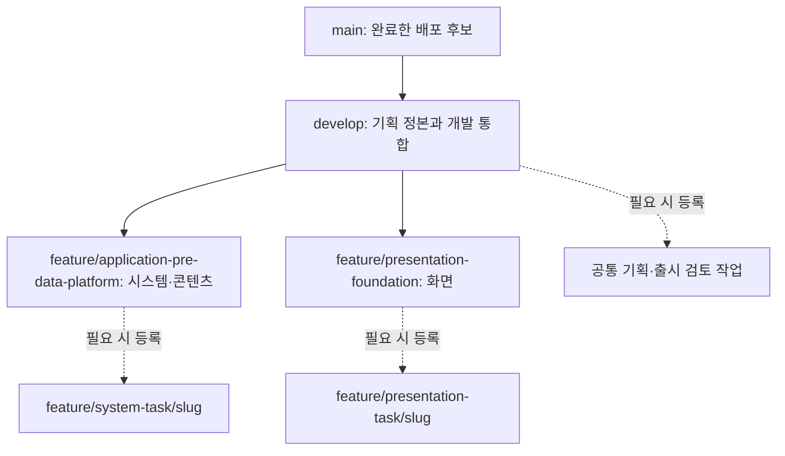

# 정시터치 개발 브랜치와 문서 운영

이 문서는 공통 명세 service_spec.json에서 생성한다. 현재 버전은 1.9.90이며 기획·라우팅·계층 문서를 같은 변경으로 갱신한다.

main은 모든 작업 완료 후 최종 코드·문서·검증·인계를 정리하는 라이브 배포 전 후보다. develop은 시스템기획팀의 현재 문서 공유와 두 개발 담당의 PR 통합 환경이다. 시스템·콘텐츠와 프레젠테이션 개발은 각각 하나의 상시 브랜치를 사용한다. 과거 기획·시안은 이력으로 보존한다.

## 브랜치 흐름

담당 임시 작업 → 해당 상시 개발 브랜치 → develop → 최종 정리·검증 PR → main → 별도 승인한 라이브 배포

초기 기반을 main에 넣었던 부트스트랩 예외는 종료됐다. 이후 main은 전체 완료·정리·검증한 develop의 배포 후보만 PR로 받으며, main 병합 자체가 라이브 배포를 뜻하지 않는다.

## 기본 4개 노드와 담당

| 브랜치 | 직접 담당 | 부모/PR 대상 | 관리 목적 |
| --- | --- | --- | --- |
| main | 시스템기획팀 최종 정리; 두 개발 담당 검토 | 최상위 배포 후보 | 전체 작업 완료 후 코드·문서·검증·인계 자료를 정리한 배포 후보. 라이브 적용은 별도 승인. |
| develop | 시스템기획팀 직접 문서 관리; 개발 담당 PR 통합 | main | 현재 개발 환경과 확정 기획의 공유 정본. 다른 팀의 구현은 PR로 누적. |
| feature/application-pre-data-platform | 시스템·콘텐츠 개발 담당 1인 / 현재 개발팀 | develop | 사용자 주도 DB·정본/저장소·산출 본체와 시스템 서비스. 화면팀과 서비스 함수 공동 개발; DB/산출 소유권 유지. |
| feature/presentation-foundation | 프레젠테이션 개발 담당 1인 / 별도 화면 작업자 | develop | 화면·BFF와 허용 서비스/애플리케이션 함수·DTO/API 흐름 공동 개발. DB/산출 보호 범위 제외. 기존 상시 브랜치 재사용. |



위 화살표는 출발/관리 관계다. 구현 PR은 하위 작업에서 부모로 올라간다. Git 브랜치는 네이티브 폴더 트리가 아니다. 이 문서의 부모는 출발 커밋과 PR 통합 경로를 뜻한다. 상시 브랜치명 뒤에 /를 붙인 하위 ref는 이름 충돌을 일으킬 수 있으므로 별도 task 접두어와 부모 등록을 사용한다.

기획팀은 develop의 service_spec.json·생성 문서와 브랜치/검사 설정을 직접 갱신한다. 다른 팀은 develop의 자료를 가져가 자기 상시 브랜치에서 개발하고 PR로 통합한다. 3티어는 코드와 포트의 구분이며 각 티어/작업/에이전트마다 브랜치를 만들지 않는다.

## 브랜치 등록부와 최신 통합 관측

정책 등록일 2026-10-04 (Asia/Seoul), 등록 기준 d666a5f2bdbc846c65b5503de35c17d6d90088db. 등록부의 상시 4개, 진행 임시 0개, 종료 이력 5개로 분류한다. 현재 원격 전체 ref 재조회 결과와 구분한다. 관측 커밋은 당시 증거이며 작업 브랜치의 미래 HEAD를 고정하는 값이 아니다.

최신 통합 관측일 2026-10-06, develop 3d90bc461c57102fc9ee8868cec7edac498470d4. root의 PR15 고정 head/CI2/GitHub merge 및 develop source 영수증 대조; 원격 전체 ref/main/server 재조회 아님

| 브랜치 | 분류/담당 | 부모와 PR 대상 | 현재 작업/근거 |
| --- | --- | --- | --- |
| feature/planning-presentation-contracts | retired_superseded; 화면 작업자의 계약 제안; 시스템기획팀 검토·정본 반영 | develop | 기존 PR #5: session.read·화면 기술 계약 제안. 미확정 계약을 현행 운영 구현으로 기록하지 않는다.; PR #5; 원격 ref: retained_closed_superseded_no_deletion_authorization |
| feature/presentation-favorable | retired_merged; 별도 프레젠테이션 작업자 | feature/presentation-foundation | 이전 PR7의종료/부모통합이력과원격ref는보존한다. 최신 PR15 source는develop3d90에merged/CI2확인됐으며원original347ancestor를새로주장하지않는다. 실browser·수치·권한·보안운영과FE-01R/FE-ORIGIN/FE-SOURCE-01은pending이다. 새개발은등록된상시부모를사용한다.; PR #7; 원격 ref: retained_finished_temporary_ref_no_deletion_authorization |
| feature/presentation-results | retired_integrated_closed; 별도 프레젠테이션 작업자 | feature/presentation-favorable | 이전 PR9의종료/부모통합이력과원격ref는보존한다. 최신 PR15 source는develop3d90에merged/CI2확인됐으며원original347ancestor를새로주장하지않는다. 실browser·수치·권한·보안운영과FE-01R/FE-ORIGIN/FE-SOURCE-01은pending이다. 새개발은등록된상시부모를사용한다.; PR #9; 원격 ref: retained_finished_temporary_ref_no_deletion_authorization |
| feature/overall-analysis-service | retired_merged; 현재 개발팀 / 과거 DEV-001 | 종료: 새 PR 금지 | develop 조상 및 진행 PR 없음 확인 후 사용자 허용 범위의 원격 참조만 삭제 완료. 새 작업 금지. 로컬 브랜치와 작업 파일은 보존. 사용자가 정확히 허용한 GitHub 원격 refs/heads/feature/overall-analysis-service만 삭제했다. develop의 커밋과 로컬 브랜치·파일·worktree·원격 추적 캐시는 보존한다.; 병합 PR #2; 원격 ref: deleted_2026-10-04_user_authorized_remote_ref_only |
| feature/planning-layer-ownership | retired_merged; 시스템기획팀 / 과거 소유권 기획 | 종료: 새 PR 금지 | develop 조상 및 진행 PR 없음 확인 후 사용자 허용 범위의 원격 참조만 삭제 완료. 새 작업 금지. 로컬 브랜치와 작업 파일은 보존. 사용자가 정확히 허용한 GitHub 원격 refs/heads/feature/planning-layer-ownership만 삭제했다. develop의 커밋과 로컬 브랜치·파일·worktree·원격 추적 캐시는 보존한다.; 병합 PR #3; 원격 ref: deleted_2026-10-04_user_authorized_remote_ref_only |

PR5closed·ref보존과PR6통합역사는유지한다. 최신PR15 ef7b7c08 exactCI2·develop3d90정상merge/삭제0·화면branch보존을확인했다. FE05빈학교fix는source통합됐으나 FE-01R/FE-ORIGIN/FE-SOURCE-01·실browser/권한/수치/보안운영은pending이다. 원격전체ref계수/등록부checked시각·main/server미재조회값은과거관측그대로이며새조회·삭제허가로확대하지않는다.

PR #5의 중복 제안은 종료됐고 head/ref는 보존한다. 정식 session.read 계약과 동적 경로 제목 검사는 현행 공통 도구로 계승했다. PR43 headebb3d2d가 develop e789313/기획1.9.81을 일반 merge했다. 정상 --write 생성/검사와 정확 head push39213665734·PR39213667946 CI success 및 MERGEABLE/CLEAN을 확인했다. Draft·미병합이며 e806 대비 화면 소스/package/wrangler 변경0으로 운영 재배포는 없다. 화면팀이 서비스 함수 공동 개발 범위를 수용했고 새 서비스 구현 완료로 확대하지 않는다. 이후 기획 변경은 기존 브랜치의 정상 merge/생성/검사를 따른다. 종료 ref는 새 개발에서 제외하고 보존한다. 후속 PR 담당은 최신 develop과 충돌을 해결한 뒤 등록 부모에 통합한다.

기본 노드는 상시 4개뿐이다. 임시 작업은 등록 후 필요할 때만 만들며 종료 시 status=retired_merged와 병합 PR/커밋을 기록한다. 브랜치 ref·로컬 파일·worktree·캐시·잠금 파일 삭제는 자동화하지 않는다. 삭제 대상·범위를 사용자에게 명시해 허용받기 전 보존한다.

## 필요한 하위 작업만 등록

| 필요 시 이름 | 부모/PR 대상 | 담당 | 생성 사유 |
| --- | --- | --- | --- |
| feature/system-task/<slug> | feature/application-pre-data-platform | 시스템·콘텐츠 개발 담당 | 독립 리뷰·충돌 분리 등 분리가 필요한 개발 작업 |
| feature/presentation-task/<slug> | feature/presentation-foundation | 프레젠테이션 개발 담당 | 독립 리뷰·화면 병렬 작업 등 필요한 분리 |
| feature/planning-task/<slug> | develop | 시스템기획팀 | 공통 계약 제안·별도 문서 검토 |
| feature/release-task/<slug> | develop | 시스템기획팀과 두 개발 담당 | 배포 전 종합 검증·문서 정리. main으로 직접 우회하지 않음 |

새 하위 브랜치 생성 전 시스템기획팀이 develop 정본의 additional_branches에 name·kind·owner·parent·pr_target·status·temporary=true·purpose·base_commit을 기록한다. 출발 SHA는 부모의 실제 커밋이어야 한다. 최초 생성 후 부모 변경은 협의해 명세와 PR base를 함께 갱신한다. 상시 노드뿐 아니라 같은 담당의 등록 임시 노드 아래에도 꼭 필요하면 작업을 등록할 수 있다. allowed_parent_kinds가 허용한 부모 역할만 사용하며 직계 부모를 건너뛰지 않는다.

각 노드에서 분리가 필요한 작업을 제안할 수 있다. main 배포 검토 작업도 develop의 release_task에서 정리해 develop으로 먼저 올리고, 최종 develop → main 경로를 유지한다. 임시 작업이 없으면 상시 브랜치 하나를 계속 사용한다.

## 작업 시작·동기화·PR

origin/develop의 최신 기획·HEAD를 확인해 자기 상시 브랜치에 일반 merge로 가져온다. 충돌은 해당 담당이 현재 공통 명세와 코드 변경 범위로 해결한다. 다른 체크아웃을 reset하거나 원자료를 재집계하지 않는다.

임시 개발 작업은 등록된 직계 부모에 먼저 PR한다. 일반적으로 부모는 담당 상시 브랜치이며 기존 PR #9처럼 등록한 임시 부모가 있으면 그 단계를 따른다. 상시 시스템/화면 브랜치는 develop에 PR한다. 최종 main PR은 develop에서만 연다. GitHub 병합은 merge commit으로 수행해 상시 브랜치의 이력을 이어 간다.

develop의 기획/계약 최종 검토와 통합 조율은 시스템기획팀이 담당한다. 두 개발자는 담당 브랜치에서 작업한다. 계약 변경에는 작업 요구사항·API·DTO·소유권·계층과 변경 검증을 같은 커밋에 포함한다. 상시 브랜치 간 직접 병합으로 develop을 우회하지 않는다. REQ-24~26·보안 개발기준은 모든 구현의 필수 참조이며 보안 gate/operation/증거 누락은 인수하지 않는다. 2026-10-19 서비스 함수 공동 개발은 service_delegation_policy를 따른다. 허용 기능은 함수별 사전 승인 없이 화면팀이 구현하고 정상 PR로 통합한다.

```text
git status --short --branch
git fetch --no-prune origin
git rev-parse origin/develop
# 담당 상시 브랜치에서 기획을 가져온다
git merge --no-edit origin/develop
# 하위 작업 PR: base는 등록된 parent
# 상시 시스템/화면 PR: base=develop
# 전체 인수 완료 후 최종 PR: head=develop, base=main
```

GitHub 병합은 merge commit만 허용하고 squash/rebase 병합과 병합 후 자동 브랜치 삭제를 끈다. 상시 브랜치의 이력이 이어지고 통합 뒤 다시 같은 브랜치에서 개발할 수 있다. 미커밋 변경이 있으면 먼저 보존·검토하고 강제 checkout/reset/clean 없이 진행한다.

## develop 직접 변경 범위와 적용 검사

| 검사 지점 | 검사/실제 한계 |
| --- | --- |
| local | pre-commit은 등록·활성 브랜치와 파일 삭제 금지를 검사한다. develop은 planning 선언 및 허용 문서/관리 경로만 직접 stage할 수 있다. pre-push는 main 직접 푸시·ref 삭제·non-fast-forward와 develop 범위 위반을 차단한다. 각 clone에서 훅 활성화가 필요하다. |
| CI | PR head/base를 정본의 부모 경로와 검사하고 planning task는 문서/관리 변경만 허용한다. push는 등록 브랜치·develop의 직접 커밋 범위·non-fast-forward를 검사한다. 모든 merge commit PR을 사용하며 이전 정책 도입 전 커밋은 새로운 시행 커밋 이전 이력으로 보존한다. |
| limits | 현재 비공개 GitHub 요금제의 보호 API는 403이다. 원격 권한·PR 승인·검사 통과를 서버에서 강제할 수 없다. 로컬 planning 선언은 신원 인증이 아니며 훅 우회/API 직접 변경을 기술적으로 막지 못한다. CI 실패는 반영 자체를 되돌리지 않으므로 시스템기획팀이 결과를 확인한다. |

기획팀의 직접 허용 범위는 docs/·.github/·.githooks/와 아래 공통 관리 파일, 생성된 현재 문서/카탈로그/README다. 업무·화면 실행 코드·DB 마이그레이션·런타임 잠금은 담당 개발 PR로만 누적한다.

- README.md
- AGENTS.md
- .gitignore
- .gitattributes
- scripts/check_project_consistency.py
- scripts/check_branch_policy.py
- tests/test_branch_policy.py
- tests/test_project_consistency.py
- tests/test_ci_snapshot_preservation.py
- tests/test_deletion_approval.py
- tests/test_session_contract.py
- scripts/audit_documentation_sync.py
- tests/test_documentation_sync.py
- docs/current/code_routing_index.json
- scripts/check_edge_contract.py
- scripts/run_edge_tests.py
- tests/test_edge_harness.py
- tests/test_edge_source_scope.py
- scripts/edge_source_scope.py
- scripts/run_committed_tests.py
- scripts/bootstrap_edge_runtime.py
- tests/test_edge_runtime_supply.py
- edge-runtime.lock.json

기획팀은 현재 셸 세션에서만 아래처럼 역할을 선언한다. .env 파일을 만들거나 GitHub 인증정보를 기록하지 않는다. JUNGSI_TEAM=planning (해당 셸 세션에만 설정; 신원 인증이나 GitHub 권한 분리는 아님).

```powershell
$env:JUNGSI_TEAM = "planning"
python -B scripts/check_branch_policy.py --staged
```

## main 최종 반영과 라이브 적용

현재 release_gate.state=not_ready. 전체 작업 완료와 최종 자료 정리가 확인될 때에만 ready로 바꾸고 각 항목에 증거 경로/PR/커밋을 남긴다. main 병합 후에도 라이브 배포 승인은 별도다.

| 최종 인수 항목 | 상태 | 확인할 증거 |
| --- | --- | --- |
| system_contracts | passed | 정식22 API/session/forecast 서비스·DB 계약은493개 정상Git스냅샷 검사와PR13/develop947cee8 CI를 거쳐 인수·통합완료. 실제로그인/이용권/DB/Drive와외부프런트는다른pending gate로분리한다. |
| presentation | pending | PR15 ef7b7c08/CI2·develop3d90통합·삭제0/branch보존은source인수다. FE-01R/FE-ORIGIN/FE-SOURCE-01·실browser/유효action·권한/전달물·실429/숫자·보안gate는pending이다. |
| live_connections | pending | SQL001002003/fresh권한metadata·UTC/타입·master명시port와합성10행별도process지속성은제한PASS다. 기본factorylegacy유지·실JWT/유료rows·livehost/승인자료/Drive·22API/security운영은미인수다. |
| approved_data | pending | 승인 자료/모형 공급 및 실제 결과 검수 대기. GitHub에 실제 데이터 업로드하지 않음 |
| release_validation | pending | 최종 develop SHA의 문서·경로·계층·데이터 제외·CI 및 통합 검증 필요 |
| handoff | pending | 최소자료staged/보류·app/owner배포설정경계와직접인간기본경로유지결정을기록했다. backup/restore·실권한/자료활성화·후보sameSHA/CI·별도배포승인은pending이다. |
| security_response_artifacts | pending | 모든 역할 HTTP 응답과 실제 외부 화면 빌드/브라우저 노출 검수 NOT_RUN |
| security_direct_authorization | pending | 서버 중계·실세션/이용권·소유권·관리 범위와 직접 접근 거절 NOT_RUN |
| security_harvest_controls | pending | 공유 원자적 예산·무료 누백/paid 후보·동시성/재시작/429 검수 NOT_RUN; 운영 숫자 승인 필요 |

최종 PR에는 배포 후보 develop SHA·문서/계약 버전·CI/통합 검증·실제 연결 검수·운영/복구 인계 근거를 담는다. 모든 체크가 passed이고 증거가 있을 때만 ready로 확정한다. main 병합 뒤 별도 승인한 배포를 실행한다. 기능 완료·합성 테스트 성공만으로 실제 데이터와 라이브 준비 완료를 표시하지 않는다.

현재 기준의 출발 커밋은 87dba635ebc5119e53e9c7e3c5f456636a9c50e9이다. 작업 시작 시 현재 브랜치·HEAD·변경 목록을 확인한다. 커밋하지 않은 다른 작업자의 코드나 로컬 전용 검수 결과를 구현의 확정 기준으로 취급하지 않는다.

## 한 변경에 포함할 내용

요구사항과 페이지/API 경로를 공통 명세에 반영하고 해당 계층의 코드를 수정한다. 문서와 경로 카탈로그를 생성하고 검사·검산한 뒤 같은 커밋으로 올린다. 코드·공유 도구·워크플로·테스트 변경이 있으면 공통 명세와 현재 기획·라우팅 문서가 같은 변경 목록에 있어야 한다. 변경 메모에 실제 구현 범위를 기록한다. develop에서 검증한 PR만 main에 반영한다. main 반영 후에도 develop을 통합 개발 기준으로 유지한다.

## 문서 생성과 검사 명령

```text
python -B scripts/audit_documentation_sync.py --sync
# 검토한 이번 작업 파일만 경로를 명시하여 stage
git add -- <reviewed-work-item-paths>
python -B scripts/check_project_consistency.py --staged
python -B scripts/run_committed_tests.py --staged
```

검산은 선택한 Git 인덱스 또는 커밋의 파일을 새 outputs 폴더에 복사해서 실행한다. 커밋하지 않은 코드와 제외된 실제 데이터 의존 테스트를 섞지 않는다. 기존 파일·검산 폴더를 정리하거나 삭제하지 않는다.

## 로컬 훅과 GitHub 검사

공통 문서·경로 계약·훅·새 계층 코드의 줄바꿈은 .gitattributes에서 LF로 고정해 Windows와 CI의 바이트 검사를 일치시킨다. 각 체크아웃에서 git config --local core.hooksPath .githooks를 설정한다. Python 경로가 필요하면 git config --local jungsi.python으로 실행기를 지정한다. pre-commit은 등록 브랜치·develop 직접 범위·파일 보존과 스테이징된 문서·코드·데이터 제외·합성 테스트를 검사한다. pre-push는 main 직접 푸시·ref 삭제·강제 갱신·develop 직접 범위를 차단한다. GitHub Actions의 검사 이름은 project-consistency다.

GitHub는 현재 비공개 저장소 보호 조회에 HTTP 403과 요금제 업그레이드 요구를 반환했다. 따라서 원격 PR·검사 통과 강제 보호는 활성화되지 않았다. 로컬 훅은 각 체크아웃에 적용되며 서버의 강제 보호와 같지 않다. 보호 지원 요금제에서 main에 PR·검사 통과, 강제 푸시·브랜치 삭제 금지 규칙을 적용한다. 저장소 비공개 상태는 유지한다.

## 파일을 보존하는 CI 스냅샷

| 항목 | 실행 기준 |
| --- | --- |
| runner | GitHub-hosted ubuntu-24.04의 사전 설치 Git/CPython 3.12를 사용하고, Deno 2.9.7은 고정 공식 아카이브를 새 outputs/ci_edge_runtime에 명시적으로 공급한다. checkout/setup-python/외부 설치 액션·시스템 설치·최신 버전 대체는 사용하지 않는다. |
| destination | GITHUB_WORKSPACE/retained_snapshots/run_<run_id>_attempt_<run_attempt>가 존재하거나 symlink이면 중단한다. 새 비존재 경로만 생성하고 기존 경로·파일을 보존한다. |
| commit | git init 후 github.sha와 전체 부모 이력, refs/heads/develop 및 refs/heads/feature/presentation-foundation을 fetch한다. 두 origin tracking ref의 고정 SHA가 확인돼야 지정 github.sha를 최초 detached checkout한다. 각 HEAD/ref가 확보된 SHA와 다르면 실패한다. |
| credentials | GitHub token은 fetch subprocess의 GIT_CONFIG_* http extraheader 환경으로만 전달한다. argv/로그/파일과 init/checkout/test subprocess에는 전달하지 않는다. Git trace 및 외부 config 입력을 차단하며 실패는 원문 진단 없이 안전한 사유로 기록한다. |
| preservation | gc.auto=0, maintenance.auto=false와 fetch --no-auto-maintenance를 적용한다. clean/reset/drop/기존 경로 초기화/temp cleanup을 호출하지 않는다. 생성 runtime/다운로드/검산 스냅샷은 정리하지 않는다. |
| verification | 보존/ref/인증 범위 합성 검사를 포함한 b66의 정상 commit/push 훅 530건 PASS와 정확한 HEAD project-consistency CI success를 확인했다. 이후 문서 커밋의 미래 SHA/미실행 CI를 성공으로 기록하지 않는다. 기존 경로·출처 보존과 실제 운영/외부 프런트 미검증 경계는 유지한다. |

## 공유 실행 도구

- scripts/calculate_overall_percentile.py
- scripts/analyze_exam_score.py
- scripts/compare_year_scores.py
- scripts/demo_profile_percentile.py
- scripts/demo_school_screening.py
- scripts/demo_total_curve_principle_20260927.py
- scripts/import_kice_exam.py
- scripts/check_project_consistency.py
- scripts/run_committed_tests.py
- scripts/bootstrap_backend_runtime.py
- scripts/probe_backend_connection.py
- scripts/check_branch_policy.py
- scripts/audit_documentation_sync.py
- scripts/check_edge_contract.py
- scripts/run_edge_tests.py
- scripts/edge_source_scope.py
- scripts/bootstrap_edge_runtime.py

실제 모집표·매핑·상담자료가 든 나머지 작업 도구와 원자료 검증 결과는 로컬 전용이다. 새 공통 도구를 공유하려면 명세의 공유 목록과 .gitignore를 함께 갱신한다.

## 공식 설정 근거

[GitHub 브랜치 보호](https://docs.github.com/en/repositories/configuring-branches-and-merges-in-your-repository/managing-protected-branches/about-protected-branches)와 [Python 자동 검사](https://docs.github.com/en/actions/tutorials/build-and-test-code/python)를 참고한다.

## 계층별 담당과 브랜치

기획 정본은 시스템기획팀이 develop에서 관리한다. 사용자 주도 DB·산출 담당자는 DB/엔진 본체를 유지하고, 화면 담당자는 화면과 허용 서버 서비스 함수를 기존 상시 브랜치에서 자율 개발한다. 두 담당은 develop PR로 통합하며 실행3티어·데이터/보안 경계는 유지한다.

| 담당 영역 | 작업자 | 코드와 문서 위치 | 브랜치 |
| --- | --- | --- | --- |
| 공통 기획 | 시스템기획팀 | docs/current/service_spec.json, scripts/check_project_consistency.py | develop |
| 프레젠테이션 | 다른 PC의 프런트 전담 개발자 | apps/web | feature/presentation-foundation (상시); 등록된 presentation_task만 하위 작업 |
| 애플리케이션 | 기존 DB·산출 담당과 화면구현팀 공동(보호 본체 제외) | src/jungsi_touch/application, src/jungsi_touch | feature/application-pre-data-platform 또는 feature/presentation-foundation |
| 데이터와 인프라 | 사용자 주도 기존 DB·산출 담당; 데이터팀 비공개 자료 정리 | src/jungsi_touch/infrastructure, database | feature/application-pre-data-platform |

시스템기획팀은 develop의 현재 HEAD와 원격 동기화 상태를 확인하고 기획 정본을 검증·공유한다. 서버 개발팀과 별도 프레젠테이션 담당은 최신 origin/develop의 기획 기준과 출발 SHA를 확인하고 각자의 기존 작업 브랜치를 재사용한다. 다른 작업자의 미커밋 변경을 기준으로 삼지 않는다. AGENTS.md와 외부접근_데이터보호_개발기준.md를 반드시 읽고 변경 operation의 SEC 통제를 확인한다.

시스템기획팀만 develop에서 기획·공통 관리 설정을 직접 관리한다. 시스템·콘텐츠 개발자는 feature/application-pre-data-platform, 화면 개발자는 feature/presentation-foundation을 상시 재사용한다. 다른 팀은 develop에서 직접 구현하지 않고 담당 브랜치의 PR로 누적한다. 3티어는 폴더·포트·의존 관계로 구분한다. 하위 작업은 필요 시 부모·담당·사유를 정본에 등록하며 작업 항목이나 에이전트마다 생성하지 않는다. 상시 시스템/화면 브랜치의 통합 대상은 develop이고, 하위 개발 작업은 등록된 직계 부모에 먼저 통합한다. main에는 작업이 모두 끝나고 최종 검증·인계가 정리된 develop만 PR로 반영하며 라이브 배포는 별도 승인한다.

현재 개발팀의 기존 브랜치는 feature/application-pre-data-platform이다. 화면 작업자는 feature/presentation-foundation를 화면 담당의 상시 브랜치로 재사용한다. PR43 headebb3d2d가 develop e789313/기획1.9.81을 일반 merge했다. 정상 --write 생성/검사와 정확 head push39213665734·PR39213667946 CI success 및 MERGEABLE/CLEAN을 확인했다. Draft·미병합이며 e806 대비 화면 소스/package/wrangler 변경0으로 운영 재배포는 없다. 화면팀이 서비스 함수 공동 개발 범위를 수용했고 새 서비스 구현 완료로 확대하지 않는다. 이후 기획 변경은 기존 브랜치의 정상 merge/생성/검사를 따른다.

route_catalog.json과 생성 README/현재 문서는 직접 편집하지 않는다. 계약 변경은 service_spec.json과 생성 도구에서 수정하고 생성 결과를 같은 커밋에 포함한다.

두 개발 담당은 origin/develop의 같은 커밋에 있는 service_spec과 생성 문서를 가져가 구현한다. 계약·필드·오류/보류 사유가 바뀌면 시스템기획팀과 해당 계층 담당에게 인계한다. 통합되지 않은 feature의 코드·가상 응답을 develop에 구현된 기능으로 기록하지 않는다. 현재 기획팀과 서비스·DB 개발팀은 외부 프런트 담당에게 확정 공통 계약과 백엔드 인수 증거를 전달한다. 외부 프런트의 수정·브라우저 인수검증은 해당 담당자의 완료 증거를 별도로 확인한다. 화면팀은 service_delegation_policy의 허용 서비스 함수를 스스로 구현한다. 새 DB/산출 작업만 기존 담당에게 인계하며 일반 노출 필드/서비스 함수마다 사전 승인을 요구하지 않는다. 공유 DB 용량 후속 DB-CAP-01은 현재값과 릴리스별 검수/회원 이력의 단위를 구분해 읽기 전용으로 진단한다. 파일/이전 버전·현재 head를 보존하고 보관 정책·변경 범위/전후 인수 없이 정리·이관·인덱스/요금 변경을 하지 않는다. 전국 로컬 준비와 승인된 최종 단일 writer는 별도 현재 체크포인트를 따른다.

Git 변경 범위와 해당 계약·필수 커밋 검산을 확인한다. 원자료 전수검수나 전국 재집계를 매 개발 작업에서 반복하지 않는다. 하위 브랜치 병합은 등록된 직계 부모 또는 승인된 develop 인입과 결속한 Git merge-tree 결과를 기준으로 확인한다. 충돌 해결 근거와 별도 직접 수정의 승인 범위를 구분하며 삭제 차단·팀 권한·main 승격·등록 부모·fast-forward 규칙을 유지한다. merge_scope_policy 표식이 있는 커밋부터 병합 재구성 정책을 적용한다. 과거 병합은 소급 판정하지 않으며, 기획 경로 충돌 해결과 비기획 자동 병합 결과를 구분한다.

## 화면팀 서비스 함수 공동 개발 · 2026-10-19 사용자 지시

| 업무 | 담당과 허용 범위 |
| --- | --- |
| 화면과 서비스 함수 | 화면구현팀(서비스 함수 공동 개발) / 기존 승인 저장소 포트·엔진 결과를 이용하는 서버 조회·조합·업무 흐름·입력 검증·오류 매핑·DTO·공개 응답/경로·표시용 파생값을 직접 신규 작성·수정한다. 표시용 단위·상태·문자열·페이지 건수와 승인된 기존 표시 추정식을 재사용하며 새로운 환산·누백·분포·지원판정 산출을 만들지 않는다. |
| DB·저장소와 산출 본체 | 사용자 주도 기존 DB·산출 담당 / feature/application-pre-data-platform / DB 스키마/마이그레이션·SQL·실저장소/공급 어댑터·정본/발행 writer 및 수능/대학 환산·누백·동등화·분포/모형·지원판정 산출 본체·가중치와 집단/동점 정의. |
| 사전 승인과 통합 | 허용 서비스 함수는 매 함수별 사전 승인 없이 기존 화면 브랜치에서 자율 개발한다. 코드·명세·라우팅·검증을 같은 커밋에 포함해 develop PR로 통합한다. 정본 기획/공통 검사 직접 수정은 기획팀이 담당하고, 기능 계약 변경 제안은 해당 feature PR에 함께 둔다. 새 DB/산출 본체 작업이 필요할 때만 기존 담당 범위로 인계한다. |
| 계층·보안 | 개발자 권한과 실행 계층을 구분한다. 화면팀이 작성한 서비스 함수도 서버 application에서 승인된 포트와 엔진을 이용한다. 브라우저 DB/비공개 모형 접근, 실제 값 하드코딩, 결측의0/ready 치환,인증·소유권·입력권·멱등·예산·relay·응답 허용목록 우회를 허용하지 않는다. DB/Secrets/역할/운영 승인 권한을 새로 부여하지 않는다. |
| 혼합 파일 | 혼합 Python platform.py의 서비스 조회/조합/DTO는 공동 수정하되 PlatformService.statistics의 산출 AST·참조 전역 바인딩·클래스 기반은 유지한다. TypeScript report_actions/paid_result_components와 산출 혼합 본체는 현 보호 파일로 유지하고 화면 확장은 별도 application 서비스 함수에서 기존 포트/엔진을 호출한다. 기존 승인 표시 추정식의 계약은 유지한다. |

담당 브랜치: feature/presentation-foundation → develop. 최신 검증 develop부터 변경 범위만 확인하고 기획·라우팅·요구사항·권한/소유권·계층·검증 상태를 같은 명세/커밋에서 일치시킨다. 정상 pre-commit/pre-push·정확 SHA CI·기존 보안/데이터 제외 검사를 유지한다.

| 분류 | 경로 |
| --- | --- |
| 기존 DB/엔진 보호 prefix | database/, src/jungsi_touch/infrastructure/, supabase/functions/_shared/jungsi/domain/, supabase/functions/_shared/jungsi/infrastructure/ |
| DB/SQL 보호 pattern | *.sql, supabase/functions/**/*_sql.ts, supabase/functions/**/*_postgres.ts, supabase/functions/**/postgres_pool.ts |
| 계산/혼합 본체 보호 파일 | src/jungsi_touch/admission_result_percentile.py, src/jungsi_touch/application/estimated_population.py, src/jungsi_touch/application/forecast_assessment.py, src/jungsi_touch/application/forecast_policy.py, src/jungsi_touch/application/offering_analysis.py, src/jungsi_touch/application/overall_analysis.py, src/jungsi_touch/application/university_percentile.py, src/jungsi_touch/application/university_scoring.py, src/jungsi_touch/estimated_curves.py, src/jungsi_touch/estimated_fitting.py, src/jungsi_touch/estimated_profiles.py, src/jungsi_touch/estimated_validation.py, src/jungsi_touch/exam_pack.py, src/jungsi_touch/forecasting.py, src/jungsi_touch/joint_distribution.py, src/jungsi_touch/percentile.py, src/jungsi_touch/percentile_cli.py, src/jungsi_touch/profile_percentile.py, src/jungsi_touch/reference_curve.py, src/jungsi_touch/reported_score_mapping.py, src/jungsi_touch/school_screening.py, src/jungsi_touch/university_conversion.py, src/jungsi_touch/year_comparison.py, src/jungsi_touch/year_equating.py, supabase/functions/_shared/current_review_model_codec.ts, supabase/functions/_shared/current_review_model_validation.ts, supabase/functions/_shared/jungsi/application/forecast_assessment.ts, supabase/functions/_shared/jungsi/application/forecast_calculation.ts, supabase/functions/_shared/jungsi/application/offering_analysis.ts, supabase/functions/_shared/jungsi/application/overall_analysis.ts, supabase/functions/_shared/jungsi/application/paid_result_components.ts, supabase/functions/_shared/jungsi/application/report_actions.ts, supabase/functions/_shared/jungsi/application/university_percentile.ts, supabase/functions/_shared/jungsi/application/university_scoring.ts |
| 공동 수정 HTTP 어댑터 | src/jungsi_touch/infrastructure/http_api.py, src/jungsi_touch/infrastructure/secured_http.py, supabase/functions/_shared/jungsi/infrastructure/api_http.ts, supabase/functions/_shared/jungsi/infrastructure/supabase_api_ingress.ts |
| 보호 경로 안의 생성 문서 | database/README.md |
| 혼합 Python 산출 보호 | src/jungsi_touch/application/platform.py: PlatformService.statistics |

로컬 훅/CI는 등록 경로·보호 Python 산출 AST/바인딩·정본 소유 정책을 검사하며 승인된 develop 인입을 새 화면 변경과 구분한다. TypeScript 혼합 본체는 파일 단위로 보호한다. 이는 GitHub 계정/DB 권한 분리나 모든 의미 변경의 자동 증명이 아니다. 공통 명세·보안/3티어·회귀 검토를 유지한다. 정책 변경은 기획 develop에서만 하고 기존 브랜치·원본·파일은 삭제하지 않는다.

## Supabase 운영 인수 상태

보관된 이전 운영 검수 이력: 현재 develop57f74b1daabd2d6a8e94de216f182e8bfe6557b7에 서비스phase2와 승인된 병합 하네스 수정이 통합됐다. 정상precommit/prepush/정확HEAD pushCI/PR병합시험CI/최종developCI각678PASS·실패/오류/skip0이며 main은 보존했다. 최소source-only draft18의신규2 ownerINSERT COMMIT/freshapp18과선별Storage18(fullGET/SHA·비인증72건본문미반환)을확인했다. 최종appTLS READONLY exact18/old16불변/new2exact 독립영수증도PASS이며003/13RLS24policy·공개/Storagebaseline보존을확인했다. 원수능AST source는 보존하고 모평적용child3의 source/applicationContext를 분리 확인했다. engine/production/runtimefalse·publishednull과 기본회원경로유지/명시DI만준비선택은 확정 유지다. 공식입결v2/v3의미실패는보존하고 최소선별v4의일부학교/학교년도local·remote native범위PASS를 수령했다. 신규2개DB메타등록을수령하고최소공식source2의독립native58/frozenRAM39를기록했으며전체draft18/발행0·전국완료false를유지한다. 최종freshapp18독립검수도완료했다. StorageRLS메타는현재보호bucket에클라이언트SELECT허용조건없음을확인했으나실제JWT HTTP/운영SECgate는NOT_RUN이다. v2설계승인·최신v1.1/14경로PLAN_ONLY구현계획은 준비됐으나 코드0·품질/newscopeFE공통계약/모형호환·계산채택은 미완료다. 실제JWT/APIorigin·22API/4페이지/보안운영·live배포는 미인수다. 과거제안/실패/fixture·관측은 보존한다.

2026-10-10 Owner 작업 준수(DEP-IO-01-WINDOW): 대량 작업은 매일 02:00~06:00 KST, 최대 4시간의 조건부 창에서 한 팀의 한 작업만 수행한다. 시작 전 경고가 있으면 그날 SKIP하고 일관된 체크포인트에서 중단하며 기존의 더 짧은 배치·bytes·5초·RLS·subject·승인/만료 한계를 유지한다. 소량 조회 예외는 과거57014 전수 쿼리나 요청 수·limit만으로 적용하지 않는다. CAP-03은 정확한 표·PK·열·영향·비삭제 대안의 별도 제거 승인 전 단계이며 registry/overlays를 보존한다. 정확 관측 시각 UNCONFIRMED·원인/예산 회복 미확정·I/O HOLD·컴퓨트 변경 보류다. Storage·정리·VACUUM·read model·배포·PIN/만료 연장·자동 실행은 이번에 수행하지 않았다. 공식 입결 DB 표시 연결 문서의 같은 ID 준수 절을 함께 따른다. 지표 확장/가산점 요약은 데이터팀·서비스팀의 미채택 CR 준비안 검토까지 완료했고 자료 발행·DTO/엔진/화면·실API/BFF 인수는 NOT_RUN이다.

2026-10-10 읽기 모델 수정 후보(spec1.9.33): 사용자 지시에 따라 개발팀은 현재 정본의 검색용 narrow model과 명시 provider/handler·typed 검증·prepared DDL7파일 후보를 구현하고 데이터팀·독립 검토·native 합성 HTTP를 준비한다. 서명 유효성과 전체 원형 census·source coverage/fence 완전성은 별도 판정이며 실제 trusted baseline receipt 부재는 NOT_READY다. 기존 전수5초57014 실패는 보존하고 실제 DDL/GRANT/RLS·model build·성능·새 승인 PIN4·배포·JWT/BFF/브라우저는 NOT_RUN이다. DB 정리·VACUUM·과금 변경은 수행하지 않는다. fresh UI에서는Healthy와 용량 증가만 확인했으며 IOPS/처리량/연결 그래프는 불러오지 못해 I/O 회복 미확정/HOLD를 유지한다.

[Supabase 운영 인수인계](Supabase_운영_인수인계.md)를 따른다. revision 2026.10.07.v9; HTTP 관측 시각 2026-10-06T08:40:54.349322Z.

[화면팀 최종 회신 요청](화면팀_회신요청_최종.md)의 RF-01~06과 로컬 요청 ①~⑥를 함께 인수한다. 문서 전달 준비 완료는 담당자 회신·실제 연결·운영 검수 완료를 뜻하지 않는다.

[화면팀 후속 작업 지시](화면팀_후속작업_지시.md)의 FE-01~05는 로컬 검수 보고 이후 발견한 결함·증거 보완·승인 자료 대조·후속 PR 통합을 담당한다.

PR13 adc684/74fd/947의493건·b66의530건·PR14 구현429/병합91과 문서816의 정상561건/정확CI는 확인된 이전 코드 인수 이력이다. 이번 문서 후보의 미실행 검사·미래 commit/CI와 실제 운영 완료를 뜻하지 않는다.

## DEV006⑦ 정확한 파일 삭제 승인 검사

기본값은 deny다. develop947 이후 등록·공통 검사는 시스템기획팀, 실제 삭제와 화면 검증은 외부 화면 개발팀의 범위다. 서비스 개발팀은 서비스 계층만 담당한다. 삭제 승인 등록 당시의 역사 관측 상태: observed_completed_external_not_integrated. 이 관측을 현재 PR 통합 상태로 취급하지 않는다. 별도 develop 선행 등록 전에는 후보가 스스로 승인할 수 없다.

| 정확한 경로 | mode | 고정 Git blob | 원본 바이트 SHA256 |
| --- | --- | --- | --- |
| apps/web/src/app/admissions/possibilities/actions.ts | 100644 | c1f0200bec8cdd20f23e49134125a7cff7b17fce | fe2fcf6e3e02c9a08c4d7922babd6e4c8c1d6a10ccdd3b7120493dfb3dfe5c68 |
| apps/web/src/components/pending-page.tsx | 100644 | 2bd4303143db69494460f8740977c90c2e4060c1 | 7fd9a61c79fc4b09296d6140db4318482974ee37a8a47dc034e72c53af08a9ec |
| apps/web/src/lib/api/synthetic-fixtures.ts | 100644 | a8e5bb68743d8f2f5a776964f8c042d09a97dc51 | bdc103cb6059e29f1192d22e40275da77ff17beb17a7414577df40c0fe245ede |
| apps/web/src/lib/contract.ts | 100644 | c12709ab04dba81d6f4748b3fea7a937b5a0d6c9 | 0456daf6671c4c2ba76b932dc7d7cf5022cd96b398a1baa10c219b0013f7e478 |

출발 브랜치: feature/presentation-foundation; 출발 커밋: f46c6635664a6c2315e6c71c4f700aa3e331c60c; 사용자 메시지: 01a10bf5-898b-7180-8442-3bfd4d1c2914; 요청서 SHA256: 686e51deb7f29cc259e5fb8d63e1c16456b16aebfa5fc9f4c04e9988d0d694e3. 원본과 이전 버전은 보존한다. 최초 삭제와 승인된 삭제의 부모 병합 승계를 구분하고 다른 경로·수정/복원 후 재사용·병렬 삭제 origin의 재소비·과거 소급·숨긴 sideparent·ref 삭제·force를 거절한다. 동일한 승인 삭제 origin을 develop/main으로 운반하는 정상 병합과 새로운 삭제 사건은 구분한다.

[명시 Supabase 실행 자료 연결·공급자별 readiness·운영 준비](Supabase_실행자료_연결.md)의 DEV-009 계약을 함께 따른다.

## 현재 운영 플랫폼과 화면 인계

[Google Drive·Supabase 전용 배포 계약](Supabase_배포_화면_후속작업.md)이 이전 별도 FastAPI 호스팅/외부 워커 인계보다 우선한다. Python 검산은 보존하고 Edge 호환과 실제 인수는 후속 작업이다. relay는 X-Jungsi-Relay-Token 확정 계약이며 발행 감지는 최신 승인 native 버전/해시를 사용한다. 화면 제공 범위와 요금제 포함량 검수는 완료 전 상태를 유지한다.

## 기존 입결 DB를 화면 API에 연결

[공식 입결 DB 표시 연결](DB_입결_화면연결.md)의 DEV-011을 따른다. 기존 DB를 별도 목적 범위로 명시 조회하며 기본 이용권·엔진/운영 원형 상태·22API/DTO·보안 gate를 유지한다. 코드 implemented_current_review_local_owner_intake_and_offline_four_page_diagnostics; C_plus_official_exam_local_native_HTTP_partial_success_and_exact_holds_verified; full_calculation_live_and_general_publication_pending; 실제 검수/운영 상태는 같은 문서의 항목별 증거로 확인한다.

## 1페이지 추정 2열과 초안 시사

[공식 자료·추정 표기·시사 계약](1페이지_공식자료_추정표기_시사.md)을 따른다. 추정 총 지원자·추정 탈락자 2열을 유지한다. 대학 발표 공식 지표와 분리된 화면 파생값이며 자체 누백/예상컷/개인 분석을 1페이지에 추가하지 않는다. 2026-10-19 사용자 채택: 1페이지의 자료 공급 범위는 현재 단일 정본의 서비스 대상 전국 전체다. 학교별 부분 발행 완료를 기다리는 조건을 이번 연결에 적용하지 않는다. 현재값을 읽는 공개 어댑터·명시 승인 binding과 페이지별 검수는 별도로 완료해야 하며, 자료가 부족한 셀은 보류/null로 보존한다. 동일 학년도/모집행/통계 분모와 결측·실제0·음수를 검사하고 실제 불합격자수와의 차이를 표시한다. API의 공식 history_metric과 회원 권한은 유지한다. 학교별 부분 발행은 단일 활성 catalog의 누적 불변 판으로 착수하며 source 승격·자동 병합을 하지 않는다. 실제 발행된 과거 입결의 목록/검수 계보·부분 조회를 화면에서 대조하고 승인·선택·수신·브라우저·운영 발행은 별도 인수다.

## 개발 변경과 문서 동기화

[현재 개발현황과 문서 동기화](개발현황_문서동기화.md) 및 [코드 색인](code_routing_index.json)을 먼저 읽는다. 최신 검증 커밋부터 Git 변경 파일과 연결된 요구사항·라우팅만 검토하고 공통 명세에서 모든 문서를 함께 생성한다. 모든 에이전트는 코드·기획·라우팅을 같은 커밋에서 일치시키고 필수 훅·CI를 통과해야 한다. 이미 검증한 원자료·전체 소스를 매 작업마다 다시 읽지 않는다. 범위 확대 사유와 실제 운영 미검증 상태는 별도로 기록한다.

## 공통 도구의 확인된 이전 인수 기준

| 범위 | 확인한 증거 |
| --- | --- |
| 공통 Git/CI 검사·명세·생성 문서 | b66c2274f0b0a27dc174555adde181cd16c68188; tree bd23bf5bd1ec0a05fed7c7f8db7db39621bf2748 |
| 정상 commit/push 훅 | 530건 PASS; 실패 0·오류 0·건너뜀 0 |
| 정확한 HEAD GitHub CI | [project-consistency](https://github.com/natural0448/Jungsi_touch/actions/runs/37324278331/job/111810898785): success |
| 서비스·DB 역사 기준 | adc684/74fd 구현과 develop947 통합의 493 PASS는 별도의 역사 인수 증거로 유지한다. |
| 당시 외부 프런트 관측 | d7b0279b2725a81ecd734cdec957c485ae5d6172; 4cc에서 필수3버전의 비어 있지 않은 문자열·정확동일성 보완과context17비교유지를관측했다. 실제Caller/브라우저/운영로그인인수는NOT_RUN이다. |
| 승인 등록 당시 외부 삭제 관측 | observed_completed_external_not_integrated; 이후 develop 통합과 실제 브라우저 인수는 각각의 정확한 증거로 구분한다. |
| 운영/외부 인수 | verification_pending; DB .env 추후; main not_ready |

확인된 이전 baseline b66까지만 증거로 명시한다. 후속 문서 커밋 자신의 미래 SHA나 미실행 CI 성공을 기록하지 않는다. 공통 Git/CI 검사·명세·생성 문서 인수 및 전체 합성 회귀. 운영 DB·외부 프런트·실제 데이터·모형 운영 승인을 뜻하지 않는다. 이전 e12/676 버전값 보완 pending은 역사이며 최신 소스 관측과 실제 프런트 인수 대기를 구분한다. 최소 profile 조건 읽기와 실제 로그인 JWT NOT_RUN, 실제 자료·모형 운영 미승인 상태를 유지한다.

## 외부 접근 데이터 보호: 개발 시작 전 필수

[외부접근 데이터보호 개발기준](외부접근_데이터보호_개발기준.md)을 작업 전에 반드시 읽는다. 정본은 service_spec.json의 security_contract와 workflow.development_harness이며 보안 revision은 2026.10.06.v1이다. REQ-24~26 / SEC-01~08은 화면·API·DB 개발의 공통 기준이다. 공개 응답의 재귀 허용목록, 서버 중계와 사용자 권한, 공유 누적 사용량 통제를 함께 구현한다. 기획·라우팅·route_catalog와 AGENTS 필수 참조는 동일 Git 스냅샷에서 하네스가 검사한다. 현재 운영 인수는 production_ready=false이고 3개 보안 release gate는 pending이다. 문서/계약 검사 통과는 런타임 차단 구현·브라우저·운영 DB 검수 완료와 구분한다.

## 2026-10-14 오픈 전 최신 확정

유료 이용권 원본은 public.jeongsi_passes이며 관리자 접근 예외는 동일 검증 Bearer·본인 role=admin/status=active·aal2·요청 내부 origin이 모두 필요하다. 실제 만료 우선, 예외만 paid+null, 일반 paid 만료 누락503과 FE-ADMIN-ACCESS-01을 따른다. 관리 8경로의 검증 aal2·본인 active 상태·기존 학교 권한을 결합한다. 이 문서에 남은 과거 어댑터/명시 연결 전용 결정은 당시 이력이다. 현재 변경 범위와 검수 상태는 [오픈 전 보안운영 변경](오픈전_보안운영_변경.md)와 opening_security_operations_contract를 우선한다. API22/session3·자료 승인/보존 경계는 유지한다.


<!-- jungsi:generated spec_sha256=0f1c35764f669e549dff0ce51667d9df1ab6d0b8931e7ea60c10c1d616244c95 -->


## DEV-010 foundation TypeScript 등록과 검산

상태: required. domain은 애플리케이션 내부 계산 라이브러리다. TS 선언·기본값·반환형·import graph는 고정 snapshot에서 Deno doc/info로 대조한다.

| 파일 | 계층 | 등록 심볼 |
| --- | --- | --- |
| supabase/functions/_shared/jungsi/application/access.ts | application | AccessError, authorizeCurrent, authorizeReport, authorizeUser |
| supabase/functions/_shared/jungsi/application/api_dispatch.ts | application | API_OPERATION_IDS, ApiBusinessPort, ApiExecution, ApiOperationId, ApiRoutePolicy, LEGACY_API_OPERATION_IDS, SCORE_POLICY_OPERATION_IDS |
| supabase/functions/_shared/jungsi/application/catalog.ts | application | CATALOG_OPERATIONS, CatalogDataPort, CatalogRelease, CatalogService, OFFERING_FIELDS, offeringDto, publicSourceUrl |
| supabase/functions/_shared/jungsi/application/forecast_assessment.ts | application | evaluateForecastRelease |
| supabase/functions/_shared/jungsi/application/forecast_calculation.ts | application | forecastDecimal, forecastDigest, forecastNumber, forecastObject, forecastPolicyDecimal, forecastRequire, forecastTruthy, generateForecast, validateForecastDirection, validateForecastPolicyResult, validateForecastRanges, validateForecastResult |
| supabase/functions/_shared/jungsi/application/forecast_dto.ts | application | FORECAST_PUBLIC_CONTEXT_FIELDS, forecastDraftDto, forecastResultDto, pendingPublicForecast, publicForecastContext, publishedForecastDto |
| supabase/functions/_shared/jungsi/application/forecast_policy.ts | application | FORECAST_OPERATIONS, ForecastPolicyService |
| supabase/functions/_shared/jungsi/application/forecast_ports.ts | application | ForecastDraftScope, ForecastInputPort, ForecastRepositoryPort, ForecastTransactionPort |
| supabase/functions/_shared/jungsi/application/management_access.ts | application | MANAGEMENT_OPERATIONS, ManagementDecision, ManagementOperation, authorizeManagement, requireManagementUniversity |
| supabase/functions/_shared/jungsi/application/offering_analysis.ts | application | NativeOfferingAnalysisRelease, OfferingAnalysisDataPort, OfferingAnalysisSettings, YearBridge, blockedOffering, decisionEvidenceDto, evaluateOffering, scoreEligibility |
| supabase/functions/_shared/jungsi/application/operating_policy.ts | application | OperatingPolicyBinding, StageBudgetProof, verifyStageBudgetProof, ApprovedOperatingPolicy |
| supabase/functions/_shared/jungsi/application/overall_analysis.ts | application | OverallAnalysisService, OverallDataPort, TotalModelBinding, validateScoreInput, validateScoreStructure |
| supabase/functions/_shared/jungsi/application/paid_result_components.ts | application | resultObject, personalAssessment, personalResultComponents |
| supabase/functions/_shared/jungsi/application/platform_repository.ts | application | PlatformRepositoryPort, ProfileWrite, ReportWrite, StoredMutation, StoredProfile, StoredReport |
| supabase/functions/_shared/jungsi/application/ports.ts | application | CurrentEntitlement, EntitlementPort, ForecastAuthorityPort, ForecastAuthorityState, ManagementResourcePort, ManagementResourceScope, PublicPassPort, PublicPassState, ReportAccess, ReportAccessPort, RequestClockPort, UserSessionPort, VerifiedUser |
| supabase/functions/_shared/jungsi/application/profile_reports.ts | application | PROFILE_REPORT_OPERATIONS, ProfileReportService, profileDto, reportDto, ScoreWorkflowMode |
| supabase/functions/_shared/jungsi/application/public_response.ts | application | PublicResponseProjection, publicJsonText |
| supabase/functions/_shared/jungsi/application/report_actions.ts | application | REPORT_ACTION_OPERATIONS, ReportActionService |
| supabase/functions/_shared/jungsi/application/request_budget.ts | application | BUDGET_OPERATIONS, BudgetRequest, RequestBudgetPort, RequestLimitError |
| supabase/functions/_shared/jungsi/application/research_offering.ts | application | SyntheticOfferingPort, calculateSyntheticOffering |
| supabase/functions/_shared/jungsi/application/rule_explanations.ts | application | explainRule |
| supabase/functions/_shared/jungsi/application/score_input_ports.ts | application | ApprovedScoreStage, ScoreInputContext, ScoreInputAttempt, ScoreCorrectionCommand, ScoreCorrectionReceipt, PaidResultOriginWrite, SavedSnapshotScope, PaidResultDelivery, ScoreInputRepositoryPort, ScoreInputPolicyPort, ScoreInputWorkflowPort |
| supabase/functions/_shared/jungsi/application/score_input_service.ts | application | SCORE_CONTENT_REJECTION_CODES, ScoreInputService |
| supabase/functions/_shared/jungsi/application/session_service.ts | application | SessionDto, SessionSnapshot, readSessionSnapshot, requirePaidSession, sessionDto, isVerifiedAdminSnapshot |
| supabase/functions/_shared/jungsi/application/university_analysis.ts | application | PublishedForecastPort, UNIVERSITY_ANALYSIS_OPERATIONS, UniversityAnalysisDataPort, UniversityAnalysisService, candidateGroups |
| supabase/functions/_shared/jungsi/application/university_percentile.ts | application | PercentileResult, PercentileState, UniversityPercentileDataPort, UniversityPercentileRelease, UniversityPercentileService, resultForUniversityCurve |
| supabase/functions/_shared/jungsi/application/university_scoring.ts | application | CONVERSION_CONTEXT_FIELDS, ScoringResult, ScoringState, UniversityConversionRelease, UniversityScoringDataPort, UniversityScoringService, publicVersion |
| supabase/functions/_shared/jungsi/application/usage_budget.ts | application | BUDGET_KINDS, BudgetKind, UsageBudgetStorePort, UsageDemand, UsageLease, UsageReservationDecision, UsageReservationRequest, UsageStoreLimits |
| supabase/functions/_shared/jungsi/application/usage_service.ts | application | ApprovedUsagePlan, RepositoryUsageReplays, SharedRequestBudget, UsagePlanningPort, UsageReplayVerificationPort, PreparedUsageAdmission |
| supabase/functions/_shared/jungsi/domain/all_examinees_total_model.ts | application | ALL_EXAMINEES_POPULATION_ID, NativeAllExamineesTotalModel |
| supabase/functions/_shared/jungsi/domain/conversion.ts | application | Calculation, ConversionRule, Row, row |
| supabase/functions/_shared/jungsi/domain/conversion_release.ts | application | NativeConversionRelease, NativeConversionRule, conversionBindingKey |
| supabase/functions/_shared/jungsi/domain/exact.ts | application | ContractError, Rational, RoundingMode, displayExact, exact, requireContract, roundExact |
| supabase/functions/_shared/jungsi/domain/exam_pack.ts | application | ExamRow, NativeExamAnalysis, NativeExamPack, OVERALL_METRIC_ID, OVERALL_POPULATION_ID, examSubjectKey |
| supabase/functions/_shared/jungsi/domain/json_value.ts | application | NativeObject, cloneNativeJson, nativeJsonSha256, nativeJsonText |
| supabase/functions/_shared/jungsi/domain/native_json.ts | application | JsonFloat, NativeJson, canonicalIntegerKeys, parseNativeJson, parseNativeObject |
| supabase/functions/_shared/jungsi/domain/percentile.ts | application | ExactFrequencyDistribution, Frequency |
| supabase/functions/_shared/jungsi/domain/python_json_digest.ts | application | pythonDecimalText, pythonDefaultStrJsonSha256 |
| supabase/functions/_shared/jungsi/domain/score_input_rights.ts | application | SCORE_INPUT_STAGES, ScoreInputStage, ScoreInputState, ScoreInputBalance, assertScoreInputState, initialScoreInputState, scoreInputBalance, consumeScoreInput, grantScoreCorrection |
| supabase/functions/_shared/jungsi/domain/text.ts | application | hasAsciiControl, pythonTrim, unicodeCasefold, unicodeCompare |
| supabase/functions/_shared/jungsi/domain/time.ts | application | calendarDate, seoulDateRange, utcInstant, utcText |
| supabase/functions/_shared/jungsi/domain/total_model.ts | application | NativeExamTotalModel |
| supabase/functions/_shared/jungsi/domain/university_distribution.ts | application | NativeUniversityScoreDistribution, PublicationInterval, UNIVERSITY_MATCH_FIELDS, UNIVERSITY_SCORE_METRIC, publicationInterval, universityNumber |
| supabase/functions/_shared/jungsi/domain/year_equating.ts | application | EQUATING_AREAS, EQUATING_YEARS, NativeBridgePolicy, NativeRankDistribution, RankBundle, TailRank, estimateYear, prepareEquatedProfile |
| supabase/functions/_shared/jungsi/infrastructure/api_http.ts | data_infrastructure | ApiHttpPorts, createApiHandler, API_REQUEST_STAGES, ApiRequestStage |
| supabase/functions/_shared/jungsi/infrastructure/auth_relay.ts | data_infrastructure | BoundaryPorts, RelayBoundary, authorizeRelayed, safeFailure |
| supabase/functions/_shared/jungsi/infrastructure/forecast_postgres.ts | data_infrastructure | FORECAST_APPROVAL_POLICY_PROVENANCE_SQL, FORECAST_CURRENT_SCHOOL_SQL, FORECAST_DRAFT_INSERT_SQL, FORECAST_DRAFT_LIST_SQL, FORECAST_DRAFT_READ_SQL, FORECAST_DRAFT_SCOPE_LOCK_SQL, FORECAST_DRAFT_UPDATE_SQL, FORECAST_PUBLISHED_MANY_SQL, FORECAST_PUBLISH_INSERT_SQL, FORECAST_REQUEST_INSERT_SQL, FORECAST_REQUEST_READ_SQL, FORECAST_REQUEST_SCOPE_SQL, FORECAST_REVISION_INSERT_SQL, ForecastSqlLimits, SupabaseForecastRepository |
| supabase/functions/_shared/jungsi/infrastructure/jsonb_value.ts | data_infrastructure | nativeJsonbText |
| supabase/functions/_shared/jungsi/infrastructure/management_postgres.ts | data_infrastructure | FORECAST_AUTHORITY_SQL, FORECAST_SCOPE_SQL, SupabaseForecastAuthorities, SupabaseManagementResources, forecastAuthorityState |
| supabase/functions/_shared/jungsi/infrastructure/native_data_provider.ts | data_infrastructure | NativeDataProvider, NativeForecastInputs, NativeSelectionFreshness, NativeSelectionHeadPort |
| supabase/functions/_shared/jungsi/infrastructure/native_source_selection.ts | data_infrastructure | NATIVE_RUNTIME_KINDS, NativePayloadMode, NativeRuntimeKind, NativeSourceSelection, PinnedSourceBytes, SelectedNativeArtifact |
| supabase/functions/_shared/jungsi/infrastructure/platform_postgres.ts | data_infrastructure | AUDIT_INSERT_SQL, PROFILE_INSERT_SQL, PROFILE_READ_SQL, REPORT_ACCESS_SQL, REPORT_INSERT_SQL, REPORT_READ_SQL, REPORT_REVISION_SQL, REPORT_UPDATE_SQL, REQUEST_INSERT_SQL, REQUEST_LOCK_SQL, REQUEST_REPLAY_SQL, REVISION_INSERT_SQL, SupabasePlatformRepository |
| supabase/functions/_shared/jungsi/infrastructure/project_binding.ts | data_infrastructure | assertSupabaseProjectBinding, databaseProjectRef |
| supabase/functions/_shared/jungsi/infrastructure/public_passes.ts | data_infrastructure | PASS_STATE_SQL, PublicJeongsiPassesReader, ReadonlyPassSqlPort |
| supabase/functions/_shared/jungsi/infrastructure/runtime_budget.ts | data_infrastructure | RuntimeExamBudget, RuntimeUsagePolicy, RuntimeRequestBudget, RUNTIME_BUDGET_STAGES, RuntimeBudgetStage |
| supabase/functions/_shared/jungsi/infrastructure/runtime_composition.ts | data_infrastructure | RuntimeRoutePolicy, RuntimeComposition, NativeRuntimeApi, SafeRuntimeObservation, observeRuntimeResponse |
| supabase/functions/_shared/jungsi/infrastructure/runtime_context.ts | data_infrastructure | NativeRuntimeRequest |
| supabase/functions/_shared/jungsi/infrastructure/runtime_controls.ts | data_infrastructure | RuntimeReadBudget, SupabaseRuntimeControls |
| supabase/functions/_shared/jungsi/infrastructure/runtime_settings.ts | data_infrastructure | RuntimeEnvironment, BasicRuntimeSettings, CONTROL_SOURCE_NAMES, ControlSourceName, PinnedControlReference, RuntimeReadLimits, RuntimeRepositoryLimits, ApprovedRuntimeBinding, runtimeInteger, readBasicRuntimeSettings, readApprovedRuntimeBinding, resolveRuntimeEnvironment |
| supabase/functions/_shared/jungsi/infrastructure/score_input_postgres.ts | data_infrastructure | SupabaseScoreInputRepository, isCommittedScoreRejection |
| supabase/functions/_shared/jungsi/infrastructure/session_http.ts | data_infrastructure | ManagementGuardPorts, ManagementRoute, SessionReadPorts, createSyntheticManagementGuard, createSyntheticSessionReadHandler, managementRoute |
| supabase/functions/_shared/jungsi/infrastructure/sql_values.ts | data_infrastructure | requireSqlTextColumns, sqlArrayText, sqlDateText, sqlDecimalText, sqlIntegerText, sqlJsonText, sqlObjectText, sqlUtcText |
| supabase/functions/_shared/jungsi/infrastructure/supabase_api_ingress.ts | data_infrastructure | JUNGSI_API_FUNCTION_NAME, createSupabaseApiIngress |
| supabase/functions/_shared/jungsi/infrastructure/supabase_artifacts.ts | data_infrastructure | StorageArtifactLimits, StorageArtifactReuse, StorageArtifactSettings, SupabaseArtifactClient, VerifiedArtifactCache, VerifiedStorageArtifact |
| supabase/functions/_shared/jungsi/infrastructure/supabase_auth.ts | data_infrastructure | SupabaseAuthSettings, SupabaseNativeAuth |
| supabase/functions/_shared/jungsi/infrastructure/transaction_sql.ts | data_infrastructure | NativeSqlPool, NativeSqlTransaction, RUNTIME_ROLE_SQL, SUBJECT_CONTEXT_SQL, SupabaseSqlTransport |
| supabase/functions/_shared/jungsi/infrastructure/usage_postgres.ts | data_infrastructure | SupabaseUsageBudgetStore, USAGE_ACTIVE_EXPIRY_SQL, USAGE_EXPIRED_SQL, USAGE_IDENTITY_INSERT_SQL, USAGE_IDENTITY_READ_SQL, USAGE_LEASE_FINISH_SQL, USAGE_LEASE_INSERT_SQL, USAGE_LEASE_READ_SQL, USAGE_LOCK_SQL, USAGE_NOW_SQL, USAGE_VERSION_SQL, USAGE_WINDOW_CHANGE_SQL, USAGE_WINDOW_INSERT_SQL, USAGE_WINDOW_READ_SQL |
| supabase/functions/_shared/jungsi/infrastructure/verified_session.ts | data_infrastructure | BoundVerifiedSessionProvider, NativeSessionReceipt, NativeSessionVerificationPort, OwnProfileReceipt, OwnProfileVerificationPort, bearerSha256 |
| tests/edge/fixture.ts | verification | assert, equal, rejects, syncPromise, syntheticFixture |
| tests/edge/parity_driver.ts | verification |  |
| tests/edge/public_api_contract_fixture.ts | verification | canonicalApiPolicies, canonicalPublicResponseSchemas |
| tests/edge/synthetic_api_contract.ts | verification | syntheticApiPolicies |
| tests/edge/synthetic_catalog.ts | verification | syntheticCatalog |
| tests/edge/synthetic_exam_pack.ts | verification | syntheticNativeModelData, syntheticNativePackData |
| tests/edge/synthetic_forecast.ts | verification | syntheticForecastFixture |
| tests/edge/synthetic_forecast_repository.ts | verification | SyntheticForecastRepository |
| tests/edge/synthetic_offering_analysis.ts | verification | syntheticOfferingAnalysisFixture |
| tests/edge/synthetic_platform_repository.ts | verification | SyntheticNativeRepository |
| tests/edge/synthetic_runtime_binding.ts | verification | SYNTHETIC_RUNTIME_URL, SYNTHETIC_RUNTIME_NOW, syntheticRuntimePin, syntheticRuntimeBinding |
| tests/edge/synthetic_university.ts | verification | SyntheticUniversityData |
| tests/edge/synthetic_university_curve.ts | verification | syntheticUniversityCurveData |
| tests/edge/synthetic_year_equating.ts | verification | syntheticBridgeFixture, syntheticRankBundle, syntheticRankRaw |
| tests/edge/test_access_contract.ts | verification |  |
| tests/edge/test_api_http.ts | verification |  |
| tests/edge/test_catalog.ts | verification |  |
| tests/edge/test_conversion_release.ts | verification |  |
| tests/edge/test_exam_pack.ts | verification |  |
| tests/edge/test_forecast_assessment.ts | verification |  |
| tests/edge/test_forecast_calculation.ts | verification |  |
| tests/edge/test_forecast_policy.ts | verification |  |
| tests/edge/test_forecast_postgres.ts | verification |  |
| tests/edge/test_foundation.ts | verification |  |
| tests/edge/test_json_value.ts | verification |  |
| tests/edge/test_jsonb_value.ts | verification |  |
| tests/edge/test_management_postgres.ts | verification |  |
| tests/edge/test_native_auth.ts | verification |  |
| tests/edge/test_native_data_provider.ts | verification |  |
| tests/edge/test_native_source_selection.ts | verification |  |
| tests/edge/test_native_sql.ts | verification |  |
| tests/edge/test_offering_analysis.ts | verification |  |
| tests/edge/test_official_subject_runtime.ts | verification |  |
| tests/edge/test_overall_service.ts | verification |  |
| tests/edge/test_platform_postgres.ts | verification |  |
| tests/edge/test_profile_reports.ts | verification |  |
| tests/edge/test_project_binding.ts | verification |  |
| tests/edge/test_public_projection.ts | verification |  |
| tests/edge/test_python_json_digest.ts | verification |  |
| tests/edge/test_report_actions.ts | verification |  |
| tests/edge/test_runtime_budget.ts | verification |  |
| tests/edge/test_runtime_composition.ts | verification |  |
| tests/edge/test_runtime_context.ts | verification |  |
| tests/edge/test_runtime_controls.ts | verification |  |
| tests/edge/test_runtime_settings.ts | verification |  |
| tests/edge/test_score_input_policy.ts | verification |  |
| tests/edge/test_session_candidate.ts | verification |  |
| tests/edge/test_sql_values.ts | verification |  |
| tests/edge/test_supabase_api_ingress.ts | verification |  |
| tests/edge/test_supabase_artifacts.ts | verification |  |
| tests/edge/test_university_analysis.ts | verification |  |
| tests/edge/test_university_distribution.ts | verification |  |
| tests/edge/test_university_percentile.ts | verification |  |
| tests/edge/test_university_scoring.ts | verification |  |
| tests/edge/test_usage_postgres.ts | verification |  |
| tests/edge/test_usage_service.ts | verification |  |
| tests/edge/test_year_equating.ts | verification |  |

같은 Git snapshot에서 기존 Python 전체 검산 다음에 Deno check/lint/fmt·656 단위검산·Python–Deno 993 합성 대조를 실행한다. 로컬 훅은 명시한 Deno 경로를 사용한다. CI는 edge-runtime.lock.json의 공식 Deno 2.9.7 배포 파일을 scripts/bootstrap_edge_runtime.py로 새 보존 폴더에 공급하고 아카이브 해시·크기·실행 버전을 검증한다. 기존 폴더 덮어쓰기·삭제·시스템 설치·최신 버전 대체는 없다. 미설치·비호환·파서 실패·결과 누락은 실패이고 skip 성공은 없다. foundation 소스가 없는 공통 준비 단계는 NOT_APPLICABLE_NO_FOUNDATION_SOURCE이며 실행 검산 완료가 아니다. 실행기 공급 영수증도 서비스 단위검산·oracle 통과를 대신하지 않는다. 기존 공개 Edge 소스는 현재 문서 동기화 색인으로 결속하며 foundation 선언·graph·단위검산·oracle 결과에 포함하지 않는다.

## 기존 운영 조회의 후속 검수

RECOVERY_READINESS_VERIFIED_REPORT_OWNER_REPORTED. 기존 운영 조회의 구성 복구 보고 및 독립 준비 확인을 수신했다. 실제 저장 결과 재조회 성공은 Owner의 외부 증거이며 별도 요청을 재실행한 검수와 구분한다. 상세 운영 근거는 비공개 영수증에 보존한다. 새 정책 후보의 배포·활성화와 분리한다. 이전 성공 증거는 보존한다. 복구 상태는 READINESS_VERIFIED_REPORT_READ_EXTERNAL_EVIDENCE로 구분한다.


## REQ-27 서비스 정책 후보

서비스 API/DTO·애플리케이션·저장소·준비 SQL·검증. 화면 구현은 화면팀 담당이다.

기존22 API와 신규3 API를 각각 검증한 현재 계약은 총25개다. session/v1은 기존3개 공개 필드를 유지한다. 신규 경로: score-input.status.read, score-input.correction.grant, report.sample.read.

예산 예약은 먼저 독립 원자 커밋하여 실패 요청의 빈도 기록을 보존한다. 요청별 SQL fork의 동일 transaction frame에 프로필·입력권·예산 정산을 참여시켜 응답 투영·직렬화·마지막 인증/정책 검증 뒤 커밋한다. 실패 frame은 롤백 후 기존 lease를 정산하며 COMMIT 전송 확인 불명은 동일 key/status 복구로 구분한다. 성공한 프로필 POST 이후 분리된 overall 5xx는 기존 프로필/소비를 보존하고 profile_id로 재개한다.

개인 일일 distinct_scores/calculation_cost는 단계별 최초1회+관리자 정정1회로 대체하며 빈도·공유 동시성·요청당 물리 비용/시간·반환량·저장소 보호를 유지한다. 미설정·legacy 미전환·미승인 단계는 fail closed다.

첫 유료 결과는 해당 유료 작업의 공개 숫자 결과를 기준으로 생성 출처 이용권/현재 접근 이용권을 분리한다. 본인 read/export는 저장 원결과의 미전달 근거만 복구한다. 고정 가상 견본·단순 페이지 진입·통계·관리·전부 pending은 소비로 기록하지 않는다.

런타임별 상태: 서비스 구현 후보; 새 승인 usage-policy/v2·006·전환·범위/비용/배포 검수 전 개인 입력 503 hold / REQ-27 입력권/정정/첫사용 미구현. 운영 경로는 개인 새 입력/분석 및 신규 API를 503 hold; legacy_synthetic 검증은 명시적 모드로 분리한다.. 006 상태: APPLIED_EMPTY_SCHEMA_NOT_ACTIVATED. 공개 RPC·기존 프로필 전환·신규 scope/비용·정책 활성화·배포/실계정 검수: NOT_RUN. 기존003 승인은 새006의 실행 승인이 아니다.


## 서비스 성능 후보와 P1 조회 계약

CR-SERVICE-PERFORMANCE-20261018-01 / SOURCE_CANDIDATE_NOT_DEPLOYED. SHA·길이·버전이 검증된 불변 본문만 worker 메모리에서 재사용한다. 최대16항목·원문4MiB·60초이며 파싱 트리의 추가 heap 비용이 있다. 현재 head·만료·registry/selection·버킷 비공개/상한·relay/JWT·현재 이용권/소유권·공유 원자 사용량은 매 요청 검사한다. 적중도 논리 요청/바이트를 차감하고 실제 GET/바이트를 별도 계수한다. 사용자 응답·권한·예산·진행 Promise는 저장하지 않는다. 동시 miss는 독립된 요청 한도/timeout으로 읽으며 공유 큐가 없다.

첫 캐시 후보의 검증은 기존624+신규20=644 합성 회귀와 기존 oracle993이다. 오프라인 fake-fetch 계수는 실 지연/전체HTTP 인수를 증명하지 않는다. 실제 Auth/DB/Storage 및 배포는 NOT_RUN.

CR-P1-BOUNDED-READ-20261018-01는 PROPOSED_NOT_IMPLEMENTED다. 기존 history.search의 academic_year 생략을 채택한다. 전체 조회에서 최대6페이지/100개/600지표 상한을 명시하며, 기존과 같은 총량이라고 주장하지 않는다. 반환된 원래 학년도·PK만 묶고 미해소 cursor와 마지막 미완전 모집행을 보류한다. 미래 학년도로 바꾸지 않는다. historical offering_id does not imply a target2027 offering. Use explicit verified school4year mapping and exact target ID; never prefix/name substitution. Existing public history DTO has no mapped target field. Skip target recruitment request unless independently verified target ID is available; missing link remains pending. 신규 합성/batch API는 여전히 미채택이다. 이번에는 기존 history.search 선택 필드를 사용한다. 새 operation을 추가하려면 별도 DTO·권한·예산·확장 검증이 필요하다. one bounded in-memory catalog pass or parameterized selected-ID ANY/unnest JOIN; at most one bounded recruitment query for unique verified target IDs; no N+1, bulk hidden loop, inferred merge or widened school scope

재시도: Do not retry generic429 after an unconditional3seconds. Parse safe Retry-After (seconds or HTTP date), keep finite retry count and UI deadline; unknown/long wait requires user action. Do not promise a lease expiry is the actual completion time. No automatic quota retry. Each retry repeats JWT/current entitlement/ownership/head/shared atomic admission; POST/PUT preserve identical body and Idempotency-Key. 서버 대기는 별도 설계이며 현재 추가하지 않는다.

배포 차이: NOT_ACCEPTED; usage/v1 data-only smoke does not accept rights-mode HTTP. New save/analysis needs approved operating policy and rollout; preserve503 hold. exact develop+REQ27 candidate requires complete transition before deployment; cache-only032 alternative requires planning-registered maintenance parent/target/source manifest and separate exact-source proof before any branch or bundle. Never mix unbound032/9c files or turn off policy guards. 006a·기존 프로필 전환·usage/v2·신규3 scope·실제 반례·배포/활성화는 NOT_RUN이다.


## 누백 릴리스 보관·정리 실행 경계

DB-CAP-01-RETENTION / POLICY_ADOPTED_EXACT_PLAN_PREPARED_NOT_A_DELETE_EXECUTION_APPROVAL. 보관 원칙 승인과 정확 대상의 실제 실행 승인은 별개다.

| 항목 | 기준 |
| --- | --- |
| DB 유지 | 현재 정본 릴리스; 검증된 채택 계보의 직전 완료 릴리스 2개; 보존 리포트·검수/발행 기록·현재/후보 포인터·Storage descriptor/binding·Edge/view 등 실제 소비자가 참조하는 모든 릴리스; 보관 근거가 아직 연결되지 않은 정정 릴리스 1건; 모든 원본/로컬파일/과거 산출물 및 현재값·공유 방법 정의 |
| 직전 계보 | 정본 채택·완료·부모 영수증으로 직전2개를 고정한다. 릴리스ID 문자열이나 추정 시각 정렬로 대체하지 않는다. 계보 또는 참조가 미확인인 버전은 보존한다. |
| 참조 확인 | 보존 소비자 root와 의존관계를 제한 명부로 조사한다. 한 릴리스 내부 회원/OX 행은 함께 보관할 대상 단위이며 자기 release_id만으로 독립 소비자 참조라고 세지 않는다. 보존되는 외부 검수/리포트가 해당 릴리스를 실제 필요로 하면 유지한다. 미확인 참조는 삭제 후보에서 제외한다. |
| 보관·복구 | 기존 비공개 Storage/Drive만 사용한다. 후보별 native 스키마·자료형·NULL/Decimal·행키·값/방법/검수/회원 관계·행수·bytes·SHA256을 고정한다. 불변 보관본 재다운로드 대조와 격리 환경의 복구·전체필드/ID/해시 대조를 완료한다. 기존 원본 파일과 보관본은 삭제하지 않는다. |
| 실행 승인 | 정확 제거 계획을 관리자에게 제출하고 그 대상에 대한 별도 실행 승인 후만 진행한다. 이번 보관 원칙·계획 작성은 DELETE·파일삭제·운영전환·요금변경 승인이 아니다. |
| 실행·정비 | 승인 후 기존 단일 writer가 제약/RLS/매개변수와 정확 과거행 범위를 유지하며 배치별 커밋 영수증과 새 참조 경쟁을 확인한다. CASCADE·FK/trigger 해제·광범위 TRUNCATE·현재head 변경은 금지한다. 대상표 일반 VACUUM(ANALYZE)은 DELETE 커밋 뒤 별도 유지보수로 실행한다. 일반 VACUUM은 dead 공간을 재사용하게 하며 할당디스크/요금 축소를 보장하지 않는다. 잠금·I/O·장기 snapshot을 확인하고 승인된 대상표로 한정한다. VACUUM FULL·pg_repack·REINDEX·PK/UNIQUE/인덱스 제거·테이블 재작성은 제외한다. |
| 전후 증거 | DB와 대상별 heap/index/TOAST 크기, 유지/제거 행수, 보관SHA, 현재head/원형값/방법/연결 불변 및 할당디스크 사용을 기록한다. 추정 재사용량·실측 재사용·청구 관측을 구분한다. |
| 미래 writer | no-op은 숫자만 비교하지 않고 값/방법/검수 의미·native형·관측정의·출처 맥락을 비교한다. 같으면 기존릴리스/멱등 영수증을 재사용하고 전량 snapshot을 만들지 않는다. 변경분/공유정의 저장은 재구성·출처·예상이전해시·구소비자 호환을 검증한 별도 writer/schema 제안으로 준비하며 이번에 전환하지 않는다. |
| 용량·비용 | 다음 승인 대량배치 전 현재 디스크/I/O·보관공간·WAL/index/temp 증가·백업/snapshot·서비스부하를 제한 메타데이터/계획과 기존 재조회로 확인한다. 한도 위험 시 배치 전에 관리자에게 알리고 compute/disk/부가기능을 자동 변경하지 않는다. 현재 Spend Cap 켜짐을 유지한다. 일부 사용량만 제한하므로 compute·PITR 등 별도 부가항목까지 총추가요금0을 보장한다고 기록하지 않는다. 실제 설정·청구 적용범위를 별도로 확인한다. |

| 단계 | 산출물 | 상태 |
| --- | --- | --- |
| RET-00 | current lineage and consumer reference inventory | CURRENT_LINEAGE_AND_BOUNDED_REFERENCES_VERIFIED_EXTERNAL_OWNER_ROSTER_PENDING |
| RET-01 | native archive/readback/isolated restore proof | LOCAL_NATIVE_ARCHIVE_RESTORE_PASS_REMOTE_DURABILITY_CHECK_PENDING |
| RET-02 | exact removal plan and administrator execution approval | EXACT_PLAN_PREPARED_ALL_TARGETS_HELD_NOT_APPROVED |
| RET-03 | approved single-writer historical-row cleanup | NOT_RUN |
| RET-04 | affected-table ordinary VACUUM ANALYZE and before/after receipt | NOT_RUN |
| RET-05 | frontend scoped post-maintenance recheck | NOT_RUN |

공식 참고: https://www.postgresql.org/docs/current/sql-vacuum.html / https://supabase.com/docs/guides/platform/cost-control. 실제 ID·대상행·용량·계정·SQL·보관위치는 비공개 계획에 고정한다.


## P1·P2 화면 변경의 한정 수용

cde233fc026116b99b2289b2886b6158e75f71b0 / ACCEPTED_SCOPED_SOURCE_AND_REPORTED_GET_ONLY_BROWSER_RECEIPT_NOT_DEVELOP_MERGE. Frontend reports new worker serving that commit, frontdoor P1 small frozen supply and own P2 saved report GET-only PASS; Root independent current-browser rerun NOT_RUN. Private receipt binds worker/time and observations.

Preserve original year/PK,only2024-2026 result rows,exact same IDs for cross-year grouping. Six-page remaining cursor means incomplete; withhold last incomplete offering and never conclude empty/no result while cursor remains. Unverified2027 target stays pending with no per-card historical recruitment call.

Only total_model_missing says 자료 연결 대기 / 전체 누백 분포 자료 연결 대기. Explain that no total-model computation is in progress and no score re-save is needed; preserve scores/subjects and other pending-code distinctions.

One observed small-binding frontdoor result, not an SLA, nationwide coverage or server-only latency claim. Actual timing and result cardinality stay in private evidence.

| 후속 | 상태 | 조건 |
| --- | --- | --- |
| FE-P1-NATIONAL-BOUNDARY | NOT_RUN | After nationwide provider: exactly full6 pages with/no cursor,empty items with remaining cursor,last incomplete offering,head409 and permission/quota failures; explicit filters and original PK/year preserved. |
| FE-P1-ASOF-KST | ASSIGNED_NEXT_FRONTEND_CHANGE | Render validated ISO instant using explicit Asia/Seoul YYYY.MM.DD, preserve original source instant; missing/invalid remains pending,never current-day fallback. Date-only official values remain date-only without invented timezone shift. No standalone redeploy required for this intake. |
| FE-P1-VERIFIED-2027 | CONTRACT_AND_DATA_PENDING | Use only exact qualified target metadata; propose compatible optional public DTO/versioned mapping through normal PR before connecting recruitment. No ID prefix/name guesses or N+1. |
| FE-RECEIPT-CARDINALITY | CLARIFICATION_REQUESTED | Correct ambiguous listed department labels versus unit cardinality using observed actual offering IDs; no new score or data save. |

PR 통합/전국 binding/9월 total_model/REQ27·보안 인수는 이 영수증 수용으로 완료되지 않는다.


## 카탈로그 전용 본문 선택 로딩 후속 후보

CR-CATALOG-PAYLOAD-SCOPE-20261018-01 / SOURCE_CANDIDATE_NOT_DEPLOYED. 별도 보존한 첫 캐시 후보7d53dda는 정상 훅/source·PR CI Python1125·Edge644·oracle993 PASS다. 현재 후속은 기존644+신규12=656 합성 회귀로 따로 검수한다.

history.search, recruitment.read, offerings.search, offering.read만 catalog 본문을 읽는다. registry/selection의 전체선택 참조·승인·scope·형식·크기와 fresh 비공개 버킷의 전체선택 최대길이를 검사한다. policy exam의 선택참조 version/명시year도 일치시킨다. 실제 소비 catalog의 SHA·길이·버전·native decode는 그대로다. 사용하지 않은 exam/conversion 본문은 읽지도 검증했다고 기록하지도 않는다. 잘못된 참조 메타데이터는 이 분리로 통과시키지 않는다.

미로딩 scoring 자료를 요구하면 runtime_dependency_not_loaded503이며 미선택 null/pending과 구분한다. 카탈로그 preflight는 catalog_payload_and_all_selected_reference_metadata만 검증했다고 기록한다. 나머지21 operation은 자료가 필요한 기존 경로에서 전체 선택 그래프 검사를 유지하고 health.ready도 전체 검사를 유지한다. JWT/현재권한/소유권/head·만료·공유 원자 예산·기존 작업 비용·반환량·읽기/시간 상한은 바꾸지 않는다. 캐시 적중은 해당 소비 본문의 cold 논리읽기 차감을 유지한다.

Source 합성/오프라인 I/O 계수와 실제 응답시간 인수는 별도다. 새 API·운영 승인 확대·REQ27전환·032 drop-in·실제 DB/배포/활성화는 NOT_RUN이다.


## 현재 정본 전국 공개 연결 · 최신 채택

CR-CURRENT-NATIONAL-PUBLIC-20261019-01 / ADOPTED_SOURCE_IMPLEMENTED_NORMAL_SOURCE_CI_PASS_HOSTED_ACTIVATION_PENDING. 2026-10-19 사용자 채택: 1페이지의 자료 공급 범위는 현재 단일 정본의 서비스 대상 전국 전체다. 학교별 부분 발행 완료를 기다리는 조건을 이번 연결에 적용하지 않는다. 현재값을 읽는 공개 어댑터·명시 승인 binding과 페이지별 검수는 별도로 완료해야 하며, 자료가 부족한 셀은 보류/null로 보존한다.

적용 경로: /admissions/results, /admissions/possibilities. 기존 작업: history.search, offerings.search, offering.read, recruitment.read. P1 standard/paid without a personal score; P3 offerings/search/detail remains paid, existing active+aal2 admin exception and ownership/auth/relay rules unchanged

All currently available eligible national canonical rows, not only an approved school subset; preserve active_service=false and actual-practical exclusions. All searchable does not mean a single unbounded response or automatic bulk retrieval.

No DB production_allowed/engine_approved/source release flag rewrite; authorise the explicit read provider and public projection separately. Missing unpublished fields remain distinct from source eligibility.

Existing public history/offering/recruitment DTO and recursive allowlist. Preserve original statistic/cohort/score kind/scale/unit/year/source and scalar types allowed by that DTO; unrepresentable source fields are explicit pending, not fabricated.

Missing value, unread/unqualified metadata, officially unpublished, inapplicable and actual zero are distinct. Never fill missing cells with 0 or estimates. Final reserve number is not additional admitted count. 2024-2026 observations are not 2027 offerings. Target recruitment only uses the exact verified target PK; no prefix/name replacement, automatic lineage merge, or invented future-year quota.

P1은 기존 history.search에서 academic_year를 생략해 2024·2025·2026을 함께 읽는다. 전체 UI 조회는 최대6페이지×100=600지표이며 기존 서버의 요청별 상한과 계정 공유 예산을 보존한다. 이 값은 새 전역 상한이지 이전의 연도별 합산과 같다는 주장이 아니다. 잔여 cursor는 조회 미완료이며 마지막 미완전 모집행을 보류한다. 신규 batch API는 미채택이다.

Parameterized bounded page query and selected-page IDs JOIN, stable deterministic cursor sorting with query/user/source binding and head-change409. No per-row DB fetch, N+1, hidden cursor drain, COUNT(*) census, full payload download or implicit new materialization.

Fresh verified JWT, relay, public.jeongsi_passes, active+aal2 admin exception, RLS app role, no-store, recursive output filtering, shared atomic quota and timeout/read/result caps unchanged. No bypass to repair409.

기존 학교별 부분 발행/C 묶음 설명은 이전 절차의 보존 이력이다. 이번 전국 검색 공급의 선행 조건으로 다시 적용하지 않는다. Source registration/006a/profile migration/usage-v2/new policy activation remain separate and are not accepted by this read-provider change.

Existing DB stays readable while national numerical supplementation is prepared locally and cross-reviewed, followed by one final authorised writer batch. No per-school DB upload/recombine/COPY/full reread for this request.

현재 구현 SOURCE_COMMITTED_NORMAL_HOOKS_CI_AND_PRIVATE_BOUNDED_DB_AND_KEY_COVERAGE_VERIFIED · hosted 전환 NOT_RUN · 전국 브라우저 인수 NOT_RUN. 자료 보완 중인 상태와 연결 구현/배포 완료를 혼동하지 않는다.

### 서비스 어댑터 후보와 최종 결속 경계

EXACT_SOURCE_ACCEPTED_EXACT_PUBLICATION_BINDING_OWNER_REGISTRATION_AND_HOSTED_INTAKE_PENDING. 점수·정원 원값 없이 키·검색 메타데이터만 분할한다. 요청마다 최대101개 키를 선택해 같은 READ ONLY 트랜잭션에서 현재 DB를 일괄 JOIN한다. 기존 5초·객체 byte·페이지·요청 공유 예산과 fresh head 검사는 유지한다. 별도 root/lookup v3는 두 hash 버킷과 엄격한 가역 guide tuple2(학년도/학교 코드, 원래 PK 문자열) 및 기존 사전 tuple8 fallback으로 중복 주소만 제거한다. v1/v2 파서·행·byte 검사는 보존하며 v3 전체 lookup 논리 상한도 종전과 같다. namespace·schema·8종 guide command 상태가 어긋나면 첫503/후속409다.

전국 현재 정본 공급 범위는 사용자 채택 상태다. 이번 키 인덱스 v2의 정확 snapshot·coverage 검수·불변 객체와 publication/v2 결속 및 hosted 전환은 최종 운영 승인으로 분리한다. 준비·표본 실제 읽기는 DB 전체 값 인수나 브라우저 인수를 대신하지 않는다.

설치032의 정확 runtime_composition/index 두 입력을 패치하고, P2 v2는 exam_pack/overall_analysis/native_data_provider 세 입력의 정확032 해시를 따로 확인한다. 새 domain 한 파일만 기존 exact/native_json/percentile/exam_pack/time 의존성에 연결한다. 최신 platform 전체를 반입하지 않고 consumer14·usage-v1·기존032 입력검증/프로필/역할/소유권을 보존한다. REQ27·006a·profile migration·usage-v2 활성화는 별도다.

원래 DB offering_pk는 보존한다. 현재 DB 조회의 공개 offering_id는 실제 academic_year와 native PK의 가역 주소(year:PK)로 학년도 사이 중복을 구분하며 2027 계보를 만들지 않는다. PK 없는 관측은 기존 current-public-observation|year|canonical ID의 SHA 주소를 쓴다. guide tuple의 다섯째 키는 같은 공개 주소이며 버전은 별도 head/command 상태에 결속한다. 미검증 지표 정의/단위/출처는 pending_metadata이고 의미가 다른 충원인원·예비번호·컷을 임의 별칭으로 통합하지 않는다. 제어문자 이름은 기존 공개 필드의 null/빈 검색 처리와 동일하게 보류하고 원자료는 바꾸지 않는다.

요청당 최대12개 키 shard, shard당256개 키, 반환 최대100개+다음 판정1개다. 물리 읽기 상한에 닿으면 빈 결과에도 다음 cursor를 보존하며 전체 무결과로 표시하지 않는다. 이 제한과 UI 최대6페이지/600지표의 드문 검색어·부분 모집행 동작은 실제 인수 대기다. 12개 lookup shard를 넘는 새 ID 배치는 false404 대신 fail closed다.

최종 exact source CI·전국 coverage 검토·객체 readback·승인 publication/binding 등록과 실제 P1/P3/보안·만료·예산/화면 인수. 현재 정본 수정·새 DB 스키마/writer/운영 배포는 이 소스 검증에 포함하지 않는다.


## 전체 응시자 추정 모형의 별도 v2 계약

CR-OVERALL-ALL-EXAMINEES-V2-20261020-01 / FORMAT_IMPLEMENTED_SELECTION_AND_HOSTED_ACTIVATION_PENDING. 기존 완전응답 교집합 모형과 공식 전체 응시자 분모의 추정 모형을 별도 형식으로 검증한다. 사용자가 지정한 전체 분모 자체와 모형 시나리오/운영 채택은 구분한다.

jungsi.exam-total-model/v1·exam_population·complete-response population ID·pack.populationBounds·approved population_verified=true 검사는 그대로 유지한다. 원래 시험팩 bytes/버전/target_population은 수정하지 않는다. 같은 pack participants.total을 읽는 readonly getter만 추가한다.

jungsi.exam-total-model/v2·official_all_examinees_estimate는 정확6필드 봉투와 닫힌27필드 population_policy, 기존 distribution3/metadata13/row2 필드만 허용한다. source/정책/시나리오 검수 해시를 필수로 검증하며 명시된 시나리오 외 기본 선택은 없다.

population_id=official_all_examinees·kind=estimated_weights만 허용한다. official_total_verified=true와 joint_scores_observed=false·population_verified=false를 구분한다. 전체 modeled weight 합, 완전응답+결측모형 인원 합과 같은 시험팩 participants.total이 정확히 같아야 한다. complete는 모형 질량 완결이며 관측 공동분포 완결이 아니다. null/-1·결측모형 정책을 보존한다.

2026-10-20 사용자가 정확한 base 추정 모형 채택을 직접 승인했다. 원래 연구/시나리오 파일의 바이트와 과거 PENDING 표시는 보존하고, 현재 채택 결정은 별도 비공개 승인 영수증과 새 approval에 결속한다. registry/selection/runtime binding 등록·배포·실사용자 재분석은 NOT_RUN이다. reference/synthetic 모형을 자동 승격하지 않고 기존 승인·선택 경계를 유지한다. 같은 기존 공개 필드(status/data_kind/population_id/model_version 및 동점 포함/제외·구간)를 사용한다. 실제 분모·모형 SHA·가중치·운영키는 공개 명세에 기록하지 않는다.

report.read는 저장 snapshot을 읽고 계산하지 않는다. 기존 profile_id로 overall.analyze를 명시 호출하고 새 request key와 현재 report_id/expected_version을 보낸다. 같은 key의 과거 응답은 보존하며 새 분석은 새 report revision에 저장한다. 프로필/점수를 다시 저장하거나 입력권을 차감하지 않는다. 자료 채택에는 registry/selection/context 변경과 fresh head 검증이 필요하며 percentile DB head 변화만으로 캐시가 자동 갱신되지는 않는다.

설치032의 세 파일 exact hash를 확인하는 v2 패치와 새 domain closure만 추가한다. consumer14·usage-v1·기존 응답/역할/소유권·입력권 경로를 유지한다. 최신 platform·REQ27/006a/25operation으로 전환하지 않는다.

공개 응답은 기존 overall 필드만 사용한다. 원자료·모형 가정·분포·정책·출처 해시는 서버에만 보관한다. 별도 합성14건은 기존 foundation656·Owner36·public-provider58 및 legacy22+extension3 등록과 구분한다. 실제 모형 채택·운영 binding·배포·저장 리포트 화면 인수는 별도 근거가 필요하다.
