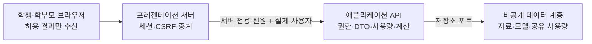

# 외부접근 데이터보호 개발기준 · 필수 개발 참조

이 문서는 공통 명세 service_spec.json에서 생성한다. 현재 버전은 1.9.176이며 기획·라우팅·계층 문서를 같은 변경으로 갱신한다.

필수 개발 기준 · 보안 revision `2026.10.06.v1` · 기획 출발 commit `25973cb1a93b452e002d5902ef573013ebcabfaf`

외부 이용자가 화면/응답/요청을 분석하여 내부자료·권한 밖 결과·대량 분석 결과를 가져가는 경로를 통제한다. 공동 제작자의 신뢰·전체 접근 정책은 변경하지 않는다.

**작업 전에 이 문서와 공통 명세를 읽고, 영향 operation·SEC ID·담당 브랜치를 PR에 기록한다.** 이 문서는 전체 보안 통제의 개발·인수 기준이다. 명시 보안 구성의 코드·합성 검수 결과는 DEV-008 절에서 확인한다. 전체 운영 인수는 미완료다. 전체 구현 상태 in_progress / production_ready=false. 기존 인증·소유권·이용권 코드가 존재해도 아래 추가 통제를 구현·검수하기 전 완료로 처리하지 않는다.

## 세 가지 위협과 결과

| 외부 반출 경로 | 필수 대응 | 인수 기준 |
| --- | --- | --- |
| 화면 전달물에서 내부 자료를 얻음 | SEC-01·02: 역할별 필드 허용목록과 브라우저 전달물 검사 | 정상/pending/오류/재응답/인쇄·JS/HTML/RSC 등에 전체 곡선·환산표·비밀이 없음 |
| 화면을 거치지 않고 API 직접 호출 | SEC-03·04: 서버 중계 신원과 실제 사용자 권한을 각각 확인 | 서버 신원 누락·타인·무료 유료기능·만료·scope 밖 결과 거절 |
| 정상 계정으로 점수·결과를 반복 수집 | SEC-05·06·07: 원자적 공유 예산과 계산/반환량·탐지 | 무료 견본·본인 저장본 조회·유료 개인 분석에 적용; ID/JWT/worker/재시작 교체로 예산 초기화 불가 |

## 3티어 구현 경계와 연결 변경

기존 22 API 경로·회원·DTO를 유지한다. 기존 연결 준비의 사용자 Bearer는 중계 뒤 분석 서버에서도 검증하며 서버 전용 신원을 추가한다. 기존 화면 직접 호출 방식은 운영 보안 인수 경로로 채택하지 않는다. 중계 경로/전달 방식/오류·CSRF 세부 계약은 두 개발 담당이 구현 PR에서 정본과 함께 확정한다.

필수 서버 인증 설정 누락·잘못된 신원에 보호 대상 결과를 제공하지 않는다. 통제 의존 장애는 비밀 없는 503으로 실패한다.

중계는 실제 세션·안전한 입력을 전달한다. 쿠키 세션이면 HttpOnly/Secure/SameSite와 상태변경 CSRF 검증을 적용한다. Origin/Referer/CORS는 서버·사용자 인증을 대신하지 않는다.

중계/분석은 클라우드에서 운영하며 PC 로컬 파일·상주 프로세스를 의존하지 않는다. 공개 원본·이전/preview 주소로 보안 계층을 우회하지 못하게 검수한다. 크롤링·색인 보조 정책(2026-10-23): 도메인 루트 /robots.txt에서 모든 크롤러의 /jeongsi 경로 수집을 거부하고, 정시 응답에 X-Robots-Tag와 HTML noindex/nofollow/noarchive/nosnippet을 적용한다. basePath 아래 robots 파일만으로 루트 정책을 대신하지 않는다. 에듀터치의 다른 경로·기존 규칙·sitemap은 보존하며 적용 그룹별 예외를 확인한다. robots/메타는 자발적 준수 신호이므로 로그인·소유권·이용권·relay·허용 DTO·유한 공유 예산을 대체하지 않는다. 앱 구현/합성검수와 Owner 루트 적용/실제 정문 응답 검수를 구분한다.

## 담당자별 구현과 인수

| 통제 | 담당 계층 | 기존 담당 브랜치 | 구현 상태 | 운영 검수 |
| --- | --- | --- | --- | --- |
| SEC-01 공개 응답의 재귀 허용목록 | application | feature/application-pre-data-platform | in_progress | NOT_RUN |
| SEC-02 브라우저 전달물 검수 | presentation | feature/presentation-foundation | pending | NOT_RUN |
| SEC-03 서버 중계와 분석 API 직접 접근 거절 | infrastructure | feature/application-pre-data-platform | in_progress | NOT_RUN |
| SEC-04 현재 세션·이용권·소유권·관리 범위 | application | feature/application-pre-data-platform | pending | NOT_RUN |
| SEC-05 반복 분석·조회·계산 비용 예산 | application | feature/application-pre-data-platform | pending | NOT_RUN |
| SEC-06 공유 사용량 저장·원자성·결과 재사용 | data | feature/application-pre-data-platform | pending | NOT_RUN |
| SEC-07 거절 응답·안전한 관측·화면 안내 | application | feature/application-pre-data-platform | in_progress | NOT_RUN |
| SEC-08 동일 스냅샷 인수와 운영 gate | planning | develop | in_progress | NOT_RUN |

SEC-03은 두 기존 담당자가 함께 인수한다. 표의 infrastructure는 분석 API 측 책임이다.

| 중계 참여 계층 | 담당 브랜치 | 책임 |
| --- | --- | --- |
| presentation | feature/presentation-foundation | 화면 서버 BFF·실제 세션/쿠키와 CSRF·서버 전용 신원 송신·허용 DTO 소비·브라우저 검수 |
| infrastructure | feature/application-pre-data-platform | 분석 API 서버 신원 검증·실사용자 권한 재인가·직접 접근 거절·운영 설정/장애 응답 |

### SEC-01 공개 응답의 재귀 허용목록

기존 contract_ref의 회원/관리 역할별 허용 필드를 중첩 객체·배열까지 적용한다. 정상·pending·오류·멱등 재응답·리포트 snapshot·인쇄 DTO·발표본을 포함한다.

인수: 금지 필드를 중첩/배열에 넣은 합성 자료로 실제 HTTP 응답을 검사하고 공개 근거·버전·공식 출처를 보존한다.

### SEC-02 브라우저 전달물 검수

외부 화면 담당이 API JSON·SSR HTML·hydration/RSC·클라이언트 JS·정적 JSON·source map·다운로드·브라우저 저장소·오류 전달물을 검사한다. CSS 숨김이나 .gitignore만으로 통과하지 않는다.

인수: 동일 후보의 실제 빌드/브라우저 전달물 영수증이 필요하다. 합성 화면과 운영 자료 검수를 구분한다.

### SEC-03 서버 중계와 분석 API 직접 접근 거절

화면 서버의 중계 API(BFF)와 분석 API 사이에 서버 전용 인증을 적용하며 분석 API에서도 실제 사용자 권한을 검증한다. 공개 origin·우회 도메인·preview·이전 배포 경로를 포함한다. 화면 BFF/세션·CSRF·신원 송신은 외부 화면 브랜치, 분석 서버 검증/재인가는 서비스·DB 브랜치가 각각 구현하고 같은 전이 계약으로 인수한다.

인수: 허용 중계+허용 사용자만 성공한다. 직접 호출/잘못된 서버 신원/필수 설정 누락에 보호 대상 결과를 제공하지 않는다. health와 결과 API는 구분한다.

### SEC-04 현재 세션·이용권·소유권·관리 범위

자료·건수·멱등 저장 응답을 읽기 전에 Supabase 검증 사용자와 DB 현재 이용권을 판단한다. 본인 소유권과 editor/approver·학교 scope·자기승인 거절을 유지한다.

인수: 401/403/404/409와 무료 overall/유료 후보·staff≠paid를 회귀 검증한다. 인증/이용권 장애를 허용으로 바꾸지 않는다.

### SEC-05 반복 분석·조회·계산 비용 예산

무료 고정 견본·본인 저장본 조회·유료 개인 분석·검색/통계/발표본/export를 대상으로 한다. 정상 성적표의 대학·학과 검색 범위는 유지한다. 개인 일일 새 성적·계산비용 제한은 REQ-27 입력권으로 대체하되 요청 빈도·공유 동시성·요청당 물리 비용/시간·반환량·저장소 fail closed와 키/계정/성적 회전 우회 차단은 유지한다.

인수: 키/프로필/리포트/검색어/cursor·새 JWT/재로그인/동시 요청으로 우회하지 못한다. candidates.build 내부 다수 학과 계산 비용도 계상한다.

### SEC-06 공유 사용량 저장·원자성·결과 재사용

애플리케이션 포트와 비공개 공유 저장소로 예산 예약/소비/동시성/만료를 관리한다. 초기 Supabase 구현은 담당 PR에서 준비하며 메모리 카운터만으로 완료 처리하지 않는다.

인수: 복수 worker·재시작·경계 시간·장애·멱등 재시도를 검증한다. 결과 재사용은 사용자·성적·시험·자료/산식/곡선/정책/모집행 버전에 결속한다.

### SEC-07 거절 응답·안전한 관측·화면 안내

기존 오류 객체를 유지한 429 사유/Retry-After와 통제 저장소 장애의 503을 구현한다. 원성적·JWT·키·예외 원문·타인 정보·내부 예산을 응답/로그에 남기지 않는다.

인수: 안전한 제한 안내와 재시도 시각만 표시한다. 기록/쿨다운/추가 확인/이용 검토는 정상 학교 검색을 영구히 감추지 않는다.

### SEC-08 동일 스냅샷 인수와 운영 gate

필수 문서·operation 참조·기획/라우팅·release gate를 하네스에 결속한다. 계약 검산·합성 HTTP·브라우저·운영 검수를 구분한다.

인수: 필수 계약/문서/gate 제거, 미구현 상태의 passed/ready, 증거 없는 완료를 거절한다. 등록/합성 PASS만으로 운영 인수를 완료하지 않는다.

## 모든 API의 보안 연결

| operation | 경로 | 회원/관리 조건 | 필수 통제 | 현재 적용 상태 |
| --- | --- | --- | --- | --- |
| history.search | GET /api/v1/admission-history | 일반·유료 | SEC-01, SEC-03, SEC-04, SEC-07, SEC-08, SEC-05, SEC-06 | pending_runtime_implementation |
| recruitment.read | GET /api/v1/offerings/{offering_id}/recruitment | 일반·유료 | SEC-01, SEC-03, SEC-04, SEC-07, SEC-08, SEC-05, SEC-06 | pending_runtime_implementation |
| score-profile.create | POST /api/v1/score-profiles | 유료 | SEC-01, SEC-03, SEC-04, SEC-07, SEC-08, SEC-05, SEC-06 | pending_runtime_implementation |
| overall.analyze | POST /api/v1/overall-reports | 유료 | SEC-01, SEC-03, SEC-04, SEC-07, SEC-08, SEC-05, SEC-06 | pending_runtime_implementation |
| report.read | GET /api/v1/reports/{report_id} | 일반·유료; 본인 소유 리포트/성적표 | SEC-01, SEC-03, SEC-04, SEC-07, SEC-08, SEC-05, SEC-06 | pending_runtime_implementation |
| offerings.search | GET /api/v1/offerings/search | 유료 | SEC-01, SEC-03, SEC-04, SEC-07, SEC-08, SEC-05, SEC-06 | pending_runtime_implementation |
| offering.read | GET /api/v1/offerings/{offering_id} | 유료 | SEC-01, SEC-03, SEC-04, SEC-07, SEC-08, SEC-05, SEC-06 | pending_runtime_implementation |
| university.analyze | POST /api/v1/reports/{report_id}/university-results | 유료; 본인 소유 리포트/성적표; 확인 성적표 필수 | SEC-01, SEC-03, SEC-04, SEC-07, SEC-08, SEC-05, SEC-06 | pending_runtime_implementation |
| candidates.build | POST /api/v1/reports/{report_id}/candidates | 유료; 본인 소유 리포트/성적표; 확인 성적표 필수 | SEC-01, SEC-03, SEC-04, SEC-07, SEC-08, SEC-05, SEC-06 | pending_runtime_implementation |
| shortlist.update | PUT /api/v1/reports/{report_id}/shortlist/{offering_id} | 유료; 본인 소유 리포트/성적표 | SEC-01, SEC-03, SEC-04, SEC-07, SEC-08, SEC-05, SEC-06 | pending_runtime_implementation |
| report.export | GET /api/v1/reports/{report_id}/print | 일반·유료; 본인 소유 리포트/성적표 | SEC-01, SEC-03, SEC-04, SEC-07, SEC-08, SEC-05, SEC-06 | pending_runtime_implementation |
| statistics.read | GET /api/v1/reports/{report_id}/offerings/{offering_id}/live-statistics | 유료; 본인 소유 리포트/성적표; 확인 성적표 필수 | SEC-01, SEC-03, SEC-04, SEC-07, SEC-08, SEC-05, SEC-06 | pending_runtime_implementation |
| session.read | GET /api/v1/me | 일반·유료 | SEC-01, SEC-03, SEC-04, SEC-07, SEC-08 | pending_runtime_implementation |
| forecast.capabilities | GET /api/v1/forecast-capabilities | 일반·유료 | SEC-01, SEC-03, SEC-04, SEC-07, SEC-08 | pending_runtime_implementation |
| forecast.list | GET /api/v1/forecast-drafts | 일반·유료; 관리 editor/approver + 허용 학교 scope | SEC-01, SEC-03, SEC-04, SEC-07, SEC-08 | pending_runtime_implementation |
| forecast.create | POST /api/v1/offerings/{offering_id}/forecast-drafts | 일반·유료; 관리 editor + 허용 학교 scope | SEC-01, SEC-03, SEC-04, SEC-07, SEC-08 | pending_runtime_implementation |
| forecast.read | GET /api/v1/forecast-drafts/{draft_id} | 일반·유료; 관리 editor/approver + 허용 학교 scope | SEC-01, SEC-03, SEC-04, SEC-07, SEC-08 | pending_runtime_implementation |
| forecast.adjust | POST /api/v1/forecast-drafts/{draft_id}/adjustments | 일반·유료; 관리 editor + 허용 학교 scope | SEC-01, SEC-03, SEC-04, SEC-07, SEC-08 | pending_runtime_implementation |
| forecast.validate | POST /api/v1/forecast-drafts/{draft_id}/validations | 일반·유료; 관리 editor + 허용 학교 scope | SEC-01, SEC-03, SEC-04, SEC-07, SEC-08 | pending_runtime_implementation |
| forecast.approve | POST /api/v1/forecast-drafts/{draft_id}/approvals | 일반·유료; 관리 approver + 허용 학교 scope; 독립 approver·자기승인 거절 | SEC-01, SEC-03, SEC-04, SEC-07, SEC-08 | pending_runtime_implementation |
| forecast.publish | POST /api/v1/forecast-drafts/{draft_id}/publications | 일반·유료; 관리 approver + 허용 학교 scope; 독립 approver·자기승인 거절 | SEC-01, SEC-03, SEC-04, SEC-07, SEC-08 | pending_runtime_implementation |
| forecast.published.read | GET /api/v1/offerings/{offering_id}/forecast | 유료 | SEC-01, SEC-03, SEC-04, SEC-07, SEC-08, SEC-05, SEC-06 | pending_runtime_implementation |
| score-input.status.read | GET /api/v1/me/score-input-status | 일반·유료 | SEC-01, SEC-03, SEC-04, SEC-05, SEC-06, SEC-07, SEC-08 | pending_runtime_implementation |
| score-input.correction.grant | POST /api/v1/management/score-input-corrections | 유료 | SEC-01, SEC-03, SEC-04, SEC-05, SEC-06, SEC-07, SEC-08 | pending_runtime_implementation |
| report.sample.read | GET /api/v1/report-sample | 일반·유료 | SEC-01, SEC-03, SEC-04, SEC-05, SEC-06, SEC-07, SEC-08 | pending_runtime_implementation |
| history.snapshot.head | GET /api/v1/admission-history/snapshot/head | 일반·유료 | SEC-01, SEC-03, SEC-04, SEC-07, SEC-08, SEC-05, SEC-06 | pending_runtime_implementation |
| history.snapshot.read | GET /api/v1/admission-history/snapshots/{snapshot_id} | 일반·유료 | SEC-01, SEC-03, SEC-04, SEC-07, SEC-08, SEC-05, SEC-06 | pending_runtime_implementation |
| report.list-own | GET /api/v1/me/reports | 일반·유료 | SEC-01, SEC-03, SEC-04, SEC-07, SEC-08, SEC-05, SEC-06 | pending_runtime_implementation |
| member-shortlist.read | GET /api/v1/me/shortlist | 유료 | SEC-01, SEC-03, SEC-04, SEC-07, SEC-08, SEC-05, SEC-06 | pending_runtime_implementation |
| member-shortlist.update | PUT /api/v1/me/shortlist/{offering_id} | 유료 | SEC-01, SEC-03, SEC-04, SEC-07, SEC-08, SEC-05, SEC-06 | pending_runtime_implementation |

## 응답과 브라우저의 전달 범위

기존 operations[].contract_ref의 공개·관리 역할별 DTO가 허용목록의 원본이다. 중첩 객체/배열도 명시적으로 선택하고 저장 객체를 그대로 직렬화하지 않는다.

- 전달 금지 [private_source_and_model]: 원자료/전체 분포·환산표·계수·모델
- 전달 금지 [unapproved_internal_detail]: 학생에게 허용되지 않은 내부 정확값 저장 객체·trace·관리 기록
- 전달 금지 [private_reference_and_download]: 비공개 경로·Drive 식별자·원자료 다운로드 URL
- 전달 금지 [credential_and_token]: DB 연결·secret/service_role 키·OAuth/access/refresh token

- 보존 [student_result_and_rationale]: 학생 허용 점수·누백·자료 상태·판단 근거·공식 공개 출처·버전
- 보존 [authorized_management_receipts]: 권한 있는 직원의 기존 관리 actor·검증/승인 영수증 DTO
- 보존 [independent_score_and_judgment_state]: 성공 환산·누백과 지원 판단 보류의 독립 상태

## 누적 예산과 정상 이용의 보존

같은 성적/버전 결과 재사용과 새 계산 비용을 구분한다. 프로필 생성과 flat/profile_id 전체 분석은 공통 예산을 쓴다. 멱등 재응답은 계산을 중복 소비하지 않되 요청/반환량 통제를 적용한다.

사용량 확인/예약/소비는 공유 저장소에서 원자적으로 수행한다. 취소/실패의 예약 해제·기간 만료를 정책으로 정하며 장애를 무제한 허용으로 바꾸지 않는다.

전체 서비스 대학·학과 검색은 유지한다. 학교 제외나 성공 점수 삭제 대신 요청/재분석/동시성/반환량을 통제한다. IP는 계정 통제의 보조 신호다.

예산 키: verified_subject_id, exam_id, policy_version, period. 직접 성적 입력과 본인 성적표 ID 경로 모두 같은 예산에 결속한다.

교체해도 초기화 금지: JWT, request_key, profile_id, report_id, search_term, cursor, worker, server_restart.

결과 재사용의 결속: verified_subject_id, normalized_scores, exam_id, source_pack_version, calculation_version, rule_version, curve_version, catalog_version, analysis_version, policy_version, offering_id, report_revision.

학생/상담 계정별 숫자는 승인된 운영 정책으로 별도 설정한다. 실제 한도/탐지 임계값은 Git에 넣지 않는다. null/미설정을 무제한 또는 실제 0으로 치환하지 않는다. 현재 숫자는 모두 null이며 미승인이다. 운영 설정 승인·검증 전 무제한 기본값을 넣거나 이 정책이 적용됐다고 표시하지 않는다.

무료 전체 누백 제공, 유료 전체 대학·학과 검색, 성공한 점수·누백과 판단 보류의 독립 표시를 유지한다. 학교 목록을 임의 축소해 보안 통제로 대체하지 않는다.

## 실패 응답과 안전한 기록

| 계획 코드 | HTTP | Retry-After | 구현 상태 |
| --- | --- | --- | --- |
| rate_limit_exceeded | 429 | true | planned_not_implemented |
| analysis_quota_exceeded | 429 | true | planned_not_implemented |
| security_policy_unavailable | 503 | false | in_progress |
| operation_scope_not_approved | 503 | false | in_progress |

기존 {status:error,error:{code},request_id}를 유지한다. 401/403/404/409의 기존 의미를 우선하며 429/Retry-After는 정식 계약 반영·구현 전 실제 응답이라고 주장하지 않는다. no-store와 안전한 거절 이벤트를 유지한다.

## 하네스 필수 참조와 검사

작업 전에 이 정본을 읽고 현재 develop SHA·REQ-24~26·SEC 영향·담당 브랜치를 확인한다. 선독을 생략해 API/화면/DB를 구현하지 않는다. 모든 에이전트는 최신 검증 커밋과 개발현황/코드 색인에서 시작해 Git 변경 범위부터 확인하고 기획·라우팅을 항상 같은 커밋에서 일치시킨다. 입결 현재 자료 조회/변경 작업은 비공개 현재 정본 포인터와 고정 admission_results_current를 먼저 확인하고, 과거동결검수와 구분한다. 공개 코드/합성CI가 내부 포인터나 자료를 포함하거나 실제 자료 인수를 대신하지 않는다. 오픈 전 계정/MFA/이용권/용량 변경은 오픈전_보안운영_변경.md를 먼저 읽고 이력이 아닌 최신 확정 기준을 적용한다. 2026-11-03 사용자 정정: 학교별 4개년 묶음은 원자료 수집 및 기본 PK·연도 관계 최초 정리에만 적용한다. 기존 정본·검증 결과를 사용하는 DB·API·화면 연결, 기존 산출값 재사용에는 4개년 재검수나 전국 재검수를 선행하지 않는다.

PR/완료 보고에 보안 revision·영향 operation/SEC ID·합성/브라우저/운영 증거와 NOT_RUN을 각각 적는다. 하네스 PASS는 실제 독서·런타임 보안 증명이 아니다. 승인·적용된 병합 판정은 동일하게 캡처한 index에서 HEAD와 검증된 각 MERGE_HEAD 부모까지의 diff 합집합, 커밋 검사에서는 각 부모부터 해당 merge commit까지의 diff 합집합이다. 부모/zero-parent/diff조회 실패는 실패로 거절하며 빈목록으로 대체하지 않는다. 최종snapshot 내용·계층·권한·삭제·비공개 검사와 branch/정본 소유 규칙은 보존한다. phase1c1cd의645×3 및 phase2 3938/최종develop57의정상678검수는 실제 적용 증거이고 운영자료/실회원/UI 인수와 별개다.

선독 문서:

- [AGENTS.md](../../AGENTS.md)
- [service_spec.json](service_spec.json)
- [서비스_기획.md](서비스_기획.md)
- [라우팅_명세.md](라우팅_명세.md)
- [3티어_개발구조.md](3티어_개발구조.md)
- [개발_브랜치_운영.md](개발_브랜치_운영.md)
- [API_DTO_계약.md](API_DTO_계약.md)
- [프레젠테이션_작업인계.md](프레젠테이션_작업인계.md)
- [외부접근_데이터보호_개발기준.md](외부접근_데이터보호_개발기준.md)
- [개발현황_문서동기화.md](개발현황_문서동기화.md)
- [code_routing_index.json](code_routing_index.json)
- [DB_입결_화면연결.md](DB_입결_화면연결.md)
- [오픈전_보안운영_변경.md](오픈전_보안운영_변경.md)

기획 변경은 공통 명세와 생성 도구를 수정하고 문서·라우팅·두 catalog를 함께 생성한다. 정상 pre-commit/pre-push와 GitHub 정확 커밋 CI가 필수 계약/AGENTS 참조/operation 연결/역할·예산 불변 조건/발행 gate와 같은 스냅샷의 생성 결과를 검사한다. 필수 항목 제거·문서 단독 편집·우회 설정·근거 없는 ready/passed는 실패한다. 개발자가 실제로 읽었는지는 기계가 증명할 수 없어 PR의 revision·영향/무영향 설명으로 남긴다. 파일 보존·비공개 데이터 제외·담당 브랜치와 기존 테스트를 유지한다.

## 회귀·브라우저·운영 인수와 발행 gate

| 사례 | 통제 | 증거 범위 | 통과 기준 |
| --- | --- | --- | --- |
| SEC-QA-01 | SEC-01 | synthetic_HTTP | 중첩/배열·오류/pending/멱등/report/print/published 금지값 노출 없음 |
| SEC-QA-02 | SEC-02 | browser_artifacts | HTML/hydration/RSC/JS/JSON/source map/storage/download와 preview 내부자료 없음 |
| SEC-QA-03 | SEC-03 | synthetic_HTTP | 직접 요청/잘못된 서버 신원/미설정 거절; 중계만으로 사용자 권한 승격 없음 |
| SEC-QA-04 | SEC-04 | operational_auth_db | 실제 일반/유료/만료/취소/타인·직원 학교 범위/자기승인·의존 장애 검수 |
| SEC-QA-05 | SEC-05 | synthetic_HTTP | 무료 고정 견본·본인 저장본 조회·유료 개인 분석도 요청 빈도·공유 예산·반환량 통제를 준수하며 cursor·키·계정·성적표 회전으로 우회하지 못한다. REQ-27의 개인 일일 제한 대체는 입력권과 요청당 물리 한도를 유지한다. |
| SEC-QA-06 | SEC-06 | operational_auth_db | 동시 요청·복수 worker·재시작·재시도·만료·카운터 장애 일관성 |
| SEC-QA-07 | SEC-07 | synthetic_HTTP | 429/Retry-After·503와 로그의 비밀/원성적/타인정보 미노출 |
| SEC-QA-08 | SEC-08 | contract_harness | 필수 계약/문서/gate 제거·우회·증거 없는 완료를 하네스가 거절 |

완료 시 동일 구현 commit·정책 revision·검수 범위·결과·안전한 증거 참조를 기록한다. 3개 보안 gate와 synthetic_HTTP/browser_artifacts/operational_auth_db 증거가 모두 있어야 운영 준비를 검토한다. 문서 등록/계약 회귀 PASS는 런타임 또는 운영 보안 인수가 아니다. 현재 인수 명부는 case_id마다 활성 증거 1건이며 중복/상충 결과를 허용하지 않는다. 이전 검수 이력·파일은 보존하고 현 명부와 구분한다.

증거 필드: case_id, control, scope, result, implementation_commit, policy_revision, evidence_ref. case_id별 통과 증거의 구현 commit와 보안 revision이 일치해야 한다. 계약 회귀의 합성 PASS는 실제 JWT/이용권/DB/배포·브라우저를 대체하지 않는다. 현재 acceptance_evidence는 비어 있고 운영 실행은 NOT_RUN이다.

필수 보안 발행 gate: security_response_artifacts, security_direct_authorization, security_harvest_controls. 하나라도 누락·pending/failed면 main 준비 완료로 올리지 않는다.

## 보호 범위의 한계

사용자에게 정상 제공한 개별 결과 저장을 완전히 막는다고 약속하지 않는다. 내부자료 비전달·권한 밖 조회 거절·대량 수집 규모/비용 통제를 인수 범위로 한다. overall_only는 전체 selected metadata 승인·핀·버킷, pack/model 검증, finish fresh-head와 원래 한도를 유지한다. RAM 요청 검증은 hosted 운영 인수가 아니다. 추가 세 operation은 직접 승인으로 적용했고, university_only는 total_model 본문만 유예하며 나머지 release 검증과 전체 selected metadata·현재 head·마지막 확인·원래 한도를 유지한다. 새 관리자 등록물과 실제 운영 검수는 NOT_RUN이다.

## 공식 기술 근거

- [OWASP API 응답 항목 노출 방지](https://api-security.owasp.org/editions/2023/en/0xa3-broken-object-property-level-authorization/)
- [OWASP REST 접근 통제](https://cheatsheetseries.owasp.org/cheatsheets/REST_Security_Cheat_Sheet.html)
- [OWASP 업무 기능 자동화 악용](https://api-security.owasp.org/editions/2023/en/0xa6-unrestricted-access-to-sensitive-business-flows/)
- [Supabase API grants/RLS/비공개 스키마](https://supabase.com/docs/guides/api/securing-your-api)
- [Google robots.txt limits](https://developers.google.com/search/docs/crawling-indexing/robots/intro)
- [Robots root location and group interpretation](https://developers.google.com/crawling/docs/robots-txt/robots-txt-spec)
- [OpenAI crawlers and user-initiated fetch limitations](https://developers.openai.com/api/docs/bots)

## DEV-008 명시 보안 앱 구성

명시 보안 앱 구성의 중계 인증·역할별 재귀 응답 투영과 합성 HTTP 검수. 기존 기본 연결과 운영 상태를 보존한다.

계약 2026.10.07.v1 · 정책 2026.10.06.v1 · 코드 accepted_on_develop_scoped_synthetic_verified · 운영 준비 false. 기존 create_app/configured_app·이용권·Drive·local·22 API/session v1을 유지한다. create_secured_app(*, security, ...)를 명시 선택하며 운영 자동전환을 하지 않는다.

중계 헤더 X-Jungsi-Relay-Token는 서버 전용 JUNGSI_RELAY_TOKEN/명시 설정 객체에서 공급한다. relay → 사용자 Bearer → 현재 이용권/소유권 → 입력/자료 순서다. 중계만으로 사용자 권한이 생기지 않는다. 누락/잘못된 설정은 503 security_policy_unavailable, 누락/불일치/중복/잘못된 헤더는 403 relay_authentication_failed다. raw header의 대소문자·중복, ASCII/공백/쉼표/Unicode/크기와 정확 길이를 검사하고 bytes compare_digest를 쓴다.

22 operation의 contract_ref와 standard/paid typed root를 연결한다. 객체·배열·ID map의 값까지 재귀 투영하고 추가 필드는 응답에서만 제거한다. 구조·필수값 오류는 비밀 없는 503이다. 자유 Any/무제한 객체는 금지한다. 정상 점수·누백·판단 보류·공식 출처/버전·권한 있는 관리 영수증을 보존한다. 정적 registry src/jungsi_touch/application/public_response_schemas.json (jungsi.public-response-schemas/v1)를 JSON으로 읽어 API별 역할 필드, 참조·순환·타입·required/optional·중복 key를 검사한다.

/health/live는 공개 최소 liveness다. /health/ready는 relay만 확인하고 status, server_timezone, production_ready, security_boundary만 반환한다. production_ready=false이며 비공개 환경·DB role/경로를 전달하지 않는다.

검수 상태 PASS_SCOPED_SYNTHETIC_HTTP. 합성 인수: all_22_operation_bindings_and_contract_fields; nested_object_array_ID_map_extra_field_removal; malformed_required_value_safe_503; saved_report_and_print_and_idempotent_and_forecast_projection; current_standard_member_paid_field_exclusion; authorized_staff_scope_and_receipts_preserved; missing_invalid_duplicate_Unicode_oversized_relay_denied_before_provider; valid_relay_still_requires_real_user_authorization; public_live_protected_redacted_ready; legacy_and_local_factory_regressions.

기획 인수 2026-10-07 · [17번 PR](https://github.com/natural0448/Jungsi_touch/pull/17) · merged_verified.

구현 HEAD 5f9618c447be95f6a858b4bb24a31a30433be337 · develop 병합 9abc493ffc5b1ef6b3c8a00042c125f9dff183cb.

보안 HTTP 57개 · 고정 스냅샷 전체 748개 · 독립 합성 22개 PASS. 716affb4915a2e7e5af690da7574262fa2459c86와 최종 HEAD의 런타임 보안 코드·스키마는 동일하며 생성 catalog의 기획 출처만 갱신했다. 최종 HEAD의 정상 훅 748개·CI PASS와 PR 병합 tree 일치를 확인했다.

GitHub CI: [implementation_head](https://github.com/natural0448/Jungsi_touch/actions/runs/37560623438) success; [pull_request_candidate](https://github.com/natural0448/Jungsi_touch/actions/runs/37560978933) success; [integrated_develop](https://github.com/natural0448/Jungsi_touch/actions/runs/37561114571) success. 실제 Auth·DB·BFF·브라우저·배포는 NOT_RUN이다.

남은 인수: external presentation BFF relay secret/CSRF and same-snapshot browser acceptance; SEC-05/06 shared atomic private quota and approved operational values; actual JWT/entitlement/owner/DB/Storage/deployment acceptance; exam catalog, latest owned report and reflection combinations are separate follow-ups. 전체 SEC-01~08/3 보안 gate와 실운영 준비는 미완료로 유지한다.

## 2026-10-14 오픈 전 최신 확정

유료 이용권 원본은 public.jeongsi_passes이며 관리자 접근 예외는 동일 검증 Bearer·본인 role=admin/status=active·aal2·요청 내부 origin이 모두 필요하다. 실제 만료 우선, 예외만 paid+null, 일반 paid 만료 누락503과 FE-ADMIN-ACCESS-01을 따른다. 관리 8경로의 검증 aal2·본인 active 상태·기존 학교 권한을 결합한다. 이 문서에 남은 과거 어댑터/명시 연결 전용 결정은 당시 이력이다. 현재 변경 범위와 검수 상태는 [오픈 전 보안운영 변경](오픈전_보안운영_변경.md)와 opening_security_operations_contract를 우선한다. API22/session3·자료 승인/보존 경계는 유지한다.

<!-- jungsi:generated spec_sha256=3b272d75877fe6828f96f410b6dfc93aa40bf372b750302f9c7b55587e68abb9 -->
