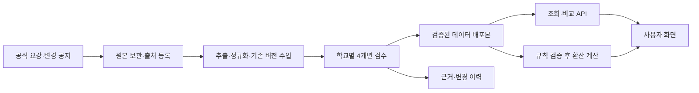

<!-- jungsi:historical -->
> 이 문서는 이전 기획·검토 이력입니다. 현재 개발 기준은 [현재 서비스 기획](../../current/서비스_기획.md)과 [라우팅 명세](../../current/라우팅_명세.md)입니다. 아래 내용은 당시 상태를 보존하며 현재 요구사항이나 구현 완료 판정으로 사용하지 않습니다.

# 시스템·데이터 설계 v0.1

작성일: 2026-09-23 · 상태: 논리 설계 제안 · 운영 DB와 API는 아직 생성하지 않음

## 시스템 구성

첫 화면은 개인 성적 없이 정시 성적자료를 조회하고, 상담 흐름은 실제 수능 성적을 입력해 환산·비교한다. 첫 화면의 구체 지표와 예시 구조는 파일 확인 후 확정한다.

초기에는 하나의 서비스 안에 업무별 모듈을 나누는 구성을 제안한다. 원문 처리 작업은 사용자 요청과 분리해 실행하고, 검수된 데이터 배포본을 API와 화면이 읽는다. 모듈을 곧바로 각각의 독립 서버로 만드는 요구는 없다.

| 모듈 | 책임 | 입력 → 출력 |
|---|---|---|
| sources | 원문·수집 이력·문서 위치 | 공식 문서 → 문서 ID·해시·메타데이터 |
| ingestion | 기존 JSONL/CSV 및 문서 추출 연결 | 불변 입력 묶음 → 검토용 적재 배치 |
| catalog | 정시 성적자료·대학·캠퍼스·모집행 조회 | 공개 배포본 → 필터·검색·상세 |
| lineage | 동일·변경·통합·분리 및 경로 조회 | 검증된 관계 → 연도별 대응 집합 |
| review | 학교별 검수·쟁점·정정 제안 | 근거와 비교표 → 검토 결과 |
| release | 공개 가능 항목·배포본 관리 | 검토 결과 → 버전 고정된 조회 자료 |
| calculation | 첫 핵심 기능의 점수 계산 | 점수·규칙 버전 → 결과·계산 과정 |
| user_workspace | 선택 기능의 저장·공유 | 사용자 권한 → 후보·성적·상담 자료 |

AI나 OCR은 추출·후보 제안에 활용할 수 있으나 원문 검수 완료 상태를 자동으로 부여하지 않는다. 환산 계산은 검증된 명시 규칙으로 실행하고, 설명 생성 기능이 숫자나 규칙을 새로 결정하지 않게 한다.

## 첫 화면 자료의 연결

정시 성적자료는 사용자의 점수 프로필과 독립적으로 조회한다. 조회 API는 개인 성적 ID를 필수값으로 받지 않는다. 예시 파일에서 지표 정의·대상 학년도·모집행 키·점수 체계·대상 집단·출처를 추출해 자료 계약을 확정한다. 기존 모집표에 성적 지표의 값이 없는 경우 별도 성적자료를 적재해야 한다.

예시 자료가 전년도 입시결과, 대학별 성적 반영 정리, 다른 형태의 점수 자료 중 무엇을 담는지 확인한 뒤 저장 구조를 선택한다. 입시결과이면 result_metrics/admission_results에, 반영 규칙이면 score_rule_sets에 연결하며 둘의 의미를 섞지 않는다.

## 기존 자산을 연결하는 원칙

1. Resource 아래 원문과 regular_dataset_v1~v4를 보존한다.
2. 수입할 버전·입력 파일 해시·스키마 버전을 명시한 배치를 만든다. ‘가장 큰 버전 번호’나 ‘가장 최근 수정 파일’을 자동으로 공개 대상으로 삼지 않는다.
3. rows.jsonl, lineage_links.csv, PK 별칭표, 출처 목록, 학교별 검수 결과를 각각의 입력으로 읽는다.
4. 미확인 값과 기존 confidence를 원형대로 보존한 뒤 서비스의 검토 상태로 명시적으로 매핑한다.
5. 데이터 수입 결과와 학교별 검수 결과를 연결하고 공개 조건을 충족한 항목만 배포본에 포함한다.
6. 새로운 버전은 새 배포본으로 만든다. 과거 배포본과 계산 결과를 재작성하지 않는다.

기존 33개 컬럼은 교환·내보내기 형식으로 계속 사용할 수 있다. 정규화 테이블과 추가 메타데이터를 별도로 두고, 신규 설계 때문에 기존 시트의 컬럼·PK를 일괄 변경하지 않는다.

후속 school_four_year_v1 패치와 v5 생성 스크립트가 확인되었으나 이번 기획에서 통합 실행·검증하지 않았다. 실제 구현 시 완료된 출력과 검증 보고서를 다시 확인하고 수입 대상을 결정한다.

## 데이터의 기본 단위와 키

- 모집행은 입학 학년도 × 출처 대학·캠퍼스 코드 × 실제 모집단위 × 전형 × 모집군을 기본으로 하되, 원문에서 별도 행인 정원 구분·주야·모집계열·선발유형을 추가 식별한다.
- 이름·모집인원·문자열 유사도만으로 중복 행을 합치지 않는다.
- 기존 number_sort는 문자열로 보존한다. 현재 데이터에서 유일성 범위는 (year, number_sort)이며 버전을 함께 보관할 때는 (dataset_version, year, number_sort)이다.
- 서비스 내부 offering_id는 특정 학년도의 실제 모집행을 가리키는 식별자로 제안한다. 연도 간 의미 연결은 별도 관계로 처리한다.
- offering_external_keys로 외부 버전·연도·PK를 내부 ID에 연결한다. v3→v4 별칭 등 검증된 대응만 승계한다. 대응이 애매하면 새 ID 또는 검토 항목을 만든다.
- uni_number는 문자열이다. 대학 자체의 ID와 캠퍼스·출처 코드는 구별한다. 학년도에 따라 코드 대응이 달라질 수 있다.
- program_lineage_id는 기존 계획에 있으나 확인한 33개 필드에는 없다. 필요하면 별도 테이블로 추가하며 모집단위 이름에서 자동 생성하지 않는다.
- merge/split의 모든 연결을 하나의 ‘같은 학과 ID’로 합치지 않는다. 이전·이후의 복수 관계를 보존한다.
- anchor_2027_pks는 계산된 조회용 자료다. 기본키 또는 최종 검증의 근거로 사용하지 않는다. 향후 target_year별로 재생성할 수 있게 한다.

## 논리 테이블 제안

첫 핵심 기능은 교사·입시상담자의 성적 환산·후보 비교로 확정했다. 개인 성적의 영구 저장 여부는 미정이다. 실제 SQL 타입·인덱스·제약은 기술 선택 후 DDL로 확정한다. 아래는 데이터 계약이다.

| 테이블 / 영역 | 핵심 키·필드 | 책임과 제약 |
|---|---|---|
| institutions / campuses | institution_id, campus_id, 이름 이력 | 실체·연도별 명칭 보존. 코드만으로 캠퍼스 추정 금지 |
| source_units_by_year | source_system, source_code, academic_year | 연도별 공식 코드와 실체 대응·검토 상태 |
| source_documents | document_id, hash, URL, local_path, publication_date, retrieved_at | 원문 보존. 공표일 미상과 수집일 구별 |
| source_evidence | evidence_id, document_id, physical_page, printed_page, table, row, excerpt | PDF 실제 쪽과 인쇄 쪽번호 구별. 문서 링크만 있는 근거는 위치 미완 상태 |
| import_batches | batch_id, inputs_manifest, schema_version, imported_at | 재현 가능한 수입. 같은 입력의 중복 적재 방지 |
| offerings / offering_revisions | offering_id, revision_id, academic_year, source_code, unit, track, group, quota_scope, selection_stream | 원문상의 실제 모집행과 변경본 |
| offering_external_keys | dataset_version, year, legacy_pk, offering_id, evidence | 외부 키를 안정적으로 해석. 버전별 별칭 보존 |
| offering_lineage_edges | edge_id, from_id, to_id, relation_type, review_state, evidence | 동일성·조직 개편 관계. 후보와 확정 구별 |
| recruitment_route_edges | route_id, from_id, to_id 또는 선택가능전공, relation_type, evidence | 광역모집·입학 후 전공 선택. 동일 모집행으로 치환하지 않음 |
| quota_snapshots | snapshot_id, offering_id, stage, value, value_state, recruitment_condition, evidence | 기준·이월·정정과 수치 상태를 분리 |
| score_rule_sets | rule_set_id, version, offering_revision_id, required_inputs, status, evidence | 계산 규칙 적용 대상·순서·유효 범위 |
| score_conversion_rows | rule_set_id, table_id, input_key, decimal_value | 공식 환산표와 규칙 연결 |
| result_metrics / admission_results | metric_definition_id, result_year, offering_id, population, scale, value, evidence | 지표 정의·집단·만점이 맞을 때만 비교 |
| review_cases / school_reviews | review_id, school_family_id, years, coverage, findings, reviewer, status | 학교별 4개년 모집표 확인 범위 |
| dataset_releases / release_items | release_id, manifest_hash, offering_revision_id, rule_version, approved_at | 공개할 행·필드·관계의 불변 묶음 |
| audit_events | event_id, actor, operation, target, before_ref, after_ref, reason, time | 변경과 공개 이력 |
| calculation_runs / results | run_id, release_id, rule_version, input_hash, engine_version, result, trace | 핵심 기능. 저장 기간은 별도 결정. 같은 입력·버전으로 재현 |
| user_profiles / candidate_sets | owner_id, institution_id, permission, items | 저장 기능 채택 시 도입 |

외래키는 참조 대상의 존재를 강제한다. 공개 배포본은 행·관계·규칙의 버전을 함께 고정하고 다른 배포본의 PK를 암묵적으로 섞지 않는다. 파일 보존 규칙에 맞춰 운영 도구의 초기화·정리·자동 삭제 명령을 준비 단계에서 실행하지 않는다.

## 기존 33개 필드의 수입 매핑

| 기존 필드 | 서비스에서의 처리 |
|---|---|
| number_sort, year | 외부 문자열 PK·입학 학년도. 버전과 함께 등록 |
| uni_match_key | 기존 대학 묶음 힌트. 검증된 실체 ID와 분리 |
| uni_number, uni_name, uni_location | 당시 출처 코드·표시명·지역. 대학·캠퍼스 매핑 근거 확인 |
| period_recruit, mojip_category, mojip_name | 모집시기·기존 전형 분류·전형명. 기존 범위 필터를 별도 정책으로 기록 |
| lesson_name, recruit_group | 실제 모집단위 명칭·군. 주야·계열 구분은 원문·원시 코드에서 보충 |
| latest_quota | 관측된 인원 값으로 보존. 시점·이월 여부·검토 상태를 보충하기 전 ‘최종 확정 인원’으로 승격 금지 |
| lesson_change_status | 기존 설명 보존. 구조화된 검증 상태와 구분 |
| anchor_2027_pks | JSON 배열로 검증·파싱. 확정 관계로 만든 서비스 조회표와 대조 |
| selection_method, interview_info, practical_info | 선발방법·면접·실기 원문 설명. 미입력과 해당 없음을 구별 |
| csat_ratio, student_record_ratio, student_record_method | 계산 규칙으로 옮기되 빈값을 0이나 미반영으로 해석하지 않음 |
| csat_minimum, required_exam_areas | 지원·최저 조건과 필수 입력으로 구조화 |
| korean_ratio, math_ratio, english_ratio, inquiry_ratio, history_ratio | 영역 비중과 반영 방식을 규칙 단계로 보존 |
| inquiry_subject_count, inquiry_score_basis | 반영 과목 수·점수 종류·선택 방법 |
| english_grade_points, history_grade_points | 등급별 환산표·가감점 구분 |
| math_bonus, inquiry_bonus | 적용 대상·조건·계산 순서를 가진 가산 규칙 |

이 표는 33개 필드를 모두 다룬다. 원시 데이터가 지원하면 모집단위 코드·학과 코드·모집계열 코드도 추가 증거로 보존한다. 공란이 많은 상태에서 범용 계산 수식을 먼저 채워 넣지 않는다.

## 모집인원 계약

수치, 자료 단계, 선발 조건, 검토 상태는 서로 다른 축이다.

| 필드 | 제안 값 | 의미 |
|---|---|---|
| value | 0 이상의 정수 또는 null | 문서가 실제 숫자를 공표했는지 |
| value_state | reported, unknown, not_published, not_applicable, unreadable, conflict | 값이 없는 이유 또는 공표값 여부 |
| stage | baseline, after_carryover, correction, unknown | 기준·이월 반영·정정 단계 |
| recruitment_condition | unconditional, conditional_carryover, other, unknown | 선발 조건 |
| review_state | imported, in_review, verified, conflict | 해당 값의 원문 대조 상태 |
| supersedes_snapshot_id | 이전 스냅샷 ID 또는 null | 어떤 값을 공식적으로 정정했는지 |
| applies_at / recorded_at | 적용 시점 / 시스템 기록 시점 | 문서의 의미와 적재 시간을 분리 |

규칙:
- value_state=reported이면 value가 있어야 한다. 이 상태만으로 원문 대조 완료는 아니다.
- 나머지 대표 상태는 value=null로 두고 충돌한 후보 숫자는 별도 근거 레코드에 남긴다.
- 조건부 이월이면서 원문이 숫자 0을 명시하면 value=0과 conditional_carryover를 함께 보존한다.
- ●·※처럼 수치를 공표하지 않은 기호는 원문 설명에 따라 상태와 조건을 기록한다. 0을 만들지 않는다.
- 기존 latest_quota 숫자의 의미가 확인되지 않았으면 stage=unknown과 review_state=imported로 수입한다.
- ‘최신’은 다운로드 시간의 최댓값이 아니다. 적용 대상·공식 정정 관계·공표일을 대조하여 공개 값을 선택한다.
- 합계에는 포함한 단계·전형 범위·미정 행 수를 함께 제공한다.

## 관계와 검수 상태

raw confidence와 서비스 review_state를 모두 남긴다. official_portal_exact_identity는 원시 코드 일치 근거이며 학교별 요강 모집표 대조 완료와 구분한다. rename_candidate나 근거 충돌은 서비스에서 확정 관계로 사용하지 않는다.

관계 조회는 출발 모집행과 목표 학년도, 배포본을 입력받고 모든 도착 모집행을 반환한다. same/rename, merge/split, school_change/group_change, gap_reappear 등 기존 유형은 의미·근거를 검토해 매핑한다. gap_reappear는 중간 연도의 모집이 없었다는 증거로 단정하지 않는다.

공개 비교의 동일성 경로는 검증된 offering_lineage_edges만 따라간다. 입학경로를 포함하려면 별도 요청·별도 표시로 recruitment_route_edges를 반환한다. 경로가 없을 때는 미검증·미공개·범위 밖·해당 연도 독립 모집 없음·실제 종료 확인을 구분한다. 종료는 공식 근거가 필요하다.

검수 상태는 한 개 완료 체크로 대체하지 않는다. 원문 확보, 텍스트 판독, 모집행 확인, 인원 확인, 관계 확인, 계산 규칙 확인을 별도 관리하고 학교별 확인 범위와 검토자를 남긴다.

## 공개 배포 흐름

검토 배치 → 구조 검사 → 학교별 4개년 모집표 대조 → 기능별 필수 근거 확인 → 공개 후보 생성 → 담당자 검토 → 공개 포인터 전환.

배포본 내용은 고정한다. 공개 포인터 변경은 감사 이력에 기록하고 문제가 생기면 이전 배포본을 다시 가리키게 한다. 후보 파일·이전 배포본은 보존한다.

각 모집행의 capabilities는 browse, compare_lineage, calculate 등으로 관리하는 방안을 제안한다. 조회 가능한 행이라도 계산 규칙이 없으면 calculate=false다. 검수 중인 항목을 빈 숫자로 대신하지 말고 미제공 사유를 내려준다.

## API 계약 초안

| 메서드·경로 | 역할 | 핵심 계약 |
|---|---|---|
| GET /v1/admission-data | 첫 화면의 정시 성적자료 | 개인 성적 입력 불필요. 필터·지표 계약은 예시 확인 후 확정 |
| GET /v1/releases/current | 공개 배포본과 제공 범위 | release_id, 학년도·학교·전형 범위, 갱신일 |
| GET /v1/offerings | 검색·필터 | academic_year, institution/campus, track, group, q, cursor, release_id |
| GET /v1/offerings/{id} | 모집행 상세 | 당시 명칭, 인원 상태, 근거, 항목별 검토 상태 |
| GET /v1/offerings/{id}/lineage | 연도별 대응 | target_years, relation_scope, 전체 도착 목록·경로·미연결 사유 |
| POST /v1/comparisons | 선택 모집행 비교 | offering_ids, release_id, 비교 기준; 영구 저장 여부 별도 |
| GET /v1/evidence/{id} | 근거 위치 | 공식 URL, 문서·페이지·표·행, 확인 상태 |
| POST /v1/calculations | 첫 핵심 기능의 계산 | 입력·시험·점수 종류, 모집행, release_id, 지원 규칙만 실행 |
| GET /v1/reviews/schools/{id} | 운영 검수판 | 4개년 범위·쟁점·근거; 운영 권한 필요 |
| POST /v1/review-proposals | 정정 제안 | 기준 revision, 수정 제안, 근거, 이유; 운영 권한 필요 |
| POST /v1/release-candidates | 공개 후보 생성 | 검증된 revision 목록, 검사 결과; 공개 권한 필요 |

목록은 안정된 정렬과 페이지 나누기를 사용한다. 같은 비교 화면의 요청은 하나의 release_id로 고정한다. 응답에는 요청 추적 ID와 검증 가능한 오류 코드를 둔다. 동시 수정은 expected_revision 불일치 시 409로 알리고 기존 제안을 보존한다.

입력 형식 오류는 422, 권한 부족은 403, 없는 ID는 404로 구분한다. 계산 가능한 형식이지만 규칙이 준비되지 않은 모집행은 결과 항목의 status=not_supported와 reason_code로 반환하며 0점을 반환하지 않는다. 일괄 계산은 모집행별 성공·미지원·입력 부족을 구분한다.

외부 API에는 로컬 파일의 절대 경로를 노출하지 않는다. 원문 제공은 승인된 문서 ID를 통해 접근하고, 다운로드 공개 범위와 출처별 이용 조건을 정한 뒤 구현한다. 내부 검수에서는 보존된 파일 경로를 사용할 수 있다.

## 계산 엔진 제안

입력 검증 → 지원 조건 판정 → 반영 영역·점수 선택 → 대학 환산표 적용 → 가산·감산 → 명시된 반올림·절사 → 합산 → 결과와 과정 기록.

이는 공통 처리 틀이다. 실제 계산 순서는 대학별 공식 규칙이 우선하며 전형별로 다를 수 있다. 영역 선택·환산·가산·반올림의 각 위치를 규칙에 표현한다.

- 표준점수·백분위·등급·원점수·대학 환산점수를 다른 타입으로 취급한다.
- 시험 시행일·시험 유형·입학 학년도는 별도 보관한다.
- 십진수 계산과 공식 정밀도·반올림 방식을 사용한다.
- 규칙의 필수 입력·지원 과목 조합·적용 범위를 검증한다.
- 자유 텍스트 수식을 임의 실행하지 않고 허용한 연산과 표 조회로 구성한다.
- 결과에는 입력 요약, 배포본, 규칙 버전, 엔진 버전, 영역별 값, 보정, 최종값, 미산출 사유를 보존한다.
- 지원자격 결과(eligible/ineligible/undetermined)와 점수 산출 상태는 별도다. 충분한 자격 정보 없이 ‘지원 가능’을 확정하지 않는다.
- 첫 버전의 입력 시험은 실제 수능으로 제한한다. 적용 학년도와 수능 시행 연도의 대응을 명시한다.

## 성적 입력·계산 요청의 데이터 계약

| 항목 | 타입·내용 | 검증 |
|---|---|---|
| case_id / input_revision | 임시 상담 사례 ID·입력 버전 | 이름·학교 없이도 사용 가능. 저장 정책 확정 전 실제 개인정보 수집을 필수로 하지 않음 |
| target_academic_year | 정수 | 지원하려는 입학 학년도. 시험 시행 연도와 분리 |
| exam_kind / exam_year | csat 고정·실제 수능 시행 연도 | 실제 수능만 허용. 입학 학년도와 대응 확인 |
| subjects | 영역·선택 과목 코드·점수 객체 배열 | 같은 과목 중복 금지. 해당 시험의 과목 체계 확인 |
| score values | standard_score, percentile, grade, raw_score 중 제공된 값 | 점수 종류별 타입·허용 범위. 없는 점수를 다른 종류에서 추정하지 않음 |
| eligibility_answers | 모집행별 필요한 자격 응답 | 미응답을 자격 충족으로 해석하지 않음 |
| offering_ids / release_id | 계산 대상·배포본 | 같은 비교의 기준 배포본 고정 |
| calculation_mode | official | 해당 적용 학년도의 검증된 공식 규칙·표를 사용 |

학생 이름은 계산에 필수 입력이 아니다. 상담 사례를 구분할 별칭부터 사용하는 방안을 제안한다. 필수 과목과 점수 종류는 선택한 모집행의 규칙에서 결정하고, 전체 규칙의 필수값 합집합을 화면에서 안내한다.

입력 변경은 새 input_revision을 만들며 이전 계산은 기존 입력과 연결된 채 보존한다. 서버 계산 응답이 도착했을 때도 현재 화면의 입력 버전과 일치하는지 검사한다.

대상 학년도의 공식 환산표가 아직 공개되지 않았다면 해당 항목을 계산 대기로 표시한다. 다른 학년도의 표를 자동으로 대신 사용하지 않는다. 전체 후보가 준비되어야만 결과를 보게 하는 대신, 모집행별 계산 가능 상태를 반환한다.

개인 성적을 영구 저장하지 않는 방식이라면 계산 재현에 필요한 입력 스냅샷은 해당 상담 세션 범위에서만 유지하고, 서버의 공통 운영 로그에는 원점수·학생 이름·전체 입력을 남기지 않는 설계를 우선 검토한다. 장기 재현·상담 저장은 사용자 저장 정책이 확정된 뒤 적용한다.

## 기술 후보와 선택 기준

| 후보 | 구성 | 적합한 조건 | 비용·복잡도 측면 |
|---|---|---|---|
| A: 공유 웹서비스 후보 | Next.js/TypeScript 화면 + Python/FastAPI API·계산 + PostgreSQL | 여러 사용자의 비교·계산·검수, 기존 Python 처리 활용 | 화면·서버 두 언어와 배포 단위 관리 |
| B: 단독 검수 시제품 후보 | Python API 또는 간단한 웹 화면 + SQLite | 한 운영자의 검수 흐름부터 빠르게 검증 | 운영 확장 시 DB·권한·배포 재검토 |
| C: 웹 개발팀 중심 후보 | Next.js/TypeScript 웹·API + PostgreSQL, Python은 데이터 처리 | TypeScript 중심 운영 조직 | 점수 엔진 언어와 데이터 계약 중복 방지 필요 |

공유 웹서비스라면 A를 우선 검토하는 것이 현재의 Python 자료 처리 자산에 잘 맞는다는 설계 판단이다. 팀 역량과 배포 조건을 아직 확인하지 않았으므로 채택은 미정이다.

PostgreSQL은 복합 기본키·유일성·외래키·CHECK 제약을 제공하므로 데이터 관계와 유효성 보존에 활용할 수 있다. [공식 제약 문서](https://www.postgresql.org/docs/current/ddl-constraints.html)

FastAPI는 Python 타입 기반 API와 OpenAPI 문서화를 지원한다. Next.js App Router는 React 기반 화면과 경로 구성을 제공한다. 이 기능들을 사용할 수 있다는 확인과 이 프로젝트의 채택 결정은 구분한다. [FastAPI 공식 문서](https://fastapi.tiangolo.com/), [Next.js 공식 문서](https://nextjs.org/docs/app)

SQLite는 단독 검수 시제품의 후보이나 동시 쓰기와 네트워크 파일시스템 잠금 제약을 고려해야 한다. 실행 중인 DB 파일을 현재 동기화 드라이브에서 여러 장치가 직접 공유하는 설계는 피하고, 개발·운영 DB 위치를 별도로 정하는 방안을 제안한다. 이는 공식 문서의 제약을 현재 작업 환경에 적용한 설계 판단이다. [SQLite 공식 사용 지침](https://www.sqlite.org/whentouse.html)

기술 버전·호스팅 업체·요금·로그인 제공자는 이 문서에서 확정하지 않는다. 원문 보관 경로와 운영 DB 저장 위치, 예산, 동시 사용자, 운영 주체를 확인한 뒤 선택한다.
