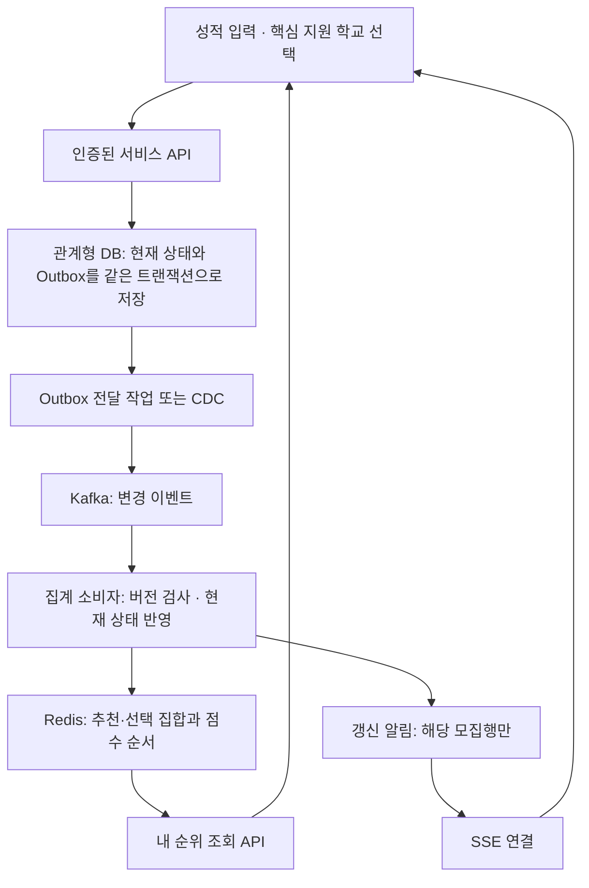

# 실시간 추천·선택 인원과 내 순위 — Kafka 설계안

작성일: 2026-09-27. 요구사항과 구현 제안을 정리한 문서다. Kafka·Redis·DB를 설치하거나 운영 이벤트를 처리한 결과가 아니다. 예시 숫자·식별자는 모두 가상이다.

## 1. 사용자 결정과 제안의 구분

사용자 결정:

- 서비스가 추천한 대학에 대해 학생 인원과 내 위치를 실시간으로 확인한다.
- 추천 인원과 학생이 선택한 인원을 각각 표시한다.
- Kafka를 이용한 실시간 처리를 검토한다.

이번 설계 제안:

- 추천 학생 집단과 핵심 지원 학교에 담은 학생 집단 각각에서 내 순위를 제공한다.
- DB의 현재 상태와 변경 기록을 원본으로 두고, Kafka가 변경 전달·재처리를, Redis가 집계·순위 조회를 담당한다.
- 서버에서 화면으로 갱신을 전달하는 기본 후보는 SSE다. 브라우저는 Kafka나 Redis에 직접 접속하지 않는다.
- 기존 유료 개인별 대학 분석 영역에 배치한다. 무료회원에게 공개할 익명 집계 범위는 아직 확정하지 않는다.
- DB 제품·소비자 구현 언어·호스팅·Kafka 운영 방식은 미정이다. 관계형 DB의 구체 후보로 PostgreSQL을 제안한다.

## 2. 집계와 순위의 정의

기본 단위는 적용 학년도 + 실제 모집행 ID(대학·캠퍼스·모집단위·전형·군) + 집계 배포 버전이다. 기존 매핑 결과의 모집행 키를 사용한다. 연도 연결 키만으로 여러 연도 또는 여러 전형을 섞지 않는다.

| 집단 | 인원 | 내 순위 |
|---|---|---|
| 추천 학생 | 최신 유효 추천 결과에 이 모집행이 포함된 고유 학생 | 같은 집단의 비교 가능한 학생 중 대학 환산점수 순위 |
| 선택 학생 | 현재 핵심 지원 학교 목록에 이 모집행을 담은 고유 학생 | 같은 집단의 비교 가능한 학생 중 대학 환산점수 순위 |

추천 노출 횟수·클릭 횟수·API 호출 수를 인원으로 세지 않는다. 같은 학생의 새로고침, 여러 기기, 여러 보호자 계정은 같은 학생 ID에 연결한다. 교사 상담용 가상 사례와 시험 계정은 모집단에 포함하지 않는다. 실제 학생의 중복 계정 통합·인증 및 대표 성적 지정 정책은 구현 전 확정한다.

두 집단은 겹칠 수 있다. 두 인원을 더해 전체 고유 학생 수로 표시하지 않는다. 선택은 독립적인 학생 의사 상태다. 이후 추천 목록에서 빠져도 선택을 자동 취소하지 않으며, 지원 조건이나 점수의 유효성이 달라지면 비교 상태를 별도로 표시한다.

집단 소속 수 members_total과 유효 점수로 비교 가능한 수 ranked_total을 구분한다. 성적 미확인·재계산 대기·자격 확인 필요 등의 학생은 전체 집단에는 남을 수 있으나 순위 계산에서는 제외한다. 이때 화면은 '선택 219명 · 순위 비교 210명 중 내 18위'처럼 분모를 명시한다. 두 수가 같을 때만 '선택 219명 중 내 18위'로 줄인다.

현재 선택하지 않은 사용자의 선택 집단 순위는 not_member로 둔다. 가입하지 않은 집단에 가상으로 들어갔다고 계산한 위치를 실제 순위로 표기하지 않는다. 가상 비교 기능은 별도 후속 범위다.

대학 전체의 추천·선택 인원 요약이 필요하면 학과를 가로질러 학생을 다시 중복 제거한다. 학과별 인원을 합산하지 않는다. 서로 다른 환산 방식의 학과를 섞은 대학 전체 순위는 제공하지 않는다.

## 3. 순위 계산과 동점 처리

같은 모집행에서 높은 대학 환산점수부터 비교한다. 전국 총점 누적이나 다른 대학의 점수를 이 순위 정렬에 사용하지 않는다. 공식 절사·반올림을 적용한 해당 규칙의 비교 점수와 rule_version을 함께 보존한다.

- H = 같은 집단에서 내 점수보다 높은 학생 수
- T = 나와 같은 점수인 학생 수(본인 포함)
- 공동 순위 = H + 1
- 동점 순위 구간 = H + 1 ~ H + T
- 비교 인원 = 해당 집단의 ranked_total

예를 들어 높은 점수 17명, 같은 점수 3명이면 공동 18위, 동점 구간 18~20위로 표시한다. 해당 대학의 최종 동점자 선발 기준까지 적용하지 않았다면 '환산점수 기준'이라고 명시한다.

Redis Sorted Set의 원시 ZREVRANK는 동점에도 멤버 정렬에 따른 위치가 생길 수 있으므로 그대로 입시 공동 순위로 노출하지 않는다. 점수 구간의 인원을 세는 ZCOUNT로 H와 T를 구한다. 전체 비교 인원은 ZCARD로 조회한다.

점수 저장은 정해진 최소 단위를 곱한 정수 표현을 우선한다. Redis가 정수를 정확히 표현하는 범위를 확인해 스케일을 결정하며, 대학별 필요한 정밀도를 임의로 낮추지 않는다. 정확한 표현 범위를 벗어나거나 유리수 비교가 필요한 규칙은 별도 인덱스 방식을 검토한다.

## 4. 데이터 처리 구조



성적 수정 후 환산·추천 재계산은 기존 서버 엔진이 담당한다. 재계산 작업이 끝나면 해당 학생·모집행의 현재 상태를 DB 트랜잭션으로 반영한다. 늦게 끝난 과거 성적 버전의 계산 결과는 DB 반영 전에 거부한다.

추천·선택 상태 저장과 발행 예정 이벤트를 같은 DB 트랜잭션에 남기는 Outbox 패턴을 사용한다. Outbox 전달 작업은 같은 이벤트를 재발행할 수 있다. 소비자가 중복과 역순 도착을 처리한다. DB 기록과 Kafka 전송을 서로 독립된 성공으로 처리해 변경을 유실하지 않도록 한다.

Kafka만으로 빠른 개인 순위 조회나 브라우저 갱신이 완성되는 것은 아니다. Kafka는 여러 변경을 순서와 이력을 유지해 전달하며, Redis는 조회용 현재 상태를 제공한다. 첫 집계는 일반 Kafka 소비자로도 구성 가능하다. 복잡한 시간 창·이벤트 결합이 생기면 Kafka Streams 등 처리 계층을 추가 검토한다.

## 5. 이벤트 계약 초안

초기 집계 이벤트는 증가량(+1/-1)이 아닌 해당 학생·모집행의 완전한 현재 상태를 전달한다.

```json
{
  "schema_version": 1,
  "event_id": "example-event-001",
  "event_type": "student_offering_state_changed",
  "academic_year": 2027,
  "offering_id": "example-offering-001",
  "student_id": "example-student-001",
  "aggregate_version": 14,
  "score_profile_version": 3,
  "rule_version": "example-rule-v1",
  "recommendation_version": "example-model-v1",
  "ranking_epoch": "example-epoch-v1",
  "recommended": true,
  "selected": true,
  "ranking_eligible": true,
  "eligibility_status": "verified",
  "score_scaled": 783210,
  "score_scale": 1000,
  "changed_at": "2026-09-27T10:00:00+09:00"
}
```

- Kafka key 초안: academic_year + offering_id + ranking_epoch. 같은 모집행·버전의 이벤트를 같은 파티션에서 처리한다. 특정 모집행에 부하가 몰릴 때의 확장 방식은 부하 시험으로 결정한다.
- aggregate_version은 학생·학년도·모집행 상태에 대해 DB에서 순차 증가시킨다. 동시 성적/추천/선택 수정은 행 잠금 또는 동등한 원자적 갱신으로 직렬화한다. 발생 시각만으로 새 이벤트를 판단하지 않는다.
- 추천 갱신과 선택 변경이 서로의 상태를 덮지 않도록 동일한 현재 상태 행을 기준으로 이벤트를 만든다. 독립 서비스가 오래된 selected/recommended 값을 임의로 채워 발행하지 않는다.
- 추천·선택 모두 비활성화된 상태에도 버전을 가진 이벤트를 전달한다. 마지막 처리 버전은 보존해 늦게 도착한 과거 활성 이벤트가 학생을 되살리지 못하게 한다.
- 이벤트에는 이름·전화번호·학교명·원본 성적표를 싣지 않는다. 집계에 필요한 불투명 학생 ID와 환산 결과·버전만 사용한다.

재계산으로 추가·제외된 모든 모집행을 처리한다. 새 목록에 있는 행만 갱신하면 빠진 학교의 추천 인원이 계속 남는 문제가 있으므로 이전 유효 목록과의 차이까지 현재 상태에 반영한다.

## 6. Redis 현재 상태와 재처리

한 모집행·ranking_epoch 안에서 다음 자료구조를 둔다.

- 추천 소속 학생 Set / 선택 소속 학생 Set: 전체 고유 인원.
- 추천 비교 학생 Sorted Set / 선택 비교 학생 Sorted Set: 유효 대학 환산점수별 학생 ID.
- 학생별 마지막 처리 버전 Hash: 중복 및 과거 상태 차단.
- 현재 집계 버전과 갱신 시각: 응답 일관성과 지연 표시.

같은 학생 상태를 적용할 때 두 집단과 처리 버전을 함께 갱신한다. Redis Cluster를 쓰면 관련 키를 같은 hash slot에 두며, 짧은 서버 측 스크립트/함수로 입력 검증 후 적용한다. 원자 실행은 중간 상태를 다른 조회가 끼어 읽지 않게 하는 의미다. 스크립트 오류가 자동으로 모든 쓰기를 롤백한다고 가정하지 않는다.

처리 순서: 이벤트 구조·점수·버전 검증 → 이전 버전보다 새로울 때 전체 상태 반영 → 성공 후 Kafka offset 확정. Redis 반영 후 offset 확정 전에 중단돼도 재처리로 중복 인원을 만들지 않도록 설계한다. 점수 하락도 갱신해야 하므로 최고점만 남기는 쓰기 옵션을 사용하지 않는다.

Kafka의 내부 트랜잭션 보장만으로 Redis까지 종단 간 exactly-once가 되는 것은 아니다. 조회 상태의 중복·역순 방지는 애플리케이션 버전 검사와 멱등 갱신으로 구현한다. Redis의 데이터 유실·eviction 시에는 이미 확정된 offset부터 계속 읽는 것만으로 복구되지 않으므로 DB 스냅샷과 재처리 기준 지점을 이용해 재구축한다.

재구축은 일관된 DB snapshot과 그 시점의 변경 위치를 잡고, 이후 변경을 이어 반영한 새 집계 버전을 검증한 뒤 조회 대상을 전환하는 방식으로 설계한다. 복구 중 상태를 실제 0명으로 표시하지 않는다.

## 7. 성적·추천 모델 변경 시점

개별 성적 수정은 재계산 대기 상태를 표시하고, 완료된 최신 성적 버전만 순위에 반영한다. 해당 모집행에서 추천 소속과 선택 소속을 각각 유지·변경하고, 두 집단에 동시에 속한 학생이면 두 점수 인덱스를 갱신한다.

대학 환산 규칙이나 추천 모델이 전체적으로 바뀌면 ranking_epoch를 새로 만든다. 모든 필요한 학생을 같은 배포 기준으로 다시 계산하고, 준비된 새 집계에 이후 변경까지 반영한 후 해당 모집행의 조회 포인터를 전환한다. 구버전·신버전 점수를 무표시로 섞지 않는다. 선택 목록은 모델 변경과 독립적으로 이어지며 비교 점수와 상태를 갱신한다.

## 8. 화면/API 초안과 실시간 목표

개인화 응답 예시:

```json
{
  "academic_year": 2027,
  "offering_id": "example-offering-001",
  "ranking_epoch": "example-epoch-v1",
  "rank_basis": "university_converted_score",
  "population_label": "우리 서비스의 현재 추천·선택 학생",
  "recommended": {
    "members_total": 1284,
    "ranked_total": 1284,
    "my_status": "ranked",
    "rank_start": 86,
    "rank_end": 88,
    "tied_count": 3
  },
  "selected": {
    "members_total": 219,
    "ranked_total": 219,
    "my_status": "ranked",
    "rank_start": 18,
    "rank_end": 19,
    "tied_count": 2
  },
  "snapshot_version": 580,
  "as_of": "2026-09-27T10:00:03+09:00",
  "freshness_status": "current"
}
```

위 수치는 가상 UI 예시다. 제안 문구는 '추천 학생 1,284명 중 공동 86위(동점 3명)' / '선택 학생 219명 중 공동 18위(동점 2명)'다. 학생별 식별자나 타인의 개별 점수 목록을 응답하지 않는다. 내부 Kafka 토픽·Redis 키·모델 파라미터는 공개 응답에 포함하지 않는다.

GET /admission-offerings/{offering_id}/my-live-position 같은 인증된 조회 API를 제안한다. 서버는 학년도·유료 권한·학생 접근 권한을 확인한다. 다른 학생 ID를 임의로 전달해 타인의 순위를 조회할 수 없게 한다. cohort별 count/rank/tie는 같은 상태를 원자적으로 읽는다. 개인별 응답을 공용 캐시에 섞지 않는다.

SSE는 로그인 세션 단위 연결 하나로 현재 보는 모집행의 변경 알림을 묶어 전달한다. 원본 학생 이벤트를 브라우저에 전달하지 않는다. 알림을 받으면 인증 API로 최신 count와 내 순위를 조회한다. 학생의 선택·성적 변경은 일반 HTTPS API를 사용한다. 연결 재개 시 전체 현재값을 다시 조회하고, 알림 누락을 복구하는 주기적 확인도 둔다.

초기 목표 제안은 상태 변경이 DB에 확정된 뒤 화면 반영까지 95%가 5초 이내다. 성적 수정의 환산·추천 재계산 시간도 별도로 측정하고 사용자 행동부터 최종 표시까지의 지연을 함께 관찰한다. 이 수치는 성능을 측정한 결과가 아니며 처리량·동시 접속·후보 수를 정한 뒤 부하 시험으로 확정한다.

outbox 지연, Kafka 소비 지연, 재계산 대기, 집계 불일치, SSE 전송·재접속을 관찰한다. 지연 시 '갱신 지연 · 마지막 집계 시각'을 표시하고 이전 상태의 기준 시점을 보존한다. 처음 값이 없으면 집계 중으로 표시한다.

## 9. 컷 예측과의 연결

이 값은 서비스 내부의 현재 추천·선택 학생 집단에 대한 지표다. 전체 수능 응시자 누적, 대학 실제 지원자 수, 대학 공식 경쟁률, 실제 합격 순위와 구분해 표시한다.

추천 수는 추천 모델·노출 범위의 영향을 받고 선택 수는 이용자의 관심과 서비스 이용자 구성의 영향을 받는다. 특히 모델이 추천을 늘린 뒤 그 추천 인원 증가를 수요 상승 근거로 다시 컷에 반영하면 자기 강화가 생길 수 있다. 장래 예측 피처로 사용할 경우 모델 버전과 노출·선택 이력을 분리해 검증한다. 이번 요구만으로 추천 수를 컷 조정식에 자동 연결하지 않는다.

## 10. 구현 순서와 검증할 사례

1. 학생 대표 성적·모집행 키·집단 소속 및 비교 가능 상태·점수 정밀도를 확정한다.
2. 현재 상태 저장과 Outbox, 내부 이벤트 계약을 구현한다.
3. Kafka 소비자와 Redis 투영을 연결하고 중복·역순·복구를 검증한다.
4. 개인 순위 API와 SSE를 연결한다.
5. 실제 목표 부하와 지연을 측정한 뒤 운영 구성을 확정한다.

필수 검증 사례: 중복 전달 시 인원 불변, 과거 이벤트 거부, 선택 취소·재선택, 성적 상승·하락, 여러 추천 학교 중 일부 제외, 추천에서 빠져도 선택 유지, 동일 학생 다중 계정 연결, 동점 공동 순위, 미선택자의 rank null, 비교 불가 인원 분모 분리, 다른 학년도·군·규칙 격리, 재시작·Redis 재구축·모델 배포 전환, 권한과 개인화 캐시 분리.

초기 규모에서 단순 DB 집계도 대안이지만, 변경 이력 재처리와 후속 실시간 분석을 함께 다루려는 사용자 목적에는 Kafka 중심 구성이 적합한 후보다. 이벤트 수·후보 수·운영 인력에 따른 비용과 복잡성을 확인해 운영 방식을 정한다. 현재 어떤 외부 서비스도 생성·배포하지 않았다.

## 공식 기술 근거

확인일: 2026-09-27. 제품 버전 고정은 아직 하지 않았다.

- [Apache Kafka 설계 — 전달 보장 및 외부 시스템 출력](https://kafka.apache.org/43/design/design/): 로그 재처리·멱등 업데이트 및 외부 저장소와 소비 위치의 조정 필요성.
- [Debezium Outbox Event Router](https://debezium.io/documentation/reference/stable/transformations/outbox-event-router.html): Outbox 이벤트 ID와 파티션 순서를 위한 aggregate key.
- [Redis Sorted Sets](https://redis.io/docs/latest/develop/data-types/sorted-sets/): 고유 멤버의 점수별 정렬·업데이트.
- [Redis ZCOUNT](https://redis.io/docs/latest/commands/zcount/) / [ZCARD](https://redis.io/docs/latest/commands/zcard/): 점수 구간 인원과 집합 크기.
- [Redis ZADD 정수 정밀도](https://redis.io/docs/latest/commands/zadd/): 64-bit double과 정확한 정수 표현 범위.
- [Redis Lua](https://redis.io/docs/latest/develop/programmability/eval-intro/): 서버 측 원자 실행.
- [MDN SSE](https://developer.mozilla.org/en-US/docs/Web/API/Server-sent_events/Using_server-sent_events): 서버에서 브라우저로 전달하는 단방향 갱신 연결.
